# مستندات جامع و گزارش فنی سامانه اطلاعاتی خانه‌یاب دیوار
## (Divar Housing Finder - Technical & Architecture Documentation)

---

## فهرست مطالب
1. [چکیده و معرفی پروژه](#۱-چکیده-و-معرفی-پروژه)
2. [تحلیل حوزه کسب‌وکار و نیازمندی‌های سامانه](#۲-تحلیل-حوزه-کسبوکار-و-نیازمندیهای-سامانه)
3. [معماری کلی سامانه (System Architecture)](#۳-معماری-کلی-سامانه-system-architecture)
4. [طراحی مدل داده‌ای و ساختار پایگاه داده (Data Modeling & Database Design)](#۴-طراحی-مدل-دادهای-و-ساختار-پایگاه-داده-data-modeling--database-design)
   - [دیاگرام رابطه موجودیت‌ها (ER Diagram)](#دیاگرام-رابطه-موجودیتها-er-diagram)
   - [فرهنگ داده‌ها (Data Dictionary)](#فرهنگ-دادهها-data-dictionary)
   - [تحلیل الگوی خواندن/نوشتن و کش تحلیلی](#تحلیل-الگوی-خواندننوشتن-و-کش-تحلیلی)
   - [استراتژی ایندکس‌گذاری و کارایی کوئری‌ها](#استراتژی-ایندکسگذاری-و-کارایی-کوئریها)
5. [پایپ‌لاین پردازش داده‌ها و منطق تجاری](#۵-پایپلاین-پردازش-دادهها-و-منطق-تجاری)
   - [دریافت دوره‌ای محله‌ها (Neighborhood Discovery)](#الف-دریافت-دورهای-محلهها-neighborhood-discovery)
   - [زمان‌بندی روزانه و زمان محلی تهران (Scheduling & Tehran Clock)](#ب-زمانبندی-روزانه-و-زمان-محلی-تهران-scheduling--tehran-clock)
   - [مدیریت سهمیه ۵۰۰ پردازش و کنترل بودجه](#ج-مدیریت-سهمیه-۵۰۰-پردازش-و-کنترل-بودجه)
   - [استخراج داده با مدل زبانی هوش مصنوعی (Workers AI)](#د-استخراج-داده-با-مدل-زبانی-هوش-مصنوعی-workers-ai)
   - [محاسبه ودیعه معادل در بازار مسکن](#ه-محاسبه-ودیعه-معادل-در-بازار-مسکن)
   - [رده‌بندی آگهی‌های هم‌خانه و اتاق اشتراکی](#و-ردهبندی-آگهیهای-همخانه-و-اتاق-اشتراکی)
   - [موتور تشخیص آگهی‌های مشکوک و جعلی (Fraud Detection)](#ز-موتور-تشخیص-آگهیهای-مشکوک-و-جعلی-fraud-detection)
   - [پیش‌محاسبه آمار و کنترل سهمیه خواندن D1](#ح-پیشمحاسبه-آمار-و-کنترل-سهمیه-خواندن-d1)
6. [داشبورد تحلیلی و مستندات رابط برنامه‌نویسی (API)](#۶-داشبورد-تحلیلی-و-مستندات-رابط-برنامهنویسی-api)
   - [تصاویر رابط کاربری](#تصاویر-رابط-کاربری)
   - [راهنمای دکمه‌ها و کنترل‌ها](#راهنمای-دکمهها-و-کنترلها)
   - [جریان‌های اصلی برنامه](#جریانهای-اصلی-برنامه)
7. [اعتبارسنجی و آزمون‌های صحت عملکرد (Verification)](#۷-اعتبارسنجی-و-آزمونهای-صحت-عملکرد-verification)
8. [راهنمای گام‌به‌گام راه‌اندازی و اجرای سامانه](#۸-راهنمای-گامبهگام-راهاندازی-و-اجرای-سامانه)
9. [انطباق با سرفصل‌های پروژه](#۹-انطباق-با-سرفصلهای-پروژه)
10. [نتیجه‌گیری و افق‌های توسعه آتی](#۱۰-نتیجهگیری-و-افقهای-توسعه-آتی)

---

## ۱. چکیده و معرفی پروژه

پروژه **سامانه خانه‌یاب دیوار** به عنوان یک سامانه اطلاعاتی هوشمند تحت وب و مبتنی بر معماری لبه‌ای بدون سرور (Edge Serverless) توسعه یافته است. هدف اصلی این سامانه، پایش هوشمند بازار مسکن تهران در بستر پلتفرم دیوار، استانداردسازی قیمت‌های رهن و اجاره، استخراج ساخت‌یافته متادیتا به کمک مدل‌های هوش مصنوعی زبانی، و ارائه گزارش‌ها و داشبوردهای تحلیلی جهت شفاف‌سازی و کشف آگهی‌های فریبنده یا نامتعارف است.

این سامانه به شکل کامل با یک پایگاه داده رابطه‌ای توزیع‌شده (**Cloudflare D1**) یکپارچه شده است و کلیه روندهای دریافت، پردازش، تحلیل و نمایش داده را با مکانیزم‌های زمان‌بندی خودکار و ابزارهای تحلیلی درون دیتابیس به اجرا درمی‌آورد.

---

## ۲. تحلیل حوزه کسب‌وکار و نیازمندی‌های سامانه

### الف) تبیین مسئله در حوزه مسکن
در بازار مسکن، بخش استیجاری به دلیل نوسانات اقتصادی و تورم، حساسیت بالایی برای جامعه دارد. پلتفرم‌های نیازمندی آنلاین نظیر «دیوار»، حجم عظیمی از داده‌های بازار املاک را تولید می‌کنند. با این حال، تحلیل دستی این آگهی‌ها به دلایل زیر دشوار است:
1. **تشتت در درج قیمت‌ها**: برخی آگهی‌ها ودیعه کامل، برخی اجاره با ودیعه اندک، و برخی امکان تبدیل رهن و اجاره را ذکر می‌کنند که مقایسه مستقیم آن‌ها را غیرممکن می‌سازد.
2. **آگهی‌های طعمه و قیمت‌های فیک**: آگهی‌دهندگان سودجو برای جذب تماس، قیمت‌هایی بسیار کمتر از عرف منطقه اعلام می‌کنند.
3. **تداخل آگهی‌های اشتراکی**: آگهی‌های اجاره اتاق یا هم‌خانه در دسته‌بندی مسکونی قرار گرفته و آمار متراژ و اجاره را در محله‌ها مخدوش می‌نمایند.
4. **تغییرات مداوم محله‌ها و نام‌گذاری‌ها**: محله‌های شهری ممکن است دستخوش تغییرات، ادغام یا تغییر اسلاگ در ساختار نرم‌افزاری دیوار شوند.

### ب) اهداف و کارکردهای عملیاتی سیستم
- **کشف و به‌روزرسانی خودکار محله‌ها**: دریافت دوره‌ای لیست جامع محله‌های تهران به منظور عدم وابستگی به لیست‌های ثابت و دستی.
- **پیمایش برنامه‌ریزی‌شده منظم**: اجرای خودکار دو نوبت در روز (ساعت ۱۰:۰۰ صبح و ۲۲:۰۰ شب به وقت تهران) جهت نمونه‌برداری مستمر از آگهی‌های جدید.
- **رعایت محدودیت‌های پردازشی (سهمیه ۵۰۰ عددی)**: کنترل دقیق ترافیک مصرفی هوش مصنوعی برای جلوگیری از اتمام توکن‌ها و هزینه‌های مازاد سرور.
- **استخراج معنایی متاداده با هوش مصنوعی**: تبدیل متن غیرساختاریافته فارسی آگهی‌ها به داده‌های عددی و قطعی شامل ودیعه، اجاره، متراژ، خواب و امکان تبدیل.
- **تولید متریک‌های کلیدی و پایش قیمتی**: محاسبه «ودیعه معادل» و ودیعه بر هر متر مربع و شناسایی انحراف از میانگین محله.
- **داشبورد تحلیلی تعاملی**: ارائه نمودارها، کارت‌های آماری، ابزار فیلتر و امکان جستجوی سریع.

---

## ۳. معماری کلی سامانه (System Architecture)

معماری سامانه بر پایه‌ی فناوری‌های نوین ابری لبه‌ای (Cloudflare Edge Ecosystem) به صورت کاملاً سرورلس بنا شده است:

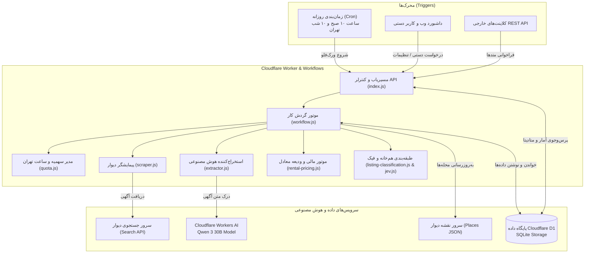

---

## ۴. طراحی مدل داده‌ای و ساختار پایگاه داده (Data Modeling & Database Design)

پایگاه داده سامانه از نوع رابطه‌ای (Relational) بوده و با هدف پایداری، سرعت بالا و رعایت اصول نرمال‌سازی پیاده‌سازی شده است.

### دیاگرام مدل داده‌ای و ساختار جداول (ER & Database Architecture)

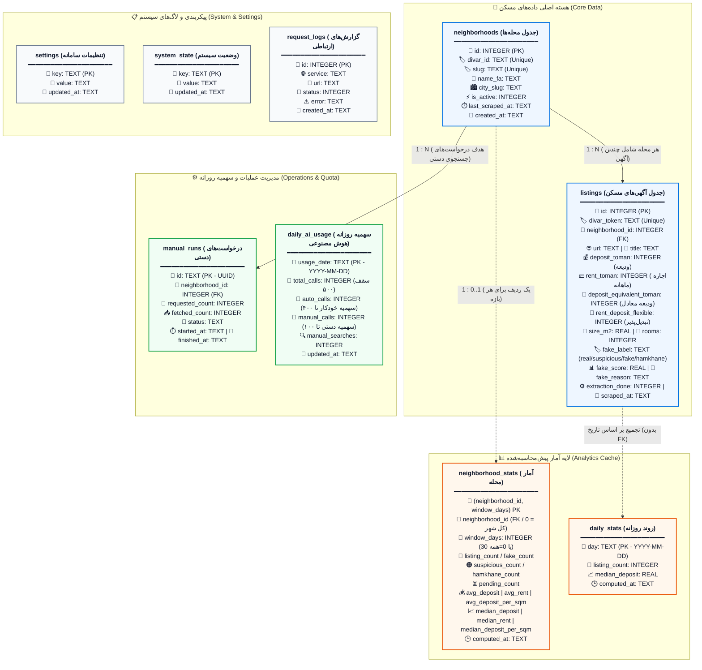

> جدول‌های `neighborhood_stats` و `daily_stats` کش تحلیلی هستند؛ دادهٔ جدید تولید نمی‌کنند و در پایان هر اجرای ورک‌فلو از روی `listings` بازسازی می‌شوند. ردیف `neighborhood_id = 0` در `neighborhood_stats` یک ردیف مصنوعی «کل شهر» است و عمداً کلید خارجی ندارد.

<details>
<summary><b>روابط جداول پایگاه داده (کلیک کنید)</b></summary>

| جدول مبدأ | نوع رابطه | جدول مقصد | توضیح |
|---|---|---|---|
| `neighborhoods` | یک به چند (1:N) | `listings` | هر محله شامل چندین آگهی است |
| `neighborhoods` | یک به چند (1:N) | `manual_runs` | هر محله می‌تواند چندین درخواست دستی داشته باشد |
| `neighborhoods` | یک به یک (1:0..1) | `neighborhood_stats` | برای هر محله در هر بازه (`30` و `0`) یک ردیف تجمیعی |
| `listings` | تجمیع منطقی (بدون FK) | `daily_stats` | یک ردیف به ازای هر روز دارای آگهی |

**ساختار کامل ستون‌های هر جدول:**

**`neighborhoods`:** `id` PK, `divar_id` UNIQUE, `slug` UNIQUE, `name_fa`, `city_slug`, `is_active`, `last_scraped_at`, `created_at`

**`listings`:** `id` PK, `divar_token` UNIQUE, `neighborhood_id` FK, `url`, `title`, `price_toman`, `rent_toman`, `deposit_toman`, `deposit_equivalent_toman`, `rent_deposit_flexible`, `size_m2`, `rooms`, `description`, `image_url`, `extracted_data`, `extraction_done`, `jev_result`, `jev_score`, `jev_done`, `fake_label`, `fake_score`, `fake_reason`, `scrape_source`, `scraped_at`, `updated_at`

**`manual_runs`:** `id` PK (UUID), `neighborhood_id` FK, `requested_count`, `fetched_count`, `status`, `error`, `started_at`, `finished_at`

**`daily_ai_usage`:** `usage_date` PK, `total_calls`, `auto_calls`, `manual_calls`, `manual_searches`, `updated_at`

**`settings`:** `key` PK, `value`, `updated_at`

**`system_state`:** `key` PK, `value`, `updated_at`

**`request_logs`:** `id` PK, `service`, `url`, `status`, `error`, `response_snippet`, `created_at`

**`neighborhood_stats`:** `(neighborhood_id, window_days)` PK, `listing_count`, `fake_count`, `suspicious_count`, `hamkhane_count`, `pending_count`, `avg_deposit`, `avg_rent`, `avg_deposit_per_sqm`, `median_deposit`, `median_rent`, `median_deposit_per_sqm`, `computed_at` — بدون FK؛ `neighborhood_id = 0` ردیف سراسری شهر است.

**`daily_stats`:** `day` PK, `listing_count`, `median_deposit`, `computed_at`

</details>

### فرهنگ داده‌ها (Data Dictionary)

#### جدول ۱: `neighborhoods`
نگهداری اسامی و شناسه‌های رسمی محله‌های تهران.
- `id` (INTEGER, Primary Key, Auto Increment): شناسه محلی یکتا.
- `divar_id` (TEXT, Unique, Not Null): کد شناسه دیوار برای محله (جهت فیلتر در API دیوار).
- `slug` (TEXT, Unique, Not Null): نام یکتای انگلیسی محله در URL دیوار (مانند `central-janat-abad`).
- `name_fa` (TEXT, Not Null): نام فارسی محله (مانند «جنت‌آباد مرکزی»).
- `city_slug` (TEXT, Default 'tehran'): نام شهر.
- `is_active` (INTEGER, Default 1): نشان‌دهنده فعال بودن محله جهت شرکت در جستجوها.
- `last_scraped_at` (TEXT): مهر زمانی آخرین باری که این محله پیمایش شد.

#### جدول ۲: `listings`
رکورد اصلی آگهی‌های مسکن استخراج شده.
- `id` (INTEGER, Primary Key): شناسه آگهی در دیتابیس.
- `divar_token` (TEXT, Unique, Not Null): کد رشته‌ای اختصاصی دیوار برای هر آگهی (نظیر `gaEnqi7f`).
- `url` (TEXT, Not Null): لینک کامل صفحه آگهی.
- `deposit_toman` (INTEGER): مبلغ ودیعه (رهن) به تومان.
- `rent_toman` (INTEGER): مبلغ اجاره ماهانه به تومان.
- `deposit_equivalent_toman` (INTEGER): ودیعه معادل تبدیل‌شده بر مبنای فرمول بازار.
- `rent_deposit_flexible` (INTEGER, 0 یا 1): اعلام تمایل مالک به تبدیل رهن و اجاره.
- `size_m2` (REAL): مساحت مفید بر حسب متر مربع.
- `rooms` (INTEGER): تعداد اتاق خواب.
- `neighborhood_id` (INTEGER, Foreign Key): ارجاع به جدول `neighborhoods`.
- `extracted_data` (TEXT): رشته ذخیره‌شده JSON حاوی مشخصات خام استخراج شده توسط مدل هوش مصنوعی.
- `fake_label` (TEXT): وضعیت اصالت آگهی (`real`, `suspicious`, `fake`, `hamkhane`).
- `fake_score` (REAL): نمره ریسک از ۰ تا ۱.
- `fake_reason` (TEXT): توضیح تحلیلی مدل در مورد علت نامتعارف بودن قیمت.

#### جدول ۳: `daily_ai_usage`
جدول مدیریت سهمیه سخت‌گیرانه شبانه‌روزی.
- `usage_date` (TEXT, Primary Key): تاریخ روز بر مبنای تقویم محلی تهران (`YYYY-MM-DD`).
- `total_calls` (INTEGER): شمارنده کل فراخوانی‌های هوش مصنوعی در این روز.
- `auto_calls` (INTEGER): شمارنده فراخوانی‌های بخش خودکار.
- `manual_calls` (INTEGER): شمارنده فراخوانی‌های بخش دستی.
- `manual_searches` (INTEGER): تعداد دفعاتی که کاربر در طول روز درخواست دستی ثبت کرده است.

#### جدول ۴: `manual_runs`
مدیریت صف و مانیتورینگ درخواست‌های کاربر برای پیمایش سریع یک محله.
- `id` (TEXT, Primary Key): شناسه یکتای UUID.
- `neighborhood_id` (INTEGER, Foreign Key): شناسه محله مورد تقاضا.
- `requested_count` (INTEGER): تعداد آگهی‌های تقاضاشده (بین ۱ تا ۵۰۰). مقدار مؤثر ممکن است به دلیل سهمیهٔ دستی کمتر باشد.
- `fetched_count` (INTEGER): تعداد آگهی‌های تازه‌ای که ذخیره شد (نه تعداد آگهی‌های دیده‌شده).
- `status` (TEXT): وضعیت جاری کار؛ یکی از `queued`، `running`، `scraped`، `complete`، `partial`، `empty`، `quota_exhausted` یا `failed`.
- `error` (TEXT): پیام خطای فارسی در صورت شکست یا اتمام سهمیه.
- `started_at` / `finished_at` (TEXT): زمان شروع و پایان اجرا به وقت گرینویچ.

#### جدول ۵: `settings`
جدول کلید-مقدار برای اعمال پیکربندی‌های سامانه بدون نیاز به بازنشر کد.
- مقادیر پیش‌فرض ذخیره‌شده:
  - `daily_listing_limit`: سقف پردازش شبانه‌روزی (۵۰۰ عدد).
  - `fake_threshold`: آستانه مشکوک بودن (۰.۶).
  - `high_fake_threshold`: آستانه قطعی بودن جعلی/فیک (۰.۸).
  - `auto_neighborhoods`: آرایه JSON از اسلاگ محله‌های پیش‌فرض تحت پیمایش خودکار.
  - `bait_keywords`: آرایه عبارات تبلیغاتی طعمه («قیمت توافقی»، «زیر قیمت»، «فوری»، «فرصت استثنایی»، «فقط امروز»).

#### جدول ۶: `system_state`
نگهداری فلگ‌های اجرایی و متغیرهای هماهنگی ورک‌فلو.
- `workflow_running`: جلوگیری از هم‌پوشانی و اجرای هم‌زمان دو ورک‌فلو.
- `neighborhood_discovery_last_run`: زمان آخرین به‌روزرسانی محله‌ها از دیوار.
- `ai_quota_until`: تاریخ انقضای قفل ۲۴ ساعته در صورت تمام شدن سهمیه کلادفلر.

#### جدول ۷: `request_logs`
ثبت لاگ‌های ارتباطی برای خطایابی و رهگیری عملیات.
- `id` (INTEGER, Primary Key): شناسه لاگ.
- `service` (TEXT): سرویس مبدأ رخداد (`scraper`, `neighborhood-discovery`, `workers-ai`, `jev`, `system`).
- `url` (TEXT): آدرس درخواست‌شده.
- `status` (TEXT): وضعیت یا کد پاسخ.
- `error` (TEXT): متن خطا در صورت وجود.
- `response_snippet` (TEXT): بخش کوتاه از پاسخ برای خطایابی.
- `created_at` (TEXT): زمان ثبت رخداد.

#### جدول ۸: `neighborhood_stats`
کش تحلیلی از پیش محاسبه‌شدهٔ آمار هر محله. این جدول دادهٔ خام جدیدی تولید نمی‌کند و در پایان هر اجرای ورک‌فلو به‌صورت اتمیک از روی `listings` بازسازی می‌شود.
- `neighborhood_id` (INTEGER, بخشی از Primary Key): شناسه محله؛ مقدار `0` یک ردیف مصنوعی «کل شهر» است و کلید خارجی ندارد.
- `window_days` (INTEGER, بخشی از Primary Key): بازهٔ محاسبه (`30` برای ۳۰ روز اخیر و `0` برای کل زمان).
- `listing_count` (INTEGER): تعداد آگهی‌های غیر هم‌خانه در بازه.
- `fake_count` / `suspicious_count` (INTEGER): تعداد آگهی‌های جعلی و مشکوک.
- `hamkhane_count` (INTEGER): تعداد آگهی‌های هم‌خانه (جدا از آمار قیمت).
- `pending_count` (INTEGER): تعداد آگهی‌های در انتظار استخراج.
- `avg_deposit`, `avg_rent`, `avg_deposit_per_sqm` (REAL): میانگین ودیعه، اجاره و ودیعه بر متر.
- `median_deposit`, `median_rent`, `median_deposit_per_sqm` (REAL): میانه‌های همان سه شاخص.
- `computed_at` (TEXT): زمان محاسبهٔ این ردیف.

#### جدول ۹: `daily_stats`
سری زمانی روزانهٔ میانهٔ ودیعه برای نمودار روند؛ یک ردیف به ازای هر روز دارای آگهی.
- `day` (TEXT, Primary Key): تاریخ میلادی به قالب `YYYY-MM-DD`.
- `listing_count` (INTEGER): تعداد آگهی‌های آن روز (بدون هم‌خانه).
- `median_deposit` (REAL): میانهٔ ودیعهٔ اعلامی آن روز.
- `computed_at` (TEXT): زمان محاسبه.

### تحلیل الگوی خواندن/نوشتن و کش تحلیلی
پیش از افزودن کش، هر بارگذاری داشبورد چند کوئری تجمیعی (میانگین، میانه، میانهٔ هر متر، روند روزانه) را با `GROUP BY` و توابع پنجره‌ای روی بازهٔ ۳۰ روزهٔ `listings` اجرا می‌کرد. یعنی رابطهٔ خواندن به نوشتن بسیار نامتوازن بود: در هر شب فقط دو اجرای نوشتن رخ می‌داد، اما هر بازدید کاربر کل بازهٔ داده را چند بار اسکن می‌کرد. این الگو در D1 با سقف روزانهٔ ردیف‌های خوانده‌شده ناسازگار است؛ بنابراین الگو به «محاسبهٔ یک‌باره در نوشتن، خواندن ارزان در بازدید» تغییر کرد:

1. **مسیر نوشتن**: مرحلهٔ `refresh-stats` در پایان ورک‌فلو، هر دو بازهٔ ۳۰ روزه و کل‌زمانی، ردیف کل شهر و سری روزانه را در ۸ دستور داخل یک `env.DB.batch()` اتمیک بازسازی می‌کند و نشانگر `stats_computed_at` را در `system_state` ثبت می‌کند.
2. **مسیر خواندن**: اگر نشانگر موجود و بازهٔ درخواستی ۳۰ روز باشد، اندپوینت‌ها فقط از `neighborhood_stats` و `daily_stats` می‌خوانند (حدود ۲۰ ردیف) و هیچ اسکنی روی `listings` انجام نمی‌شود.
3. **مسیر بازگشتی**: برای بازه‌های دیگر (۷ یا ۹۰ روز) یا پیش از نخستین اجرا، همان کوئری زندهٔ قبلی اجرا می‌شود؛ قرارداد خروجی API در هر دو مسیر یکسان است.
4. **هم‌ارزی معنایی**: آگهی‌های `hamkhane` در هر دو مسیر از شمارش و میانه‌ها کنار گذاشته می‌شوند و شمارششان جدا گزارش می‌شود؛ میانهٔ دقیق نیز در SQL با `ROW_NUMBER()` محاسبه می‌شود تا مقدار کش‌شده با مسیر زنده تفاوت نداشته باشد.

### استراتژی ایندکس‌گذاری و کارایی کوئری‌ها
به منظور تضمین کارایی بالا در مواجهه با کوئری‌های تحلیلی پیچیده و فیلترهای داشبورد، ایندکس‌های بهینه‌ای تعریف شده‌اند:
1. `idx_listings_neighborhood_scraped`: ایندکس ترکیبی روی `(neighborhood_id, scraped_at DESC)` برای واکشی سریع آگهی‌های ۳۰ روز اخیر هر محله.
2. `idx_listings_extraction_source`: ایندکس ترکیبی روی `(extraction_done, scrape_source, scraped_at)` جهت انتخاب سریع رکوردهای در صف تحلیل هوش مصنوعی.
3. `idx_listings_fake_label`: ایندکس روی برچسب‌های فیک برای فیلتر آنی در داشبورد.
4. `idx_listings_divar_token`: جلوگیری از ورود آگهی تکراری با جستجوی سریع هش توکن دیوار.

---

## ۵. پایپ‌لاین پردازش داده‌ها و منطق تجاری

### الف) دریافت دوره‌ای محله‌ها (Neighborhood Discovery)
سامانه از نقشه سراسری دیوار به نشانی `https://map.divarcdn.com/places-web.json` استفاده می‌کند. متد `refreshNeighborhoodsIfDue`:
- بررسی می‌کند آیا از آخرین بررسی ۷ روز گذشته است یا خیر.
- در صورت فرا رسیدن موعد یا فراخوانی متد اجباری (`force = true`)، محله‌ها را دانلود کرده و رکوردهایی با شناسه شهر تهران را در دسته‌های ۱۰۰‌تایی با دستور `batch` در پایگاه داده ادغام (`UPSERT`) می‌کند.

### ب) زمان‌بندی روزانه و زمان محلی تهران (Scheduling & Tehran Clock)
تریگر زمان‌بندی ورکر با عبارت کرون زیر در کلادفلر فعال است:
$$\text{Cron: } \texttt{30 6,18 * * *}$$
با توجه به اینکه زمان‌بندی در کلادفلر همیشه بر پایه گرینویچ (UTC) است و ساعت رسمی تهران ۳ ساعت و نیم جلوتر است:
- ساعت **۰۶:۳۰ UTC** برابر با ساعت **۱۰:۰۰ صبح تهران** است.
- ساعت **۱۸:۳۰ UTC** برابر با ساعت **۲۲:۰۰ (۱۰ شب) تهران** است.

ماژول `quota.js` با استفاده از `Intl.DateTimeFormat` تاریخ و ساعت محلی تهران (`Asia/Tehran`) را دقیقاً استخراج می‌کند تا مرزبندی روزها و ساعات بر مبنای تاریخ محلی سنجیده شود.

### ج) مدیریت سهمیه ۵۰۰ پردازش و کنترل بودجه
مدل‌های هوش مصنوعی دارای سهمیه روزانه هستند. برای کنترل دقیق و پایدار:
1. سقف روزانه به **۵۰۰ درخواست** محدود شده است.
2. **سهمیه خودکار**: ۸۰ درصد کل ظرفیت (۴۰۰ فراخوانی) به پیمایش‌های خودکار صبح و شب تعلق دارد.
3. **سهمیه دستی**: ۲۰ درصد کل ظرفیت (۱۰۰ فراخوانی) برای کاربرانی که به صورت دستی در طول روز محله‌ای را جستجو می‌کنند ذخیره می‌شود.
4. **انتقال سهمیه مازاد در ساعت ۲۲:۰۰**: چنانچه در ساعت ۱۰ شب کاربر هیچ جستجوی دستی انجام نداده باشد (`manual_searches = 0`)، سامانه سهمیه ۱۰۰‌تایی دستی را به بخش خودکار می‌افزاید تا تمام ظرفیت ۵۰۰‌تایی استفاده شود.
5. **تراکنش اتمیک رزرو سهمیه**: رزرو سهمیه از طریق کوئری اتمیک با `RETURNING total_calls` انجام می‌شود تا در صورت بروز همروندی، هیچ فراخوانی اضافه بر سقف صورت نگیرد.
6. **توزیع وزن‌دار ظرفیت میان محله‌ها**: فرمول `neighborhoodTarget` اولویت پیمایش را به محله‌هایی می‌دهد که آگهی‌های تازه کمتری داشته و زمان بیشتری از آخرین پیمایش آن‌ها گذشته است. در صورت کم بودن آگهی در یک محله، ظرفیت بلااستفاده به محله‌های بعدی هدایت می‌شود.

> سهمیه فقط شمار فراخوانی‌های هوش مصنوعی است؛ جست‌وجو در دیوار و ذخیرهٔ آگهی مصرفی از سهمیه ندارد. هر صفحهٔ نتایج دیوار حداکثر ۳۰ آگهی دارد و `divar_token` یکتا مانع ذخیرهٔ تکراری می‌شود؛ بنابراین «دریافت‌شده» در گزارش‌ها یعنی آگهی تازه.

#### مسیر خودکار دریافت آگهی
1. سهمیهٔ خودکار امروز از `aiCallBudgets` خوانده می‌شود.
2. محله‌های `auto_neighborhoods` بر اساس کم‌ترین آگهی ۷ روز گذشته و قدیمی‌ترین `last_scraped_at` مرتب می‌شوند.
3. برای هر محله `neighborhoodTarget` سهم آن را از باقی‌ماندهٔ سهمیه محاسبه می‌کند.
4. عمق جست‌وجو از هدف محله ساخته می‌شود: `min(20, max(3, ceil(هدف ÷ 30) × 3))` صفحه. هدف ۹۰ آگهی ۹ صفحه و هدف ۳۱۰ آگهی ۲۰ صفحه (سقف) جست‌وجو می‌کند.
5. آگهی‌های تازه ذخیره می‌شوند؛ هر محله که کمتر از سهمش آگهی تازه داشته باشد، باقی سهمیه را به محلهٔ بعدی می‌دهد.
6. در پایان همهٔ محله‌ها، آگهی‌های در انتظار تا سقف `auto_remaining` تحلیل می‌شوند.

#### مسیر دستی دریافت آگهی
1. در `POST /api/manual-runs` ابتدا سهمیهٔ دستی امروز و قفل هوش مصنوعی بررسی می‌شود. اگر سهمیه صفر باشد یا قفل فعال باشد، پاسخ ۴۲۹ است و هیچ اجرایی ساخته نمی‌شود.
2. تعداد مؤثر `min(count, manual_remaining)` است و در پاسخ به‌صورت `effective_count` برگردانده می‌شود؛ `requested_count` مقدار درخواستی کاربر می‌ماند.
3. جست‌وجوی همان محله با همان فرمول عمق انجام می‌شود و آگهی‌های تازه ذخیره می‌شوند.
4. فقط آگهی‌های تازه همان محله و از جدید به قدیم تحلیل می‌شوند تا نتیجهٔ درخواست دستی سریع دیده شود.
5. وضعیت پایانی با `manualRunOutcome` تعیین می‌شود: `complete` (به تعداد درخواستی آگهی تازه دریافت شد)، `partial` (کمتر از درخواست دریافت شد؛ به دلیل سهمیه یا کمبود آگهی تازه)، `empty` (آگهی تازه‌ای پیدا نشد)، `quota_exhausted` (قفل یا اتمام سهمیه در میانهٔ کار) یا `failed` (خطای دریافت).

### د) استخراج داده با مدل زبانی هوش مصنوعی (Workers AI)
ماژول `extractor.js` از مدل **Qwen 3 30B** (`@cf/qwen/qwen3-30b-a3b-fp8`) استفاده می‌کند. به مدل دستور داده می‌شود داده‌ها را دقیقاً در فرمت JSON استخراج کند:
```json
{
  "price_toman": 500000000,
  "rent_toman": 15000000,
  "deposit_toman": 500000000,
  "rent_deposit_flexible": true,
  "size_m2": 85,
  "rooms": 2,
  "property_type": "apartment",
  "description": "شرح خلاصه آگهی...",
  "has_bait_signals": false,
  "suspicious_phrases": []
}
```
اعداد فارسی و عربی خودکار نرمال‌سازی شده و خطاهای رایج در تبدیل واحدهای «میلیون» و «میلیارد» کنترل می‌گردند. رفتار خطا در `extractor.js` و `workflow.js` یکسان و قابل بازیابی است:
- **سقف ساب‌ریکوئست یا اتمام سهمیه** (`subrequest_limit` یا `quota_exhausted`): آگهی روی `extraction_done = 0` می‌ماند، حلقهٔ پردازش متوقف می‌شود و در اجرای بعدی دوباره تلاش می‌شود. مقدار `"limits": { "subrequests": 1000 }` در `wrangler.jsonc` سقف بالاتری فراهم می‌کند.
- **آگهی غیرقابل استخراج** (پاسخ خالی مدل): فقط این آگهی با `extraction_done = -1` علامت می‌خورد تا صف را مسدود نکند.
- **خطای گذرا**: آگهی روی `0` می‌ماند و در نوبت بعدی دوباره پردازش می‌شود.

### ه) محاسبه ودیعه معادل در بازار مسکن
به منظور امکان‌پذیر ساختن مقایسه ریاضی میان آگهی‌هایی که صرفاً رهن کامل هستند با آگهی‌هایی که دارای ترکیب ودیعه و اجاره ماهانه می‌باشند، از فرمول سنتی و پذیرفته‌شده بازار مسکن ایران استفاده می‌شود:
> **قانون تبدیل ۳ درصد**: هر ۱۰۰ میلیون تومان ودیعه معادل ۳ میلیون تومان اجاره ماهانه در نظر گرفته می‌شود (نسبت ۱۰۰ به ۳ یا ۳۳.۳۳).

$$\text{Deposit Equivalent} = \text{Deposit} + \left(\text{Rent} \times \frac{100}{3}\right)$$

### و) رده‌بندی آگهی‌های هم‌خانه و اتاق اشتراکی
آگهی‌های هم‌خانه قیمت بسیار پایینی دارند و در صورت محاسبه در میانگین مسکن مستقل، شاخص‌های متراژ و قیمت محله را به شدت گمراه‌کننده می‌کنند.
ماژول `listing-classification.js` با عبارات باقاعده دقیق (شامل انواع فاصله‌ها و نیم‌فاصله‌های فارسی) و بررسی مقدار خروجی هوش مصنوعی (`property_type = room`)، این آگهی‌ها را شناسایی کرده و برچسب `hamkhane` را اعمال می‌کند. در کوئری‌های آماری داشبورد، این آگهی‌ها از محاسبات میانگین و میانه جدا می‌شوند اما در تب آگهی‌ها قابل فیلتر و مشاهده هستند.

### ز) موتور تشخیص آگهی‌های مشکوک و جعلی (Fraud Detection)
ماژول `jev.js` فرایند ارزیابی سلامت آگهی را با الگوریتم‌های آماری به شرح زیر انجام می‌دهد:
1. **محاسبه میانگین ودیعه معادل بر هر متر مربع در همان محله**.
2. **محاسبه ودیعه بر متر مربع آگهی جاری**.
3. **محاسبه نسبت قیمت آگهی به میانگین محله**:
   - چنانچه نسبت کمتر از ۴۰٪ باشد $\rightarrow$ نمره ریسک اولیه ۰.۹ (شدیداً فیک).
   - چنانچه نسبت بین ۴۰٪ تا ۶۰٪ باشد $\rightarrow$ نمره ریسک اولیه ۰.۶۵ (مشکوک).
   - چنانچه نسبت بین ۶۰٪ تا ۷۵٪ باشد $\rightarrow$ نمره ریسک اولیه ۰.۴.
4. **بررسی کلمات کلیدی طعمه (Bait Keywords)**:
   - واژگانی نظیر «فوری»، «زیر قیمت»، «فرصت استثنایی» و «قیمت توافقی» امتیاز ریسک آگهی را تا سقف ۰.۹۵ افزایش می‌دهند.
5. **برچسب‌گذاری نهایی**:
   - نمره $\ge 0.8 \rightarrow \mathbf{fake}$ (جعلی).
   - نمره $\ge 0.6 \rightarrow \mathbf{suspicious}$ (مشکوک).
   - نمره $< 0.6 \rightarrow \mathbf{real}$ (معمولی).

### ح) پیش‌محاسبه آمار و کنترل سهمیه خواندن D1
خواندن زندهٔ آمار داشبورد چند کوئری پنجره‌ای روی بازهٔ ۳۰ روزه اجرا می‌کرد و می‌توانست به سقف روزانهٔ خواندن پلن رایگان D1 برسد. راه‌حل در `src/stats.js`:

1. **محاسبه در نوشتن**: در پایان هر اجرای ورک‌فلو، مرحلهٔ `refresh-stats` تابع `refreshAggregates` را در یک `batch` اتمیک اجرا می‌کند و `neighborhood_stats`، `daily_stats` و نشانگر `stats_computed_at` را بازمی‌سازد.
2. **میانهٔ دقیق در SQL**: میانه با `ROW_NUMBER() OVER (PARTITION BY ...)` و `COUNT(*) OVER ()` محاسبه می‌شود.
3. **مسیر خواندن کش**: برای بازهٔ ۳۰ روز، اندپوینت‌های `/api/neighborhoods`، `/api/analytics`، `/api/stats` و شمارش کل `/api/listings` از کش می‌خوانند (چند ده ردیف).
4. **بازگشت خودکار به مسیر زنده**: برای بازه‌های دیگر یا پیش از نخستین اجرا، کوئری زندهٔ SQL اجرا می‌شود؛ بنابراین قرارداد API تغییر نمی‌کند.
5. **هم‌ارزی و خطای غیرمهلک**: آگهی‌های `hamkhane` در هر دو مسیر از شمارش و میانه‌ها کنار گذاشته می‌شوند. شکست `refresh-stats` فقط لاگ می‌شود و اجرای دریافت آگهی را ناموفق نمی‌کند.

---

## ۶. داشبورد تحلیلی و مستندات رابط برنامه‌نویسی (API)

داشبورد تک‌صفحه‌ای سامانه با طراحی مدرن و راست‌به‌چپ (RTL) بدون وابستگی سنگین و با ابزار Chart.js پیاده‌سازی شده است.

### ویژگی‌های داشبورد
1. **کارت‌های شاخص ۳۰ روز اخیر**: تعداد آگهی، میانه ودیعه، میانه اجاره ماهانه، تعداد آگهی‌های فیک/مشکوک و تعداد آگهی‌های در صف پردازش.
2. **پنج محله برتر**: نمایش سریع پرآگهی‌ترین محله‌های ماه اخیر.
3. **نمودارها**: نمودار ستونی مقایسه‌ای حجم آگهی محله‌ها و نمودار خطی روند روزانه میانه ودیعه.
4. **جدول داده‌های محله‌ها**: مجهز به جستجو، مرتب‌سازی بر اساس ستون‌های مختلف و صفحه‌بندی.
5. **تب آگهی‌ها**: نمایش کارت‌های اختصاصی با عکس، مشخصات فنی، تگ وضعیت و لینک مستقیم دیوار.
6. **تب دریافت دستی**: پنل تعاملی برای واکشی یک محله؛ سقف ورودی از سهمیهٔ دستی باقی‌مانده پیروی می‌کند و در صورت صفر شدن سهمیه، دکمه غیرفعال می‌شود.
7. **تب تنظیمات**: کنترل پارامترهای موتور هوش مصنوعی و لیست محله‌ها با محافظت **رمز عبور (`1311`)**.
8. **تب گزارش‌ها**: نمایش لحظه‌ای رخدادهای سیستمی و خطاهای شبکه.

### تصاویر رابط کاربری
تصاویر زیر با اسکریپت `scripts/capture-screenshots.js` از همان HTML داشبورد و با دادهٔ نمونه تولید می‌شوند (بدون تماس با دیتابیس یا سرویس‌های بیرونی):

| نمای کلی (نمودارها و جدول) | انتخاب یک محله |
|---|---|
| 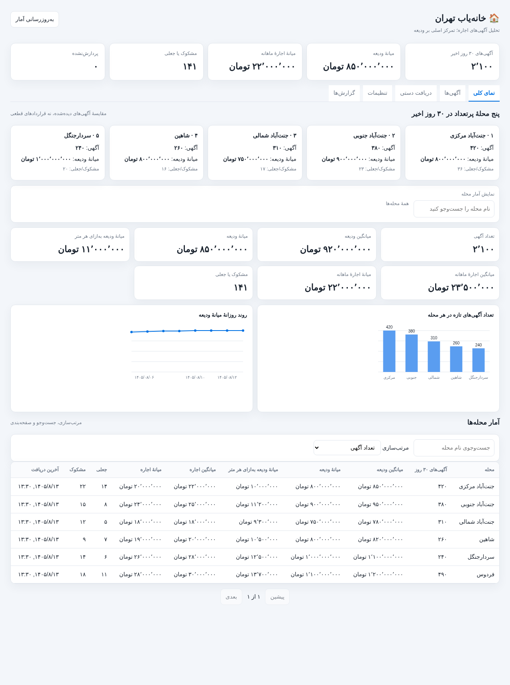 | 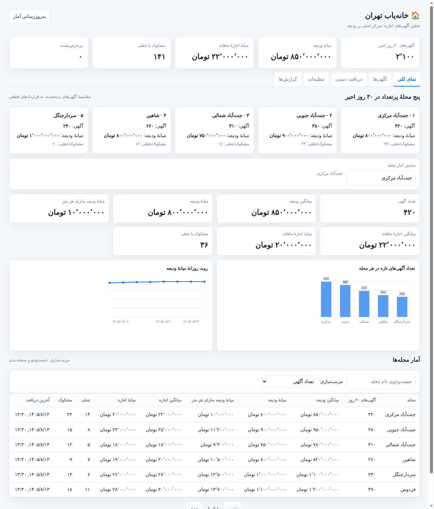 |

| تب آگهی‌ها | فیلتر آگهی‌های جعلی |
|---|---|
| 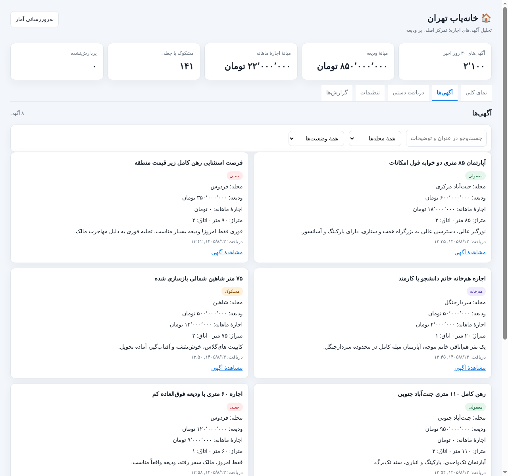 | 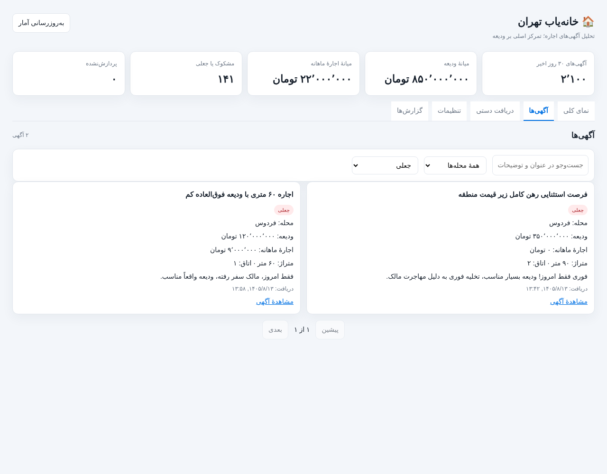 |

| دریافت دستی | تنظیمات | گزارش‌ها |
|---|---|---|
| 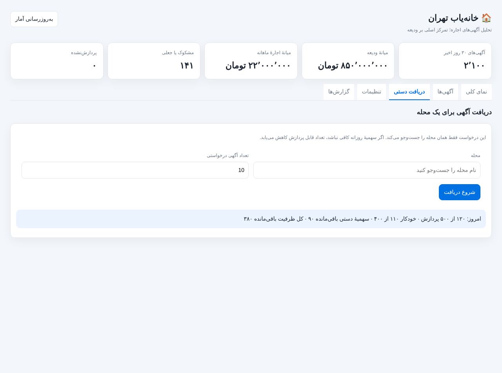 | 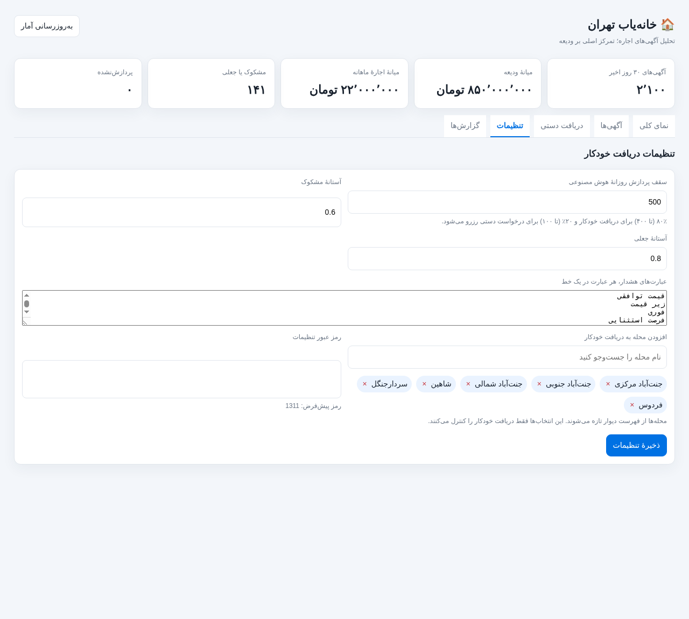 | 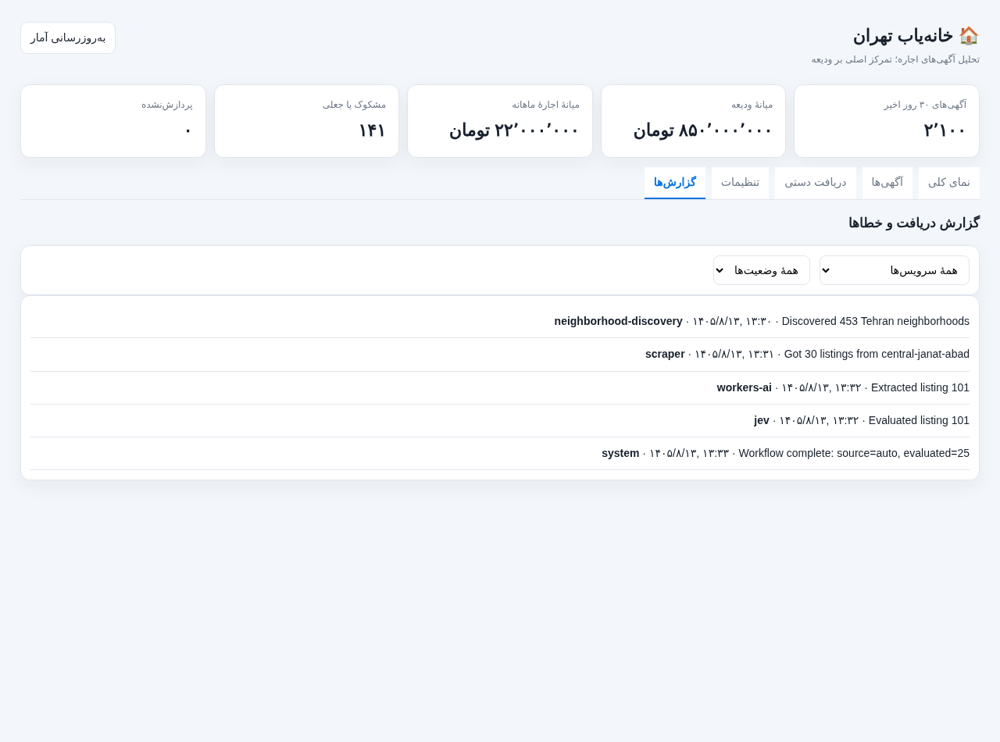 |

برای بازتولید تصاویر:
```bash
node scripts/capture-screenshots.js
```
این اسکریپت به `google-chrome` (حالت headless) نیاز دارد و تصاویر را در `docs/screenshots/` بازنویسی می‌کند. نمودارها با یک رندرر Canvas محلی کشیده می‌شوند تا تصاویر بدون اینترنت و به‌صورت تکرارپذیر ساخته شوند.

### راهنمای کامل دکمه‌ها و کنترل‌های داشبورد
داشبورد یک صفحهٔ RTL است و داده‌ها را از همان APIهای مستندشده می‌خواند. جدول‌های زیر تمام کنترل‌های تعاملی را شرح می‌دهند:

#### کنترل‌های سراسری

| کنترل | شناسه | رفتار | درخواست‌های شبکه |
|---|---|---|---|
| دکمهٔ «به‌روزرسانی آمار» | `#refresh` | در حین اجرا غیرفعال و متن آن «در حال به‌روزرسانی…» می‌شود؛ ابتدا یک اجرای ورک‌فلو صف می‌کند و سپس خلاصه، جدول و سهمیه را دوباره می‌خواند | `POST /api/refresh` سپس `GET /api/neighborhoods?all=1`، `GET /api/analytics?days=30`، `GET /api/neighborhoods?...`، `GET /api/quota` |
| تب‌ها | `.tab[data-tab]` | جابه‌جایی بین پنج پنل بدون بارگذاری مجدد صفحه؛ تب «آگهی‌ها» فهرست، تب «گزارش‌ها» لاگ‌ها و تب «دریافت دستی» سهمیه را تازه می‌کند | `GET /api/listings`، `GET /api/logs`، `GET /api/quota` |

#### تب «نمای کلی»

| کنترل | شناسه | رفتار | درخواست |
|---|---|---|---|
| کارت‌های پنج محلهٔ برتر | `.top-card` | کلیک روی کارت، همان محله را انتخاب و آمار بخش «نمایش آمار محله» را به‌روز می‌کند | `GET /api/analytics?days=30&neighborhood=<slug>` |
| انتخاب محله | `#overview-neighborhood` + `#neighborhood-options` | جست‌وجوی نام فارسی از فهرست محله‌های دارای آگهی؛ تغییر مقدار، محله را انتخاب یا در صورت خالی بودن، «همهٔ محله‌ها» را نمایش می‌دهد | `GET /api/analytics?days=30[&neighborhood=<slug>]` |
| جست‌وجوی جدول | `#neighborhood-search` | جست‌وجوی سرور-side روی نام محله و بازگشت به صفحهٔ اول | `GET /api/neighborhoods?search=...&page=1` |
| مرتب‌سازی جدول | `#neighborhood-sort` | گزینه‌ها: تعداد آگهی، میانگین ودیعه، میانهٔ ودیعه، میانهٔ ودیعه به‌ازای متر، تعداد جعلی، نام محله | `GET /api/neighborhoods?sort=...` |
| ردیف جدول | `tr.table-row` | کلیک روی ردیف، محله را انتخاب کرده و به تب «آگهی‌ها» با فیلتر همان محله می‌رود | `GET /api/analytics?...` و `GET /api/listings?neighborhood=<slug>` |
| صفحهٔ قبل/بعد جدول | `#table-prev` / `#table-next` | صفحه‌بندی ۲۰ ردیفی؛ در ابتدا/انتهای فهرست غیرفعال می‌شوند | `GET /api/neighborhoods?page=...` |
| نمودارها | `#count-chart` / `#deposit-chart` | خودکار از دادهٔ همان پاسخ analytics رسم می‌شوند (ستونی: تعداد آگهی محله‌ها؛ خطی: میانهٔ ودیعهٔ روزانه) | — |

#### تب «آگهی‌ها»

| کنترل | شناسه | رفتار | درخواست |
|---|---|---|---|
| جست‌وجو | `#listing-search` | جست‌وجو در عنوان و توضیحات و بازگشت به صفحهٔ اول | `GET /api/listings?search=...` |
| فیلتر محله | `#listing-neighborhood` | «همهٔ محله‌ها» یا یک محلهٔ فعال | `GET /api/listings?neighborhood=<slug>` |
| فیلتر وضعیت | `#listing-label` | همه، معمولی (`real`)، مشکوک (`suspicious`)، جعلی (`fake`)، هم‌خانه (`hamkhane`)، در انتظار بررسی (`pending` → `extraction_done = 0`) | `GET /api/listings?label=...` |
| صفحهٔ قبل/بعد | `#listing-prev` / `#listing-next` | صفحه‌بندی ۲۰تایی کارت‌ها | `GET /api/listings?page=...` |
| «مشاهدهٔ آگهی» | لینک داخل کارت | باز کردن صفحهٔ آگهی در دیوار در تب جدید (`target="_blank"`, `rel="noopener noreferrer"`) | — |

#### تب «دریافت دستی»

| کنترل | شناسه | رفتار | درخواست |
|---|---|---|---|
| انتخاب محله | `#manual-neighborhood` + `#manual-options` | فقط محله‌های فعال؛ ورودی نامعتبر با پیام خطا رد می‌شود | — |
| تعداد درخواستی | `#manual-count` | عدد صحیح بین ۱ و سهمیهٔ دستی باقی‌ماندهٔ امروز؛ سقف ورودی با هر بار تازه‌سازی سهمیه به‌روز می‌شود | — |
| دکمهٔ «شروع دریافت» | `#manual-start` | اعتبارسنجی، ثبت درخواست، سپس نظرسنجی وضعیت هر ۳ ثانیه تا رسیدن به وضعیت پایانی؛ در صورت صفر بودن سهمیه غیرفعال است | `POST /api/manual-runs` و `GET /api/manual-runs/<id>` |
| پنل سهمیه | `#quota-panel` | نمایش سهمیهٔ دستی قابل استفاده، سهمیهٔ خودکار و مصرف امروز؛ در صورت اتمام سهمیه یا قفل هوش مصنوعی، ورودی و دکمه غیرفعال می‌شوند | `GET /api/quota` |
| ناحیهٔ وضعیت | `#manual-status` | وضعیت فارسی اجرا، تعداد درخواستی/دریافت‌شده و متن خطا در صورت شکست | — |

وضعیت‌های اجرای دستی: `queued` (در صف) ← `running` (در حال اجرا) ← `scraped` (در حال تحلیل) و سپس یکی از `complete` (کامل)، `partial` (کمتر از درخواست دریافت شد)، `empty` (آگهی تازه‌ای پیدا نشد)، `quota_exhausted` (سهمیه یا قفل هوش مصنوعی) یا `failed`.

#### تب «تنظیمات»

| کنترل | شناسه | رفتار | درخواست |
|---|---|---|---|
| سقف پردازش روزانه | `#daily-limit` | عدد ۳ تا ۵۰۰؛ ۸۰٪ خودکار و ۲۰٪ دستی تقسیم می‌شود | — |
| آستانهٔ مشکوک / جعلی | `#fake-threshold` / `#high-threshold` | عدد بین ۰ و ۱ | — |
| عبارت‌های هشدار | `#bait-keywords` | هر عبارت در یک خط | — |
| افزودن محله به دریافت خودکار | `#auto-search` + `#auto-suggestions` | پیشنهاد تا ۱۵ محلهٔ انتخاب‌نشده؛ کلیک روی پیشنهاد، برچسب اضافه می‌کند | — |
| برچسب محله‌های خودکار | `#auto-selected .chip` | دکمهٔ «×» هر برچسب را حذف می‌کند | — |
| رمز عبور تنظیمات | `#settings-password` | الزامی برای ذخیره؛ پیش‌فرض `1311` | — |
| دکمهٔ «ذخیرهٔ تنظیمات» | `form#settings-form` | ارسال همهٔ مقادیر؛ در موفقیت پیام سبز و پاک شدن رمز، در خطا پیام قرمز | `POST /api/settings` |

#### تب «گزارش‌ها»

| کنترل | شناسه | رفتار | درخواست |
|---|---|---|---|
| فیلتر سرویس | `#log-service` | همه یا یکی از `scraper`، `neighborhood-discovery`، `workers-ai`، `jev`، `system` | `GET /api/logs?service=...` |
| فیلتر وضعیت | `#log-status` | همه، خطاها یا موفق | `GET /api/logs?status=...` |

### جریان‌های اصلی برنامه (Flows)
#### ۱) اجرای خودکار زمان‌بندی‌شده
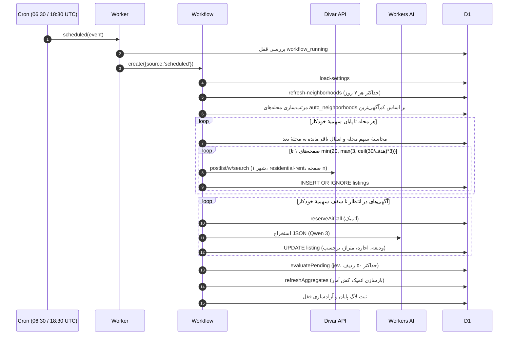

#### ۲) دریافت دستی یک محله
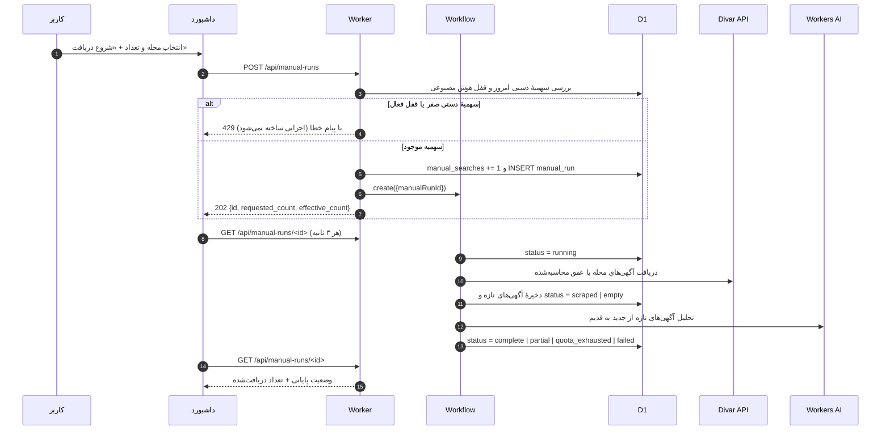

#### ۳) ذخیرهٔ تنظیمات
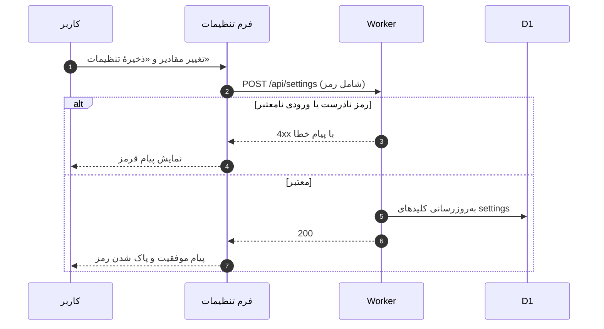

#### ۴) بارگذاری اولیهٔ داشبورد
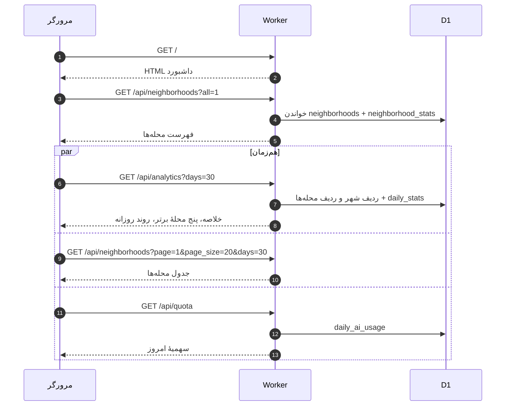

### مستندات کامل وب‌سرویس‌ها (RESTful API)

#### ۱. دریافت اطلاعات تحلیلی و نمودارها
- **متد**: `GET`
- **آدرس**: `/api/analytics`
- **پارامترها**:
  - `days` (اختیاری، پیش‌فرض: 30)
  - `neighborhood` (اسلاگ محله، اختیاری)
- **نمونه خروجی**:
```json
{
  "days": 30,
  "overall": {
    "count": 1420,
    "fake_count": 45,
    "suspicious_count": 82,
    "hamkhane_count": 18,
    "average_deposit": 450000000,
    "median_deposit": 400000000,
    "median_rent": 12000000,
    "median_deposit_per_sqm": 5200000
  },
  "top_neighborhoods": [...],
  "daily": [
    {"day": "2026-10-15", "median_deposit": 390000000},
    {"day": "2026-10-16", "median_deposit": 410000000}
  ]
}
```

#### ۲. دریافت لیست و آمار محله‌ها
- **متد**: `GET`
- **آدرس**: `/api/neighborhoods`
- **پارامترها**: `page`, `page_size`, `search`, `sort`, `order`, `all` (مقدار 1 برای همه)

#### ۳. جستجو و دریافت آگهی‌ها
- **متد**: `GET`
- **آدرس**: `/api/listings`
- **پارامترها**: `page`, `page_size`, `neighborhood`, `label`, `search`

#### ۴. ثبت درخواست دریافت دستی آگهی
- **متد**: `POST`
- **آدرس**: `/api/manual-runs`
- **بدنه درخواست**:
```json
{
  "neighborhood": "central-janat-abad",
  "count": 20
}
```
- **پاسخ موفق**: `{"id": "c1f3...", "status": "queued", "requested_count": 20, "effective_count": 15}` با کد 202. `effective_count` برابر کوچک‌ترین مقدار میان درخواست و سهمیهٔ دستی باقی‌مانده است.
- **پاسخ خطا**: اگر سهمیهٔ دستی امروز صفر باشد یا هوش مصنوعی قفل شده باشد، کد 429 با پیام فارسی برمی‌گردد و اجرایی ساخته نمی‌شود.

#### ۵. استعلام وضعیت درخواست دستی
- **متد**: `GET`
- **آدرس**: `/api/manual-runs/{id}`
- **فیلدهای پاسخ**: `requested_count`، `fetched_count` (آگهی تازه)، `status`، `status_fa`، `error` و زمان شروع/پایان. وضعیت‌ها: `queued`, `running`, `scraped`, `complete`, `partial`, `empty`, `quota_exhausted`, `failed`.

#### ۶. استعلام سهمیه هوش مصنوعی
- **متد**: `GET`
- **آدرس**: `/api/quota`
- **خروجی**: سقف روز، مصرف کل/خودکار/دستی، `auto_limit`، `manual_limit`، `auto_remaining`، `manual_remaining`، `remaining` و وضعیت قفل هوش مصنوعی.

#### ۷. دریافت و تغییر تنظیمات
- **متد**: `GET` و `POST`
- **آدرس**: `/api/settings`
- **نکته امنیتی در POST**: نیازمند ارسال `"settings_password": "1311"` در بدنه JSON.

#### ۸. خلاصهٔ آماری کل شهر
- **متد**: `GET`
- **آدرس**: `/api/stats`
- **خروجی**: همان قرارداد `overall` برای ۳۰ روز؛ در مسیر کش، فیلد `stats_computed_at` نیز برگردانده می‌شود و در مسیر زنده `null` است.

#### جدول کامل مسیرها

| مسیر | متد | شرح |
|---|---|---|
| `/api/analytics` | `GET` | خلاصه، پنج محلهٔ برتر و روند روزانه (`days`, `neighborhood`) |
| `/api/stats` | `GET` | خلاصهٔ آماری کل شهر برای ۳۰ روز |
| `/api/neighborhoods` | `GET` | آمار محله‌ها با جستجو، مرتب‌سازی و صفحه‌بندی (`page`, `page_size`, `search`, `sort`, `order`, `all`) |
| `/api/listings` | `GET` | آگهی‌ها با فیلتر `neighborhood`، `label`، `search` و صفحه‌بندی |
| `/api/manual-runs` | `POST` | ثبت درخواست دستی با بدنه `{"neighborhood":"<slug>","count":10}`؛ پاسخ `202` شامل `requested_count` و `effective_count`؛ در نبود سهمیه `429` |
| `/api/manual-runs/:id` | `GET` | وضعیت پیشرفت درخواست دستی و برچسب فارسی آن |
| `/api/quota` | `GET` | مصرف و باقی‌ماندهٔ سهمیهٔ روزانه (کل، خودکار، دستی) و وضعیت قفل |
| `/api/settings` | `GET`/`POST` | خواندن و به‌روزرسانی تنظیمات (POST با رمز) |
| `/api/logs` | `GET` | لاگ‌های سیستمی با فیلتر `service`، `status` و `limit` |
| `/api/discover-neighborhoods` | `POST` | همگام‌سازی اجباری و لحظه‌ای فهرست محله‌ها از دیوار |
| `/api/refresh` | `POST` | فراخوانی دستی ورک‌فلو پیمایش خودکار |

---

## ۷. اعتبارسنجی و آزمون‌های صحت عملکرد (Verification)

### الف) آزمون‌های خودکار
`npm test` مجموعهٔ ۱۹ آزمون را اجرا می‌کند (`test/quota.test.js`، `test/rental-pricing.test.js`، `test/system-verification.test.js`). این آزمون‌ها رفتار فعلی کد را تضمین می‌کنند:
- تبدیل ساعت UTC به ساعت تهران برای دو اجرای `06:30` و `18:30`.
- تقسیم سهمیهٔ ۵۰۰تایی به ۴۰۰ خودکار و ۱۰۰ دستی و آزادسازی سهمیهٔ دستی در ساعت ۲۲ فقط وقتی `manual_searches = 0` باشد.
- عمق جست‌وجوی متناسب با هدف: ۱۰→۳، ۹۰→۹، ۱۰۰→۱۲ و ۳۱۰/۴۰۰→۲۰ صفحه.
- نتیجهٔ اجرای دستی: `complete`، `partial`، `empty` و `quota_exhausted`.
- وزنی بودن توزیع سهمیه بین محله‌ها و حداقل یک آگهی برای محلهٔ آخر.
- فرمول ودیعه معادل با نسبت $100/3$، تشخیص هم‌خانه با نیم‌فاصله، و رفتار مقاوم استخراج در برابر پاسخ خالی یا خراب.

### ب) اعتبارسنجی مسیرهای API روی D1 محلی
همهٔ اندپوینت‌های `/api/analytics`، `/api/neighborhoods` (با جست‌وجو، مرتب‌سازی و صفحه‌بندی)، `/api/listings`، `/api/quota` و مسیرهای اجرای دستی روی D1 محلی پاسخ ۲۰۰ برگرداندند. خروجی مسیر کش و مسیر زنده برای بازهٔ ۳۰ روز یکسان بود و تنها `stats_computed_at` در مسیر زنده `null` است.

### ج) اعتبارسنجی جریان دریافت
- سهمیهٔ دستی صفر باعث پاسخ ۴۲۹ و عدم ساخت اجرا می‌شود.
- `effective_count` هرگز از سهمیهٔ دستی باقی‌مانده بیشتر نیست.
- دریافت‌شده فقط آگهی تازه را می‌شمارد؛ جست‌وجوی تکراری همان صفحات، مقدار `fetched_count` را افزایش نمی‌دهد.
- خطای ساب‌ریکوئست یا قفل هوش مصنوعی، آگهی را از صف خارج نمی‌کند و اجرای بعدی آن را ادامه می‌دهد.

### د) هشدار ایمنی داده‌ها
- اجرای `0001_neighborhood_first_rebuild.sql` یا هر `DROP` روی دیتابیس ریموت ممنوع است؛ این فایل فقط برای ساخت اولیهٔ دیتابیس است.
- برای بازگرداندن آگهی‌های ناموفق به صف، از اسکریپت ایمن و بدون حذف داده استفاده کنید:
  ```bash
  npm run db:retry-failed-extractions
  ```

---

## ۸. راهنمای گام‌به‌گام راه‌اندازی و اجرای سامانه

### مرحله ۱: نیازمندی‌های سیستمی
- نصب بودن **Node.js نسخه 20 یا بالاتر** (توصیه: Node v22).
- ابزار مدیریت بسته **npm**.
- دسترسی به حساب Cloudflare (جهت استقرار بر بستر ابری).

### مرحله ۲: نصب وابستگی‌ها
```bash
cd divar-housing-finder
npm install
```

### مرحله ۳: اجرای آزمون‌های سلامت کد
```bash
npm test
```

### مرحله ۴: آماده‌سازی دیتابیس محلی (Local D1)
برای ایجاد جداول و داده‌های پایه در سیستم محلی خود:
```bash
npm run db:init-local
npm run db:seed-local
```
برای دیتابیس محلی قدیمی، مایگریشن‌های افزایشی را اجرا کنید:
```bash
npm run db:migrate-neighborhoods-local
npm run db:migrate-quota-and-labels-local
npm run db:increase-daily-quota-local
npm run db:migrate-precomputed-stats-local
```

### مرحله ۵: اجرای محیط شبیه‌ساز سرورلس (Local Development)
برای راه‌اندازی سرور محلی و باز شدن داشبورد روی سیستم:
```bash
npm run dev
```
سامانه تحت آدرس محلی `http://localhost:8787` در دسترس خواهد بود. برای ساختن مجدد تصاویر مستندات (نیازمند `google-chrome`):
```bash
node scripts/capture-screenshots.js
```

### مرحله ۶: استقرار بر بستر ابری کلادفلر (Remote Deploy)
1. ورود به حساب کلادفلر:
   ```bash
   npx wrangler login
   ```
2. ایجاد پایگاه داده D1 در صورت نیاز:
   ```bash
   npx wrangler d1 create divar-housing-db
   ```
   (سپس مقدار شناسه `database_id` را در فایل `wrangler.jsonc` ثبت کنید).
3. ایجاد جداول روی دیتابیس ابری:
   ```bash
   npm run db:init
   npm run db:seed
   ```
   برای دیتابیس موجود، فقط مایگریشن افزایشی آمار را یک‌بار اجرا کنید:
   ```bash
   npm run db:migrate-precomputed-stats
   ```
4. انتشار نهایی:
   ```bash
   npm run deploy
   ```
   > این مخزن به Git متصل است و با هر `git push` روی شاخهٔ اصلی به‌صورت خودکار روی Cloudflare دیپلوی می‌شود. مایگریشن‌ها خودکار اجرا نمی‌شوند؛ پیش از نخستین دیپلویِ نسخه‌ای که به جدول‌های آمار وابسته است، `db:migrate-precomputed-stats` را روی دیتابیس ریموت اجرا کنید. حتی بدون آن، اندپوینت‌ها به‌صورت خودکار به مسیر زنده برمی‌گردند و خطا نمی‌دهند.

---

## ۹. انطباق با سرفصل‌های پروژه

| سرفصل | محل پاسخ |
|---|---|
| **تعیین حوزهٔ کسب‌وکاری** | حوزهٔ «پایش بازار رهن و اجارهٔ مسکن و شناسایی آگهی‌های مشکوک» در بخش ۱ و تحلیل مسئله، اهداف و نیازمندی‌ها در بخش ۲ همین سند. |
| **تحلیل برای مدل داده‌ای و ساختار جداول** | بخش ۴: نمودار ER، روابط جداول، فرهنگ دادهٔ ۹ جدول، تحلیل الگوی خواندن/نوشتن و کش تحلیلی، و استراتژی ایندکس‌گذاری. اسکریپت اجرایی: `schema.sql` و `migrations/`. |
| **پیاده‌سازی با زبان انتخابی** | جاوااسکریپت (ES Modules) روی Cloudflare Workers با D1، Workflows و Workers AI؛ کد در `src/` و پیکربندی در `wrangler.jsonc`. |
| **سورس + راهنمای کاربردی + سند تحلیل و طراحی** | سورس کامل در مخزن؛ راهنمای کاربر در `README.md` و بخش ۸ همین سند (نصب، اجرا، دکمه‌ها، API)؛ سند تحلیل و طراحی همین فایل؛ تصاویر رابط کاربری در `docs/screenshots/`. |

---

## ۱۰. نتیجه‌گیری و افق‌های توسعه آتی

سامانه **خانه‌یاب دیوار** یک نمونه موفق از تلفیق سامانه‌های اطلاعاتی رابطه‌ای با مدل‌های هوش مصنوعی زبانی مدرن بر بستر معماری لبه‌ای سرورلس است. این سیستم با خودکارسازی کامل چرخه جمع‌آوری محله‌ها، زمان‌بندی دقیق در ساعات پربازدید روز، مدیریت سخت‌گیرانه سهمیه‌ها و حذف داده‌های نامربوط، دیدی واقع‌بینانه و شفاف از نبض بازار مسکن تهران را در اختیار متقاضیان و تحلیل‌گران قرار می‌دهد.

### پیشنهادات برای توسعه آتی:
1. **افزودن شهرهای دیگر**: گسترش سیستم برای پوشش سایر کلان‌شهرها نظیر مشهد، اصفهان، شیراز و تبریز با تغییر پارامتر `city_slug`.
2. **ارسال هشدار آنی در پیام‌رسان‌ها**: اتصال به ربات تلگرام یا وب‌هوک بله و ایتا برای آگاه‌سازی فوری از آگهی‌های ارزنده با قیمت مناسب.
3. **پیش‌بینی روند آتی قیمت‌ها**: افزودن ماژول رگرسیون زمانی برای پیش‌بینی میانگین ودیعه در ماه‌های آتی بر اساس سری‌های زمانی ثبت‌شده.

