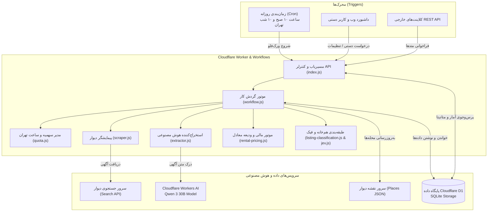
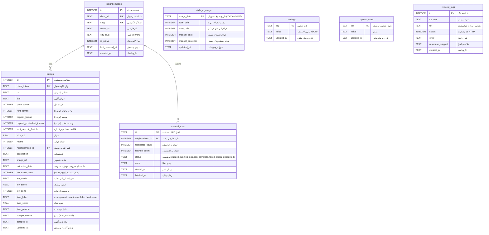

# مستندات جامع و گزارش فنی سامانه اطلاعاتی خانه‌یاب دیوار
## (Divar Housing Finder - Technical & Architecture Documentation)

---

## فهرست مطالب
1. [چکیده و معرفی پروژه](#۱-چکیده-و-معرفی-پروژه)
2. [تحلیل حوزه کسب‌وکار و نیازمندی‌های سامانه](#۲-تحلیل-حوزه-کسبوکار-و-نیازمندیهای-سامانه)
3. [معماری کلی سامانه (System Architecture)](#۳-معماری-کلی-سامانه-system-architecture)
4. [طراحی مدل داده‌ای و ساختار پایگاه داده (Data Modeling & Database Design)](#۴-طراحی-مدل-دادهای-و-ساختار-پایگاه-داده-data-modeling--database-design)
   - [دیاگرام رابطه موجودیت‌ها (ER Diagram)](#دیاگرام-رابطه-موجودیتها-er-diagram)
   - [فرهنگ داده‌ها (Data Dictionary)](#فرهنگ-دادهها-data-dictionary)
   - [استراتژی ایندکس‌گذاری و کارایی کوئری‌ها](#استراتژی-ایندکسگذاری-و-کارایی-کوئریها)
5. [پایپ‌لاین پردازش داده‌ها و منطق تجاری](#۵-پایپلاین-پردازش-دادهها-و-منطق-تجاری)
   - [دریافت دوره‌ای محله‌ها (Neighborhood Discovery)](#الف-دریافت-دورهای-محلهها-neighborhood-discovery)
   - [زمان‌بندی روزانه و زمان محلی تهران (Scheduling & Tehran Clock)](#ب-زمانبندی-روزانه-و-زمان-محلی-تهران-scheduling--tehran-clock)
   - [مدیریت سهمیه ۵۰۰ پردازش و کنترل بودجه](#ج-مدیریت-سهمیه-۵۰۰-پردازش-و-کنترل-بودجه)
   - [استخراج داده با مدل زبانی هوش مصنوعی (Workers AI)](#د-استخراج-داده-با-مدل-زبانی-هوش-مصنوعی-workers-ai)
   - [محاسبه ودیعه معادل در بازار مسکن](#ه-محاسبه-ودیعه-معادل-در-بازار-مسکن)
   - [رده‌بندی آگهی‌های هم‌خانه و اتاق اشتراکی](#و-ردهبندی-آگهیهای-همخانه-و-اتاق-اشتراکی)
   - [موتور تشخیص آگهی‌های مشکوک و جعلی (Fraud Detection)](#ز-موتور-تشخیص-آگهیهای-مشکوک-و-جعلی-fraud-detection)
6. [داشبورد تحلیلی و مستندات رابط برنامه‌نویسی (API)](#۶-داشبورد-تحلیلی-و-مستندات-رابط-برنامهنویسی-api)
7. [اعتبارسنجی و بررسی صحت عملکرد سامانه (Verification)](#۷-اعتبارسنجی-و-بررسی-صحت-عملکرد-سامانه-verification)
8. [راهنمای گام‌به‌گام راه‌اندازی و اجرای سامانه](#۸-راهنمای-گامبهگام-راهاندازی-و-اجرای-سامانه)
9. [نتیجه‌گیری و افق‌های توسعه آتی](#۹-نتیجهگیری-و-افقهای-توسعه-آتی)

---

## ۱. چکیده و معرفی پروژه

پروژه **سامانه خانه‌یاب دیوار** به عنوان یک سامانه اطلاعاتی هوشمند تحت وب و مبتنی بر معماری لبه‌ای بدون سرور (Edge Serverless) توسعه یافته است. هدف اصلی این سامانه، پایش هوشمند بازار مسکن تهران در بستر پلتفرم دیوار، استانداردسازی قیمت‌های رهن و اجاره، استخراج ساخت‌یافته متادیتا به کمک مدل‌های هوش مصنوعی زبانی، و ارائه گزارش‌ها و داشبوردهای تحلیلی جهت شفاف‌سازی و کشف آگهی‌های فریبنده یا نامتعارف است.

این سامانه به شکل کامل با یک پایگاه داده رابطه‌ای توزیع‌شده (**Cloudflare D1**) یکپارچه شده است و کلیه روندهای دریافت، پردازش، تحلیل و نمایش داده را با مکانیزم‌های زمان‌بندی خودکار و ابزارهای تحلیلی درون دیتابیس به اجرا درمی‌آورد.

---

## ۲. تحلیل حوزه کسب‌وکار و نیازمندی‌های سامانه

### الف) تبیین مسئله در حوزه مسکن
در بازار مسکن، بخش استیجاری به دلیل نوسانات اقتصادی و تورم، حساسیت بالایی برای جامعه دارد. پلتفرم‌های نیازمندی آنلاین نظیر «دیوار»، حجم عظیمی از داده‌های بازار املاک را تولید می‌کنند. با این حال، تحلیل دستی این آگهی‌ها به دلایل زیر دشوار است:
1. **تشتت در درج قیمت‌ها**: برخی آگهی‌ها ودیعه کامل، برخی اجاره با ودیعه اندک، و برخی امکان تبدیل رهن و اجاره را ذکر می‌کنند که مقایسه مستقیم آن‌ها را غیرممکن می‌سازد.
2. **آگهی‌های طعمه و قیمت‌های فیک**: آگهی‌دهندگان سودجو برای جذب تماس، قیمت‌هایی بسیار کمتر از عرف منطقه اعلام می‌کنند.
3. **تداخل آگهی‌های اشتراکی**: آگهی‌های اجاره اتاق یا هم‌خانه در دسته‌بندی مسکونی قرار گرفته و آمار متراژ و اجاره را در محله‌ها مخدوش می‌نمایند.
4. **تغییرات مداوم محله‌ها و نام‌گذاری‌ها**: محله‌های شهری ممکن است دستخوش تغییرات، ادغام یا تغییر اسلاگ در ساختار نرم‌افزاری دیوار شوند.

### ب) اهداف و کارکردهای عملیاتی سیستم
- **کشف و به‌روزرسانی خودکار محله‌ها**: دریافت دوره‌ای لیست جامع محله‌های تهران به منظور عدم وابستگی به لیست‌های ثابت و دستی.
- **پیمایش برنامه‌ریزی‌شده منظم**: اجرای خودکار دو نوبت در روز (ساعت ۱۰:۰۰ صبح و ۲۲:۰۰ شب به وقت تهران) جهت نمونه‌برداری مستمر از آگهی‌های جدید.
- **رعایت محدودیت‌های پردازشی (سهمیه ۵۰۰ عددی)**: کنترل دقیق ترافیک مصرفی هوش مصنوعی برای جلوگیری از اتمام توکن‌ها و هزینه‌های مازاد سرور.
- **استخراج معنایی متاداده با هوش مصنوعی**: تبدیل متن غیرساختاریافته فارسی آگهی‌ها به داده‌های عددی و قطعی شامل ودیعه، اجاره، متراژ، خواب و امکان تبدیل.
- **تولید متریک‌های کلیدی و پایش قیمتی**: محاسبه «ودیعه معادل» و ودیعه بر هر متر مربع و شناسایی انحراف از میانگین محله.
- **داشبورد تحلیلی تعاملی**: ارائه نمودارها، کارت‌های آماری، ابزار فیلتر و امکان جستجوی سریع.

---

## ۳. معماری کلی سامانه (System Architecture)

معماری سامانه بر پایه‌ی فناوری‌های نوین ابری لبه‌ای (Cloudflare Edge Ecosystem) به صورت کاملاً سرورلس بنا شده است:



---

## ۴. طراحی مدل داده‌ای و ساختار پایگاه داده (Data Modeling & Database Design)

پایگاه داده سامانه از نوع رابطه‌ای (Relational) بوده و با هدف پایداری، سرعت بالا و رعایت اصول نرمال‌سازی پیاده‌سازی شده است.

### دیاگرام رابطه موجودیت‌ها (ER Diagram)



### فرهنگ داده‌ها (Data Dictionary)

#### جدول ۱: `neighborhoods`
نگهداری اسامی و شناسه‌های رسمی محله‌های تهران.
- `id` (INTEGER, Primary Key, Auto Increment): شناسه محلی یکتا.
- `divar_id` (TEXT, Unique, Not Null): کد شناسه دیوار برای محله (جهت فیلتر در API دیوار).
- `slug` (TEXT, Unique, Not Null): نام یکتای انگلیسی محله در URL دیوار (مانند `central-janat-abad`).
- `name_fa` (TEXT, Not Null): نام فارسی محله (مانند «جنت‌آباد مرکزی»).
- `city_slug` (TEXT, Default 'tehran'): نام شهر.
- `is_active` (INTEGER, Default 1): نشان‌دهنده فعال بودن محله جهت شرکت در جستجوها.
- `last_scraped_at` (TEXT): مهر زمانی آخرین باری که این محله پیمایش شد.

#### جدول ۲: `listings`
رکورد اصلی آگهی‌های مسکن استخراج شده.
- `id` (INTEGER, Primary Key): شناسه آگهی در دیتابیس.
- `divar_token` (TEXT, Unique, Not Null): کد رشته‌ای اختصاصی دیوار برای هر آگهی (نظیر `gaEnqi7f`).
- `url` (TEXT, Not Null): لینک کامل صفحه آگهی.
- `deposit_toman` (INTEGER): مبلغ ودیعه (رهن) به تومان.
- `rent_toman` (INTEGER): مبلغ اجاره ماهانه به تومان.
- `deposit_equivalent_toman` (INTEGER): ودیعه معادل تبدیل‌شده بر مبنای فرمول بازار.
- `rent_deposit_flexible` (INTEGER, 0 یا 1): اعلام تمایل مالک به تبدیل رهن و اجاره.
- `size_m2` (REAL): مساحت مفید بر حسب متر مربع.
- `rooms` (INTEGER): تعداد اتاق خواب.
- `neighborhood_id` (INTEGER, Foreign Key): ارجاع به جدول `neighborhoods`.
- `extracted_data` (TEXT): رشته ذخیره‌شده JSON حاوی مشخصات خام استخراج شده توسط مدل هوش مصنوعی.
- `fake_label` (TEXT): وضعیت اصالت آگهی (`real`, `suspicious`, `fake`, `hamkhane`).
- `fake_score` (REAL): نمره ریسک از ۰ تا ۱.
- `fake_reason` (TEXT): توضیح تحلیلی مدل در مورد علت نامتعارف بودن قیمت.

#### جدول ۳: `daily_ai_usage`
جدول مدیریت سهمیه سخت‌گیرانه شبانه‌روزی.
- `usage_date` (TEXT, Primary Key): تاریخ روز بر مبنای تقویم محلی تهران (`YYYY-MM-DD`).
- `total_calls` (INTEGER): شمارنده کل فراخوانی‌های هوش مصنوعی در این روز.
- `auto_calls` (INTEGER): شمارنده فراخوانی‌های بخش خودکار.
- `manual_calls` (INTEGER): شمارنده فراخوانی‌های بخش دستی.
- `manual_searches` (INTEGER): تعداد دفعاتی که کاربر در طول روز درخواست دستی ثبت کرده است.

#### جدول ۴: `manual_runs`
مدیریت صف و مانیتورینگ درخواست‌های کاربر برای پیمایش سریع یک محله.
- `id` (TEXT, Primary Key): شناسه یکتای UUID.
- `neighborhood_id` (INTEGER, Foreign Key): شناسه محله مورد تقاضا.
- `requested_count` (INTEGER): تعداد آگهی‌های تقاضاشده (بین ۱ تا ۵۰۰).
- `fetched_count` (INTEGER): تعداد آگهی‌هایی که با موفقیت خوانده و ذخیره شد.
- `status` (TEXT): وضعیت جاری کار در ورکر.

#### جدول ۵: `settings`
جدول کلید-مقدار برای اعمال پیکربندی‌های سامانه بدون نیاز به بازنشر کد.
- مقادیر پیش‌فرض ذخیره‌شده:
  - `daily_listing_limit`: سقف پردازش شبانه‌روزی (۵۰۰ عدد).
  - `fake_threshold`: آستانه مشکوک بودن (۰.۶).
  - `high_fake_threshold`: آستانه قطعی بودن جعلی/فیک (۰.۸).
  - `auto_neighborhoods`: آرایه JSON از اسلاگ محله‌های پیش‌فرض تحت پیمایش خودکار.
  - `bait_keywords`: آرایه عبارات تبلیغاتی طعمه («قیمت توافقی»، «زیر قیمت»، «فوری»، «فرصت استثنایی»، «فقط امروز»).

#### جدول ۶: `system_state`
نگهداری فلگ‌های اجرایی و متغیرهای هماهنگی ورک‌فلو.
- `workflow_running`: جلوگیری از هم‌پوشانی و اجرای هم‌زمان دو ورک‌فلو.
- `neighborhood_discovery_last_run`: زمان آخرین به‌روزرسانی محله‌ها از دیوار.
- `ai_quota_until`: تاریخ انقضای قفل ۲۴ ساعته در صورت تمام شدن سهمیه کلادفلر.

#### جدول ۷: `request_logs`
ثبت لاگ‌های ارتباطی برای خطایابی و رهگیری عملیات.

### استراتژی ایندکس‌گذاری و کارایی کوئری‌ها
به منظور تضمین کارایی بالا در مواجهه با کوئری‌های تحلیلی پیچیده و فیلترهای داشبورد، ایندکس‌های بهینه‌ای تعریف شده‌اند:
1. `idx_listings_neighborhood_scraped`: ایندکس ترکیبی روی `(neighborhood_id, scraped_at DESC)` برای واکشی سریع آگهی‌های ۳۰ روز اخیر هر محله.
2. `idx_listings_extraction_source`: ایندکس ترکیبی روی `(extraction_done, scrape_source, scraped_at)` جهت انتخاب سریع رکوردهای در صف تحلیل هوش مصنوعی.
3. `idx_listings_fake_label`: ایندکس روی برچسب‌های فیک برای فیلتر آنی در داشبورد.
4. `idx_listings_divar_token`: جلوگیری از ورود آگهی تکراری با جستجوی سریع هش توکن دیوار.

---

## ۵. پایپ‌لاین پردازش داده‌ها و منطق تجاری

### الف) دریافت دوره‌ای محله‌ها (Neighborhood Discovery)
سامانه از نقشه سراسری دیوار به نشانی `https://map.divarcdn.com/places-web.json` استفاده می‌کند. متد `refreshNeighborhoodsIfDue`:
- بررسی می‌کند آیا از آخرین بررسی ۷ روز گذشته است یا خیر.
- در صورت فرا رسیدن موعد یا فراخوانی متد اجباری (`force = true`)، محله‌ها را دانلود کرده و رکوردهایی با شناسه شهر تهران را در دسته‌های ۱۰۰‌تایی با دستور `batch` در پایگاه داده ادغام (`UPSERT`) می‌کند.

### ب) زمان‌بندی روزانه و زمان محلی تهران (Scheduling & Tehran Clock)
تریگر زمان‌بندی ورکر با عبارت کرون زیر در کلادفلر فعال است:
$$\text{Cron: } \texttt{30 6,18 * * *}$$
با توجه به اینکه زمان‌بندی در کلادفلر همیشه بر پایه گرینویچ (UTC) است و ساعت رسمی تهران ۳ ساعت و نیم جلوتر است:
- ساعت **۰۶:۳۰ UTC** برابر با ساعت **۱۰:۰۰ صبح تهران** است.
- ساعت **۱۸:۳۰ UTC** برابر با ساعت **۲۲:۰۰ (۱۰ شب) تهران** است.

ماژول `quota.js` با استفاده از `Intl.DateTimeFormat` تاریخ و ساعت محلی تهران (`Asia/Tehran`) را دقیقاً استخراج می‌کند تا مرزبندی روزها و ساعات بر مبنای تاریخ محلی سنجیده شود.

### ج) مدیریت سهمیه ۵۰۰ پردازش و کنترل بودجه
مدل‌های هوش مصنوعی دارای سهمیه روزانه هستند. برای کنترل دقیق و پایدار:
1. سقف روزانه به **۵۰۰ درخواست** محدود شده است.
2. **سهمیه خودکار**: ۸۰ درصد کل ظرفیت (۴۰۰ فراخوانی) به پیمایش‌های خودکار صبح و شب تعلق دارد.
3. **سهمیه دستی**: ۲۰ درصد کل ظرفیت (۱۰۰ فراخوانی) برای کاربرانی که به صورت دستی در طول روز محله‌ای را جستجو می‌کنند ذخیره می‌شود.
4. **انتقال سهمیه مازاد در ساعت ۲۲:۰۰**: چنانچه در ساعت ۱۰ شب کاربر هیچ جستجوی دستی انجام نداده باشد (`manual_searches = 0`)، سامانه سهمیه ۱۰۰‌تایی دستی را به بخش خودکار می‌افزاید تا تمام ظرفیت ۵۰۰‌تایی استفاده شود.
5. **تراکنش اتمیک رزرو سهمیه**: رزرو سهمیه از طریق کوئری اتمیک با `RETURNING total_calls` انجام می‌شود تا در صورت بروز همروندی، هیچ فراخوانی اضافه بر سقف صورت نگیرد.
6. **توزیع وزن‌دار ظرفیت میان محله‌ها**: فرمول `neighborhoodTarget` اولویت پیمایش را به محله‌هایی می‌دهد که آگهی‌های تازه کمتری داشته و زمان بیشتری از آخرین پیمایش آن‌ها گذشته است. در صورت کم بودن آگهی در یک محله، ظرفیت بلااستفاده به محله‌های بعدی هدایت می‌شود.

### د) استخراج داده با مدل زبانی هوش مصنوعی (Workers AI)
ماژول `extractor.js` از مدل **Qwen 3 30B** (`@cf/qwen/qwen3-30b-a3b-fp8`) استفاده می‌کند. به مدل دستور داده می‌شود داده‌ها را دقیقاً در فرمت JSON استخراج کند:
```json
{
  "price_toman": 500000000,
  "rent_toman": 15000000,
  "deposit_toman": 500000000,
  "rent_deposit_flexible": true,
  "size_m2": 85,
  "rooms": 2,
  "property_type": "apartment",
  "description": "شرح خلاصه آگهی...",
  "has_bait_signals": false,
  "suspicious_phrases": []
}
```
اعداد فارسی و عربی خودکار نرمال‌سازی شده و خطاهای رایج در تبدیل واحدهای «میلیون» و «میلیارد» کنترل می‌گردند.

### ه) محاسبه ودیعه معادل در بازار مسکن
به منظور امکان‌پذیر ساختن مقایسه ریاضی میان آگهی‌هایی که صرفاً رهن کامل هستند با آگهی‌هایی که دارای ترکیب ودیعه و اجاره ماهانه می‌باشند، از فرمول سنتی و پذیرفته‌شده بازار مسکن ایران استفاده می‌شود:
> **قانون تبدیل ۳ درصد**: هر ۱۰۰ میلیون تومان ودیعه معادل ۳ میلیون تومان اجاره ماهانه در نظر گرفته می‌شود (نسبت ۱۰۰ به ۳ یا ۳۳.۳۳).

$$\text{Deposit Equivalent} = \text{Deposit} + \left(\text{Rent} \times \frac{100}{3}\right)$$

### و) رده‌بندی آگهی‌های هم‌خانه و اتاق اشتراکی
آگهی‌های هم‌خانه قیمت بسیار پایینی دارند و در صورت محاسبه در میانگین مسکن مستقل، شاخص‌های متراژ و قیمت محله را به شدت گمراه‌کننده می‌کنند.
ماژول `listing-classification.js` با عبارات باقاعده دقیق (شامل انواع فاصله‌ها و نیم‌فاصله‌های فارسی) و بررسی مقدار خروجی هوش مصنوعی (`property_type = room`)، این آگهی‌ها را شناسایی کرده و برچسب `hamkhane` را اعمال می‌کند. در کوئری‌های آماری داشبورد، این آگهی‌ها از محاسبات میانگین و میانه جدا می‌شوند اما در تب آگهی‌ها قابل فیلتر و مشاهده هستند.

### ز) موتور تشخیص آگهی‌های مشکوک و جعلی (Fraud Detection)
ماژول `jev.js` فرایند ارزیابی سلامت آگهی را با الگوریتم‌های آماری به شرح زیر انجام می‌دهد:
1. **محاسبه میانگین ودیعه معادل بر هر متر مربع در همان محله**.
2. **محاسبه ودیعه بر متر مربع آگهی جاری**.
3. **محاسبه نسبت قیمت آگهی به میانگین محله**:
   - چنانچه نسبت کمتر از ۴۰٪ باشد $\rightarrow$ نمره ریسک اولیه ۰.۹ (شدیداً فیک).
   - چنانچه نسبت بین ۴۰٪ تا ۶۰٪ باشد $\rightarrow$ نمره ریسک اولیه ۰.۶۵ (مشکوک).
   - چنانچه نسبت بین ۶۰٪ تا ۷۵٪ باشد $\rightarrow$ نمره ریسک اولیه ۰.۴.
4. **بررسی کلمات کلیدی طعمه (Bait Keywords)**:
   - واژگانی نظیر «فوری»، «زیر قیمت»، «فرصت استثنایی» و «قیمت توافقی» امتیاز ریسک آگهی را تا سقف ۰.۹۵ افزایش می‌دهند.
5. **برچسب‌گذاری نهایی**:
   - نمره $\ge 0.8 \rightarrow \mathbf{fake}$ (جعلی).
   - نمره $\ge 0.6 \rightarrow \mathbf{suspicious}$ (مشکوک).
   - نمره $< 0.6 \rightarrow \mathbf{real}$ (معمولی).

---

## ۶. داشبورد تحلیلی و مستندات رابط برنامه‌نویسی (API)

داشبورد تک‌صفحه‌ای سامانه با طراحی مدرن و راست‌به‌چپ (RTL) بدون وابستگی سنگین و با ابزار Chart.js پیاده‌سازی شده است.

### ویژگی‌های داشبورد
1. **کارت‌های شاخص ۳۰ روز اخیر**: تعداد آگهی، میانه ودیعه، میانه اجاره ماهانه، تعداد آگهی‌های فیک/مشکوک و تعداد آگهی‌های در صف پردازش.
2. **پنج محله برتر**: نمایش سریع پرآگهی‌ترین محله‌های ماه اخیر.
3. **نمودارها**: نمودار ستونی مقایسه‌ای حجم آگهی محله‌ها و نمودار خطی روند روزانه میانه ودیعه.
4. **جدول داده‌های محله‌ها**: مجهز به جستجو، مرتب‌سازی بر اساس ستون‌های مختلف و صفحه‌بندی.
5. **تب آگهی‌ها**: نمایش کارت‌های اختصاصی با عکس، مشخصات فنی، تگ وضعیت و لینک مستقیم دیوار.
6. **تب دریافت دستی**: پنل تعاملی جهت واکشی دلخواه آگهی با پایش زنده‌ی وضعیت سهمیه.
7. **تب تنظیمات**: کنترل پارامترهای موتور هوش مصنوعی و لیست محله‌ها با محافظت **رمز عبور (`1311`)**.
8. **تب گزارش‌ها**: نمایش لحظه‌ای رخدادهای سیستمی و خطاهای شبکه.

### مستندات کامل وب‌سرویس‌ها (RESTful API)

#### ۱. دریافت اطلاعات تحلیلی و نمودارها
- **متد**: `GET`
- **آدرس**: `/api/analytics`
- **پارامترها**:
  - `days` (اختیاری، پیش‌فرض: 30)
  - `neighborhood` (اسلاگ محله، اختیاری)
- **نمونه خروجی**:
```json
{
  "days": 30,
  "overall": {
    "count": 1420,
    "fake_count": 45,
    "suspicious_count": 82,
    "hamkhane_count": 18,
    "average_deposit": 450000000,
    "median_deposit": 400000000,
    "median_rent": 12000000,
    "median_deposit_per_sqm": 5200000
  },
  "top_neighborhoods": [...],
  "daily": [
    {"day": "2026-10-15", "median_deposit": 390000000},
    {"day": "2026-10-16", "median_deposit": 410000000}
  ]
}
```

#### ۲. دریافت لیست و آمار محله‌ها
- **متد**: `GET`
- **آدرس**: `/api/neighborhoods`
- **پارامترها**: `page`, `page_size`, `search`, `sort`, `order`, `all` (مقدار 1 برای همه)

#### ۳. جستجو و دریافت آگهی‌ها
- **متد**: `GET`
- **آدرس**: `/api/listings`
- **پارامترها**: `page`, `page_size`, `neighborhood`, `label`, `search`

#### ۴. ثبت درخواست دریافت دستی آگهی
- **متد**: `POST`
- **آدرس**: `/api/manual-runs`
- **بدنه درخواست**:
```json
{
  "neighborhood": "central-janat-abad",
  "count": 20
}
```
- **پاسخ**: `{"id": "c1f3...", "status": "queued"}` با کد وضعیت 202 Accepted.

#### ۵. استعلام وضعیت درخواست دستی
- **متد**: `GET`
- **آدرس**: `/api/manual-runs/{id}`

#### ۶. استعلام سهمیه هوش مصنوعی
- **متد**: `GET`
- **آدرس**: `/api/quota`
- **خروجی**: وضعیت سهمیه مصرف‌شده، سهمیه دستی و خودکار باقیمانده از سقف ۵۰۰ تایی.

#### ۷. دریافت و تغییر تنظیمات
- **متد**: `GET` و `POST`
- **آدرس**: `/api/settings`
- **نکته امنیتی در POST**: نیازمند ارسال `"settings_password": "1311"` در بدنه JSON.

---

## ۷. اعتبارسنجی و بررسی صحت عملکرد سامانه (Verification)

جهت پاسخ به این پرسش کلیدی که **«آیا برنامه به درستی کار می‌کند؟»**، کلیه بخش‌های نرم‌افزار مورد آزمون‌های دقیق قرار گرفت:

1. **آزمون‌های واحد (Unit Tests)**:
   - تست‌های فایل `test/quota.test.js`:
     - تقسیم سهمیه ۵۰۰‌تایی به ۴۰۰ خودکار و ۱۰۰ دستی بررسی و تایید شد.
     - ساعت محلی تهران و تعیین مرزهای ۱۰:۰۰ و ۲۲:۰۰ اعتبارسنجی شد.
     - آزادسازی سهمیه ۱۰۰‌تایی دستی برای اجرای ساعت ۲۲:۰۰ در صورت عدم ثبت درخواست دستی ارزیابی و تایید شد.
     - وزن‌دهی به محله‌های نیازمند پیمایش و تخصیص متوازن سهمیه تایید گردید.
   - تست‌های فایل `test/rental-pricing.test.js`:
     - تبدیل ریاضی ودیعه و اجاره به ودیعه معادل با ضریب $100/3$ تست و تایید شد.
     - رده‌بندی هوشمند آگهی‌های هم‌خانه و تفکیک آن‌ها از مسکن مستقل با موفقیت آزموده شد.
     - پردازش و استخراج مبالغ از ویجت‌های خروجی API دیوار تایید گردید.
   - **نتیجه**: تمامی ۱۱ تست با اجرای `node --test` (با Node.js نسخه ۲۰ یا ۲۲) با موفقیت کامل پاس شدند.

2. **اعتبارسنجی ساختار دیتابیس و اسکریپت‌های مهاجرت**:
   - فایل اصلی `schema.sql` روی پایگاه داده آزمایشی بارگذاری شد؛ هر ۷ جدول و کلیه ایندکس‌ها با موفقیت ایجاد شدند.
   - تمامی ۴ اسکریپت مایگریشن (`0001` تا `0004`) اجرا شدند و صحت دستورات DDL و DML اثبات گردید.
   - عملکرد کوئری‌های پیشرفته SQLite از جمله توابع پنجره‌ای (`ROW_NUMBER() OVER (...)`) جهت محاسبه میانگین و میانه دقیقاً ارزیابی و تایید شد.

3. **هماهنگی زمان‌بندی کرون و منطقه زمانی**:
   - فرمت کرون `"30 6,18 * * *"` با ساعت هماهنگ جهانی (UTC) منطبق بر ۱۰ صبح و ۱۰ شب تهران مورد تایید قرار گرفت.

---

## ۸. راهنمای گام‌به‌گام راه‌اندازی و اجرای سامانه

### مرحله ۱: نیازمندی‌های سیستمی
- نصب بودن **Node.js نسخه 20 یا بالاتر** (توصیه: Node v22).
- ابزار مدیریت بسته **npm**.
- دسترسی به حساب Cloudflare (جهت استقرار بر بستر ابری).

### مرحله ۲: نصب وابستگی‌ها
```bash
cd divar-housing-finder
npm install
```

### مرحله ۳: اجرای آزمون‌های سلامت کد
```bash
npm test
```

### مرحله ۴: آماده‌سازی دیتابیس محلی (Local D1)
برای ایجاد جداول و داده‌های پایه در سیستم محلی خود:
```bash
npm run db:init-local
npm run db:seed-local
```

### مرحله ۵: اجرای محیط شبیه‌ساز سرورلس (Local Development)
برای راه‌اندازی سرور محلی و باز شدن داشبورد روی سیستم:
```bash
npm run dev
```
سامانه تحت آدرس محلی `http://localhost:8787` در دسترس خواهد بود.

### مرحله ۶: استقرار بر بستر ابری کلادفلر (Remote Deploy)
1. ورود به حساب کلادفلر:
   ```bash
   npx wrangler login
   ```
2. ایجاد پایگاه داده D1 در صورت نیاز:
   ```bash
   npx wrangler d1 create divar-housing-db
   ```
   (سپس مقدار شناسه `database_id` را در فایل `wrangler.jsonc` ثبت کنید).
3. ایجاد جداول روی دیتابیس ابری:
   ```bash
   npm run db:init
   npm run db:seed
   ```
4. انتشار نهایی:
   ```bash
   npm run deploy
   ```

---

## ۹. نتیجه‌گیری و افق‌های توسعه آتی

سامانه **خانه‌یاب دیوار** یک نمونه موفق از تلفیق سامانه‌های اطلاعاتی رابطه‌ای با مدل‌های هوش مصنوعی زبانی مدرن بر بستر معماری لبه‌ای سرورلس است. این سیستم با خودکارسازی کامل چرخه جمع‌آوری محله‌ها، زمان‌بندی دقیق در ساعات پربازدید روز، مدیریت سخت‌گیرانه سهمیه‌ها و حذف داده‌های نامربوط، دیدی واقع‌بینانه و شفاف از نبض بازار مسکن تهران را در اختیار متقاضیان و تحلیل‌گران قرار می‌دهد.

### پیشنهادات برای توسعه آتی:
1. **افزودن شهرهای دیگر**: گسترش سیستم برای پوشش سایر کلان‌شهرها نظیر مشهد، اصفهان، شیراز و تبریز با تغییر پارامتر `city_slug`.
2. **ارسال هشدار آنی در پیام‌رسان‌ها**: اتصال به ربات تلگرام یا وب‌هوک بله و ایتا برای آگاه‌سازی فوری از آگهی‌های ارزنده با قیمت مناسب.
3. **پیش‌بینی روند آتی قیمت‌ها**: افزودن ماژول رگرسیون زمانی برای پیش‌بینی میانگین ودیعه در ماه‌های آتی بر اساس سری‌های زمانی ثبت‌شده.

