# مستندات جامع و گزارش فنی سامانه اطلاعاتی خانه‌یاب دیوار
## (Divar Housing Finder - Technical & Architecture Documentation)

> ویرایش ۲۰۲۶-۱۱-۱۷ بر اساس کد `b73f7ba`. این سند همراه [راهنمای فارسی](./README.md)، [راهنمای انگلیسی](./README_EN.md) و [تحلیل دریافت دستی](./OOAD_MANUAL_FETCH_FA.md) به‌روز شده است. PDF و تصاویر موجود هنوز برای این ویرایش بازتولید نشده‌اند.

---

## فهرست مطالب
1. [چکیده و معرفی پروژه](#۱-چکیده-و-معرفی-پروژه)
2. [تحلیل حوزه کسب‌وکار و نیازمندی‌های سامانه](#۲-تحلیل-حوزه-کسبوکار-و-نیازمندیهای-سامانه)
3. [معماری کلی سامانه (System Architecture)](#۳-معماری-کلی-سامانه-system-architecture)
4. [طراحی مدل داده‌ای و ساختار پایگاه داده (Data Modeling & Database Design)](#۴-طراحی-مدل-دادهای-و-ساختار-پایگاه-داده-data-modeling--database-design)
   - [دیاگرام مدل داده‌ای و ساختار جداول](#دیاگرام-مدل-دادهای-و-ساختار-جداول-er--database-architecture)
   - [فرهنگ داده‌ها (Data Dictionary)](#فرهنگ-دادهها-data-dictionary)
   - [تحلیل الگوی خواندن/نوشتن و کش تحلیلی](#تحلیل-الگوی-خواندننوشتن-و-کش-تحلیلی)
   - [استراتژی ایندکس‌گذاری و کارایی کوئری‌ها](#استراتژی-ایندکسگذاری-و-کارایی-کوئریها)
5. [پایپ‌لاین پردازش داده‌ها و منطق تجاری](#۵-پایپلاین-پردازش-دادهها-و-منطق-تجاری)
   - [دریافت دوره‌ای محله‌ها (Neighborhood Discovery)](#الف-دریافت-دورهای-محلهها-neighborhood-discovery)
   - [زمان‌بندی روزانه و زمان محلی تهران (Scheduling & Tehran Clock)](#ب-زمانبندی-روزانه-و-زمان-محلی-تهران-scheduling--tehran-clock)
   - [مدیریت سهمیه و کنترل بودجهٔ رایگان](#ج-مدیریت-سهمیه-و-کنترل-بودجهٔ-رایگان)
   - [استخراج داده با مدل زبانی هوش مصنوعی (Workers AI)](#د-استخراج-داده-با-مدل-زبانی-هوش-مصنوعی-workers-ai)
   - [محاسبه ودیعه معادل در بازار مسکن](#ه-محاسبه-ودیعه-معادل-در-بازار-مسکن)
   - [رده‌بندی آگهی‌های هم‌خانه و اتاق اشتراکی](#و-ردهبندی-آگهیهای-همخانه-و-اتاق-اشتراکی)
   - [موتور تشخیص آگهی‌های مشکوک و جعلی (Fraud Detection)](#ز-موتور-تشخیص-آگهیهای-مشکوک-و-جعلی-fraud-detection)
   - [پیش‌محاسبه آمار و کنترل سهمیه خواندن D1](#ح-پیشمحاسبه-آمار-و-کنترل-سهمیه-خواندن-d1)
6. [داشبورد تحلیلی و مستندات رابط برنامه‌نویسی (API)](#۶-داشبورد-تحلیلی-و-مستندات-رابط-برنامهنویسی-api)
   - [تصاویر رابط کاربری](#تصاویر-رابط-کاربری)
   - [راهنمای کامل دکمه‌ها و کنترل‌های داشبورد](#راهنمای-کامل-دکمهها-و-کنترلهای-داشبورد)
   - [جریان‌های اصلی برنامه](#جریانهای-اصلی-برنامه-flows)
7. [اعتبارسنجی و آزمون‌های صحت عملکرد (Verification)](#۷-اعتبارسنجی-و-آزمونهای-صحت-عملکرد-verification)
8. [راهنمای گام‌به‌گام راه‌اندازی و اجرای سامانه](#۸-راهنمای-گامبهگام-راهاندازی-و-اجرای-سامانه)
9. [انطباق با سرفصل‌های پروژه](#۹-انطباق-با-سرفصلهای-پروژه)
10. [نتیجه‌گیری و افق‌های توسعه آتی](#۱۰-نتیجهگیری-و-افقهای-توسعه-آتی)

---

## ۱. چکیده و معرفی پروژه

پروژه **سامانه خانه‌یاب دیوار** به عنوان یک سامانه اطلاعاتی هوشمند تحت وب و مبتنی بر معماری لبه‌ای بدون سرور (Edge Serverless) توسعه یافته است. هدف اصلی این سامانه، پایش هوشمند بازار مسکن تهران در بستر پلتفرم دیوار، استانداردسازی قیمت‌های رهن و اجاره، استخراج ساخت‌یافته متادیتا به کمک مدل‌های هوش مصنوعی زبانی، و ارائه گزارش‌ها و داشبوردهای تحلیلی جهت شفاف‌سازی و کشف آگهی‌های فریبنده یا نامتعارف است.

این سامانه به شکل کامل با یک پایگاه داده رابطه‌ای توزیع‌شده (**Cloudflare D1**) یکپارچه شده است و کلیه روندهای دریافت، پردازش، تحلیل و نمایش داده را با مکانیزم‌های زمان‌بندی خودکار و ابزارهای تحلیلی درون دیتابیس به اجرا درمی‌آورد.

---

## ۲. تحلیل حوزه کسب‌وکار و نیازمندی‌های سامانه

### الف) تبیین مسئله در حوزه مسکن
در بازار مسکن، بخش استیجاری به دلیل نوسانات اقتصادی و تورم، حساسیت بالایی برای جامعه دارد. پلتفرم‌های نیازمندی آنلاین نظیر «دیوار»، حجم عظیمی از داده‌های بازار املاک را تولید می‌کنند. با این حال، تحلیل دستی این آگهی‌ها به دلایل زیر دشوار است:
1. **تشتت در درج قیمت‌ها**: برخی آگهی‌ها ودیعه کامل، برخی اجاره با ودیعه اندک، و برخی امکان تبدیل رهن و اجاره را ذکر می‌کنند که مقایسه مستقیم آن‌ها را غیرممکن می‌سازد.
2. **آگهی‌های طعمه و قیمت‌های فیک**: آگهی‌دهندگان سودجو برای جذب تماس، قیمت‌هایی بسیار کمتر از عرف منطقه اعلام می‌کنند.
3. **تداخل آگهی‌های اشتراکی**: آگهی‌های اجاره اتاق یا هم‌خانه در دسته‌بندی مسکونی قرار گرفته و آمار متراژ و اجاره را در محله‌ها مخدوش می‌نمایند.
4. **تغییرات مداوم محله‌ها و نام‌گذاری‌ها**: محله‌های شهری ممکن است دستخوش تغییرات، ادغام یا تغییر اسلاگ در ساختار نرم‌افزاری دیوار شوند.

### ب) اهداف و کارکردهای عملیاتی سیستم
- **کشف و به‌روزرسانی خودکار محله‌ها**: دریافت دوره‌ای لیست جامع محله‌های تهران به منظور عدم وابستگی به لیست‌های ثابت و دستی.
- **پیمایش برنامه‌ریزی‌شده منظم**: اجرای خودکار دو نوبت در روز (ساعت ۱۰:۰۰ صبح و ۲۲:۰۰ شب به وقت تهران) جهت نمونه‌برداری مستمر از آگهی‌های جدید.
- **رعایت محدودیت‌های پلن Free**: کنترل اتمیک تعداد فراخوانی با سقف تنظیم‌شده و توقف هنگام رد سهمیهٔ ارائه‌دهنده؛ تعداد فراخوانی با Neuron یکسان نیست و عدم اتمام تخصیص حساب تضمین نمی‌شود.
- **استخراج معنایی متاداده با هوش مصنوعی**: تبدیل متن غیرساختاریافته فارسی آگهی‌ها به داده‌های عددی و قطعی شامل ودیعه، اجاره، متراژ، خواب و امکان تبدیل.
- **تولید متریک‌های کلیدی و پایش قیمتی**: محاسبه «ودیعه معادل» و ودیعه بر هر متر مربع و شناسایی انحراف از میانگین محله.
- **داشبورد تحلیلی تعاملی**: ارائه نمودارها، کارت‌های آماری، ابزار فیلتر و امکان جستجوی سریع.

---

## ۳. معماری کلی سامانه (System Architecture)

معماری سامانه بر پایه‌ی فناوری‌های نوین ابری لبه‌ای (Cloudflare Edge Ecosystem) به صورت کاملاً سرورلس بنا شده است:

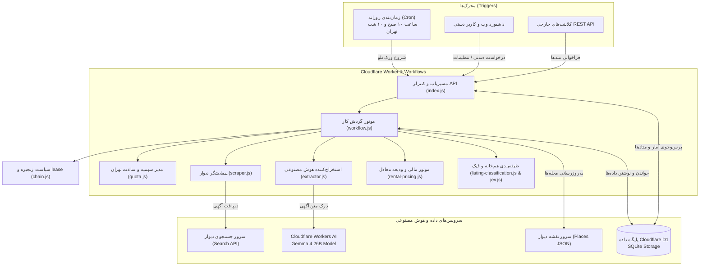

---

### اجرای محدودشدهٔ زنجیره‌ای
اجرای منطقی شامل `plan → scrape → extract → jev → finalize` است؛ هر فاز در نمونهٔ Workflow مستقل و محدود اجرا می‌شود. نمونهٔ دریافت حداکثر ۸ محله و ۳۲ صفحه، نمونهٔ استخراج حداکثر ۴۰ ردیف با ثبت نتیجه در chunkهای حداکثر ۵تایی، و نمونهٔ ارزیابی حداکثر ۴۰ ردیف دارد. سقف اضافی مسیر خودکار ۴ صفحه در هر محله است؛ مسیر دستی از بودجهٔ محاسبه‌شده تا ۲۰ صفحه استفاده می‌کند.

هم‌زمانی پیکربندی‌شده ۱ است. `system_state.workflow_running` به‌جای پرچم ساده، توکن `run:<runId>:<epochMs>` دارد؛ پس از ۳۰ دقیقه بدون تمدید قابل تصاحب است. هر فرزند lease را تمدید می‌کند و آزادسازی/نهایی‌سازی مالکیت را بررسی می‌کند. شناسهٔ فرزند قطعی است تا بازیابی گام ساخت، فرزند تکراری نسازد. `chain_state` فقط آینهٔ مشاهده‌پذیری است؛ صف‌های D1 مرجع داده‌اند. ادامهٔ برش استخراج/ارزیابی به پُربودن برش و پیشرفت ثبت‌شده وابسته است تا زنجیرهٔ بدون پیشرفت ایجاد نشود.

## ۴. طراحی مدل داده‌ای و ساختار پایگاه داده (Data Modeling & Database Design)

پایگاه داده سامانه از نوع رابطه‌ای (Relational) بوده و با هدف پایداری، سرعت بالا و رعایت اصول نرمال‌سازی پیاده‌سازی شده است.

### دیاگرام مدل داده‌ای و ساختار جداول (ER & Database Architecture)

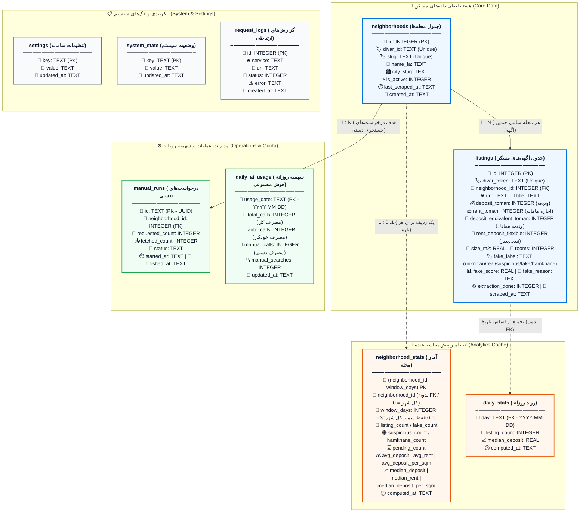

> جدول‌های `neighborhood_stats` و `daily_stats` کش تحلیلی هستند؛ دادهٔ جدید تولید نمی‌کنند و در پایان هر اجرای ورک‌فلو از روی `listings` بازسازی می‌شوند. ردیف `neighborhood_id = 0` در `neighborhood_stats` یک ردیف مصنوعی «کل شهر» است و عمداً کلید خارجی ندارد.

<details>
<summary><b>روابط جداول پایگاه داده (کلیک کنید)</b></summary>

| جدول مبدأ | نوع رابطه | جدول مقصد | توضیح |
|---|---|---|---|
| `neighborhoods` | یک به چند (1:N) | `listings` | هر محله شامل چندین آگهی است |
| `neighborhoods` | یک به چند (1:N) | `manual_runs` | هر محله می‌تواند چندین درخواست دستی داشته باشد |
| `neighborhoods` | رابطهٔ منطقی (بدون FK) | `neighborhood_stats` | آمار ۳۰روزه برای هر محلهٔ دارای داده؛ ردیف کل‌زمانی فقط برای کل شهر |
| `listings` | تجمیع منطقی (بدون FK) | `daily_stats` | یک ردیف برای هر روز دارای آگهی غیرهم‌خانه با ودیعهٔ مثبت در ۳۰ روز اخیر |

**ساختار کامل ستون‌های هر جدول:**

**`neighborhoods`:** `id` PK, `divar_id` UNIQUE, `slug` UNIQUE, `name_fa`, `city_slug`, `is_active`, `last_scraped_at`, `created_at`

**`listings`:** `id` PK, `divar_token` UNIQUE, `neighborhood_id` FK, `url`, `title`, `price_toman`, `rent_toman`, `deposit_toman`, `deposit_equivalent_toman`, `rent_deposit_flexible`, `size_m2`, `rooms`, `description`, `image_url`, `extracted_data`, `extraction_done`, `jev_result`, `jev_score`, `jev_done`, `fake_label`, `fake_score`, `fake_reason`, `scrape_source`, `scraped_at`, `updated_at`

**`manual_runs`:** `id` PK (UUID), `neighborhood_id` FK, `requested_count`, `fetched_count`, `status`, `error`, `started_at`, `finished_at`

**`daily_ai_usage`:** `usage_date` PK, `total_calls`, `auto_calls`, `manual_calls`, `manual_searches`, `updated_at`

**`settings`:** `key` PK, `value`, `updated_at`

**`system_state`:** `key` PK, `value`, `updated_at`

**`request_logs`:** `id` PK, `service`, `url`, `status`, `error`, `response_snippet`, `created_at`

**`neighborhood_stats`:** `(neighborhood_id, window_days)` PK, `listing_count`, `fake_count`, `suspicious_count`, `hamkhane_count`, `pending_count`, `avg_deposit`, `avg_rent`, `avg_deposit_per_sqm`, `median_deposit`, `median_rent`, `median_deposit_per_sqm`, `computed_at` — بدون FK؛ `neighborhood_id = 0` ردیف سراسری شهر است.

**`daily_stats`:** `day` PK, `listing_count`, `median_deposit`, `computed_at`

</details>

### فرهنگ داده‌ها (Data Dictionary)

#### جدول ۱: `neighborhoods`
نگهداری اسامی و شناسه‌های رسمی محله‌های تهران.
- `id` (INTEGER, Primary Key, Auto Increment): شناسه محلی یکتا.
- `divar_id` (TEXT, Unique, Not Null): کد شناسه دیوار برای محله (جهت فیلتر در API دیوار).
- `slug` (TEXT, Unique, Not Null): نام یکتای انگلیسی محله در URL دیوار (مانند `central-janat-abad`).
- `name_fa` (TEXT, Not Null): نام فارسی محله (مانند «جنت‌آباد مرکزی»).
- `city_slug` (TEXT, Default 'tehran'): نام شهر.
- `is_active` (INTEGER, Default 1): نشان‌دهنده فعال بودن محله جهت شرکت در جستجوها.
- `last_scraped_at` (TEXT): مهر زمانی آخرین باری که این محله پیمایش شد.

#### جدول ۲: `listings`
رکورد اصلی آگهی‌های مسکن استخراج شده.
- `id` (INTEGER, Primary Key): شناسه آگهی در دیتابیس.
- `divar_token` (TEXT, Unique, Not Null): کد رشته‌ای اختصاصی دیوار برای هر آگهی (نظیر `gaEnqi7f`).
- `url` (TEXT, Not Null): لینک کامل صفحه آگهی.
- `deposit_toman` (INTEGER): مبلغ ودیعه (رهن) به تومان.
- `rent_toman` (INTEGER): مبلغ اجاره ماهانه به تومان.
- `deposit_equivalent_toman` (INTEGER): ودیعه معادل تبدیل‌شده بر مبنای فرمول بازار.
- `rent_deposit_flexible` (INTEGER, 0 یا 1): اعلام تمایل مالک به تبدیل رهن و اجاره.
- `size_m2` (REAL): مساحت مفید بر حسب متر مربع.
- `rooms` (INTEGER): تعداد اتاق خواب.
- `neighborhood_id` (INTEGER, Foreign Key): ارجاع به جدول `neighborhoods`.
- `extracted_data` (TEXT): JSON حقایق اعتبارسنجی‌شده و نرمال‌شده؛ در تبدیل صریح کامل، مبلغ محاسبه‌شده ذخیره می‌شود، نه پاکت خام پاسخ AI. `convert_to_full_deposit` در همین JSON است و ستون جدا ندارد.
- `extraction_done` (INTEGER): `0` در انتظار، `1` استخراج‌شده، `-1` فاقد متن قابل استخراج یا شکست‌های ثبت‌شدهٔ قدیمی. خروجی نامعتبر مدل در نسخهٔ جاری روی `0` می‌ماند.
- `jev_done` (INTEGER): تکمیل ارزیابی؛ هم‌خانه‌ها بدون ارزیابی خارجی مقدار `1` می‌گیرند.
- `fake_label` (TEXT): `unknown`، `real`، `suspicious`، `fake` یا `hamkhane`؛ `failed` برچسب تقلب نیست و فقط فیلتر وضعیت استخراج است.
- `fake_score` (REAL): نمره ریسک از ۰ تا ۱.
- `fake_reason` (TEXT): توضیح تحلیلی مدل در مورد علت نامتعارف بودن قیمت.

#### جدول ۳: `daily_ai_usage`
جدول مدیریت سهمیه سخت‌گیرانه شبانه‌روزی.
- `usage_date` (TEXT, Primary Key): تاریخ روز بر مبنای تقویم محلی تهران (`YYYY-MM-DD`).
- `total_calls` (INTEGER): شمارنده کل فراخوانی‌های هوش مصنوعی در این روز.
- `auto_calls` (INTEGER): شمارنده فراخوانی‌های بخش خودکار.
- `manual_calls` (INTEGER): شمارنده فراخوانی‌های بخش دستی.
- `manual_searches` (INTEGER): تعداد دفعاتی که کاربر در طول روز درخواست دستی ثبت کرده است.

#### جدول ۴: `manual_runs`
مدیریت صف و مانیتورینگ درخواست‌های کاربر برای پیمایش سریع یک محله.
- `id` (TEXT, Primary Key): شناسه یکتای UUID.
- `neighborhood_id` (INTEGER, Foreign Key): شناسه محله مورد تقاضا.
- `requested_count` (INTEGER): تعداد آگهی‌های تقاضاشده (بین ۱ تا ۵۰۰). مقدار مؤثر ممکن است به دلیل سهمیهٔ دستی کمتر باشد.
- `fetched_count` (INTEGER): تعداد آگهی‌های تازه‌ای که ذخیره شد (نه تعداد آگهی‌های دیده‌شده).
- `status` (TEXT): وضعیت جاری کار؛ یکی از `queued`، `running`، `scraped`، `complete`، `partial`، `empty`، `quota_exhausted` یا `failed`. پایان دریافت به‌تنهایی به معنی `complete` نیست؛ `finalizeManual` تحلیل ناتمام را نیز بررسی می‌کند و وضعیت نهایی را همراه `finished_at` می‌نویسد.
- `error` (TEXT): پیام خطای فارسی در صورت شکست یا اتمام سهمیه.
- `started_at` / `finished_at` (TEXT): زمان شروع و پایان اجرا به وقت گرینویچ.

#### جدول ۵: `settings`
جدول کلید-مقدار برای اعمال پیکربندی‌های سامانه بدون نیاز به بازنشر کد.
- مقادیر پیش‌فرض ذخیره‌شده:
  - `daily_listing_limit`: پیش‌فرض کد/ساخت دیتابیس ۵۰۰ است؛ مقدار ذخیره‌شدهٔ تولید مستقل است و در ۲۰۲۶-۱۱-۱۷ برابر ۳۰۰ تأیید شد.
  - `fake_threshold`: آستانه مشکوک بودن (۰.۶).
  - `high_fake_threshold`: آستانه قطعی بودن جعلی/فیک (۰.۸).
  - `auto_neighborhoods`: آرایه JSON از اسلاگ محله‌های پیش‌فرض تحت پیمایش خودکار.
  - `bait_keywords`: آرایه عبارات تبلیغاتی طعمه («قیمت توافقی»، «زیر قیمت»، «فوری»، «فرصت استثنایی»، «فقط امروز»).

#### جدول ۶: `system_state`
نگهداری فلگ‌های اجرایی و متغیرهای هماهنگی ورک‌فلو.
- `workflow_running`: lease مالکیت زمان‌دار برای جلوگیری از هم‌پوشانی زنجیره‌ها؛ `0` آزاد و `run:<runId>:<epochMs>` توکن مالک است.
- `chain_state`: وضعیت آخرین فاز و instance برای مشاهده‌پذیری، نه مبنای تضمین صحت.
- `neighborhood_discovery_last_run`: زمان آخرین به‌روزرسانی محله‌ها از دیوار.
- `ai_quota_until`: epoch میلی‌ثانیهٔ نیمه‌شب UTC بعدی پس از خطای سهمیهٔ Workers AI؛ مستقل از پایان سهمیهٔ دستی برنامه.

#### جدول ۷: `request_logs`
ثبت لاگ‌های ارتباطی برای خطایابی و رهگیری عملیات.
- `id` (INTEGER, Primary Key): شناسه لاگ.
- `service` (TEXT): سرویس مبدأ رخداد (`scraper`, `neighborhood-discovery`, `workers-ai`, `jev`, `system`).
- `url` (TEXT): آدرس درخواست‌شده.
- `status` (INTEGER): وضعیت یا کد پاسخ؛ برای خطاهای بدون پاسخ معمولاً `0`.
- `error` (TEXT): متن خطا در صورت وجود.
- `response_snippet` (TEXT): بخش کوتاه از پاسخ برای خطایابی.
- `created_at` (TEXT): زمان ثبت رخداد.

#### جدول ۸: `neighborhood_stats`
کش تحلیلی از پیش محاسبه‌شدهٔ آمار هر محله. این جدول دادهٔ خام جدیدی تولید نمی‌کند و در پایان هر اجرای ورک‌فلو به‌صورت اتمیک از روی `listings` بازسازی می‌شود.
- `neighborhood_id` (INTEGER, بخشی از Primary Key): شناسه محله؛ مقدار `0` یک ردیف مصنوعی «کل شهر» است و کلید خارجی ندارد.
- `window_days` (INTEGER, بخشی از Primary Key): `30` برای آمار محله‌ها و کل شهر؛ `0` فقط برای شمارش کل‌زمانی شهر، نه همهٔ شاخص‌های هر محله.
- `listing_count` (INTEGER): تعداد آگهی‌های غیر هم‌خانه در بازه.
- `fake_count` / `suspicious_count` (INTEGER): تعداد آگهی‌های جعلی و مشکوک.
- `hamkhane_count` (INTEGER): تعداد آگهی‌های هم‌خانه (جدا از آمار قیمت).
- `pending_count` (INTEGER): تعداد آگهی‌های غیرهم‌خانه با `extraction_done = 0` در بازهٔ ۳۰روزه؛ شامل شکست‌های `-1` نیست.
- `avg_deposit`, `avg_rent`, `avg_deposit_per_sqm` (REAL): میانگین ودیعه، اجاره و ودیعه بر متر.
- `median_deposit`, `median_rent`, `median_deposit_per_sqm` (REAL): میانه‌های همان سه شاخص.
- `computed_at` (TEXT): زمان محاسبهٔ این ردیف.

#### جدول ۹: `daily_stats`
سری زمانی روزانهٔ میانهٔ ودیعه برای نمودار روند؛ یک ردیف برای هر روز دارای آگهی غیرهم‌خانه با ودیعهٔ مثبت در ۳۰ روز اخیر.
- `day` (TEXT, Primary Key): تاریخ میلادی به قالب `YYYY-MM-DD`.
- `listing_count` (INTEGER): تعداد آگهی‌های غیرهم‌خانه با ودیعهٔ مثبت در آن روز؛ نه کل آگهی‌های خام روز.
- `median_deposit` (REAL): میانهٔ ودیعهٔ اعلامی آن روز.
- `computed_at` (TEXT): زمان محاسبه.

### تحلیل الگوی خواندن/نوشتن و کش تحلیلی
پیش از افزودن کش، هر بارگذاری داشبورد چند کوئری تجمیعی (میانگین، میانه، میانهٔ هر متر، روند روزانه) را با `GROUP BY` و توابع پنجره‌ای روی بازهٔ ۳۰ روزهٔ `listings` اجرا می‌کرد. یعنی رابطهٔ خواندن به نوشتن بسیار نامتوازن بود: در روز دو اجرای زمان‌بندی‌شده به‌علاوهٔ اجراهای دستی/درخواستی ممکن بود، اما هر بازدید کاربر کل بازهٔ داده را چند بار اسکن می‌کرد. این الگو در D1 با سقف روزانهٔ ردیف‌های خوانده‌شده ناسازگار است؛ بنابراین الگو به «محاسبهٔ یک‌باره در نوشتن، خواندن ارزان در بازدید» تغییر کرد:

1. **مسیر نوشتن**: `refresh-stats` در نهایی‌سازی، آمار ۳۰روزهٔ محله‌ها/شهر، شمارش کل‌زمانی شهر و سری روزانهٔ شهر را در ۸ دستور داخل `env.DB.batch()` اتمیک بازسازی می‌کند و `stats_computed_at` را ثبت می‌کند. شمارنده‌های تهی با `COALESCE` صفر می‌شوند.
2. **مسیر خواندن**: پس از ثبت نشانگر، خلاصه و جدول ۳۰روزه، روند سراسری شهر و شمارش کل فهرست بدون فیلتر از کش استفاده می‌کنند. خود ردیف‌های فهرست و شمارش‌های فیلترشده همچنان از `listings` خوانده می‌شوند؛ حذف کامل خواندن آن جدول ادعا نمی‌شود.
3. **مسیر بازگشتی**: برای بازه‌های دیگر، نبود نشانگر، و روند روزانهٔ محلهٔ منتخب، SQL زنده اجرا می‌شود. مقادیر کش تصویر زمان آخرین محاسبه‌اند و ممکن است حین اجرای Workflow با ردیف‌های تازه تفاوت داشته باشند.
4. **قواعد آماری**: آگهی‌های `hamkhane` در هر دو مسیر از شمارش اصلی و میانه‌ها کنار گذاشته می‌شوند و شمارششان جدا گزارش می‌شود؛ میانه با `ROW_NUMBER()` روی مقادیر مثبت محاسبه می‌شود. میانگین ودیعه/اجاره در کش فقط مقادیر مثبت را می‌گیرد، ولی مسیر زندهٔ جدول محله‌ها مقادیر صفر را هم در `AVG` وارد می‌کند؛ بنابراین هم‌ارزی کامل همهٔ میانگین‌ها ادعا نمی‌شود.

### استراتژی ایندکس‌گذاری و کارایی کوئری‌ها
به منظور تضمین کارایی بالا در مواجهه با کوئری‌های تحلیلی پیچیده و فیلترهای داشبورد، ایندکس‌های بهینه‌ای تعریف شده‌اند:
1. `idx_listings_neighborhood_scraped`: ایندکس ترکیبی روی `(neighborhood_id, scraped_at DESC)` برای واکشی سریع آگهی‌های ۳۰ روز اخیر هر محله.
2. `idx_listings_extraction_source`: ایندکس ترکیبی روی `(extraction_done, scrape_source, scraped_at)` جهت انتخاب سریع رکوردهای در صف تحلیل هوش مصنوعی.
3. `idx_listings_fake_label`: ایندکس روی برچسب‌های فیک برای فیلتر آنی در داشبورد.
4. `idx_listings_divar_token`: ایندکس جست‌وجوی توکن دیوار؛ تضمین یکتایی از قید `UNIQUE(divar_token)` در تعریف جدول می‌آید.

---

## ۵. پایپ‌لاین پردازش داده‌ها و منطق تجاری

### الف) دریافت دوره‌ای محله‌ها (Neighborhood Discovery)
سامانه از نقشه سراسری دیوار به نشانی `https://map.divarcdn.com/places-web.json` استفاده می‌کند. متد `refreshNeighborhoodsIfDue`:
- بررسی می‌کند آیا از آخرین بررسی ۷ روز گذشته است یا خیر.
- در صورت فرا رسیدن موعد یا فراخوانی متد اجباری (`force = true`)، محله‌ها را دانلود کرده و رکوردهایی با شناسه شهر تهران را در دسته‌های ۱۰۰‌تایی با دستور `batch` در پایگاه داده ادغام (`UPSERT`) می‌کند.

### ب) زمان‌بندی روزانه و زمان محلی تهران (Scheduling & Tehran Clock)
تریگر زمان‌بندی ورکر با عبارت کرون زیر در کلادفلر فعال است:
$$\text{Cron: } \texttt{30 6,18 * * *}$$
با توجه به اینکه زمان‌بندی در کلادفلر همیشه بر پایه گرینویچ (UTC) است و ساعت رسمی تهران ۳ ساعت و نیم جلوتر است:
- ساعت **۰۶:۳۰ UTC** برابر با ساعت **۱۰:۰۰ صبح تهران** است.
- ساعت **۱۸:۳۰ UTC** برابر با ساعت **۲۲:۰۰ (۱۰ شب) تهران** است.

ماژول `quota.js` با استفاده از `Intl.DateTimeFormat` تاریخ و ساعت محلی تهران (`Asia/Tehran`) را دقیقاً استخراج می‌کند تا مرزبندی روزها و ساعات بر مبنای تاریخ محلی سنجیده شود.

### ج) مدیریت سهمیه و کنترل بودجهٔ رایگان
1. **بودجهٔ برنامه**: `daily_listing_limit` بین ۳ تا ۵۰۰ است؛ پیش‌فرض کد و schema برابر ۵۰۰، اما مقدار تأییدشدهٔ تولید در ۲۰۲۶-۱۱-۱۷ **۳۰۰** بود. اصلاحات اخیر مقدار تولید را تغییر نداده‌اند؛ `/api/quota` مرجع مقدار جاری است.
2. **تفکیک سهم‌ها**: خودکار `floor(4L/5)` و دستی `L - auto`؛ برای تولیدِ ثبت‌شده ۲۴۰/۶۰ و برای پیش‌فرض ۵۰۰، برابر ۴۰۰/۱۰۰ است. باقی‌ماندهٔ هر سهم به باقی‌ماندهٔ کل محدود می‌شود.
3. **آزادسازی شبانه**: در ساعت ۲۲ یا بعد از آن فقط اگر در همان روز تهران `manual_searches = 0` باشد، ظرفیت دستی استفاده‌نشده به خودکار می‌رسد.
4. **رزرو اتمیک**: `reserveAiCall` پیش از ارسال، شمارندهٔ تاریخ واقعی تهران را با `RETURNING` افزایش می‌دهد. پاسخ خراب و تلاش ناموفق هم شمارش می‌شوند. عبور زنجیره از نیمه‌شب تهران، مصرف را به روز واقعی ارسال منتسب می‌کند.
5. **بودجهٔ ارائه‌دهنده**: تخصیص Free برابر **۱۰٬۰۰۰ Neuron روزانه برای کل حساب** است؛ تست‌های زنده و پروژه‌های دیگر هم شریک‌اند. برنامه مصرف Neuron را جمع یا محدود نمی‌کند؛ تعداد فراخوانی تضمین ظرفیت استخراج نیست.
6. **بازنشانی مستقل**: سهم برنامه با روز تهران و سهم Neuron در **۰۰:۰۰ UTC / ۰۳:۳۰ تهران** بازنشانی می‌شود. خطای `4006` یا `daily free allocation` ارسال را فوراً متوقف و قفل را تا نیمه‌شب UTC بعدی فعال می‌کند. پایان سهم برنامه چنین قفلی ایجاد نمی‌کند. انقضا فقط اجازهٔ اجرای بعدی را می‌دهد و محرک اجرای تازه نیست.
7. **توزیع محله‌ها**: `neighborhoodTarget` کم‌آگهی‌بودن و زمان سپری‌شده از آخرین پیمایش را وزن می‌دهد و باقی‌مانده را منتقل می‌کند.

این نسخه با **Cloudflare Workers Free** سازگار نگه داشته شده است؛ پیکربندی افزایش پولی CPU/زیردرخواست یا درگاه و fallback پولی ندارد. محدودیت‌های مهم Free شامل ۱۰۰٬۰۰۰ درخواست Worker در روز، CPU فعال ۱۰ میلی‌ثانیه برای Worker/هر گام Workflow، ۵۰ زیردرخواست خارجی و ۱۰۰۰ داخلی در بودجهٔ مربوط، و سهمیهٔ D1 برابر ۵ میلیون ردیف خوانده‌شده، ۱۰۰٬۰۰۰ ردیف نوشته‌شده در روز و ۵ گیگابایت فضای کل است. زمان انتظار شبکه همان CPU فعال نیست؛ سازگاری معماری تضمین باقی‌ماندن هر بار کاری زیر همهٔ سهمیه‌ها نیست.

منابع رسمی بررسی‌شده در ۲۰۲۶-۱۱-۱۷: [Workers AI pricing](https://developers.cloudflare.com/workers-ai/platform/pricing/)، [Workers limits](https://developers.cloudflare.com/workers/platform/limits/)، [Workflows limits](https://developers.cloudflare.com/workflows/reference/limits/) و [D1 pricing](https://developers.cloudflare.com/d1/platform/pricing/).

> سهمیه فقط شمار فراخوانی‌های هوش مصنوعی است؛ جست‌وجو در دیوار و ذخیرهٔ آگهی مصرفی از سهمیه ندارد. هر صفحهٔ نتایج دیوار حداکثر ۳۰ آگهی دارد و `divar_token` یکتا مانع ذخیرهٔ تکراری می‌شود؛ بنابراین «دریافت‌شده» در گزارش‌ها یعنی آگهی تازه.

#### مسیر خودکار دریافت آگهی
1. سهمیهٔ خودکار و تعداد صف `auto` خوانده می‌شود؛ `scrapeRemaining = max(0, auto_remaining - pendingBeforeRun)` ظرفیت دریافت تازه است. اگر صف ظرفیت را پر کند، دریافت تازه حذف می‌شود، نه خود آگهی‌های قبلی.
2. محله‌های `auto_neighborhoods` بر اساس کم‌ترین آگهی ۷ روز گذشته و قدیمی‌ترین `last_scraped_at` مرتب می‌شوند.
3. برای هر محله `neighborhoodTarget` سهم آن را از باقی‌ماندهٔ سهمیه محاسبه می‌کند.
4. بودجهٔ پایه `min(20, max(3, ceil(target / 30) * 3))` است، ولی خودکار سقف ۴ صفحه برای هر محله و ۳۲ صفحه در هر instance دارد.
5. توکن‌های موجود پیش از برش تعداد نامزدها حذف و تازه‌ها در `batch` درج می‌شوند؛ ظرفیت باقی‌مانده به محلهٔ بعد می‌رسد.
6. آگهی‌های `auto` در انتظار از قدیمی به جدید تا سقف سهم پردازش می‌شوند. صف قدیمی `manual` در این انتخاب نیست و خودکار تخلیه نمی‌شود؛ پاک‌سازی یا بازصف‌گذاری آن عملیات نگهداری جداگانه است.

#### مسیر دستی دریافت آگهی
1. در `POST /api/manual-runs` بدنهٔ غیرشیء/نامعتبر با ۴۰۰، محلهٔ ناموجود با ۴۰۴، نبود سهمیه با ۴۲۹ و زنجیرهٔ فعال با ۴۰۹ رد می‌شود.
2. تعداد مؤثر `min(count, manual_remaining)` است و در پاسخ به‌صورت `effective_count` برگردانده می‌شود؛ `requested_count` مقدار درخواستی کاربر می‌ماند.
3. `planPhase` سهمیه را دوباره بررسی و `MAX(listings.id)` را در `afterId` ثبت می‌کند؛ جست‌وجوی همان محله فرمول پایه را تا سقف ۲۰ صفحه، بدون محدودیت ۴صفحه‌ای خودکار، به کار می‌گیرد.
4. فقط ردیف‌های منبع `manual`، همان محله و `id > afterId` از جدیدترین زمان دریافت استخراج می‌شوند. صف دستی قدیمی مصرف اجرای جدید را نمی‌گیرد.
5. `scraped` تا نهایی‌سازی وضعیت میانی می‌ماند، حتی اگر دریافت صفر یا خطادار باشد. `finalizeManual` ابتدا خطای دریافت، اتمام سهمیه و استخراج/ارزیابی ناتمام را بررسی و سپس `manualRunOutcome` را برای تعدادها به کار می‌گیرد: `complete` یعنی کل درخواست پردازش شده؛ `partial` یعنی تعداد کمتر ولی پردازش همان‌ها کامل؛ `empty` یعنی جست‌وجوی موفق بدون تازه؛ `failed` برای دریافت خطادار یا تحلیل ناتمام؛ `quota_exhausted` برای سهمیه. وضعیت نهایی همراه `finished_at` نوشته می‌شود.
6. با اتمام سهمیه نیز ردیف‌های موفق از `jevPhase` و مرحلهٔ آمار عبور می‌کنند؛ `jevPhase` می‌تواند سایر ردیف‌های استخراج‌شده و ارزیابی‌نشدهٔ سامانه را هم بررسی کند.

### د) استخراج داده با مدل زبانی هوش مصنوعی (Workers AI)
ماژول `extractor.js` از **Gemma 4 26B** (`@cf/google/gemma-4-26b-a4b-it`) استفاده می‌کند؛ جایگزین Qwen 3 30B پیش از [بازنشستگی ۲۰ نوامبر ۲۰۲۶](https://developers.cloudflare.com/changelog/post/2026-11-05-planned-model-deprecations/). پیکربندی مطابق [مدل](https://developers.cloudflare.com/workers-ai/models/gemma-4-26b-a4b-it/) و [راهنمای غیرفعال‌کردن thinking](https://developers.cloudflare.com/workers-ai/get-started/workers-wrangler/):
```json
{
  "response_format": { "type": "json_object" },
  "chat_template_kwargs": { "enable_thinking": false },
  "max_completion_tokens": 768,
  "temperature": 0
}
```
عنوان تا ۳۰۰ و متن تکمیلی تا ۴۰۰۰ نویسه محدود می‌شود. مدل مبلغ‌های نقل‌شده را به تومان استخراج می‌کند، مجهول‌ها را `null` می‌گذارد، برای رهن کامل اجارهٔ صفر و در چند گزینهٔ محدود پرداخت، گزینهٔ بیشترین ودیعه را انتخاب می‌کند. تبدیل کامل را مدل محاسبه نمی‌کند؛ تنها اجازهٔ صریح آن را علامت می‌زند. نمونهٔ حقایق برای آگهی قابل مذاکره، بدون اجازهٔ تبدیل کامل:
```json
{
  "price_toman": 500000000,
  "rent_toman": 15000000,
  "deposit_toman": 500000000,
  "rent_deposit_flexible": true,
  "convert_to_full_deposit": false,
  "size_m2": 85,
  "rooms": 2,
  "property_type": "apartment",
  "description": "شرح خلاصه آگهی...",
  "has_bait_signals": false,
  "suspicious_phrases": []
}
```
`callExtractionModel` دقیقاً یک درخواست می‌فرستد. `runAiStep` نتیجه یا خطای آن را در گام پایدار برمی‌گرداند و `commitChunk` آن را جداگانه تفسیر/ثبت می‌کند؛ خطای تفسیر باعث تکرار فوری فراخوانی مصرف‌شده نمی‌شود.
- **قالب‌ها**: شیء حقایق، رشتهٔ JSON، `response`، `output_text` و `choices[0].message.content` پشتیبانی می‌شوند. خروجی `length`، refusal، صرفاً reasoning، خالی یا خراب پذیرفته نمی‌شود.
- **اعتبارسنجی**: حداقل یک کلید عددی باید وجود داشته باشد؛ اعداد حاضر باید نامنفی و متناهی باشند. نوع بولی، نوع ملک، توضیح و آرایهٔ عبارت‌ها نیز در صورت حضور بررسی می‌شود. این کنترل نوع است، نه تضمین صحت معنایی مدل.
- **سقف زیردرخواست یا سهمیه**: ارسال فوراً حتی در میانهٔ chunk متوقف می‌شود؛ ردیف روی `0` می‌ماند. سهمیهٔ ارائه‌دهنده قفل تا نیمه‌شب UTC می‌سازد، ولی خطای زیردرخواست یا پایان سهم برنامه قفل ارائه‌دهنده نیست. افزایش پولی سقف در `wrangler.jsonc` وجود ندارد.
- **نبود متن قابل استخراج**: بدون مصرف AI با `extraction_done = -1` ثبت می‌شود. این رفتار با پاسخ خالی مدل متفاوت است.
- **خروجی نامعتبر/خطای گذرا**: لاگ می‌شود و ردیف روی `0` می‌ماند؛ شناسه‌های ناموفق اخیر در فهرست حداکثر ۹۰تایی زنجیره موقتاً کنار گذاشته می‌شوند. این فهرست تضمین صرف‌نظر دائمی نیست. صف خودکار در اجرای بعدی قابل انتخاب است؛ ردیف دستی قدیمی نیازمند رسیدگی جداگانه است.

اگر `convert_to_full_deposit = true` و `rent_deposit_flexible = true` باشند و هر دو مبلغ معلوم باشند، جاوااسکریپت `round(deposit + rent * 100 / 3)` را ذخیره کرده و اجاره را صفر می‌کند. ۱۰۰ میلیون ودیعه + ۶ میلیون اجاره برابر ۳۰۰ میلیون ودیعه است. صرف «توافق» یا فهرست محدود گزینه‌ها اجازهٔ این تبدیل نیست. دادهٔ قدیمیِ فاقد این پرچم به‌صورت بازگشتی تبدیل نمی‌شود.

### ه) محاسبه ودیعه معادل در بازار مسکن
به منظور امکان‌پذیر ساختن مقایسه ریاضی میان آگهی‌هایی که صرفاً رهن کامل هستند با آگهی‌هایی که دارای ترکیب ودیعه و اجاره ماهانه می‌باشند، از فرمول سنتی و پذیرفته‌شده بازار مسکن ایران استفاده می‌شود:
> **قانون تبدیل ۳ درصد**: هر ۱۰۰ میلیون تومان ودیعه معادل ۳ میلیون تومان اجاره ماهانه در نظر گرفته می‌شود (نسبت ۱۰۰ به ۳ یا ۳۳.۳۳).

$$\text{Deposit Equivalent} = \text{Deposit} + \left(\text{Rent} \times \frac{100}{3}\right)$$

معیار ودیعهٔ معادل برای مقایسه حتی بدون مجوز تبدیل محاسبه می‌شود؛ نباید آن را با شرایط پرداخت مورد قبول مالک یا تبدیل صریح بند قبل یکی دانست.

### و) رده‌بندی آگهی‌های هم‌خانه و اتاق اشتراکی
آگهی‌های هم‌خانه قیمت بسیار پایینی دارند و در صورت محاسبه در میانگین مسکن مستقل، شاخص‌های متراژ و قیمت محله را به شدت گمراه‌کننده می‌کنند.
ماژول `listing-classification.js` با عبارات باقاعده دقیق (شامل انواع فاصله‌ها و نیم‌فاصله‌های فارسی) و بررسی مقدار خروجی هوش مصنوعی (`property_type = room`)، این آگهی‌ها را شناسایی کرده و برچسب `hamkhane` را اعمال می‌کند. در کوئری‌های آماری داشبورد، این آگهی‌ها از محاسبات میانگین و میانه جدا می‌شوند اما در تب آگهی‌ها قابل فیلتر و مشاهده هستند.

### ز) موتور تشخیص آگهی‌های مشکوک و جعلی (Fraud Detection)
با وجود secret اختیاری `TYPESAFE_API_KEY`، `jev.js` از TypeSafe Jev و وزن‌های `jev_weights` استفاده می‌کند؛ در نبود کلید یا شکست سرویس، ارزیابی هیوریستیک زیر اجرا می‌شود. شرایط مصرف این سرویس خارجی مستقل از Cloudflare Free است و فعال‌کردن آن برای کارکرد پایه لازم نیست:
1. **محاسبه میانگین ودیعه معادل بر هر متر مربع در همان محله**.
2. **محاسبه ودیعه بر متر مربع آگهی جاری**.
3. **محاسبه نسبت قیمت آگهی به میانگین محله**:
   - چنانچه نسبت کمتر از ۴۰٪ باشد $\rightarrow$ نمره ریسک اولیه ۰.۹ (شدیداً فیک).
   - چنانچه نسبت بین ۴۰٪ تا ۶۰٪ باشد $\rightarrow$ نمره ریسک اولیه ۰.۶۵ (مشکوک).
   - چنانچه نسبت بین ۶۰٪ تا ۷۵٪ باشد $\rightarrow$ نمره ریسک اولیه ۰.۴.
4. **بررسی کلمات کلیدی طعمه (Bait Keywords)**:
   - واژگانی نظیر «فوری»، «زیر قیمت»، «فرصت استثنایی» و «قیمت توافقی» امتیاز ریسک آگهی را تا سقف ۰.۹۵ افزایش می‌دهند.
5. **برچسب‌گذاری نهایی با آستانه‌های پیش‌فرض قابل تنظیم**:
   - نمره $\ge 0.8 \rightarrow \mathbf{fake}$ (جعلی).
   - نمره $\ge 0.6 \rightarrow \mathbf{suspicious}$ (مشکوک).
   - نمره $< 0.6 \rightarrow \mathbf{real}$ (معمولی).

### ح) پیش‌محاسبه آمار و کنترل سهمیه خواندن D1
خواندن زندهٔ آمار داشبورد چند کوئری پنجره‌ای روی بازهٔ ۳۰ روزه اجرا می‌کرد و می‌توانست به سقف روزانهٔ خواندن پلن رایگان D1 برسد. راه‌حل در `src/stats.js`:

1. **محاسبه در نوشتن**: در پایان هر اجرای ورک‌فلو، مرحلهٔ `refresh-stats` تابع `refreshAggregates` را در یک `batch` اتمیک اجرا می‌کند و `neighborhood_stats`، `daily_stats` و نشانگر `stats_computed_at` را بازمی‌سازد.
2. **میانهٔ دقیق در SQL**: میانه با `ROW_NUMBER() OVER (PARTITION BY ...)` و `COUNT(*) OVER ()` محاسبه می‌شود.
3. **مسیر خواندن کش**: خلاصه و جدول ۳۰روزه، روند سراسری و شمارش کل فهرست بدون فیلتر از کش خوانده می‌شوند. روند محلهٔ منتخب، خود آگهی‌ها و شمارش فیلترشده SQL زنده دارند.
4. **بازگشت خودکار به مسیر زنده**: برای بازه‌های دیگر یا پیش از نخستین اجرا، کوئری زندهٔ SQL اجرا می‌شود؛ بنابراین قرارداد API تغییر نمی‌کند.
5. **شمارش خالی و خطای غیرمهلک**: `COALESCE(SUM(...), 0)` مانع نقض ستون‌های `NOT NULL` در دیتابیس خالی می‌شود. هم‌خانه از آمار مستقل جداست. شکست `refresh-stats` لاگ می‌شود و به‌تنهایی اجرای دریافت را ناموفق نمی‌کند؛ بنابراین `complete` تضمین تازه‌بودن کش نیست و باید `stats_computed_at` را هم دید.

---

## ۶. داشبورد تحلیلی و مستندات رابط برنامه‌نویسی (API)

داشبورد تک‌صفحه‌ای سامانه با طراحی مدرن و راست‌به‌چپ (RTL) بدون وابستگی سنگین و با ابزار Chart.js پیاده‌سازی شده است.

### ویژگی‌های داشبورد
1. **کارت‌های شاخص ۳۰ روز اخیر**: تعداد آگهی، میانه ودیعه، میانه اجاره ماهانه، تعداد آگهی‌های فیک/مشکوک و تعداد آگهی‌های در صف پردازش.
2. **پنج محله برتر**: نمایش سریع پرآگهی‌ترین محله‌های ماه اخیر.
3. **نمودارها**: نمودار ستونی مقایسه‌ای حجم آگهی محله‌ها و نمودار خطی روند روزانه میانه ودیعه.
4. **جدول داده‌های محله‌ها**: مجهز به جستجو، مرتب‌سازی بر اساس ستون‌های مختلف و صفحه‌بندی.
5. **تب آگهی‌ها**: نمایش کارت‌های اختصاصی با عکس، مشخصات فنی، تگ وضعیت و لینک مستقیم دیوار.
6. **تب دریافت دستی**: پنل تعاملی برای واکشی یک محله؛ سقف ورودی از سهمیهٔ دستی باقی‌مانده پیروی می‌کند و در صورت صفر شدن سهمیه، دکمه غیرفعال می‌شود.
7. **تب تنظیمات**: کنترل پارامترهای موتور هوش مصنوعی و لیست محله‌ها با محافظت **رمز عبور (`1311`)**.
8. **تب گزارش‌ها**: نمایش لحظه‌ای رخدادهای سیستمی و خطاهای شبکه.

### تصاویر رابط کاربری
تصاویر زیر نمونه‌های تولیدشده با `scripts/capture-screenshots.js` هستند، نه وضعیت زندهٔ تولید. در این ویرایش بازتولید نشده‌اند و ممکن است کنترل یا سهمیهٔ قبلی را نمایش دهند؛ رفتار جاری در متن و کد شرح داده شده است.

| نمای کلی (نمودارها و جدول) | انتخاب یک محله |
|---|---|
| 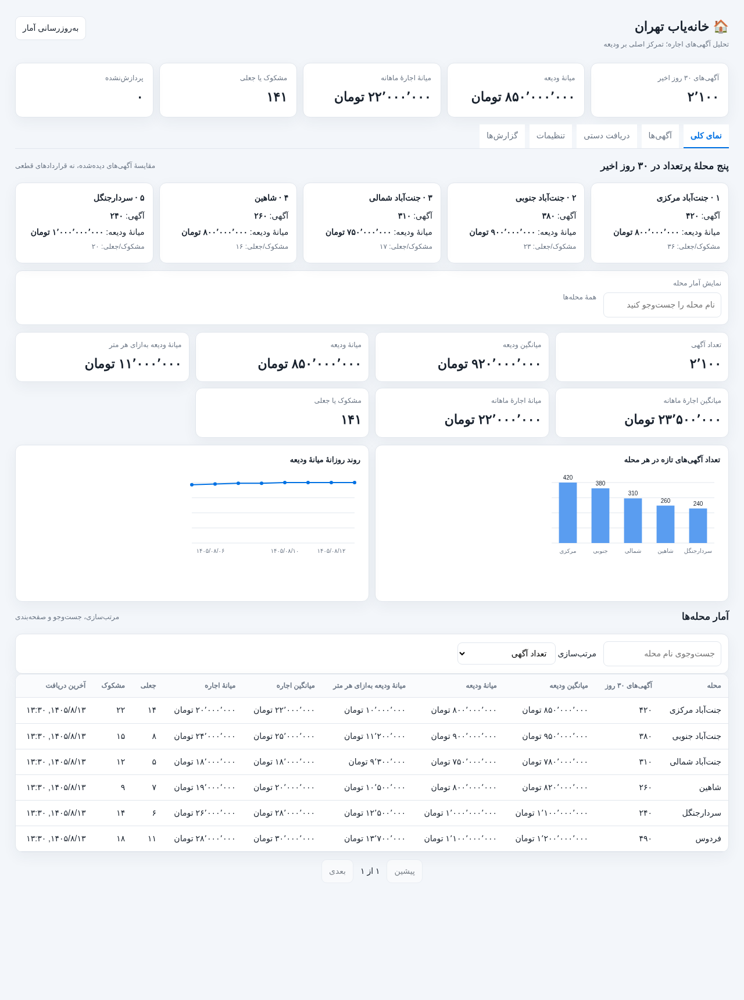 | 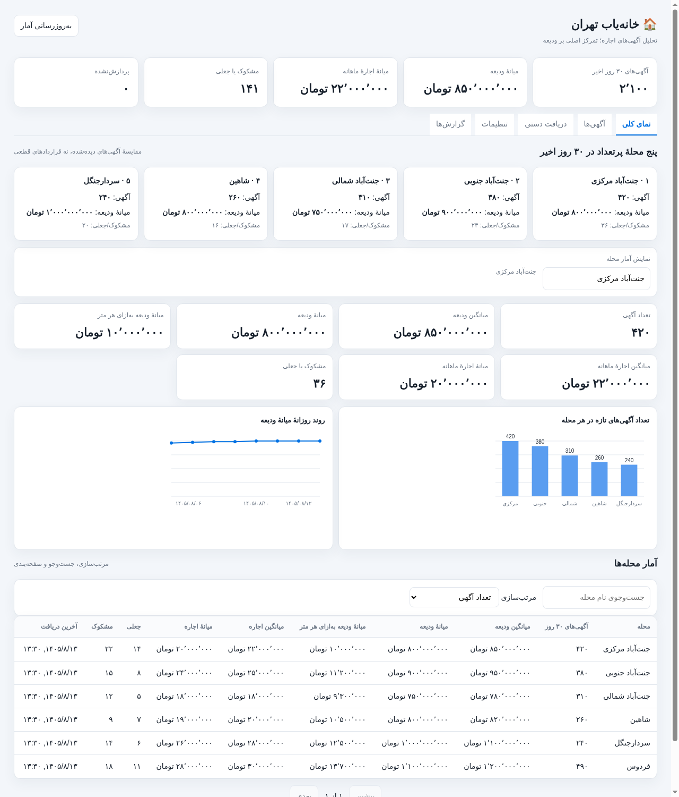 |

| تب آگهی‌ها | فیلتر آگهی‌های جعلی |
|---|---|
| 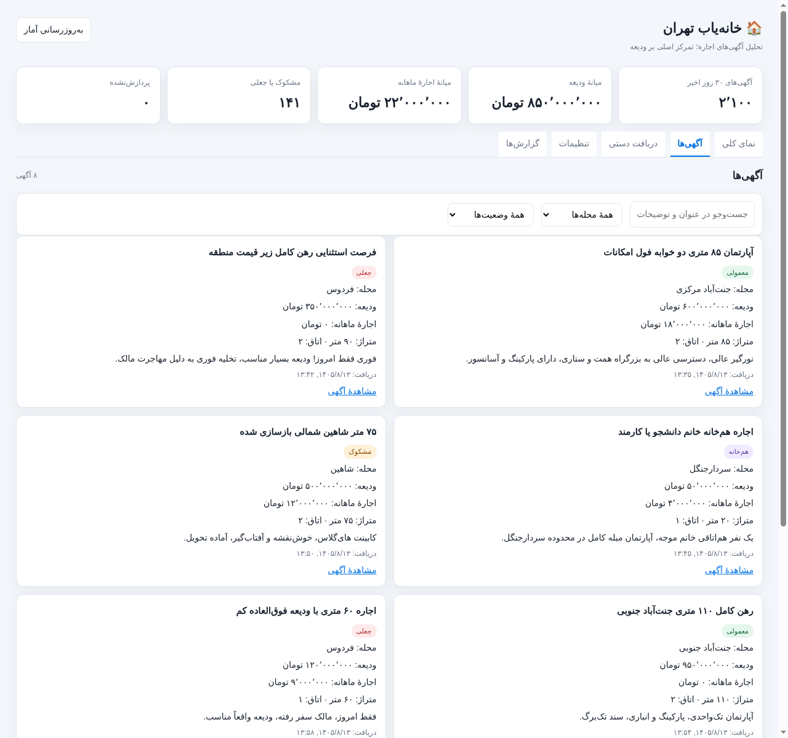 | 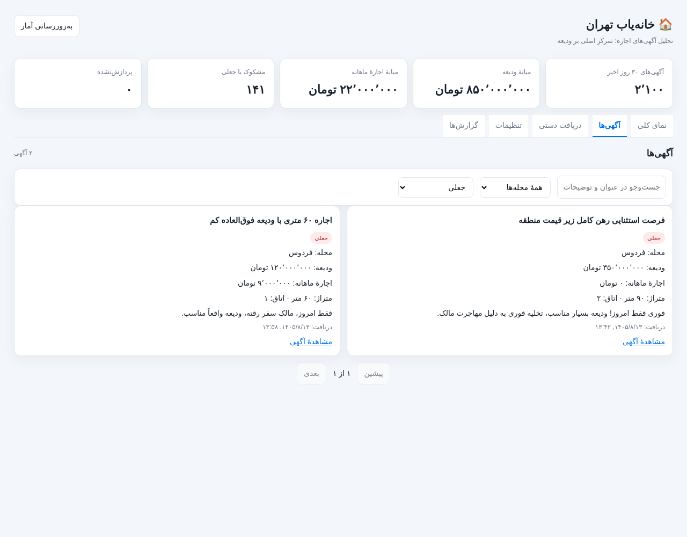 |

| دریافت دستی | تنظیمات | گزارش‌ها |
|---|---|---|
| 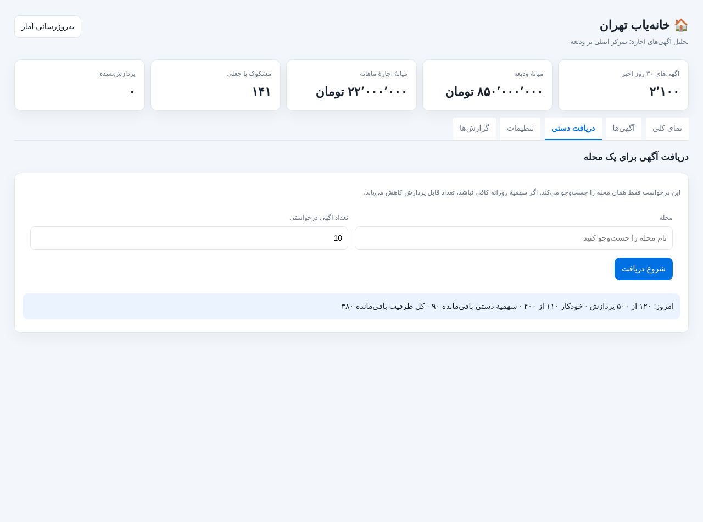 | 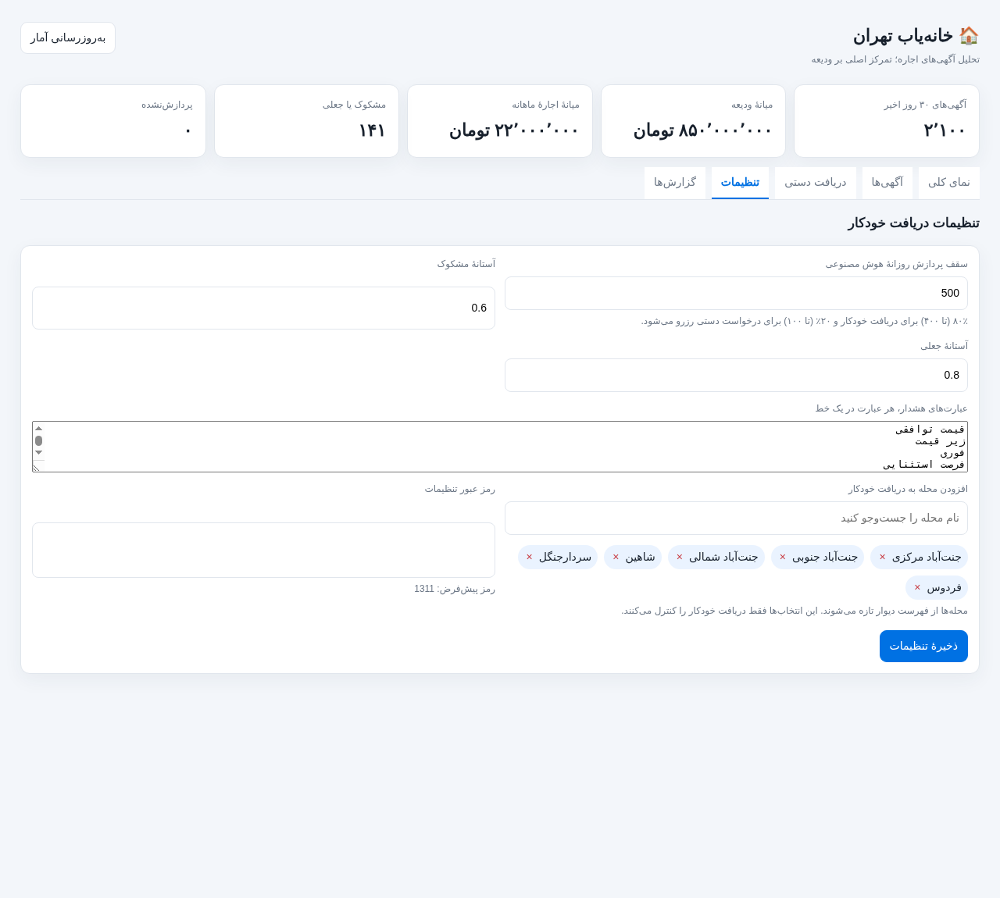 | 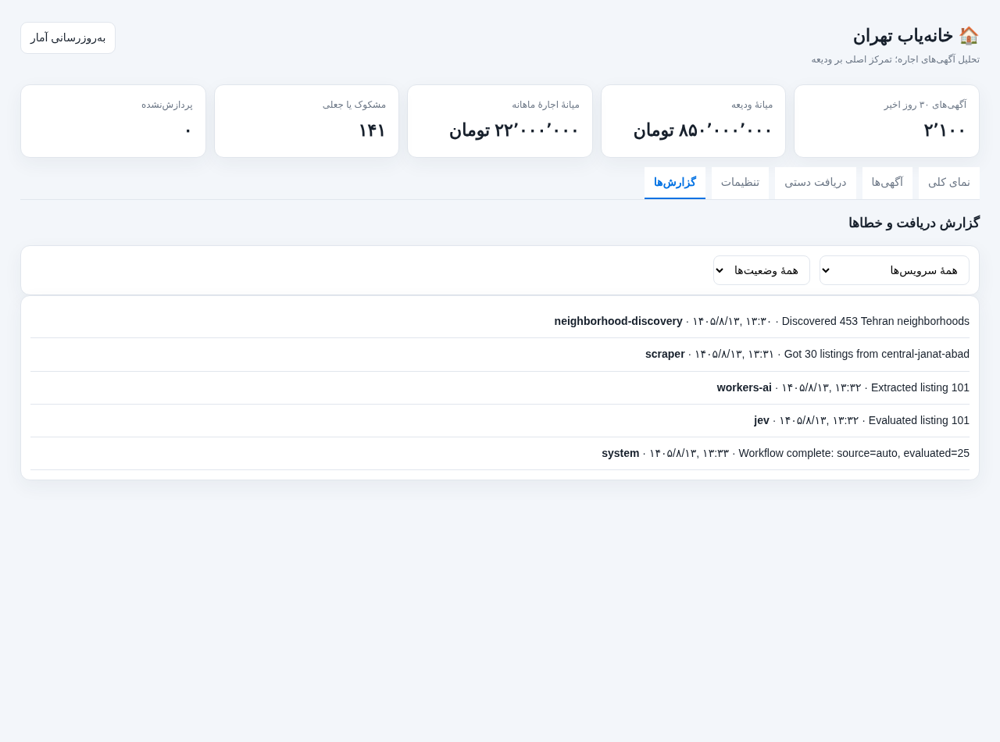 |

برای بازتولید تصاویر:
```bash
node scripts/capture-screenshots.js
```
این اسکریپت به `google-chrome` (حالت headless) نیاز دارد و تصاویر را در `docs/screenshots/` بازنویسی می‌کند. نمودارها با یک رندرر Canvas محلی کشیده می‌شوند تا تصاویر بدون اینترنت و به‌صورت تکرارپذیر ساخته شوند.

### راهنمای کامل دکمه‌ها و کنترل‌های داشبورد
داشبورد یک صفحهٔ RTL است و داده‌ها را از همان APIهای مستندشده می‌خواند. جدول‌های زیر تمام کنترل‌های تعاملی را شرح می‌دهند:

#### کنترل‌های سراسری

| کنترل | شناسه | رفتار | درخواست‌های شبکه |
|---|---|---|---|
| دکمهٔ «به‌روزرسانی آمار» | `#refresh` | در حین اجرا غیرفعال و متن آن «در حال به‌روزرسانی…» می‌شود؛ یک اجرای خودکار صف می‌کند، هر ۵ ثانیه وضعیت `workflow_running` را می‌خواند و پس از پایان، خلاصه، جدول، آگهی‌ها و سهمیه را تازه می‌کند | `POST /api/refresh` سپس `GET /api/neighborhoods?all=1`، `GET /api/analytics?days=30`، `GET /api/neighborhoods?...`، `GET /api/listings`، `GET /api/quota` |
| تب‌ها | `.tab[data-tab]` | جابه‌جایی بین پنج پنل بدون بارگذاری مجدد صفحه؛ تب «آگهی‌ها» فهرست، تب «گزارش‌ها» لاگ‌ها و تب «دریافت دستی» سهمیه را تازه می‌کند | `GET /api/listings`، `GET /api/logs`، `GET /api/quota` |

#### تب «نمای کلی»

| کنترل | شناسه | رفتار | درخواست |
|---|---|---|---|
| کارت‌های پنج محلهٔ برتر | `.top-card` | کلیک روی کارت، همان محله را انتخاب و آمار بخش «نمایش آمار محله» را به‌روز می‌کند | `GET /api/analytics?days=30&neighborhood=<slug>` |
| انتخاب محله | `#overview-neighborhood` + `#neighborhood-options` | جست‌وجوی نام فارسی از فهرست محله‌های دارای آگهی؛ تغییر مقدار، محله را انتخاب یا در صورت خالی بودن، «همهٔ محله‌ها» را نمایش می‌دهد | `GET /api/analytics?days=30[&neighborhood=<slug>]` |
| جست‌وجوی جدول | `#neighborhood-search` | جست‌وجوی سمت سرور با تأخیر ۲۵۰ میلی‌ثانیه، رد پاسخ کهنه و بازگشت به صفحهٔ اول | `GET /api/neighborhoods?search=...&page=1` |
| مرتب‌سازی جدول | `#neighborhood-sort` | گزینه‌ها: تعداد آگهی، میانگین ودیعه، میانهٔ ودیعه، میانهٔ ودیعه به‌ازای متر، تعداد جعلی، نام محله | `GET /api/neighborhoods?sort=...` |
| ردیف جدول | `tr.table-row` | کلیک روی ردیف، محله را انتخاب کرده و به تب «آگهی‌ها» با فیلتر همان محله می‌رود | `GET /api/analytics?...` و `GET /api/listings?neighborhood=<slug>` |
| صفحهٔ قبل/بعد جدول | `#table-prev` / `#table-next` | صفحه‌بندی ۲۰ ردیفی؛ در ابتدا/انتهای فهرست غیرفعال می‌شوند | `GET /api/neighborhoods?page=...` |
| نمودارها | `#count-chart` / `#deposit-chart` | خودکار از دادهٔ همان پاسخ analytics رسم می‌شوند (ستونی: تعداد آگهی محله‌ها؛ خطی: میانهٔ ودیعهٔ روزانه) | — |

#### تب «آگهی‌ها»

| کنترل | شناسه | رفتار | درخواست |
|---|---|---|---|
| جست‌وجو | `#listing-search` | جست‌وجو در عنوان و توضیحات با تأخیر ۲۵۰ میلی‌ثانیه، رد پاسخ کهنه و بازگشت به صفحهٔ اول | `GET /api/listings?search=...` |
| فیلتر محله | `#listing-neighborhood` | «همهٔ محله‌ها» یا یک محلهٔ فعال | `GET /api/listings?neighborhood=<slug>` |
| فیلتر وضعیت | `#listing-label` | همه، معمولی (`real`)، مشکوک (`suspicious`)، جعلی (`fake`)، هم‌خانه (`hamkhane`)، در انتظار بررسی (`pending` → `extraction_done = 0`)، تحلیل ناموفق (`failed` → `extraction_done = -1`)؛ هم‌خانه فقط با فیلتر خودش نمایش داده می‌شود | `GET /api/listings?label=...` |
| صفحهٔ قبل/بعد | `#listing-prev` / `#listing-next` | صفحه‌بندی ۲۰تایی کارت‌ها | `GET /api/listings?page=...` |
| «مشاهدهٔ آگهی» | لینک داخل کارت | باز کردن صفحهٔ آگهی در دیوار در تب جدید (`target="_blank"`, `rel="noopener noreferrer"`) | — |

#### تب «دریافت دستی»

| کنترل | شناسه | رفتار | درخواست |
|---|---|---|---|
| انتخاب محله | `#manual-neighborhood` + `#manual-options` | فقط محله‌های فعال؛ ورودی نامعتبر با پیام خطا رد می‌شود | — |
| تعداد درخواستی | `#manual-count` | عدد صحیح بین ۱ و سهمیهٔ دستی باقی‌ماندهٔ امروز؛ سقف ورودی با هر بار تازه‌سازی سهمیه به‌روز می‌شود | — |
| دکمهٔ «شروع دریافت» | `#manual-start` | ثبت و پایش هر ۳ ثانیه تا پایان وضعیت و Workflow؛ خطای شبکه پس از ۱۰ ثانیه دوباره بررسی می‌شود. هنگام اجرای فعال یا نبود سهمیه غیرفعال است | `POST /api/manual-runs` و `GET /api/manual-runs/<id>` |
| پنل سهمیه | `#quota-panel` | نمایش سهمیهٔ دستی قابل استفاده، سهمیهٔ خودکار و مصرف امروز؛ در صورت اتمام سهمیه، قفل هوش مصنوعی یا Workflow فعال، ورودی و دکمه غیرفعال می‌شوند | `GET /api/quota` |
| ناحیهٔ وضعیت | `#manual-status` | وضعیت فارسی اجرا، تعداد درخواستی/دریافت‌شده و متن خطا در صورت شکست | — |

وضعیت‌های اجرای دستی: `queued` (در صف) ← `running` (در حال اجرا) ← `scraped` (در حال تحلیل) و سپس یکی از `complete` (کامل)، `partial` (کمتر از درخواست دریافت شد)، `empty` (آگهی تازه‌ای پیدا نشد)، `quota_exhausted` (سهمیه یا قفل هوش مصنوعی) یا `failed`.

#### تب «تنظیمات»

| کنترل | شناسه | رفتار | درخواست |
|---|---|---|---|
| سقف پردازش روزانه | `#daily-limit` | عدد ۳ تا ۵۰۰؛ ۸۰٪ خودکار و ۲۰٪ دستی تقسیم می‌شود | — |
| آستانهٔ مشکوک / جعلی | `#fake-threshold` / `#high-threshold` | عدد بین ۰ و ۱ | — |
| عبارت‌های هشدار | `#bait-keywords` | هر عبارت در یک خط | — |
| افزودن محله به دریافت خودکار | `#auto-search` + `#auto-suggestions` | پیشنهاد تا ۱۵ محلهٔ انتخاب‌نشده؛ کلیک روی پیشنهاد، برچسب اضافه می‌کند | — |
| برچسب محله‌های خودکار | `#auto-selected .chip` | دکمهٔ «×» هر برچسب را حذف می‌کند | — |
| رمز عبور تنظیمات | `#settings-password` | الزامی برای ذخیره؛ پیش‌فرض `1311` | — |
| دکمهٔ «ذخیرهٔ تنظیمات» | `form#settings-form` | ارسال همهٔ مقادیر؛ در موفقیت پیام سبز و پاک شدن رمز، در خطا پیام قرمز | `POST /api/settings` |

#### تب «گزارش‌ها»

| کنترل | شناسه | رفتار | درخواست |
|---|---|---|---|
| فیلتر سرویس | `#log-service` | همه یا یکی از `scraper`، `neighborhood-discovery`، `workers-ai`، `jev`، `system` | `GET /api/logs?service=...` |
| فیلتر وضعیت | `#log-status` | همه، خطاها یا موفق | `GET /api/logs?status=...` |

### جریان‌های اصلی برنامه (Flows)
#### ۱) اجرای خودکار زمان‌بندی‌شده
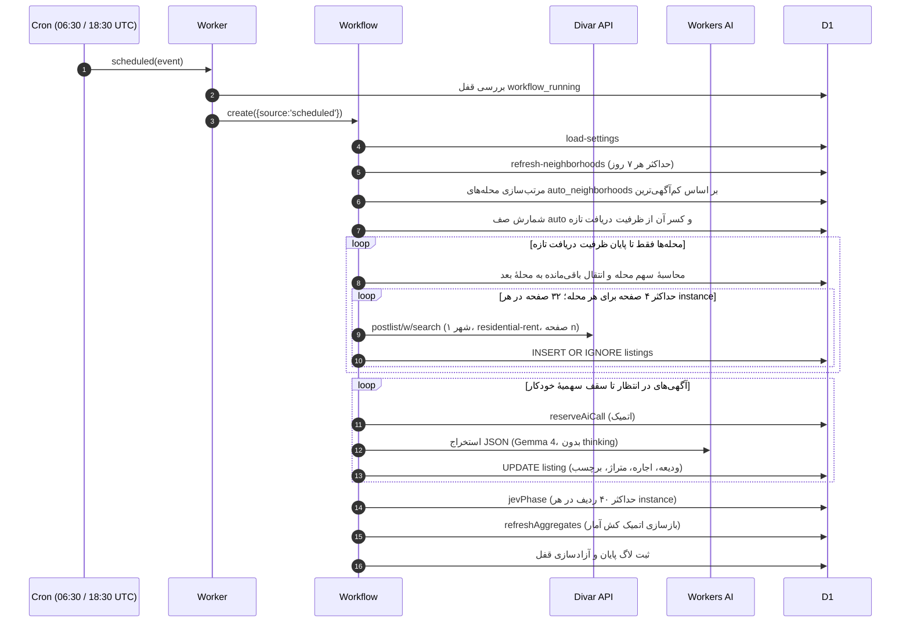

#### ۲) دریافت دستی یک محله
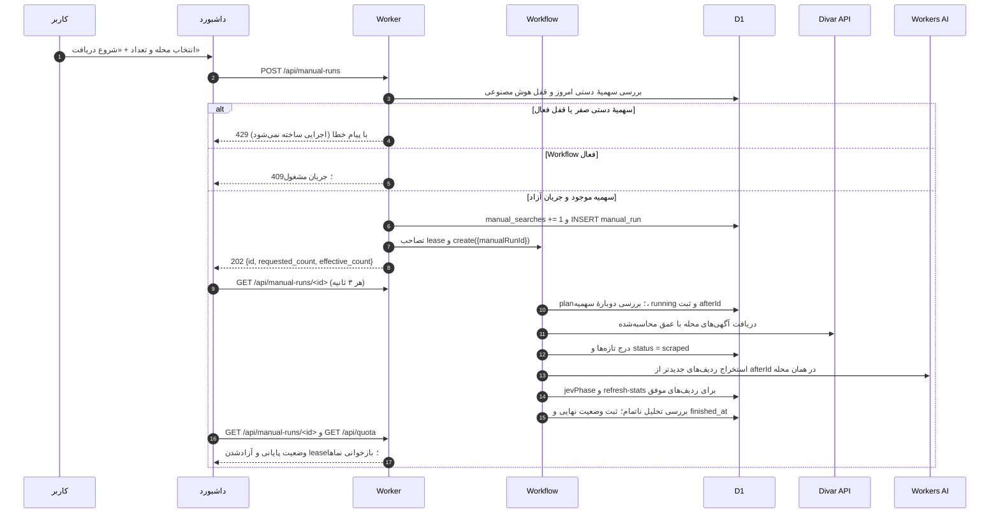

#### ۳) ذخیرهٔ تنظیمات
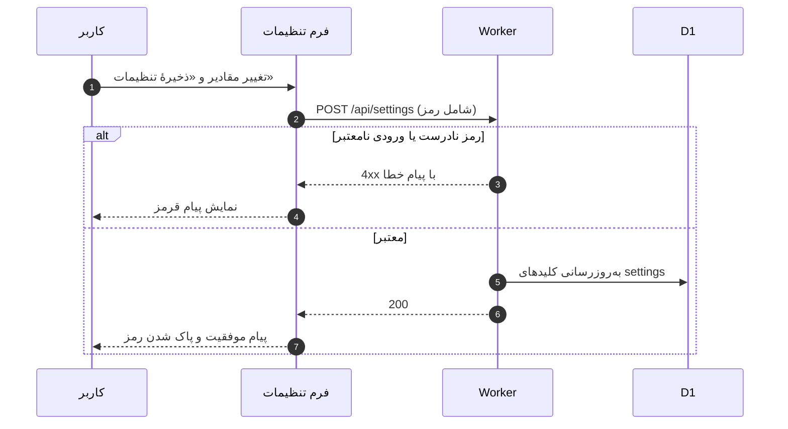

#### ۴) بارگذاری اولیهٔ داشبورد
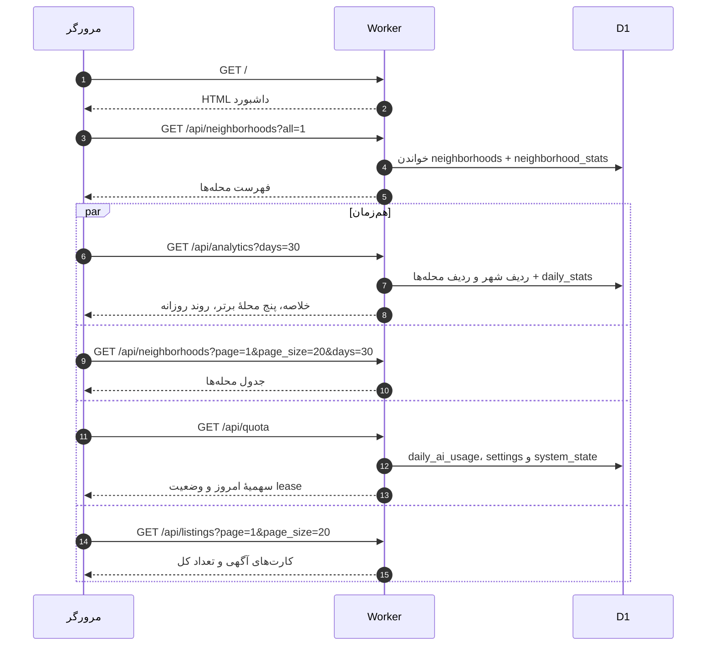

### مستندات کامل وب‌سرویس‌ها (RESTful API)

#### ۱. دریافت اطلاعات تحلیلی و نمودارها
- **متد**: `GET`
- **آدرس**: `/api/analytics`
- **پارامترها**:
  - `days` (اختیاری، پیش‌فرض: 30)
  - `neighborhood` (اسلاگ محله، اختیاری)
- **نمونهٔ خلاصه‌شدهٔ خروجی با اعداد فرضی** (فیلدهای `selected`، زمان کش و جزئیات محله‌های برتر برای اختصار حذف شده‌اند):
```json
{
  "days": 30,
  "overall": {
    "count": 1420,
    "fake_count": 45,
    "suspicious_count": 82,
    "hamkhane_count": 18,
    "average_deposit": 450000000,
    "median_deposit": 400000000,
    "median_rent": 12000000,
    "median_deposit_per_sqm": 5200000
  },
  "daily": [
    {"day": "2026-10-15", "median_deposit": 390000000},
    {"day": "2026-10-16", "median_deposit": 410000000}
  ]
}
```

#### ۲. دریافت لیست و آمار محله‌ها
- **متد**: `GET`
- **آدرس**: `/api/neighborhoods`
- **پارامترها**: `page`, `page_size`, `search`, `sort`, `order`, `all` (مقدار 1 برای همه)

#### ۳. جستجو و دریافت آگهی‌ها
- **متد**: `GET`
- **آدرس**: `/api/listings`
- **پارامترها**: `page`, `page_size`, `neighborhood`, `label`, `search`
- **برچسب‌ها**: `real`، `suspicious`، `fake`، `hamkhane`، `pending` و `failed`. دو مورد آخر فیلتر استخراج‌اند؛ هم‌خانه از سایر حالت‌های فهرست حذف می‌شود. `extracted_data` در پاسخ به شیء JSON تبدیل می‌شود.

#### ۴. ثبت درخواست دریافت دستی آگهی
- **متد**: `POST`
- **آدرس**: `/api/manual-runs`
- **بدنه درخواست**:
```json
{
  "neighborhood": "central-janat-abad",
  "count": 20
}
```
- **پاسخ موفق**: `{"id": "c1f3...", "status": "queued", "requested_count": 20, "effective_count": 15}` با کد 202. `effective_count` برابر کوچک‌ترین مقدار میان درخواست و سهمیهٔ دستی باقی‌مانده است.
- **پاسخ خطا**: JSON نامعتبر، `null`، آرایه، مقدار ساده یا تعداد نامعتبر `400`؛ محلهٔ ناموجود `404`؛ Workflow مشغول `409`؛ سهمیهٔ دستی صفر یا قفل AI فعال `429`. پیام خطا فارسی است.

#### ۵. استعلام وضعیت درخواست دستی
- **متد**: `GET`
- **آدرس**: `/api/manual-runs/{id}`
- **فیلدهای پاسخ**: `requested_count`، `fetched_count` (آگهی تازه)، `status`، `status_fa`، `error` و زمان شروع/پایان. وضعیت‌ها: `queued`, `running`, `scraped`, `complete`, `partial`, `empty`, `quota_exhausted`, `failed`.

#### ۶. استعلام سهمیه هوش مصنوعی
- **متد**: `GET`
- **آدرس**: `/api/quota`
- **خروجی**: سقف روز، مصرف کل/خودکار/دستی، `auto_limit`، `manual_limit`، `auto_remaining`، `manual_remaining`، `remaining`، `manual_searches`، قفل ارائه‌دهنده `quota_exhausted` و lease فعال `workflow_running`. قفل غیرفعال به معنی باقی‌ماندن سهم برنامه نیست.

#### ۷. دریافت و تغییر تنظیمات
- **متد**: `GET` و `POST`
- **آدرس**: `/api/settings`
- **نکته امنیتی در POST**: نیازمند ارسال `"settings_password": "1311"` در بدنه JSON. رمز نادرست `403` و JSON نامعتبر/بدنهٔ غیرشیء `400` دارد. این رمز ثابت جای احراز هویت کامل نیست.

#### ۸. خلاصهٔ آماری کل شهر
- **متد**: `GET`
- **آدرس**: `/api/stats`
- **خروجی**: همان قرارداد `overall` برای ۳۰ روز؛ در مسیر کش، فیلد `stats_computed_at` نیز برگردانده می‌شود و در مسیر زنده `null` است.

#### جدول کامل مسیرها

| مسیر | متد | شرح |
|---|---|---|
| `/api/analytics` | `GET` | خلاصه، پنج محلهٔ برتر و روند روزانه (`days`, `neighborhood`) |
| `/api/stats` | `GET` | خلاصهٔ آماری کل شهر برای ۳۰ روز |
| `/api/neighborhoods` | `GET` | آمار محله‌ها با جستجو، مرتب‌سازی و صفحه‌بندی (`page`, `page_size`, `search`, `sort`, `order`, `all`) |
| `/api/listings` | `GET` | آگهی‌ها با فیلتر `neighborhood`، `label`، `search` و صفحه‌بندی |
| `/api/manual-runs` | `POST` | ثبت درخواست دستی با بدنه `{"neighborhood":"<slug>","count":10}`؛ پاسخ `202` شامل `requested_count` و `effective_count`؛ در نبود سهمیه `429` |
| `/api/manual-runs/:id` | `GET` | وضعیت پیشرفت درخواست دستی و برچسب فارسی آن |
| `/api/quota` | `GET` | مصرف و باقی‌ماندهٔ سهمیهٔ روزانه (کل، خودکار، دستی) و وضعیت قفل |
| `/api/settings` | `GET`/`POST` | خواندن و به‌روزرسانی تنظیمات (POST با رمز) |
| `/api/logs` | `GET` | لاگ‌های سیستمی با فیلتر `service`، `status` و `limit` |
| `/api/discover-neighborhoods` | `POST` | همگام‌سازی اجباری و لحظه‌ای فهرست محله‌ها از دیوار |
| `/api/refresh` | `POST` | شروع زنجیرهٔ خودکار شامل صف (`202`)، یا `409` هنگام مشغول‌بودن؛ ممکن است AI مصرف کند و صرفاً خواندن آمار نیست |

---

## ۷. اعتبارسنجی و آزمون‌های صحت عملکرد (Verification)

### الف) آزمون‌های خودکار
در ویرایش حاضر `npm test` شامل **۵۷ آزمون: ۵۶ موفق، صفر شکست و یک آزمون زندهٔ غیرفعال** است. فایل‌ها: `chain.test.js`، `quota.test.js`، `rental-pricing.test.js`، `subrequest-budget.test.js` و `system-verification.test.js` در `test/`.
- سهم‌های ۸۰/۲۰، مرزهای تهران و UTC، محدودیت کل، رزرو پیش از ارسال و عدم قفل سراسری هنگام پایان سهم دستی.
- اولویت صف خودکار بر دریافت تازه، حذف تکراری پیش از محدودکردن تعداد، جداسازی درخواست دستی از صف قبلی و ادامهٔ جست‌وجوی دستی پس از چهار صفحهٔ تکراری.
- خطای صفحهٔ اول، ارزیابی ردیف‌های موفق پس از اتمام سهمیه، و عدم اعلام `complete` برای تحلیل ناتمام.
- بدنهٔ JSON نامعتبر، تنظیمات، فیلتر `failed`، لاگ‌ها، کرون و بازسازی آمار روی دیتابیس خالی.
- قالب‌های قدیمی/Chat Completion، نوع فیلدها، رد truncation/refusal/reasoning، کنترل درخواست Gemma و تبدیل قطعی رهن کامل.
- انتقال فاز، lease، شناسهٔ قطعی فرزند، توقف بدون پیشرفت و بودجهٔ محدود هر نمونه.

### ب) مرز آزمون یکپارچه
هارنس `system-verification.test.js` مسیریاب و Workflow واقعی را با SQL روی SQLite حافظه‌ای (`node:sqlite`) اجرا می‌کند. فقط کلاس‌های میزبان Cloudflare، زمان‌بندی گام‌های پایدار و سرویس‌های بیرونی جایگزین‌اند؛ این تست شبیه‌سازی کامل زیرساخت Cloudflare یا آزمون رندر مرورگر نیست. اجرای عادی شبکهٔ AI را فراخوانی نمی‌کند. مسیر هیوریستیک ارزیابی در این هارنس اجرا می‌شود؛ پاسخ زندهٔ TypeSafe Jev تضمین نمی‌شود.

### ج) آزمون زندهٔ مدل
شش نمونهٔ فارسی شامل ارقام فارسی/عربی، رهن کامل، تبدیل کامل مجاز، دو گزینهٔ محدود، مجهول‌ها و اتاق مشترک با پیکربندی نهایی Gemma موفق شدند. مصرف نمونه‌های کوتاه حدود ۶٫۶ تا ۸ Neuron بود. مقایسهٔ محدود Qwen 3.8 27B با prompt پیشین، reasoning کم و همان سقف ۷۶۸، حدود ۱۱۰ تا ۲۳۸ Neuron و سه شکست تطبیق، شامل دو پاسخ ناقص داشت. این مقایسه رتبه‌بندی عمومی مدل‌ها یا تضمین تعداد آگهی روزانه نیست.

آزمون `live Persian extraction fixtures` فقط با `EXTRACTION_LIVE_URL` فعال می‌شود و endpoint آزمایشی صریح روی `127.0.0.1` می‌خواهد: ورودی `{ model, listing }` و خروجی `{ facts, raw, elapsed_ms }`. چنین endpointی در برنامهٔ عادی وجود ندارد؛ Worker موقت مقایسه پس از بررسی حذف شده است. بازسازی آن و مصرف واقعی Neuron باید آگاهانه و جدا از `npm test` انجام شود. در بررسی عملیاتی ۲۰۲۶-۱۱-۱۷ نیز یک اجرای دوآگهی با Gemma تا استخراج و ارزیابی کامل تأیید شد؛ این گزارش تاریخی جای سنجش زندهٔ وضعیت فعلی را نمی‌گیرد.

### د) هشدار ایمنی داده‌ها
- `0001_neighborhood_first_rebuild.sql` مخرب و مخصوص بازسازی عمدی ساختار قدیمی است، نه استقرار عادی. روی دیتابیس عملیاتی بدون پشتیبان و تصمیم صریح برای حذف داده اجرا نشود؛ برای دیتابیس تازه از `schema.sql` استفاده کنید.
- بازصف‌گذاری شکست‌های قبلی عملیات نگهداری اختیاری است و صف و مصرف آینده را افزایش می‌دهد؛ فقط پس از بررسی SQL و سهمیه و تصمیم صریح اپراتور اجرا شود، نه برای تعویض مدل:
  ```bash
  npm run db:retry-failed-extractions
  ```

---

## ۸. راهنمای گام‌به‌گام راه‌اندازی و اجرای سامانه

### مرحله ۱: نیازمندی‌های سیستمی
- **Node.js 24 پیشنهاد می‌شود**؛ نسخهٔ تأییدشده 24.11.0 است. به دلیل `node:sqlite` و `registerHooks`، Node 20 کافی نیست؛ شاخهٔ 22 دست‌کم 22.15.0 می‌خواهد.
- ابزار مدیریت بسته **npm**.
- دسترسی به Cloudflare Workers Free، D1، Workflows و Workers AI؛ ارتقای پولی لازم نیست.

### مرحله ۲: نصب وابستگی‌ها
```bash
cd divar-housing-finder
npm ci
```

### مرحله ۳: اجرای آزمون‌های سلامت کد
```bash
npm test
```

### مرحله ۴: آماده‌سازی دیتابیس محلی (Local D1)
برای ایجاد جداول و داده‌های پایه در سیستم محلی خود:
```bash
npm run db:init-local
npm run db:seed-local
```
برای دیتابیس قدیمی، همهٔ مایگریشن‌ها را کورکورانه اجرا نکنید: `0001` مخرب، `0002` تغییردهندهٔ سهمیه به ۱۵۰ و رده‌بندی، `0003` بازصف‌گذار شکست‌ها، و `0004` تغییردهندهٔ سهمیه به ۵۰۰ است. فقط اگر جدول‌های کش وجود ندارند:
```bash
npm run db:migrate-precomputed-stats-local
```
اصلاحات صف، سهمیه و Gemma به مایگریشن تازه، پاک‌سازی داده یا افزایش سهمیه نیاز ندارند.

### مرحله ۵: اجرای محیط شبیه‌ساز سرورلس (Local Development)
برای راه‌اندازی سرور محلی و باز شدن داشبورد روی سیستم:
```bash
npm run dev
```
سامانه تحت آدرس محلی `http://localhost:8787` در دسترس خواهد بود. برای ساختن مجدد تصاویر مستندات (نیازمند `google-chrome`):
```bash
node scripts/capture-screenshots.js
```

### مرحله ۶: استقرار بر بستر ابری کلادفلر (Remote Deploy)
1. ورود به حساب کلادفلر:
   ```bash
   npx wrangler login
   ```
2. ایجاد پایگاه داده D1 در صورت نیاز:
   ```bash
   npx wrangler d1 create divar-housing-db
   ```
   (سپس مقدار شناسه `database_id` را در فایل `wrangler.jsonc` ثبت کنید).
3. فقط برای دیتابیس ابری جدید، ایجاد جداول و مقداردهی اولیه:
   ```bash
   npm run db:init
   npm run db:seed
   ```
   برای دیتابیس قدیمی فاقد جدول‌های آمار، مایگریشن افزایشی آمار را یک‌بار اجرا کنید:
   ```bash
   npm run db:migrate-precomputed-stats
   ```
4. مسیر عادی این مخزن push به `main` و انتشار خودکار Cloudflare است. فرمان زیر فقط جایگزین دستی است:
   ```bash
   npm run deploy
   ```
   > مایگریشن‌ها با push خودکار اجرا نمی‌شوند؛ برای تغییرات اخیر نیازی به اجرای آن‌ها نیست. پیش از آماده‌شدن نشانگر کش، خواندن آمار از مسیر زنده انجام می‌شود. داده‌ها، سهمیهٔ ذخیره‌شده و پلن Free را در استقرار عادی حفظ کنید.

### مرحلهٔ بعد: بازتولید PDF
منابع Markdown این ویرایش مرجع‌اند؛ PDFهای فعلی هنوز متن قبلی را دارند. پس از تأیید این مرحله، `npm run docs:pdf` و `npm run docs:ooad-pdf` به‌ترتیب PDF این سند و سند OOAD را می‌سازند. Chrome/Chromium لازم است و در صورت نبود مسیر اجرایی، `CHROME_PATH` تنظیم می‌شود. فونت‌ها و کتابخانه‌های رندر در اجرای نخست دریافت و در `.cache/docs-pdf/` ذخیره می‌شوند. در به‌روزرسانی حاضر این فرمان‌ها اجرا نشده‌اند.

---

## ۹. انطباق با سرفصل‌های پروژه

| سرفصل | محل پاسخ |
|---|---|
| **تعیین حوزهٔ کسب‌وکاری** | حوزهٔ «پایش بازار رهن و اجارهٔ مسکن و شناسایی آگهی‌های مشکوک» در بخش ۱ و تحلیل مسئله، اهداف و نیازمندی‌ها در بخش ۲ همین سند. |
| **تحلیل برای مدل داده‌ای و ساختار جداول** | بخش ۴: نمودار ER، روابط جداول، فرهنگ دادهٔ ۹ جدول، تحلیل الگوی خواندن/نوشتن و کش تحلیلی، و استراتژی ایندکس‌گذاری. اسکریپت اجرایی: `schema.sql` و `migrations/`. |
| **پیاده‌سازی با زبان انتخابی** | جاوااسکریپت (ES Modules) روی Cloudflare Workers با D1، Workflows و Workers AI؛ کد در `src/` و پیکربندی در `wrangler.jsonc`. |
| **سورس + راهنمای کاربردی + سند تحلیل و طراحی** | سورس کامل در مخزن؛ راهنمای کاربر در `README.md` و بخش ۸ همین سند (نصب، اجرا، دکمه‌ها، API)؛ سند تحلیل و طراحی همین فایل؛ تصاویر رابط کاربری در `docs/screenshots/`. |

---

## ۱۰. نتیجه‌گیری و افق‌های توسعه آتی

سامانه **خانه‌یاب دیوار** یک نمونه موفق از تلفیق سامانه‌های اطلاعاتی رابطه‌ای با مدل‌های هوش مصنوعی زبانی مدرن بر بستر معماری لبه‌ای سرورلس است. این سیستم با خودکارسازی کامل چرخه جمع‌آوری محله‌ها، زمان‌بندی دقیق در ساعات پربازدید روز، مدیریت سخت‌گیرانه سهمیه‌ها و حذف داده‌های نامربوط، دیدی واقع‌بینانه و شفاف از نبض بازار مسکن تهران را در اختیار متقاضیان و تحلیل‌گران قرار می‌دهد.

### پیشنهادات برای توسعه آتی:
1. **افزودن شهرهای دیگر**: گسترش سیستم برای پوشش سایر کلان‌شهرها نظیر مشهد، اصفهان، شیراز و تبریز با تغییر پارامتر `city_slug`.
2. **ارسال هشدار آنی در پیام‌رسان‌ها**: اتصال به ربات تلگرام یا وب‌هوک بله و ایتا برای آگاه‌سازی فوری از آگهی‌های ارزنده با قیمت مناسب.
3. **پیش‌بینی روند آتی قیمت‌ها**: افزودن ماژول رگرسیون زمانی برای پیش‌بینی میانگین ودیعه در ماه‌های آتی بر اساس سری‌های زمانی ثبت‌شده.

