# تحلیل و طراحی شی‌گرا برای زیرمجموعهٔ «دریافت دستی آگهی‌های یک محله»

**سامانهٔ خانه‌یاب تهران (Divar Housing Finder)**

**تهیه‌شده برای دانشگاه پیام نور – مرکز تهران شمال**

| مشخصه | مقدار |
|---|---|
| درس | مهندسی نرم‌افزار (۱۳۲۲۰۲۱) |
| استاد راهنما | بابک درویش روحانی |
| نسخهٔ سند | ۱.۰ |
| تاریخ | ۱۳ آبان ۱۴۰۵ / ۲۰۲۶-۱۱-۰۴ |
| روش | Pressman و Maxim، مهندسی نرم‌افزار: رویکردی عملی |
| دامنه | جریان دریافت دستی آگهی برای یک محله، از ثبت درخواست تا تحلیل و اعلام وضعیت |
| مخاطب | طراح و توسعه‌دهندهٔ سامانه، استاد و ارزیاب درس مهندسی نرم‌افزار |
| وضعیت پیاده‌سازی | پیاده‌سازی‌شده و قابل ردیابی در مخزن پروژه |

---

## ۱. انتخاب زیرمجموعه و مرز آن

### ۱.۱. چرا «دریافت دستی آگهی‌های یک محله»؟

سامانهٔ خانه‌یاب تهران چند کسب‌وکار فرعی دارد: دریافت خودکار زمان‌بندی‌شده، تحلیل و برچسب‌گذاری آگهی‌ها، داشبورد آماری، و دریافت دستی برای یک محله. زیرمجموعهٔ انتخاب‌شده، **دریافت دستی آگهی‌های یک محله** است؛ زیرا:

1. **مرز روشن دارد:** از کلیک کاربر روی «شروع دریافت» آغاز می‌شود و با یک وضعیت پایانی (`complete`، `partial`، `empty`، `quota_exhausted` یا `failed`) پایان می‌یابد.
2. **بازیگران متنوع دارد:** کاربر داشبورد، سرویس API، موتور Workflow، سامانهٔ دیوار، Workers AI و پایگاه دادهٔ D1 در آن مشارکت دارند.
3. **قواعد کسب‌وکار غنی دارد:** سهمیهٔ روزانهٔ هوش مصنوعی، تقسیم ۸۰/۲۰، عمق صفحه‌بندی، یکتایی آگهی، طبقه‌بندی هم‌خانه و محاسبهٔ معادل ودیعه.
4. **قابل ردیابی است:** هر گام آن به یک فایل، تابع یا آزمون مشخص در مخزن پروژه نگاشت می‌شود.

این زیرمجموعه از نظر ساختاری با مثال‌های کتاب هم‌خوان است:

| مثال در صورت تمرین | معادل در این پروژه |
|---|---|
| تعیین نام در فرآیند ثبت شرکت | ثبت درخواست دریافت دستی با اعتبارسنجی محله و تعداد |
| صدور سند حسابداری | ثبت اتمیک رکورد اجرا و رزرو مصرف هوش مصنوعی |
| عضویت در کتابخانه | چرخهٔ درخواست → بررسی اهلیت و سهمیه → ارائهٔ خدمت → اعلام وضعیت |

### ۱.۲. دامنهٔ داخل و خارج

| داخل دامنه | خارج دامنه |
|---|---|
| ثبت درخواست دریافت دستی از داشبورد | دریافت خودکار زمان‌بندی‌شده با Cron |
| اعتبارسنجی محله، تعداد و سهمیه | کشف و همگام‌سازی محله‌ها از سرویس مکان دیوار |
| اجرای Workflow دریافت و تحلیل | طراحی کامل داشبورد آماری و نمودارها |
| فراخوانی جست‌وجوی دیوار و تحلیل پاسخ | جزئیات الگوریتم کشف تقلب و وزن‌دهی JEV |
| ذخیرهٔ آگهی، حذف تکراری و طبقه‌بندی هم‌خانه | مدیریت هویت و احراز هویت کاربران |
| استخراج مشخصات با Workers AI | مدیریت زیرساخت Cloudflare و صورت‌حساب |
| محاسبهٔ معادل ودیعه و ارزیابی آگهی | اپلیکیشن موبایل یا کانال‌های توزیع دیگر |
| پایش وضعیت و گزارش خطا | |

### ۱.۳. واژه‌نامهٔ دامنه

| اصطلاح | معنا در این سند |
|---|---|
| محله | ناحیهٔ جغرافیایی فعال در جدول `neighborhoods` با `slug` یکتا |
| آگهی | رکوردی در جدول `listings` که با `divar_token` یکتا شناخته می‌شود |
| اجرای دستی | یک رکورد در `manual_runs` که درخواست کاربر را نمایندگی می‌کند |
| سهمیهٔ دستی | سهم مصرف هوش مصنوعی که برای درخواست‌های دستی رزرو شده است |
| `effective_count` | تعداد قابل پردازش در این نوبت: کمینهٔ تعداد درخواستی و سهمیهٔ دستی باقی‌مانده |
| استخراج | تبدیل متن آگهی به واقعیت‌های ساخت‌یافته با Workers AI |
| هم‌خانه | آگهی اشتراکی که اجارهٔ مستقل محسوب نمی‌شود و از آمار کنار گذاشته می‌شود |
| معادل ودیعه | ودیعه به‌علاوهٔ اجارهٔ ماهانه ضرب‌در ۱۰۰/۳ |
| قفل سهمیه | بازهٔ ۲۴ساعته‌ای که پس از خطای اتمام سهمیهٔ AI فعال می‌شود |

---

## ۲. ذی‌نفعان و نیازمندی‌ها

### ۲.۱. ذی‌نفعان

| ذی‌نفع | نوع | علاقه |
|---|---|---|
| بازدیدکنندهٔ داشبورد | کاربر اصلی | دریافت سریع آگهی‌های یک محله و مشاهدهٔ وضعیت |
| مالک و اپراتور سامانه | کاربر ثانویه | کنترل سهمیه، مشاهدهٔ خطاها، حفظ سلامت داده |
| سامانهٔ دیوار | سامانهٔ خارجی | پاسخ به جست‌وجوی آگهی و ارائهٔ ویجت‌های آگهی |
| Workers AI | سامانهٔ خارجی | استخراج واقعیت‌های ساخت‌یافته از متن فارسی |
| TypeSafe Jev | سامانهٔ خارجی اختیاری | ارزیابی کیفیت و واقع‌بودن قیمت |
| Cloudflare Workflow | زیرساخت اجرا | اجرای گام‌های مقاوم و قابل تکرار |
| D1 | زیرساخت داده | نگهداری محله‌ها، آگهی‌ها، اجراها، سهمیه و گزارش‌ها |

### ۲.۲. نیازمندی‌های کارکردی

| شناسه | نیازمندی | معیار پذیرش |
|---|---|---|
| FR-01 | دریافت محله و تعداد آگهی از داشبورد | فرم دارای فهرست محله‌ها و ورودی عددی است |
| FR-02 | اعتبارسنجی محلهٔ فعال | محلهٔ غیرفعال یا ناموجود با ۴۰۴ رد می‌شود |
| FR-03 | اعتبارسنجی تعداد | عدد صحیح بین ۱ تا ۵۰۰ پذیرفته می‌شود؛ در غیر این صورت ۴۰۰ |
| FR-04 | رد درخواست هنگام قفل موقت AI | پاسخ ۴۲۹ با پیام فارسی |
| FR-05 | محاسبهٔ سهمیهٔ دستی و رد در صورت اتمام | پاسخ ۴۲۹ با پیام فارسی |
| FR-06 | محاسبه و اعلام `effective_count` | مقدار برابر کمینهٔ درخواست و سهمیهٔ دستی باقی‌مانده |
| FR-07 | ثبت اتمیک شمارندهٔ جست‌وجوی دستی و رکورد اجرا | هر دو در یک `batch` انجام می‌شوند |
| FR-08 | راه‌اندازی Workflow با شناسهٔ یکتا | شناسه شامل زمان و UUID است |
| FR-09 | علامت‌گذاری اجرای ناموفق هنگام شکست راه‌اندازی | وضعیت `failed` و پیام خطا ثبت می‌شود |
| FR-10 | دریافت صفحه‌های دیوار تا سقف هدف | عمق صفحه از فرمول صفحه‌بندی محاسبه می‌شود |
| FR-11 | تحلیل ویجت‌های `POST` و `POST_ROW` و حذف تکراری | هر `divar_token` حداکثر یک بار در پاسخ |
| FR-12 | ذخیرهٔ آگهی با منبع `manual` و `extraction_done = 0` | رکورد در `listings` درج می‌شود |
| FR-13 | طبقه‌بندی هم‌خانه در زمان درج و پس از استخراج | `fake_label = 'hamkhane'` و `jev_done = 1` |
| FR-14 | استخراج مشخصات با Workers AI و رزرو اتمیک سهمیه | هر فراخوانی پیش از اجرا رزرو می‌شود |
| FR-15 | تعیین وضعیت نهایی اجرا | مطابق تابع `manualRunOutcome` |
| FR-16 | ارائهٔ وضعیت با برچسب فارسی و پایش دوره‌ای | داشبورد هر ۳ ثانیه وضعیت را می‌خواند |
| FR-17 | ثبت گزارش موفقیت و خطا | هر فراخوانی خارجی در `request_logs` ثبت می‌شود |
| FR-18 | ارزیابی آگهی‌های در انتظار و به‌روزرسانی آمار | پس از هر جریان، `evaluatePending` و `refresh-stats` اجرا می‌شوند |

### ۲.۳. نیازمندی‌های غیرکارکردی

| شناسه | نیازمندی | سنجه یا توضیح |
|---|---|---|
| NFR-01 | صحت محاسبات سهمیه | توابع خالص و آزمون واحد برای مرزهای ۸۰/۲۰ و ساعت ۲۲ |
| NFR-02 | کارایی و هزینهٔ فراخوانی | حداکثر ۳۰ آگهی در هر صفحه و حداکثر ۲۰ صفحه برای هر محله |
| NFR-03 | تاب‌آوری | استفاده از گام‌های Workflow، فاصلهٔ زمانی بین صفحه‌ها و قفل سهمیه |
| NFR-04 | یکتایی و خودتکراری‌ناپذیری | `UNIQUE(divar_token)` و `INSERT OR IGNORE` |
| NFR-05 | قابلیت مشاهده | گزارش درخواست‌ها، وضعیت اجرا و پیام‌های فارسی |
| NFR-06 | امنیت | داشبورد و API در حال حاضر احراز هویت ندارند؛ باید محدود شوند |
| NFR-07 | بومی‌سازی | رابط راست‌به‌چپ، ارقام فارسی، مبالغ به تومان |
| NFR-08 | قابلیت نگهداشت و آزمون | جدا بودن توابع دامنه از SQL و وجود آزمون‌های `node:test` |
| NFR-09 | کنترل هزینه | توقف پردازش هنگام اتمام سهمیه و رزرو پیش از فراخوانی |
| NFR-10 | یکپارچگی داده | کلید خارجی محله، وضعیت‌های مجاز و مهاجرت‌های نسخه‌دار |
| NFR-11 | دسترس‌پذیری رابط | غیرفعال‌شدن کنترل‌ها هنگام اتمام سهمیه و نمایش پیام جایگزین |
| NFR-12 | شفافیت خطا | نمایش خطا در کارت وضعیت و ثبت هم‌زمان در گزارش‌ها |

### ۲.۴. قواعد کسب‌وکار

| شناسه | قاعده |
|---|---|
| BR-01 | سقف روزانهٔ پیش‌فرض و حداکثر ۵۰۰ و حداقل ۳ فراخوانی AI است |
| BR-02 | سهم خودکار `floor(4L/5)` و سهم دستی `L − auto` است؛ برای ۵۰۰ یعنی ۴۰۰ و ۱۰۰ |
| BR-03 | اگر ساعت تهران ۲۲ یا بیشتر باشد و هیچ جست‌وجوی دستی ثبت نشده باشد، سهم خودکار به کل سقف گسترش می‌یابد |
| BR-04 | سهمیهٔ دستی باقی‌مانده برابر کمینهٔ «سهم دستی منهای مصرف دستی» و «کل سقف منهای کل مصرف» است |
| BR-05 | تعداد مؤثر هر درخواست از کمینهٔ تعداد درخواستی و سهمیهٔ دستی باقی‌مانده محاسبه می‌شود |
| BR-06 | عمق صفحه برابر `min(20, max(3, ceil(target/30) × 3))` است |
| BR-07 | هر آگهی با `divar_token` یکتا شناسایی می‌شود و درج تکراری نادیده گرفته می‌شود |
| BR-08 | آگهی با `property_type = 'room'` یا متن شامل «هم‌خانه، هماتاقی، اتاق مشترک، خانه مشترک، واحد مشترک» هم‌خانه است |
| BR-09 | معادل ودیعه برابر ودیعه به‌علاوهٔ اجاره ضرب‌در ۱۰۰/۳ است؛ در نبود هر دو، `price_toman` جایگزین می‌شود |
| BR-10 | آستانهٔ «مشکوک» ۰٫۶ و آستانهٔ «جعلی» ۰٫۸ است |
| BR-11 | هر درخواست دستی پذیرفته‌شده دقیقاً یک واحد `manual_searches` را افزایش می‌دهد |
| BR-12 | در هر لحظه فقط یک جریان دریافت در کل سامانه مجاز است |
| BR-13 | وضعیت‌های مجاز اجرا: `queued`، `running`، `scraped`، `complete`، `partial`، `empty`، `quota_exhausted`، `failed` |

---

## ۳. مدل‌سازی سناریومحور

### ۳.۱. بازیگران

| بازیگر | نوع | نقش |
|---|---|---|
| بازدیدکنندهٔ داشبورد | اصلی | انتخاب محله و تعداد، شروع دریافت، پایش وضعیت |
| مالک و اپراتور | اصلی | مشاهدهٔ گزارش‌ها و کنترل تنظیمات |
| موتور Workflow | پشتیبان | اجرای فاز دریافت، تحلیل و ارزیابی |
| سامانهٔ دیوار | خارجی | منبع آگهی‌ها و سرویس مکان |
| Workers AI | خارجی | استخراج مشخصات ساخت‌یافته |
| TypeSafe Jev | خارجی اختیاری | ارزیابی قیمت و نشانه‌های فریب |
| D1 | پشتیبان | ذخیره‌سازی و پایش وضعیت |

### ۳.۲. نمودار موارد کاربرد

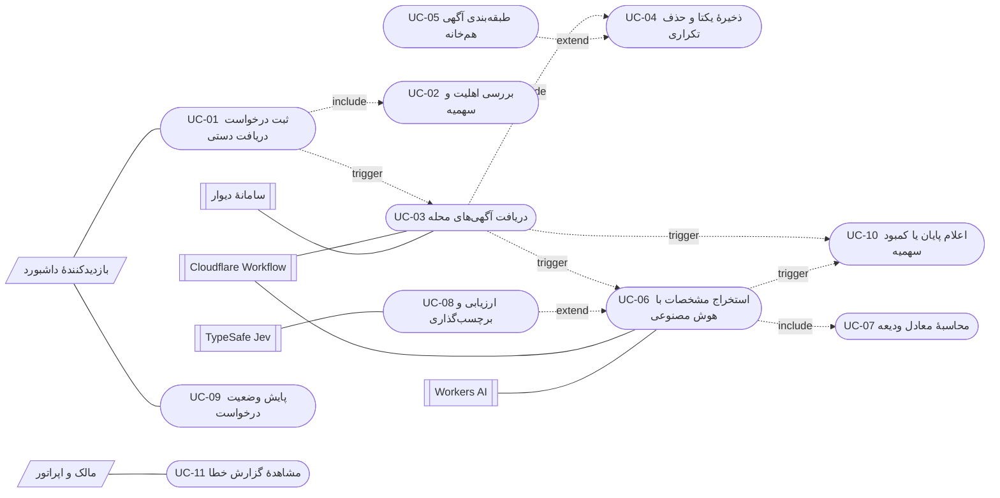

> در این نمودار، `include` و `extend` مطابق UML به کار رفته‌اند. فلش `trigger` یک قرارداد سند برای نشان‌دادن زنجیرهٔ رویداد غیرهم‌زمان بین موارد کاربرد است؛ در UML استاندارد، موارد کاربرد معمولاً فقط با `include`، `extend` یا تعمیم به هم مرتبط می‌شوند.

### ۳.۳. فهرست موارد کاربرد

| شناسه | نام | بازیگر اصلی | هدف | نتیجهٔ قابل مشاهده |
|---|---|---|---|---|
| UC-01 | ثبت درخواست دریافت دستی | بازدیدکننده | ایجاد یک اجرای دستی معتبر | رکورد `queued` و شناسهٔ اجرا |
| UC-02 | بررسی اهلیت و سهمیه | بازدیدکننده | جلوگیری از مصرف بیش از سهمیه | پذیرش با `effective_count` یا رد با ۴۲۹ |
| UC-03 | دریافت آگهی‌های محله | Workflow | جمع‌آوری آگهی‌های تازه | درج آگهی‌ها و وضعیت `scraped` یا `empty` |
| UC-04 | ذخیرهٔ یکتا و حذف تکراری | Workflow | جلوگیری از دادهٔ تکراری | حداکثر یک رکورد برای هر توکن |
| UC-05 | طبقه‌بندی آگهی هم‌خانه | Workflow | کنار گذاشتن اجارهٔ اشتراکی | برچسب `hamkhane` و خروج از آمار |
| UC-06 | استخراج مشخصات با هوش مصنوعی | Workflow | تبدیل متن به دادهٔ ساخت‌یافته | پر شدن مبلغ، متراژ، اتاق و `extracted_data` |
| UC-07 | محاسبهٔ معادل ودیعه | Workflow | مقایسه‌پذیر کردن آگهی‌ها | `deposit_equivalent_toman` |
| UC-08 | ارزیابی و برچسب‌گذاری | Workflow | تشخیص آگهی مشکوک یا جعلی | `fake_label`، `fake_score` و `fake_reason` |
| UC-09 | پایش وضعیت درخواست | بازدیدکننده | آگاهی از پیشرفت و پایان | کارت وضعیت با برچسب فارسی |
| UC-10 | اعلام پایان یا کمبود سهمیه | Workflow | بستن چرخهٔ اجرا | وضعیت پایانی و پیام متناسب |
| UC-11 | مشاهدهٔ گزارش خطا | مالک | عیب‌یابی فراخوانی‌ها | فهرست `request_logs` |

### ۳.۴. توصیف تفصیلی UC-01: ثبت درخواست دریافت دستی

| عنصر | مقدار |
|---|---|
| شناسه | UC-01 |
| بازیگر اصلی | بازدیدکنندهٔ داشبورد |
| بازیگران پشتیبان | API Worker، D1، Workflow |
| پیش‌شرط | داشبورد بارگذاری شده و فهرست محله‌های فعال در دسترس است |
| محرک | کلیک روی دکمهٔ «شروع دریافت» |
| پس‌شرط موفق | یک رکورد `manual_runs` با وضعیت `queued` ایجاد و Workflow آغاز شده است |
| پس‌شرط ناموفق | پیام خطای فارسی نمایش داده شده و هیچ اجرای نیمه‌کاره‌ای باقی نمانده است |

**جریان اصلی**

1. کاربر یک محله از فهرست انتخاب می‌کند و تعداد آگهی درخواستی را وارد می‌کند.
2. داشبورد وجود محله در فهرست محلی را بررسی می‌کند.
3. داشبورد تعداد را عدد صحیح بین ۱ تا ۵۰۰ بررسی می‌کند.
4. داشبورد از آخرین وضعیت سهمیه که هنگام باز شدن تب دریافت دستی خوانده شده استفاده می‌کند و از مثبت‌بودن سهمیهٔ دستی مطمئن می‌شود.
5. داشبورد بررسی می‌کند تعداد درخواستی از سهمیهٔ دستی باقی‌مانده بیشتر نباشد.
6. داشبورد `POST /api/manual-runs` را با بدنهٔ `{ neighborhood, count }` می‌فرستد.
7. API وجود محلهٔ فعال را در D1 بررسی می‌کند.
8. API وضعیت قفل موقت AI را بررسی می‌کند.
9. API سهمیهٔ دستی را با `aiCallBudgets` محاسبه می‌کند.
10. API مقدار `effective_count` را محاسبه می‌کند.
11. API در یک `batch` شمارندهٔ `manual_searches` را افزایش می‌دهد و رکورد اجرا را با وضعیت `queued` درج می‌کند.
12. API با شناسهٔ یکتا Workflow را آغاز می‌کند و پاسخ `202` شامل `id`، `status` و `effective_count` برمی‌گرداند.
13. داشبورد پیام «در صف» را نمایش می‌دهد و پایش دوره‌ای را آغاز می‌کند.

**جریان‌های جایگزین و استثنا**

| گام | شرط | واکنش |
|---|---|---|
| 2 | محله انتخاب نشده یا نامعتبر است | پیام «یک محلهٔ معتبر انتخاب کنید» و پایان |
| 3 | تعداد خارج از بازه است | پیام «تعداد باید بین ۱ تا ۵۰۰ باشد» و پایان |
| 4 | سهمیهٔ دستی صفر است | پیام اتمام سهمیه، غیرفعال‌شدن کنترل‌ها و پایان |
| 5 | تعداد از سهمیه بیشتر است | پیام «سهمیهٔ دستی باقی‌مانده امروز …» و پایان |
| 7 | محلهٔ فعال پیدا نشد | پاسخ ۴۰۴ و پیام «محله پیدا نشد» |
| 8 | قفل موقت AI فعال است | پاسخ ۴۲۹ و پیام «سهمیهٔ هوش مصنوعی موقتاً قفل شده است» |
| 9 | سهمیهٔ دستی صفر است | پاسخ ۴۲۹ و پیام اتمام سهمیه |
| 11 | درج رکورد یا افزایش شمارنده شکست بخورد | خطای پایگاه داده و پاسخ ۵۰۰ |
| 12 | آغاز Workflow شکست بخورد | رکورد اجرا `failed` می‌شود و خطا به کاربر برمی‌گردد |

**نکتهٔ طراحی:** اعتبارسنجی سهمیه در دو لایه انجام می‌شود: داشبورد برای تجربهٔ کاربری بهتر و API برای امنیت و صحت. لایهٔ سرویس هرگز به اعتبارسنجی سمت کلاینت اعتماد نمی‌کند.

### ۳.۵. توصیف تفصیلی UC-02: بررسی اهلیت و سهمیه

| عنصر | مقدار |
|---|---|
| شناسه | UC-02 |
| بازیگر اصلی | بازدیدکننده (به‌صورت `include` در UC-01) |
| پیش‌شرط | سقف روزانه از تنظیمات خوانده شده است |
| محرک | درخواست ثبت اجرای دستی |
| پس‌شرط | یا درخواست با سهمیهٔ کافی پذیرفته می‌شود یا با پیام مشخص رد می‌شود |

**الگوریتم**

```text
L = سقف روزانه (پیش‌فرض ۵۰۰)
A = floor(4 × L / 5)
M = L − A

اگر hour ≥ 22 و manual_searches = 0:
    A_late = L
در غیر این صورت:
    A_late = A

remaining        = max(0, L − total_calls)
auto_remaining   = max(0, A_late − auto_calls)
manual_remaining = max(0, min(M − manual_calls, L − total_calls))

اگر manual_remaining = 0: درخواست با ۴۲۹ رد می‌شود
در غیر این صورت:
    effective_count = min(requested_count, manual_remaining)
```

**جریان‌های استثنا**

| شرط | پاسخ |
|---|---|
| قفل `ai_quota_until` فعال است | ۴۲۹؛ «سهمیهٔ هوش مصنوعی موقتاً قفل شده است» |
| سهمیهٔ دستی صفر است | ۴۲۹؛ «سهمیهٔ دریافت دستی امروز تمام شده است» |
| تعداد درخواستی از سهمیه بیشتر است | پذیرش با `effective_count` کمتر و اعلام آن به کاربر |

**قاعدهٔ وابسته:** افزایش `manual_searches` در لحظهٔ پذیرش انجام می‌شود، نه در لحظهٔ پایان دریافت. این تصمیم برای جلوگیری از رزرو هم‌زمان چند درخواست است، اما اثر جانبی دارد: یک درخواست ناموفق هم سهم خودکار شبانه را آزاد نمی‌کند.

### ۳.۶. توصیف تفصیلی UC-03: دریافت آگهی‌های محله

| عنصر | مقدار |
|---|---|
| شناسه | UC-03 |
| بازیگر اصلی | موتور Workflow |
| بازیگران پشتیبان | سامانهٔ دیوار، D1 |
| پیش‌شرط | رکورد اجرا وجود دارد و وضعیت آن `running` شده است |
| محرک | آغاز شاخهٔ `manual` در `DivarScrapeWorkflow.run` |
| پس‌شرط | آگهی‌های تازه درج شده و وضعیت `scraped`، `empty` یا `failed` ثبت شده است |

**جریان اصلی**

1. Workflow شناسهٔ عددی محله را از `slug` یا شناسهٔ عددی موجود استخراج می‌کند.
2. تعداد صفحه‌ها را با `listingPagesFor(target)` محاسبه می‌کند.
3. برای هر صفحه تا سقف محاسبه‌شده و تا رسیدن به هدف:
   1. درخواست `POST` به `https://api.divar.ir/v8/postlist/w/search` با شهر `1`، دستهٔ `residential-rent`، فیلتر ناحیه و صفحهٔ جاری می‌فرستد.
   2. پاسخ خام را در گزارش درخواست ثبت می‌کند.
   3. ویجت‌های `POST` و `POST_ROW` را استخراج و بر اساس `divar_token` یکتا می‌کند.
   4. عنوان، توضیح، تصویر، محله و سیگنال‌های قیمت را از ویجت بیرون می‌کشد.
   5. فقط به اندازهٔ باقی‌ماندهٔ هدف، آگهی‌های تازه را با `INSERT OR IGNORE` درج می‌کند.
   6. اگر هنوز به هدف نرسیده و صفحهٔ پر (۳۰ آگهی) دریافت شده باشد، یک ثانیه صبر و صفحهٔ بعد را می‌گیرد؛ در غیر این صورت متوقف می‌شود.
4. اگر حداقل یک جست‌وجو انجام شده باشد، `last_scraped_at` محله را به‌روزرسانی می‌کند.
5. اگر اجرا دستی باشد، `fetched_count` و وضعیت موقت (`scraped` یا `empty`) را ثبت می‌کند.
6. نتیجه شامل تعداد درج‌شده، تعداد دریافت‌شده و پرچم شکست را برمی‌گرداند.

**جریان‌های استثنا**

| شرط | واکنش |
|---|---|
| پاسخ HTTP ناموفق | ثبت خطا در `request_logs`، بازگشت `null`، شکست فاز دریافت و وضعیت `failed` |
| JSON نامعتبر | مانند خطای HTTP |
| خطای شبکه یا استثنا | ثبت خطا با وضعیت `0` و شکست فاز دریافت |
| پاسخ بدون ویجت آگهی | توقف صفحه و در نهایت وضعیت `empty` |
| همهٔ آگهی‌های صفحه تکراری باشند | حلقه تا سقف صفحه ادامه می‌یابد و ممکن است به هدف نرسد |

**نکتهٔ طراحی:** نام `fetched_count` در پایگاه داده در واقع تعداد **درج‌شده** را نگه می‌دارد، نه تعداد خام دریافت‌شده. این اختلاف نام‌گذاری در بخش نقد طراحی بررسی شده است.

### ۳.۷. توصیف تفصیلی UC-06: استخراج مشخصات با هوش مصنوعی

| عنصر | مقدار |
|---|---|
| شناسه | UC-06 |
| بازیگر اصلی | موتور Workflow |
| بازیگران پشتیبان | Workers AI، D1 |
| پیش‌شرط | حداقل یک آگهی تازه درج شده و سهمیهٔ AI در دسترس است |
| محرک | فراخوانی `extractPending` با منبع `manual` |
| پس‌شرط | آگهی‌های پردازش‌شده `extraction_done = 1` و آگهی‌های غیرقابل استخراج `extraction_done = -1` دارند |

**جریان اصلی**

1. Workflow بررسی می‌کند قفل سراسری سهمیه فعال نباشد.
2. مصرف امروز را از `daily_ai_usage` می‌خواند و سقف منبع را محاسبه می‌کند.
3. آگهی‌های `extraction_done = 0` با منبع `manual` و محدود به محلهٔ اجرا را به ترتیب جدیدترین انتخاب می‌کند.
4. برای هر آگهی، پیش از فراخوانی مدل، یک فراخوانی را با `UPDATE` شرطی رزرو می‌کند.
5. متن عنوان، توضیح و محله را به مدل `@cf/qwen/qwen3-30b-a3b-fp8` می‌فرستد و خروجی JSON می‌خواهد.
6. خروجی را اعتبارسنجی و به فیلدهای قیمت، ودیعه، اجاره، متراژ، اتاق، نوع ملک و نشانه‌های فریب تبدیل می‌کند.
7. معادل ودیعه را محاسبه و رکورد آگهی را به‌روزرسانی می‌کند.
8. اگر آگهی هم‌خانه باشد، برچسب و دلیل را ثبت و `jev_done` را یک می‌کند.
9. بین فراخوانی‌ها ۵۰۰ میلی‌ثانیه صبر می‌کند.

**جریان‌های استثنا**

| شرط | واکنش |
|---|---|
| رزرو سهمیه ممکن نیست | توقف حلقه با `quota_locked = true` |
| خطای ۴۰۰۶ یا «سهمیهٔ رایگان روزانه» | فعال‌سازی قفل ۲۴ساعته و بازگشت `quota_exhausted` |
| خطای «تعداد زیردرخواست بیش از حد» | بازگشت `subrequest_limit` و توقف مرگبار |
| آگهی متن قابل استخراج ندارد | `extraction_done = -1` و ادامهٔ حلقه |
| سایر خطاهای مدل | ثبت خطا و ادامه؛ آگهی برای تلاش بعدی باقی می‌ماند |

### ۳.۸. توصیف تفصیلی UC-09: پایش وضعیت درخواست

| عنصر | مقدار |
|---|---|
| شناسه | UC-09 |
| بازیگر اصلی | بازدیدکننده |
| پیش‌شرط | شناسهٔ اجرا در داشبورد موجود است |
| محرک | پاسخ `202` یا پایش دوره‌ای |
| پس‌شرط | وضعیت نهایی نمایش داده شده و داده‌های آماری بازخوانی شده‌اند |

**جریان اصلی**

1. داشبورد `GET /api/manual-runs/{id}` را می‌فرستد.
2. API رکورد اجرا را همراه نام محله می‌خواند.
3. API برچسب فارسی وضعیت را به پاسخ اضافه می‌کند.
4. داشبورد تعداد درخواستی، تعداد دریافت‌شده، وضعیت و خطا را نمایش می‌دهد.
5. اگر وضعیت `queued`، `running` یا `scraped` باشد، سه ثانیه بعد دوباره پرس‌وجو می‌کند.
6. در وضعیت پایانی، داشبورد خلاصهٔ آماری، جدول محله‌ها و فهرست آگهی‌ها را بازخوانی می‌کند.

**برچسب‌های وضعیت**

| وضعیت | برچسب فارسی |
|---|---|
| `queued` | در صف |
| `running` | در حال اجرا |
| `scraped` | در حال تحلیل |
| `complete` | کامل شد |
| `partial` | کمتر از درخواست دریافت شد |
| `empty` | آگهی تازه‌ای پیدا نشد |
| `quota_exhausted` | سهمیهٔ دریافت دستی امروز تمام شده است |
| `failed` | ناموفق |

### ۳.۹. موارد کاربرد پشتیبان

| شناسه | نام | مسئول | خلاصه |
|---|---|---|---|
| UC-04 | ذخیرهٔ یکتا و حذف تکراری | مخزن آگهی | درج با `INSERT OR IGNORE` و کلید یکتای `divar_token` |
| UC-05 | طبقه‌بندی هم‌خانه | طبقه‌بند هم‌خانه | بررسی نوع ملک و الگوهای متنی، ثبت برچسب و خروج از آمار مستقل |
| UC-07 | محاسبهٔ معادل ودیعه | ارزش‌گذاری ودیعه | ودیعه + اجاره × ۱۰۰/۳ با جایگزینی `price_toman` در نبود هر دو |
| UC-08 | ارزیابی و برچسب‌گذاری | ارزیاب آگهی | انتخاب JEV در صورت وجود کلید یا روش ابتکاری، محاسبهٔ امتیاز و برچسب |
| UC-10 | اعلام پایان یا کمبود سهمیه | حل‌کنندهٔ نتیجه | تعیین وضعیت پایانی از تعداد درج‌شده و پرچم قفل سهمیه |
| UC-11 | مشاهدهٔ گزارش خطا | گزارش‌گیر درخواست | ثبت و خواندن رویدادهای موفق و ناموفق هر سرویس |

---

## ۴. مدل‌سازی کلاس‌محور

### ۴.۱. استخراج کلاس‌های کاندید از نیازمندی‌ها

| عبارت یا اسم | منبع | دستهٔ تحلیل | تصمیم |
|---|---|---|---|
| محله | FR-02، BR-06 | موجودیت | کلاس `Neighborhood` |
| آگهی | FR-11، FR-12، BR-07 | موجودیت | کلاس `Listing` |
| اجرای دستی | FR-07، FR-15 | موجودیت | کلاس `ManualRun` |
| مصرف روزانهٔ AI | FR-05، BR-02 | موجودیت | کلاس `DailyAiUsage` |
| سهمیه | FR-05، BR-04 | شیء مقدار | کلاس `QuotaBudget` |
| گزارش درخواست | FR-17 | موجودیت | کلاس `RequestLog` |
| تنظیمات | BR-01، BR-10 | موجودیت پیکربندی | کلاس `Setting` |
| داشبورد | UC-01، UC-09 | مرزی | کلاس `DashboardPage` |
| API دریافت دستی | UC-01 | مرزی | کلاس `ManualRunApi` |
| سامانهٔ دیوار | UC-03 | مرزی خارجی | کلاس `DivarSearchClient` |
| Workers AI | UC-06 | مرزی خارجی | کلاس `AiExtractor` |
| TypeSafe Jev | UC-08 | مرزی خارجی | کلاس `JevEvaluator` |
| Workflow | UC-03، UC-06 | کنترلی | کلاس `WorkflowOrchestrator` |
| ویجت آگهی | UC-03 | شیء انتقال داده | کلاس `ListingDraft` |
| توکن آگهی | BR-07 | صفت | صفت `divarToken` در `Listing` |
| صفحه | BR-06 | صفت/پارامتر | صفت `page` در درخواست جست‌وجو |
| تایمر پایش | UC-09 | مکانیزم | بخشی از `DashboardPage`، کلاس مستقل نیست |

کلاس‌های تحلیل در سه ردهٔ کلاسیک Pressman دسته‌بندی می‌شوند:

| رده | کلاس‌ها | نقش |
|---|---|---|
| موجودیت | `Neighborhood`، `Listing`، `ManualRun`، `DailyAiUsage`، `RequestLog`، `Setting` | دادهٔ پایدار و قواعد محلی |
| مرزی | `DashboardPage`، `ManualRunApi`، `DivarSearchClient`، `AiExtractor`، `JevEvaluator` | ارتباط با کاربر یا سامانهٔ خارجی |
| کنترلی | `ManualRunService`، `WorkflowOrchestrator`، `QuotaPolicy`، `OutcomeResolver` | هماهنگی جریان و تصمیم‌گیری |

### ۴.۲. نمودار کلاس دامنه

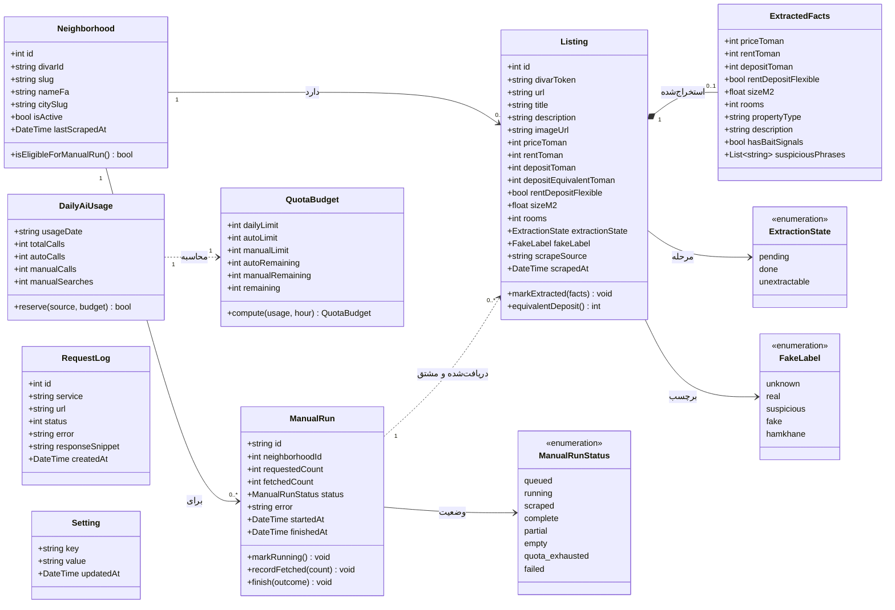

**توضیح رابطهٔ مشتق:** در پیاده‌سازی فعلی، جدول `listings` ستون `manual_run_id` ندارد. رابطهٔ `ManualRun` با `Listing` از روی محله، منبع `manual` و بازهٔ زمانی استنتاج می‌شود. این رابطه در نمودار با خط‌چین و برچسب «مشتق» نشان داده شده است. برای ردیابی دقیق، افزودن کلید خارجی پیشنهاد می‌شود.

### ۴.۳. نمودار کلاس طراحی و خدمات

برای خوانایی چاپ، نمودار طراحی به پنج بستهٔ مسئولیتی تقسیم شده است: چهار بستهٔ نمودار کلاس و یک بستهٔ جدول مسئولیت. کلاس‌های مشترک مانند `ListingRepository` در هر بسته‌ای که همکار آن هستند تکرار شده‌اند تا هر نمودار مستقل خوانده شود.

#### ۴.۳.۱. بستهٔ خدمات کاربرد

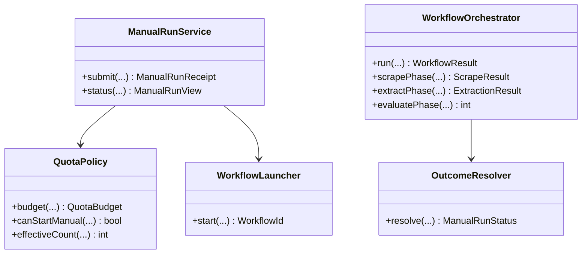

`ManualRunService` برای رزرو سهمیه، درج اجرا و ثبت مصرف به مخازن بستهٔ ۴.۳.۲ وابسته است. `WorkflowOrchestrator` نیز سه سرویس فاز را از بسته‌های ۴.۳.۳ تا ۴.۳.۵ فراخوانی می‌کند.

#### ۴.۳.۲. بستهٔ مخازن و زیرساخت

این پنج کلاس همکار سرویس‌های نمودار ۴.۳.۱ و فازهای دریافت، استخراج و ارزیابی هستند. `RunRepository` و `UsageRepository` وضعیت اجرا و مصرف را نگه می‌دارند، `NeighborhoodRepository` اهلیت محله را می‌خواند، `WorkflowLock` انحصار اجرا را تأمین می‌کند و `RequestLogger` خطاهای مرزهای خارجی را ثبت می‌کند. چون میان این کلاس‌ها وابستگی مستقیمی نیست، برای صرفه‌جویی در فضای چاپ به‌جای نمودار کلاس، جدول مسئولیت آمده است؛ خود کلاس‌ها در نمودار بسته‌هایی که آن‌ها را فراخوانی می‌کنند دیده می‌شوند.

| کلاس | مسئولیت | عملیات کلیدی |
|---|---|---|
| `RunRepository` | درج و بازیابی اجرای دستی و به‌روزرسانی وضعیت آن | `create`، `find`، `updateStatus` |
| `UsageRepository` | رزرو اتمی فراخوانی AI و شمارش جست‌وجوی دستی روز | `reserveCall`، `incrementManualSearch` |
| `NeighborhoodRepository` | خواندن محلهٔ فعال بر اساس نامک و ثبت زمان دریافت | `findActiveBySlug`، `markScraped` |
| `WorkflowLock` | تأمین انحصار اجرا تا دو Workflow هم‌زمان شروع نشوند | `acquire`، `release` |
| `RequestLogger` | ثبت پاسخ‌های موفق و خطاهای مرزهای خارجی | `success`، `error` |

#### ۴.۳.۳. بستهٔ دریافت

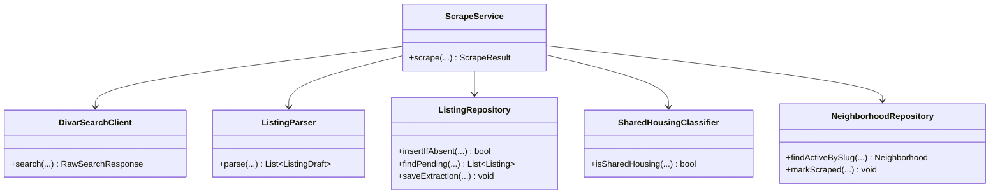

#### ۴.۳.۴. بستهٔ استخراج

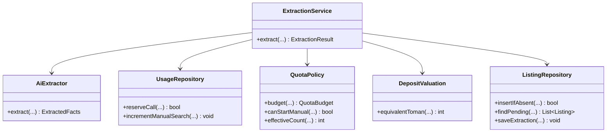

#### ۴.۳.۵. بستهٔ ارزیابی

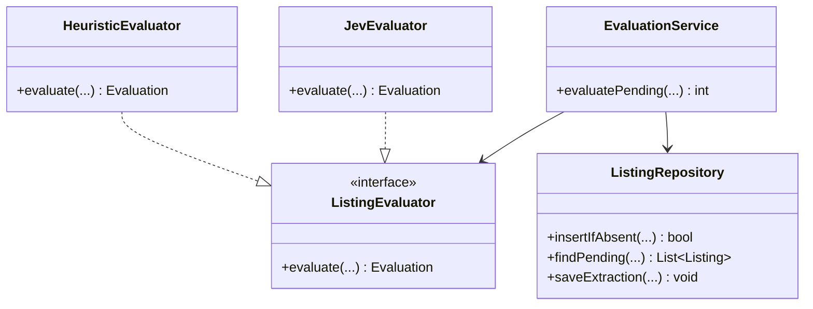

### ۴.۴. روابط و چندگانگی

| رابطه | چندگانگی | توضیح | وضعیت در پیاده‌سازی |
|---|---|---|---|
| `Neighborhood` → `Listing` | ۱ به ۰..* | هر محله چند آگهی دارد | کلید خارجی `neighborhood_id` |
| `Neighborhood` → `ManualRun` | ۱ به ۰..* | هر محله چند اجرای دستی دارد | کلید خارجی `neighborhood_id` |
| `ManualRun` → `Listing` | ۱ به ۰..* | آگهی‌های همان اجرا | مشتق؛ بدون کلید خارجی |
| `Listing` → `ExtractedFacts` | ۱ به ۰..۱ | واقعیت‌های استخراج‌شده | ستون JSON `extracted_data` |
| `DailyAiUsage` → `QuotaBudget` | ۱ به ۱ | محاسبهٔ سهمیه در هر درخواست | شیء مقدار محاسبه‌شده، بدون جدول |
| `Setting` → `QuotaPolicy` | ۱ به ۱ | سقف و آستانه‌ها از تنظیمات می‌آیند | جدول کلید-مقدار |
| `RequestLog` → سرویس | ۰..* به ۱ | هر سرویس چند گزارش دارد | ستون `service` |
| `Neighborhood` → `neighborhood_stats` | ۱ به ۰..* | آمار پیش‌محاسبه‌شده | جدول کش، خارج از دامنهٔ اصلی |

### ۴.۵. کارت‌های CRC

| کلاس | مسئولیت‌ها | همکاران |
|---|---|---|
| `ManualRun` | نگهداری شناسه، محله، تعداد درخواستی، تعداد دریافت‌شده و وضعیت؛ اعمال گذارهای مجاز؛ ثبت خطا و زمان پایان | `RunRepository`، `ManualRunStatus`، `WorkflowOrchestrator` |
| `Neighborhood` | نگهداری هویت محله و وضعیت فعال؛ اعلام اهلیت برای اجرای دستی؛ ثبت زمان آخرین دریافت | `NeighborhoodRepository`، `ScrapeService` |
| `Listing` | نگهداری هویت آگهی، مبالغ، مشخصات فیزیکی و وضعیت استخراج؛ محاسبهٔ معادل ودیعه | `ExtractedFacts`، `DepositValuation`، `SharedHousingClassifier` |
| `ExtractedFacts` | نگهداری خروجی ساخت‌یافتهٔ مدل زبانی و نشانه‌های فریب | `AiExtractor`، `Listing` |
| `QuotaBudget` | محاسبهٔ سهم خودکار و دستی، باقی‌ماندهٔ کل و باقی‌ماندهٔ هر منبع؛ تصمیم اهلیت | `DailyAiUsage`، `QuotaPolicy` |
| `DailyAiUsage` | نگهداری مصرف روزانه و شمارندهٔ جست‌وجوی دستی؛ رزرو اتمیک فراخوانی | `UsageRepository`، `QuotaBudget` |
| `DivarSearchClient` | ساخت درخواست جست‌وجو، افزودن هدرهای مرورگر، ارسال و بازگرداندن پاسخ خام؛ ثبت خطا | `ListingParser`، `RequestLogger` |
| `ListingParser` | استخراج ویجت‌های آگهی، نرمال‌سازی ارقام فارسی، استخراج سیگنال‌های ودیعه و اجاره، حذف تکراری | `DivarSearchClient`، `ListingDraft` |
| `AiExtractor` | ساخت پیام مدل، درخواست JSON، تبدیل خروجی به `ExtractedFacts`، تشخیص خطاهای سهمیه و زیردرخواست | `ExtractionService`، `RequestLogger` |
| `SharedHousingClassifier` | تشخیص هم‌خانه از نوع ملک یا الگوهای متنی با تحمل فاصله و نویسهٔ اتصال | `Listing`، `ScrapeService` |
| `DepositValuation` | تبدیل اجارهٔ ماهانه به معادل ودیعه با نسبت ۱۰۰/۳ و جایگزینی قیمت کل | `Listing` |
| `ListingEvaluator` | قرارداد مشترک ارزیابی آگهی و تولید امتیاز، برچسب و دلیل | `JevEvaluator`، `HeuristicEvaluator` |
| `WorkflowOrchestrator` | ترتیب‌دهی فازهای دریافت، استخراج و ارزیابی؛ مدیریت وضعیت اجرا؛ آزادسازی قفل در پایان | `ScrapeService`، `ExtractionService`، `EvaluationService`، `RunRepository` |
| `RequestLogger` | ثبت رویداد موفق یا ناموفق با سرویس، نشانی، وضعیت و قطعهٔ پاسخ | همهٔ مرزهای خارجی |

### ۴.۶. ناورداهای کلاس‌ها

| شناسه | ناوردا |
|---|---|
| INV-01 | `Listing.divarToken` در کل جدول یکتاست |
| INV-02 | `ManualRun.requestedCount` بین ۱ و ۵۰۰ است |
| INV-03 | `effective_count` هرگز از `requestedCount` و از `manualRemaining` بیشتر نیست |
| INV-04 | همهٔ شمارنده‌های مصرف و دریافت نامنفی‌اند |
| INV-05 | `ManualRun.status` فقط یکی از هشت وضعیت مجاز است |
| INV-06 | `manualRemaining` هرگز از `remaining` کل بیشتر نیست |
| INV-07 | آگهی `hamkhane` از آمار اجارهٔ مستقل و ارزیابی JEV کنار گذاشته می‌شود |
| INV-08 | `depositEquivalentToman` از ودیعهٔ خالص کمتر نیست |
| INV-09 | در هر لحظه حداکثر یک جریان دریافت در وضعیت اجرا وجود دارد |
| INV-10 | هر درخواست پذیرفته‌شده دقیقاً یک واحد `manual_searches` را افزایش می‌دهد |

---

<div class="page-break"></div>

## ۵. مدل‌سازی رفتارمحور

### ۵.۱. نمودار فعالیت اعتبارسنجی سمت مرورگر

این نمودار بررسی‌های محلی داشبورد پیش از ارسال درخواست را نشان می‌دهد. هر شاخهٔ خطا به وضعیت پایانی خودش می‌رسد تا نمودار برای چاپ فشرده بماند.

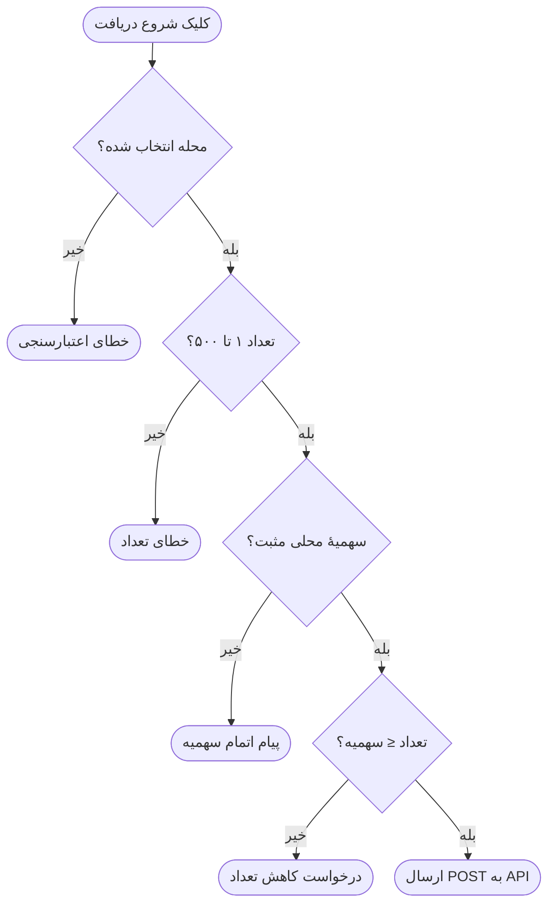

### ۵.۲. نمودار فعالیت پذیرش درخواست در API

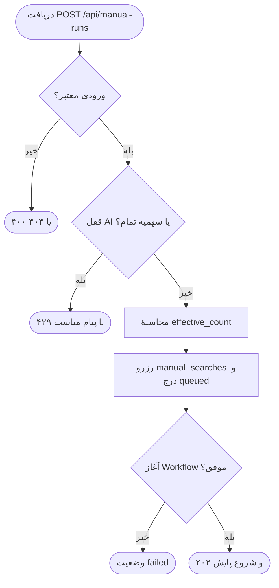

### ۵.۳. نمودار فعالیت اجرای Workflow

#### ۵.۳.۱. فاز دریافت آگهی‌ها

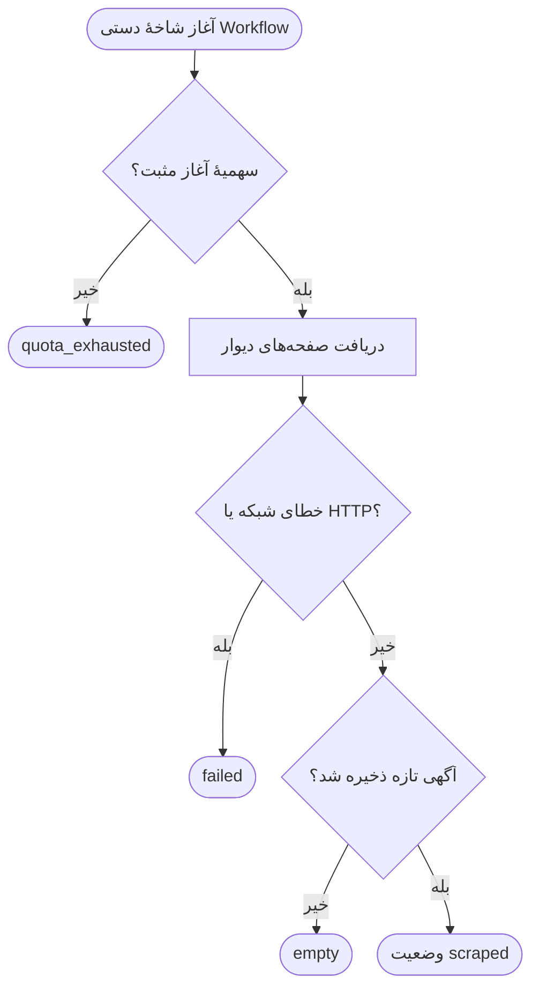

#### ۵.۳.۲. فاز استخراج

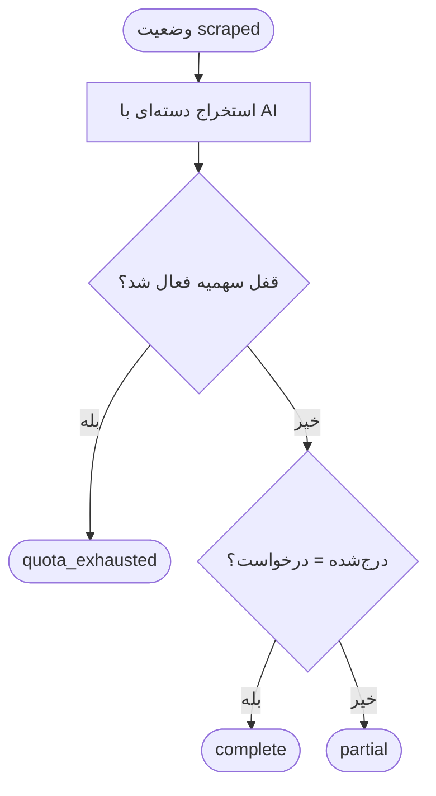

### ۵.۴. نمودار توالی ثبت درخواست و پایش وضعیت

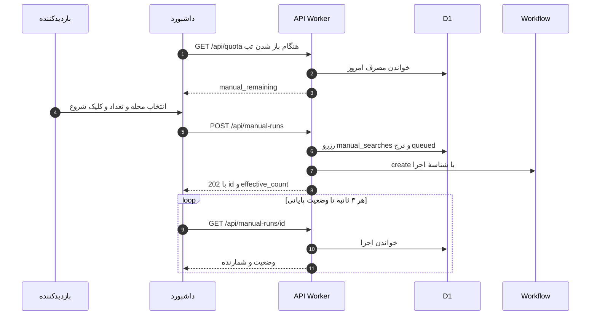

### ۵.۵. نمودار توالی اجرای Workflow و استخراج

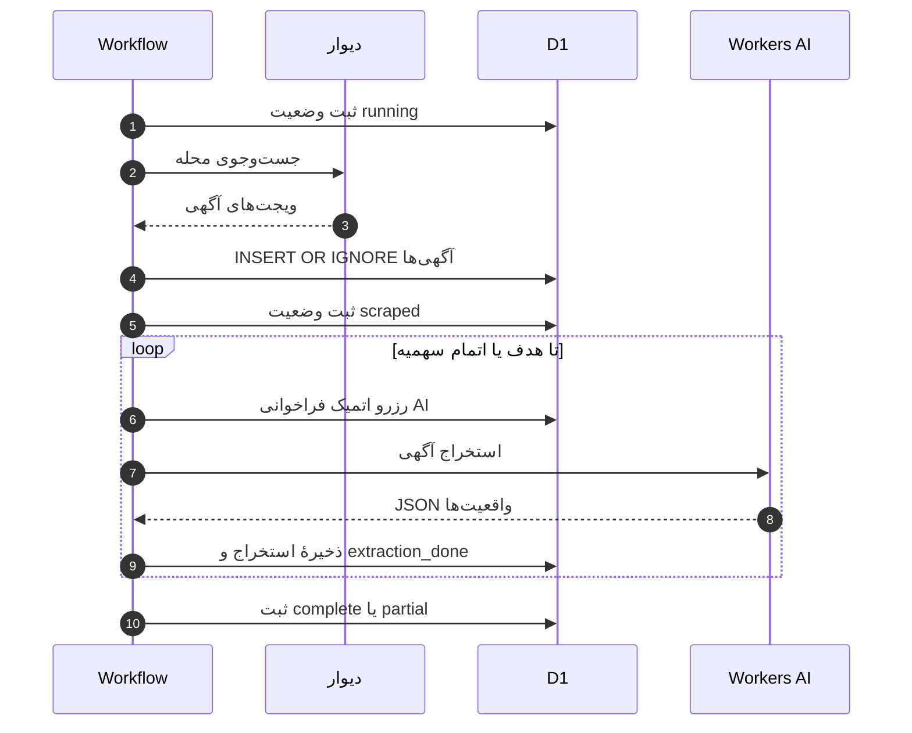

### ۵.۶. نمودار توالی رد درخواست به دلیل اتمام سهمیه

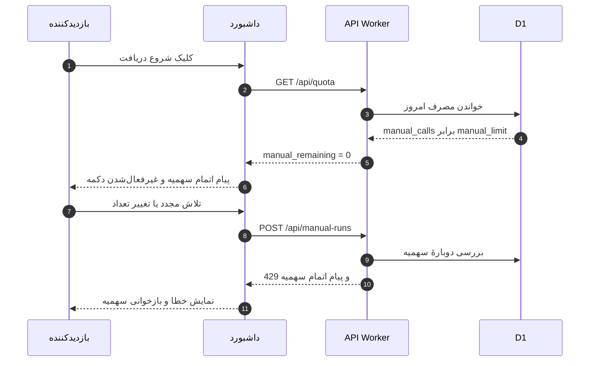

### ۵.۷. نمودار توالی اتمام سهمیه در میانهٔ استخراج

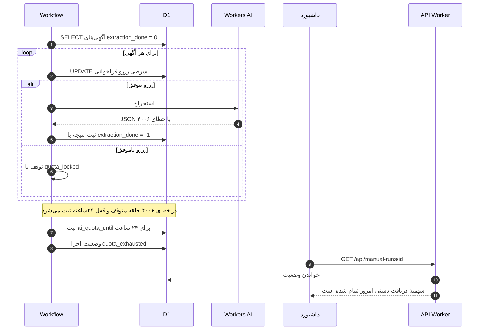

### ۵.۸. ماشین حالت `ManualRun`

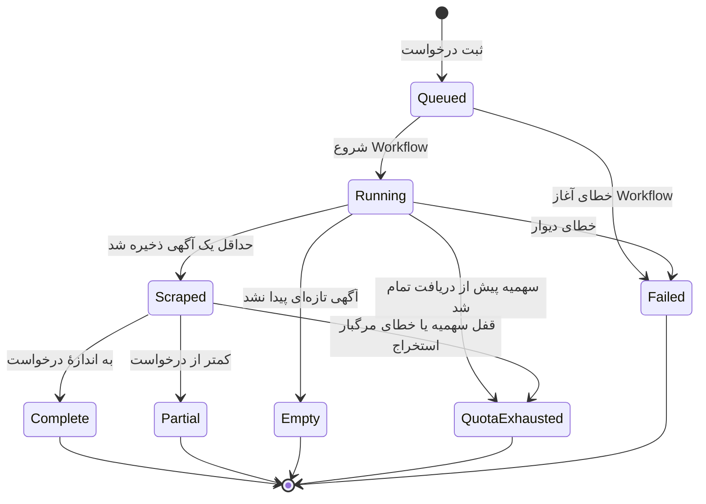

### ۵.۹. جدول وضعیت‌ها و گذارها

| وضعیت | معنا | پیش‌نیاز ورود | گذارهای خروج |
|---|---|---|---|
| `queued` | درخواست ثبت شده و منتظر آغاز Workflow است | درج موفق رکورد | `running`، `failed` |
| `running` | شاخهٔ دستی Workflow آغاز شده است | بارگذاری موفق اجرا | `scraped`، `empty`، `failed`، `quota_exhausted` |
| `scraped` | حداقل یک آگهی ذخیره شده و تحلیل در جریان است | نتیجهٔ مثبت فاز دریافت | `complete`، `partial`، `quota_exhausted` |
| `complete` | تعداد درج‌شده به تعداد درخواستی رسیده است | پایان تحلیل بدون قفل سهمیه | پایانی |
| `partial` | تعداد درج‌شده کمتر از درخواست است | پایان تحلیل بدون قفل سهمیه | پایانی |
| `empty` | آگهی تازه‌ای پیدا نشد | جست‌وجو انجام شد ولی درجی نداشت | پایانی |
| `quota_exhausted` | سهمیهٔ دستی یا AI در دسترس نیست | رد رزرو یا خطای ۴۰۰۶ | پایانی |
| `failed` | خطای دیوار، شبکه یا آغاز Workflow | شکست فاز دریافت یا راه‌اندازی | پایانی |

> **نکتهٔ پیاده‌سازی:** خطای مرگبار استخراج (مانند محدودیت زیردرخواست) در پیاده‌سازی فعلی با قفل سهمیه یکی گرفته می‌شود و به وضعیت `quota_exhausted` می‌رسد. تفکیک این دو حالت در بخش نقد طراحی پیشنهاد شده است.

---

## ۶. طراحی شی‌گرا

### ۶.۱. معماری لایه‌ای

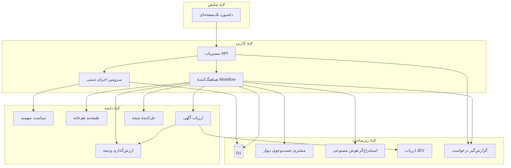

### ۶.۲. مسئولیت مؤلفه‌ها

| مؤلفه | لایه | مسئولیت | فایل مرجع |
|---|---|---|---|
| داشبورد | نمایش | فرم دریافت دستی، نمایش سهمیه، پایش وضعیت | `src/dashboard.js` |
| مسیریاب API | کاربرد | اعتبارسنجی ورودی، پاسخ‌های ۴۰۰/۴۰۴/۴۲۹، قرارداد JSON | `src/index.js` |
| سرویس اجرای دستی | کاربرد | محاسبهٔ سهمیه، ثبت اتمیک، آغاز Workflow | `src/index.js` و `src/quota.js` |
| هماهنگ‌کنندهٔ Workflow | کاربرد | ترتیب فازها، مدیریت قفل و وضعیت پایانی | `src/workflow.js` |
| مشتری دیوار | زیرساخت | ساخت و ارسال درخواست جست‌وجو، ثبت پاسخ خام | `src/scraper.js` |
| تحلیل‌گر پاسخ | دامنه | استخراج ویجت‌ها، نرمال‌سازی ارقام، سیگنال قیمت | `src/scraper.js` |
| استخراج‌گر AI | زیرساخت | فراخوانی مدل، اعتبارسنجی JSON، تشخیص خطا | `src/extractor.js` |
| طبقه‌بند هم‌خانه | دامنه | تشخیص آگهی اشتراکی از متن و نوع ملک | `src/listing-classification.js` |
| ارزش‌گذاری ودیعه | دامنه | محاسبهٔ معادل ودیعه با نسبت ۱۰۰/۳ | `src/rental-pricing.js` |
| ارزیاب آگهی | دامنه | انتخاب JEV یا روش ابتکاری و تولید برچسب | `src/jev.js` |
| سیاست سهمیه | دامنه | محاسبهٔ بودجه، عمق صفحه و نتیجهٔ اجرا | `src/quota.js` |
| گزارش‌گیر | زیرساخت | ثبت موفقیت و خطا در `request_logs` | `src/utils.js` |
| مخازن D1 | زیرساخت | خواندن و نوشتن محله، آگهی، اجرا، مصرف و تنظیمات | `schema.sql` و کوئری‌های ماژول‌ها |

### ۶.۳. الگوهای طراحی به‌کاررفته

| الگو | محل کاربرد | چرا |
|---|---|---|
| Repository | کوئری‌های D1 در API و Workflow | جداسازی منطق دامنه از جزئیات SQL و امکان آزمون |
| Adapter | `DivarSearchClient` و `AiExtractor` | تبدیل رابط خارجی ناهمگون به مدل دامنه |
| Strategy | `ListingEvaluator` با دو پیاده‌سازی JEV و ابتکاری | انتخاب الگوریتم در زمان اجرا بر اساس وجود کلید |
| Value Object | `QuotaBudget` و معادل ودیعه | جلوگیری از محاسبهٔ تکراری و تضمین ناورداها |
| Policy / Guard | `QuotaPolicy` و `WorkflowLock` | تمرکز قواعد سهمیه و هم‌زمانی در یک نقطه |
| Template Method / Orchestration | گام‌های `step.do` در Workflow | ترتیب ثابت فازها با اجرای مقاوم و قابل تکرار |
| Idempotent Repository | `INSERT OR IGNORE` و `UNIQUE(divar_token)` | جلوگیری از درج تکراری در اجرای مجدد |
| Circuit Breaker | `ai_quota_until` | توقف فراخوانی‌های AI پس از اتمام سهمیه |
| DTO | بدنهٔ درخواست و پاسخ API | جداسازی قرارداد بیرونی از موجودیت‌های داخلی |
| Polling | پایش وضعیت در داشبورد | سادگی و سازگاری با محیط بدون WebSocket |

### ۶.۴. طراحی داده و نگاشت کلاس به جدول

| کلاس | جدول | کلید | ستون‌های کلیدی | محدودیت |
|---|---|---|---|---|
| `ManualRun` | `manual_runs` | `id` (UUID) | `neighborhood_id`، `requested_count`، `fetched_count`، `status`، `error`، `started_at`، `finished_at` | کلید خارجی محله |
| `Listing` | `listings` | `id` | `divar_token`، مبالغ، متراژ، اتاق، `extraction_done`، `fake_label`، `scrape_source` | `UNIQUE(divar_token)` |
| `ExtractedFacts` | `listings.extracted_data` | همان رکورد | JSON خروجی مدل | متن JSON |
| `Neighborhood` | `neighborhoods` | `id` | `divar_id`، `slug`، `name_fa`، `is_active`، `last_scraped_at` | `UNIQUE(slug)` |
| `DailyAiUsage` | `daily_ai_usage` | `usage_date` | `total_calls`، `auto_calls`، `manual_calls`، `manual_searches` | یک رکورد در روز |
| `QuotaBudget` | بدون جدول | — | مقدار مشتق در هر درخواست | شیء مقدار |
| `RequestLog` | `request_logs` | `id` | `service`، `url`، `status`، `error`، `response_snippet` | ایندکس زمان |
| `Setting` | `settings` | `key` | `value`، `updated_at` | کلید-مقدار |
| `WorkflowLock` | `system_state` | `key = 'workflow_running'` | `value` | یک رکورد |
| قفل سهمیه | `system_state` | `key = 'ai_quota_until'` | `value` (زمان epoch) | یک رکورد |

### ۶.۵. قراردادهای API

| متد و مسیر | ورودی | خروجی موفق | خطاهای اصلی |
|---|---|---|---|
| `GET /api/quota` | — | سقف، مصرف، سهم خودکار و دستی، باقی‌مانده، وضعیت قفل | ۵۰۰ |
| `POST /api/manual-runs` | `{ neighborhood, count }` | `202 { id, status, requested_count, effective_count }` | ۴۰۰، ۴۰۴، ۴۲۹، ۵۰۰ |
| `GET /api/manual-runs/{id}` | شناسهٔ UUID | `{ id, requested_count, fetched_count, status, status_fa, error, ... }` | ۴۰۴، ۵۰۰ |
| `GET /api/neighborhoods` | صفحه، جست‌وجو، مرتب‌سازی | فهرست محله‌ها و آمار | ۵۰۰ |
| `GET /api/listings` | صفحه، جست‌وجو، محله، برچسب | فهرست آگهی‌ها | ۵۰۰ |
| `GET /api/logs` | سرویس، وضعیت، حد | فهرست گزارش‌ها | ۵۰۰ |

**نمونهٔ درخواست و پاسخ**

```json
POST /api/manual-runs
{ "neighborhood": "central-janat-abad", "count": 40 }
```

```json
202 Accepted
{
  "id": "0f1e2d3c-4b5a-6978-8c9d-0a1b2c3d4e5f",
  "status": "queued",
  "requested_count": 40,
  "effective_count": 40
}
```

### ۶.۶. طراحی هم‌زمانی و خودتکراری‌ناپذیری

| مکانیزم | محل | رفتار |
|---|---|---|
| کلید یکتای توکن | `listings.divar_token` | درج تکراری بی‌اثر است |
| `INSERT OR IGNORE` | `scrapeNeighborhood` | اجرای مجدد همان صفحه دادهٔ تکراری ایجاد نمی‌کند |
| قفل جریان | `system_state.workflow_running` | از اجرای هم‌زمان دو جریان جلوگیری می‌کند |
| رزرو شرطی AI | `UPDATE daily_ai_usage ... WHERE total_calls < ?` | شمارنده هرگز از سقف عبور نمی‌کند |
| قفل ۲۴ساعته | `system_state.ai_quota_until` | پس از خطای اتمام سهمیه، فراخوانی‌ها متوقف می‌شوند |
| `batch` ثبت درخواست | `src/index.js` | افزایش شمارنده و درج اجرا با هم انجام می‌شوند |

**ریسک باقی‌مانده:** قفل `workflow_running` تاریخ انقضا ندارد. اگر اجرای Workflow پیش از رسیدن به بلوک `finally` از بین برود، قفل ممکن است برای همیشه یک بماند. پیشنهاد: ذخیرهٔ زمان آغاز و آزادسازی خودکار پس از یک بازهٔ مشخص.

### ۶.۷. طراحی خطا و مشاهده‌پذیری

| خطا | تشخیص | واکنش | اثر قابل مشاهده |
|---|---|---|---|
| HTTP ناموفق دیوار | `!response.ok` | ثبت گزارش، شکست فاز دریافت | وضعیت `failed` |
| JSON نامعتبر | استثنای `JSON.parse` | ثبت گزارش، شکست فاز دریافت | وضعیت `failed` |
| خطای شبکه | بلوک `catch` | ثبت گزارش با وضعیت `0` | وضعیت `failed` |
| شکست آغاز Workflow | استثنای `create` | به‌روزرسانی اجرا به `failed` | خطای API |
| اتمام سهمیهٔ AI | خطای ۴۰۰۶ | ثبت `ai_quota_until` و توقف | `quota_exhausted` |
| محدودیت زیردرخواست | متن خطا | توقف مرگبار | در پیاده‌سازی فعلی `quota_exhausted` |
| آگهی غیرقابل استخراج | نبود متن کافی | `extraction_done = -1` | آگهی از صف خارج می‌شود |
| خطای موقت مدل | سایر خطاها | ثبت و ادامه | آگهی برای تلاش بعدی می‌ماند |
| محلهٔ نامعتبر | جست‌وجوی D1 | پاسخ ۴۰۴ | پیام «محله پیدا نشد» |
| تعداد نامعتبر | اعتبارسنجی ورودی | پاسخ ۴۰۰ | پیام بازهٔ مجاز |

### ۶.۸. طراحی امنیت و بهره‌برداری

| موضوع | وضعیت فعلی | ارزیابی | پیشنهاد |
|---|---|---|---|
| احراز هویت داشبورد | ندارد | هر بازدیدکننده می‌تواند درخواست دستی ثبت کند | Cloudflare Access یا ورود مدیر |
| رمز تنظیمات | مقدار ثابت در کد | قابل خواندن در مخزن و رابط | Secret محیطی و ذخیرهٔ هش‌شده |
| محافظت از سهمیه | فقط منطق سهمیه | درخواست‌های تکراری سهم دستی را مصرف می‌کنند | محدودیت نرخ و کلید ایدمپوتنسی |
| CSRF | بدون توکن | با نبود احراز هویت، اثر محدود است | پس از افزودن احراز هویت، توکن CSRF |
| تزریق SQL | کوئری‌های پارامتری | محافظت‌شده | حفظ الگوی فعلی |
| مرتب‌سازی پویا | نگاشت سفید ستون‌ها | ایمن | حفظ الگوی فعلی |
| دادهٔ حساس | متن آگهی عمومی | ریسک کم | سیاست نگهداری گزارش‌ها |

### ۶.۹. طراحی کارایی و هزینه

| تصمیم | اثر |
|---|---|
| حداکثر ۳۰ آگهی در هر صفحه | تعداد درخواست‌ها را کنترل می‌کند |
| حداکثر ۲۰ صفحه برای هر محله | از حلقهٔ بی‌پایان جلوگیری می‌کند |
| حداقل ۳ صفحه | شانس رسیدن به هدف‌های کوچک را افزایش می‌دهد |
| فاصلهٔ یک‌ثانیه‌ای بین صفحه‌ها | فشار به سرویس دیوار را کاهش می‌دهد |
| فاصلهٔ ۵۰۰میلی‌ثانیه‌ای بین فراخوانی‌های AI | نرخ درخواست را هموار می‌کند |
| انتخاب جدیدترین آگهی‌ها در اجرای دستی | نتیجهٔ مرتبط با درخواست کاربر |
| انتخاب قدیمی‌ترین آگهی‌ها در اجرای خودکار | کاهش گرسنگی داده در صف |
| آمار پیش‌محاسبه‌شده | جلوگیری از اسکن مکرر جدول بزرگ آگهی‌ها |

---

## ۷. ماتریس ردیابی

| نیازمندی | مورد کاربرد | کلاس‌های مسئول | پیاده‌سازی | آزمون |
|---|---|---|---|---|
| FR-01، FR-02 | UC-01 | `DashboardPage`، `ManualRunApi`، `NeighborhoodRepository` | `startManual` در `src/dashboard.js`؛ مسیر `POST /api/manual-runs` در `src/index.js` | شکاف |
| FR-03 | UC-01 | `ManualRunApi` | اعتبارسنجی `count` در `src/index.js` | شکاف |
| FR-04، FR-05 | UC-02 | `QuotaPolicy`، `ManualRunApi` | `isAiLocked` و `aiCallBudgets` در `src/index.js` و `src/quota.js` | `test/quota.test.js` |
| FR-06 | UC-02 | `QuotaPolicy` | `effectiveCount` در `src/index.js` | شکاف |
| FR-07 | UC-01 | `UsageRepository`، `RunRepository` | `batch` در `src/index.js` | شکاف |
| FR-08، FR-09 | UC-01 | `WorkflowLauncher`، `WorkflowLock` | `startWorkflow` در `src/index.js` | شکاف |
| FR-10 | UC-03 | `ScrapeService`، `QuotaPolicy` | `listingPagesFor` و `scrapeNeighborhood` | `test/quota.test.js` |
| FR-11 | UC-03 | `DivarSearchClient`، `ListingParser` | `fetchListingsPage` و `extractListingsFromApiResponse` در `src/scraper.js` | `test/rental-pricing.test.js` |
| FR-12 | UC-03 | `ListingRepository` | `INSERT OR IGNORE` در `src/workflow.js` | شکاف |
| FR-13، BR-08 | UC-05 | `SharedHousingClassifier` | `isSharedHousingListing` در `src/listing-classification.js` | `test/rental-pricing.test.js` |
| FR-14 | UC-06 | `AiExtractor`، `UsageRepository` | `extractPending` در `src/workflow.js` و `extractListingData` در `src/extractor.js` | شکاف |
| FR-15 | UC-10 | `OutcomeResolver` | `manualRunOutcome` در `src/quota.js` | `test/quota.test.js` |
| FR-16 | UC-09 | `DashboardPage`، `ManualRunApi` | `pollManual` در `src/dashboard.js`؛ مسیر `GET /api/manual-runs/{id}` | شکاف |
| FR-17 | UC-11 | `RequestLogger` | `logError` و `logSuccess` در `src/utils.js` | شکاف |
| FR-18 | UC-08 | `EvaluationService`، `ListingEvaluator` | `evaluatePending` و `evaluateListing` | شکاف |
| BR-09 | UC-07 | `DepositValuation` | `depositEquivalentToman` در `src/rental-pricing.js` | `test/rental-pricing.test.js` |
| BR-02، BR-03، BR-04 | UC-02 | `QuotaPolicy` | `aiCallBudgets` در `src/quota.js` | `test/quota.test.js` و `test/system-verification.test.js` |

**جمع‌بندی آزمون‌ها:** سه فایل آزمون و ۱۹ آزمون واحد وجود دارد. پوشش محاسبات خالص سهمیه، قیمت‌گذاری، طبقه‌بندی هم‌خانه و تحلیل پاسخ دیوار مناسب است؛ اما مسیرهای API، پایش وضعیت، استخراج AI و ارزیابی JEV آزمون خودکار ندارند. این شکاف‌ها در بخش نقد طراحی فهرست شده‌اند.

---

## ۸. نقد طراحی و بهبودهای پیشنهادی

| اولویت | مسئله | شاهد در کد | پیشنهاد |
|---|---|---|---|
| بالا | نداشتن احراز هویت و رمز ثابت تنظیمات | داشبورد عمومی؛ مقایسهٔ رمز با رشتهٔ ثابت در کد | Cloudflare Access، Secret محیطی، ذخیرهٔ هش رمز |
| بالا | نبود کلید ایدمپوتنسی برای درخواست دستی | هر `POST` یک اجرای جدید می‌سازد | پذیرش `Idempotency-Key` و بازگرداندن اجرای موجود |
| بالا | مصرف `manual_searches` حتی در شکست آغاز Workflow | `batch` پیش از `startWorkflow` | افزایش شمارنده پس از آغاز موفق یا جبران در خطا |
| متوسط | نبود رابطهٔ صریح اجرا و آگهی | `listings` ستون `manual_run_id` ندارد | افزودن کلید خارجی و ایندکس |
| متوسط | ذخیره‌نشدن `effective_count` | فقط `requested_count` در جدول است | افزودن ستون `effective_count` |
| متوسط | یکسان‌انگاشتن «تعداد دریافت» و «تعداد تحلیل‌شده» | `manualRunOutcome` فقط `inserted` را می‌سنجد | تفکیک وضعیت دریافت و تحلیل یا افزودن شمارندهٔ تحلیل |
| متوسط | نگاشت خطای زیردرخواست به اتمام سهمیه | `fatal_error` در `extractPending` با `quota_locked` یکی می‌شود | تفکیک `fatal_error` و وضعیت `failed` |
| پایین | نام‌گذاری گمراه‌کنندهٔ `fetched_count` | مقدار درج‌شده ذخیره می‌شود | تغییر نام به `inserted_count` یا اصلاح معنای ستون |
| پایین | قفل جریان بدون انقضا | `workflow_running` فقط صفر/یک است | ذخیرهٔ زمان و آزادسازی خودکار |
| پایین | نبود آزمون برای API و استخراج | شکاف‌های ماتریس ردیابی | آزمون یکپارچه با D1 محلی و ماک AI |
| پایین | درج تک‌تک آگهی‌ها | حلقهٔ `INSERT` در `scrapeNeighborhood` | دسته‌بندی درج‌ها با `batch` |
| پایین | نمایش رمز پیش‌فرض در رابط | متن راهنمای تنظیمات | حذف راهنما و اجبار به تغییر رمز |

---

## ۹. نتیجه‌گیری

زیرمجموعهٔ «دریافت دستی آگهی‌های یک محله» یک دامنهٔ کوچک اما کامل برای تحلیل و طراحی شی‌گراست: یک درخواست کاربر، چند قاعدهٔ سهمیه، یک منبع خارجی، یک سرویس هوش مصنوعی، یک چرخهٔ وضعیت و چند ناوردای داده‌ای. مدل ارائه‌شده نشان می‌دهد چگونه می‌توان از توصیف سناریومحور به کلاس‌های موجودیت، مرزی و کنترلی رسید و سپس با نمودارهای فعالیت، توالی و حالت، رفتار را دقیق کرد.

نقاط قوت طراحی فعلی، جداسازی توابع خالص دامنه، استفاده از گام‌های مقاوم Workflow، رزرو اتمیک سهمیه و کلید یکتای آگهی است. مهم‌ترین شکاف‌ها در امنیت دسترسی، ایدمپوتنسی درخواست دستی، ردیابی دقیق اجرا به آگهی و تفکیک معنای «دریافت» از «تحلیل» است. رفع این موارد، سامانه را از یک ابزار شخصی قابل استفاده به یک سرویس قابل بهره‌برداری تبدیل می‌کند.

---

## پیوست الف: شبه‌کد الگوریتم‌های کلیدی

```text
تابع aiCallBudgets(L, usage, hour):
    A = floor(4 × L / 5)
    M = L − A
    اگر hour ≥ 22 و usage.manual_searches = 0:
        A_late = L
    وگرنه:
        A_late = A
    remaining        = max(0, L − usage.total_calls)
    auto_remaining   = max(0, A_late − usage.auto_calls)
    manual_remaining = max(0, min(M − usage.manual_calls, L − usage.total_calls))
    بازگرداندن (A_late, M, remaining, auto_remaining, manual_remaining)

تابع listingPagesFor(target, perPage = 30, max = 20):
    بازگرداندن min(max, max(3, ceil(target / perPage) × 3))

تابع manualRunOutcome(requested, inserted, quotaLocked):
    اگر quotaLocked: بازگرداندن "quota_exhausted"
    اگر inserted ≤ 0: بازگرداندن "empty"
    اگر inserted < requested: بازگرداندن "partial"
    بازگرداندن "complete"

تابع depositEquivalent(listing):
    اگر deposit و rent هر دو خالی باشند: بازگرداندن price_toman
    بازگرداندن round(deposit + rent × 100 / 3)
```

## پیوست ب: فرض‌ها و محدودیت‌ها

1. سند بر اساس رفتار فعلی مخزن نوشته شده است، نه یک طرح آرمانی. جاهایی که طراحی فعلی با طراحی مطلوب فاصله دارد، در بخش نقد مشخص شده‌اند.
2. داشبورد در زمان نوشتن سند احراز هویت ندارد و نشانی آن عمومی است. بنابراین بخش امنیت سند، الزامات آینده را نیز ثبت کرده است.
3. Workers AI در محیط محلی قابل اجرا نیست؛ بنابراین آزمون‌های خودکار فعلی روی توابع خالص و تحلیل پاسخ متمرکزند.
4. رابطهٔ `ManualRun` با `Listing` در پیاده‌سازی فعلی مشتق است و به کلید خارجی صریح متکی نیست.

## پیوست ج: نقشهٔ فایل‌های مرتبط

| فایل | نقش |
|---|---|
| [`src/index.js`](./src/index.js) | مسیرهای API، اعتبارسنجی درخواست دستی، آغاز Workflow |
| [`src/dashboard.js`](./src/dashboard.js) | رابط فارسی، فرم دریافت دستی، پایش وضعیت |
| [`src/workflow.js`](./src/workflow.js) | هماهنگی فازهای دریافت، استخراج و ارزیابی |
| [`src/scraper.js`](./src/scraper.js) | مشتری دیوار، تحلیل ویجت‌ها و سیگنال قیمت |
| [`src/extractor.js`](./src/extractor.js) | استخراج مشخصات با Workers AI |
| [`src/jev.js`](./src/jev.js) | ارزیابی JEV و روش ابتکاری جایگزین |
| [`src/quota.js`](./src/quota.js) | سهمیه، عمق صفحه، نتیجهٔ اجرا و زمان تهران |
| [`src/rental-pricing.js`](./src/rental-pricing.js) | معادل ودیعه |
| [`src/listing-classification.js`](./src/listing-classification.js) | تشخیص آگهی هم‌خانه |
| [`src/utils.js`](./src/utils.js) | گزارش‌گیری، قفل سهمیه و تنظیمات |
| [`schema.sql`](./schema.sql) | ساختار جداول و محدودیت‌ها |
| [`test/quota.test.js`](./test/quota.test.js) | آزمون سهمیه، صفحه‌بندی و نتیجهٔ اجرا |
| [`test/rental-pricing.test.js`](./test/rental-pricing.test.js) | آزمون قیمت‌گذاری، طبقه‌بندی و تحلیل پاسخ |
| [`test/system-verification.test.js`](./test/system-verification.test.js) | آزمون یکپارچگی محاسبات کلیدی |
