# تحلیل و طراحی شی‌گرا برای زیرمجموعهٔ «دریافت دستی آگهی‌های یک محله»

**سامانهٔ خانه‌یاب تهران (Divar Housing Finder)**

**تهیه‌شده برای دانشگاه پیام نور – مرکز تهران شمال**

| مشخصه | مقدار |
|---|---|
| درس | مهندسی نرم‌افزار (۱۳۲۲۰۲۱) |
| استاد راهنما | بابک درویش روحانی |
| نسخهٔ سند | ۱.۱؛ هماهنگ با کد `b73f7ba` |
| تاریخ | ۲۶ آبان ۱۴۰۵ / ۲۰۲۶-۱۱-۱۷ |
| روش | Pressman و Maxim، مهندسی نرم‌افزار: رویکردی عملی |
| دامنه | جریان دریافت دستی آگهی برای یک محله، از ثبت درخواست تا تحلیل و اعلام وضعیت |
| مخاطب | طراح و توسعه‌دهندهٔ سامانه، استاد و ارزیاب درس مهندسی نرم‌افزار |
| وضعیت پیاده‌سازی | رفتار اجرایی با مخزن تطبیق داده شده؛ کلاس‌های OO مدل مفهومی‌اند، نه کلاس‌های اضافی جاوااسکریپت |

> این ویرایش منبع Markdown را به‌روز می‌کند؛ `OOAD_MANUAL_FETCH_FA.pdf` و تصاویر هنوز بازتولید نشده‌اند. پس از تأیید منابع، ساخت PDF مرحلهٔ بعد است. مرجع عمومی: [راهنمای فارسی](./README.md)، [راهنمای انگلیسی](./README_EN.md) و [سند فنی](./DOCUMENTATION_FA.md).

---

## ۱. انتخاب زیرمجموعه و مرز آن

### ۱.۱. چرا «دریافت دستی آگهی‌های یک محله»؟

سامانهٔ خانه‌یاب تهران چند کسب‌وکار فرعی دارد: دریافت خودکار زمان‌بندی‌شده، تحلیل و برچسب‌گذاری آگهی‌ها، داشبورد آماری، و دریافت دستی برای یک محله. زیرمجموعهٔ انتخاب‌شده، **دریافت دستی آگهی‌های یک محله** است؛ زیرا:

1. **مرز روشن دارد:** از کلیک کاربر روی «شروع دریافت» آغاز می‌شود و با یک وضعیت پایانی (`complete`، `partial`، `empty`، `quota_exhausted` یا `failed`) پایان می‌یابد.
2. **بازیگران متنوع دارد:** کاربر داشبورد، سرویس API، موتور Workflow، سامانهٔ دیوار، Workers AI و پایگاه دادهٔ D1 در آن مشارکت دارند.
3. **قواعد کسب‌وکار غنی دارد:** سهمیهٔ روزانهٔ هوش مصنوعی، تقسیم ۸۰/۲۰، عمق صفحه‌بندی، یکتایی آگهی، طبقه‌بندی هم‌خانه و محاسبهٔ معادل ودیعه.
4. **قابل ردیابی است:** هر گام آن به یک فایل، تابع یا آزمون مشخص در مخزن پروژه نگاشت می‌شود.

این زیرمجموعه از نظر ساختاری با مثال‌های کتاب هم‌خوان است:

| مثال در صورت تمرین | معادل در این پروژه |
|---|---|
| تعیین نام در فرآیند ثبت شرکت | ثبت درخواست دریافت دستی با اعتبارسنجی محله و تعداد |
| صدور سند حسابداری | ثبت اتمیک رکورد اجرا و رزرو مصرف هوش مصنوعی |
| عضویت در کتابخانه | چرخهٔ درخواست → بررسی اهلیت و سهمیه → ارائهٔ خدمت → اعلام وضعیت |

### ۱.۲. دامنهٔ داخل و خارج

| داخل دامنه | خارج دامنه |
|---|---|
| ثبت درخواست دریافت دستی از داشبورد | دریافت خودکار زمان‌بندی‌شده با Cron |
| اعتبارسنجی محله، تعداد و سهمیه | کشف و همگام‌سازی محله‌ها از سرویس مکان دیوار |
| اجرای Workflow دریافت و تحلیل | طراحی کامل داشبورد آماری و نمودارها |
| فراخوانی جست‌وجوی دیوار و تحلیل پاسخ | جزئیات الگوریتم کشف تقلب و وزن‌دهی JEV |
| ذخیرهٔ آگهی، حذف تکراری و طبقه‌بندی هم‌خانه | مدیریت هویت و احراز هویت کاربران |
| استخراج مشخصات با Workers AI | مدیریت زیرساخت Cloudflare و صورت‌حساب |
| محاسبهٔ معادل ودیعه و ارزیابی آگهی | اپلیکیشن موبایل یا کانال‌های توزیع دیگر |
| پایش وضعیت و گزارش خطا | |

### ۱.۳. واژه‌نامهٔ دامنه

| اصطلاح | معنا در این سند |
|---|---|
| محله | ناحیهٔ جغرافیایی فعال در جدول `neighborhoods` با `slug` یکتا |
| آگهی | رکوردی در جدول `listings` که با `divar_token` یکتا شناخته می‌شود |
| اجرای دستی | یک رکورد در `manual_runs` که درخواست کاربر را نمایندگی می‌کند |
| سهمیهٔ دستی | سهم مصرف هوش مصنوعی که برای درخواست‌های دستی رزرو شده است |
| `effective_count` | تعداد قابل پردازش در این نوبت: کمینهٔ تعداد درخواستی و سهمیهٔ دستی باقی‌مانده |
| استخراج | تبدیل متن آگهی به واقعیت‌های ساخت‌یافته با Workers AI |
| هم‌خانه | آگهی اشتراکی که اجارهٔ مستقل محسوب نمی‌شود و از آمار کنار گذاشته می‌شود |
| معادل ودیعه | ودیعه به‌علاوهٔ اجارهٔ ماهانه ضرب‌در ۱۰۰/۳ |
| قفل سهمیهٔ ارائه‌دهنده | پس از خطای Workers AI تا نیمه‌شب UTC بعدی؛ مستقل از سهم روزانهٔ تهران |
| lease جریان | توکن مالکیت زمان‌دار زنجیره؛ پس از ۳۰ دقیقه بدون تمدید قابل تصاحب است |
| `afterId` | بیشترین شناسهٔ آگهی هنگام برنامه‌ریزی؛ مرز انتخاب آگهی‌های جدید اجرای دستی |

---

## ۲. ذی‌نفعان و نیازمندی‌ها

### ۲.۱. ذی‌نفعان

| ذی‌نفع | نوع | علاقه |
|---|---|---|
| بازدیدکنندهٔ داشبورد | کاربر اصلی | دریافت سریع آگهی‌های یک محله و مشاهدهٔ وضعیت |
| مالک و اپراتور سامانه | کاربر ثانویه | کنترل سهمیه، مشاهدهٔ خطاها، حفظ سلامت داده |
| سامانهٔ دیوار | سامانهٔ خارجی | پاسخ به جست‌وجوی آگهی و ارائهٔ ویجت‌های آگهی |
| Workers AI | سامانهٔ خارجی | استخراج واقعیت‌های ساخت‌یافته از متن فارسی |
| TypeSafe Jev | سامانهٔ خارجی اختیاری | ارزیابی کیفیت و واقع‌بودن قیمت |
| Cloudflare Workflow | زیرساخت اجرا | اجرای گام‌های مقاوم و قابل تکرار |
| D1 | زیرساخت داده | نگهداری محله‌ها، آگهی‌ها، اجراها، سهمیه و گزارش‌ها |

### ۲.۲. نیازمندی‌های کارکردی

| شناسه | نیازمندی | معیار پذیرش |
|---|---|---|
| FR-01 | دریافت محله و تعداد آگهی از داشبورد | فرم دارای فهرست محله‌ها و ورودی عددی است |
| FR-02 | اعتبارسنجی محلهٔ فعال | محلهٔ غیرفعال یا ناموجود با ۴۰۴ رد می‌شود |
| FR-03 | اعتبارسنجی تعداد | عدد صحیح بین ۱ تا ۵۰۰ پذیرفته می‌شود؛ در غیر این صورت ۴۰۰ |
| FR-04 | رد درخواست هنگام قفل موقت AI | پاسخ ۴۲۹ با پیام فارسی |
| FR-05 | محاسبهٔ سهمیهٔ دستی و رد در صورت اتمام | پاسخ ۴۲۹ با پیام فارسی |
| FR-06 | محاسبه و اعلام `effective_count` | مقدار برابر کمینهٔ درخواست و سهمیهٔ دستی باقی‌مانده |
| FR-07 | ثبت اتمیک شمارندهٔ جست‌وجوی دستی و رکورد اجرا | هر دو در یک `batch` انجام می‌شوند |
| FR-08 | راه‌اندازی Workflow با شناسهٔ یکتا | شناسه شامل زمان و UUID است |
| FR-09 | علامت‌گذاری اجرای ناموفق هنگام شکست راه‌اندازی | وضعیت `failed` و پیام خطا ثبت می‌شود |
| FR-10 | دریافت صفحه‌های دیوار تا سقف هدف | عمق صفحه از فرمول صفحه‌بندی محاسبه می‌شود |
| FR-11 | تحلیل ویجت‌های `POST` و `POST_ROW` و حذف تکراری | هر `divar_token` حداکثر یک بار در پاسخ |
| FR-12 | ذخیرهٔ آگهی با منبع `manual` و `extraction_done = 0` | رکورد در `listings` درج می‌شود |
| FR-13 | طبقه‌بندی هم‌خانه در زمان درج و پس از استخراج | `fake_label = 'hamkhane'` و `jev_done = 1` |
| FR-14 | استخراج مشخصات با Workers AI و رزرو اتمیک سهمیه | هر فراخوانی پیش از اجرا رزرو می‌شود |
| FR-15 | تعیین وضعیت نهایی اجرا | `finalizeManual` ابتدا خطا/سهمیه/تحلیل ناتمام و سپس `manualRunOutcome` را بررسی می‌کند |
| FR-16 | ارائهٔ وضعیت با برچسب فارسی و پایش دوره‌ای | داشبورد هر ۳ ثانیه وضعیت را می‌خواند |
| FR-17 | ثبت گزارش موفقیت و خطا | لاگ ارتباطات، خطاهای AI و خلاصهٔ ثبت chunk در `request_logs`؛ نتیجهٔ خام AI در گام پایدار |
| FR-18 | ارزیابی آگهی‌های موفق و به‌روزرسانی آمار | مسیر عادی `jevPhase` و `refresh-stats` حتی پس از اتمام سهمیهٔ استخراج ادامه می‌یابد |

### ۲.۳. نیازمندی‌های غیرکارکردی

| شناسه | نیازمندی | سنجه یا توضیح |
|---|---|---|
| NFR-01 | صحت محاسبات سهمیه | توابع خالص و آزمون واحد برای مرزهای ۸۰/۲۰ و ساعت ۲۲ |
| NFR-02 | کارایی و هزینهٔ فراخوانی | حداکثر ۳۰ آگهی در هر صفحه و حداکثر ۲۰ صفحه برای هر محله |
| NFR-03 | تاب‌آوری | استفاده از گام‌های Workflow، فاصلهٔ زمانی بین صفحه‌ها و قفل سهمیه |
| NFR-04 | یکتایی و خودتکراری‌ناپذیری | `UNIQUE(divar_token)` و `INSERT OR IGNORE` |
| NFR-05 | قابلیت مشاهده | گزارش درخواست‌ها، وضعیت اجرا و پیام‌های فارسی |
| NFR-06 | امنیت | داشبورد و API در حال حاضر احراز هویت ندارند؛ باید محدود شوند |
| NFR-07 | بومی‌سازی | رابط راست‌به‌چپ، ارقام فارسی، مبالغ به تومان |
| NFR-08 | قابلیت نگهداشت و آزمون | جدا بودن توابع دامنه از SQL و وجود آزمون‌های `node:test` |
| NFR-09 | سازگاری با Workers Free | رزرو پیش از ارسال، توقف فوری سهمیه، مدل Gemma بدون thinking و بدون fallback یا override پولی |
| NFR-10 | یکپارچگی داده | کلید خارجی محله، وضعیت‌های مجاز و مهاجرت‌های نسخه‌دار |
| NFR-11 | دسترس‌پذیری رابط | غیرفعال‌شدن کنترل‌ها هنگام نبود سهمیه یا جریان فعال؛ تلاش مجدد پایش پس از خطای شبکه |
| NFR-12 | شفافیت خطا | نمایش خطا در کارت وضعیت و ثبت هم‌زمان در گزارش‌ها |

### ۲.۴. قواعد کسب‌وکار

| شناسه | قاعده |
|---|---|
| BR-01 | سقف برنامه ۳ تا ۵۰۰؛ پیش‌فرض کد ۵۰۰ ولی مقدار تأییدشدهٔ تولید در ۲۰۲۶-۱۱-۱۷ برابر ۳۰۰ است؛ مرجع جاری `/api/quota` |
| BR-02 | سهم خودکار `floor(4L/5)` و دستی `L − auto`؛ برای ۳۰۰ برابر ۲۴۰/۶۰ و برای پیش‌فرض ۵۰۰ برابر ۴۰۰/۱۰۰ |
| BR-03 | اگر ساعت تهران ۲۲ یا بیشتر باشد و هیچ جست‌وجوی دستی ثبت نشده باشد، سهم خودکار به کل سقف گسترش می‌یابد |
| BR-04 | باقی‌ماندهٔ هر دو سهم دستی و خودکار علاوه بر سقف همان منبع، به باقی‌ماندهٔ کل محدود می‌شود |
| BR-05 | تعداد مؤثر هر درخواست از کمینهٔ تعداد درخواستی و سهمیهٔ دستی باقی‌مانده محاسبه می‌شود |
| BR-06 | بودجهٔ صفحهٔ دستی `min(20, max(3, ceil(target/30) × 3))` است؛ خودکار سقف اضافی ۴ صفحه در هر محله دارد |
| BR-07 | هر آگهی با `divar_token` یکتا شناسایی می‌شود و درج تکراری نادیده گرفته می‌شود |
| BR-08 | آگهی با `property_type = 'room'` یا متن شامل «هم‌خانه، هماتاقی، اتاق مشترک، خانه مشترک، واحد مشترک» هم‌خانه است |
| BR-09 | معادل ودیعه برابر ودیعه به‌علاوهٔ اجاره ضرب‌در ۱۰۰/۳ است؛ در نبود هر دو، `price_toman` جایگزین می‌شود |
| BR-10 | آستانهٔ پیش‌فرض «مشکوک» ۰٫۶ و «جعلی» ۰٫۸ است؛ هر دو در تنظیمات قابل تغییرند |
| BR-11 | هر درخواست دستی پذیرفته‌شده دقیقاً یک واحد `manual_searches` را افزایش می‌دهد |
| BR-12 | در هر لحظه فقط یک جریان دریافت در کل سامانه مجاز است |
| BR-13 | وضعیت‌های مجاز اجرا: `queued`، `running`، `scraped`، `complete`، `partial`، `empty`، `quota_exhausted`، `failed` |
| BR-14 | استخراج دستی فقط منبع `manual`، محلهٔ همان اجرا و `id > afterId` را انتخاب می‌کند؛ صف قدیمی دستی مصرف اجرای جدید را نمی‌گیرد |
| BR-15 | تبدیل کامل مبلغ فقط با پرچم صریح `convert_to_full_deposit`، انعطاف‌پذیری و مبالغ معلوم در جاوااسکریپت انجام می‌شود |
| BR-16 | سهم Neuron رایگان ۱۰٬۰۰۰ در روز برای کل حساب، مستقل از سقف تعداد فراخوانی برنامه است |

شمارندهٔ برنامه تاریخ واقعی تهران هنگام ارسال را به کار می‌برد؛ تخصیص Neuron در ۰۰:۰۰ UTC / ۰۳:۳۰ تهران بازنشانی می‌شود. انقضای قفل به‌تنهایی اجرای تازه نمی‌سازد. تست زنده و پروژه‌های دیگر حساب نیز Neuron مصرف می‌کنند؛ نه ۳۰۰ و نه ۵۰۰ فراخوانی تضمین ظرفیت روزانه نیست. شرایط سرویس اختیاری TypeSafe Jev مستقل از Cloudflare است. منابع: [Workers AI pricing](https://developers.cloudflare.com/workers-ai/platform/pricing/) و [Workflows limits](https://developers.cloudflare.com/workflows/reference/limits/).

---

## ۳. مدل‌سازی سناریومحور

### ۳.۱. بازیگران

| بازیگر | نوع | نقش |
|---|---|---|
| بازدیدکنندهٔ داشبورد | اصلی | انتخاب محله و تعداد، شروع دریافت، پایش وضعیت |
| مالک و اپراتور | اصلی | مشاهدهٔ گزارش‌ها و کنترل تنظیمات |
| موتور Workflow | پشتیبان | اجرای فاز دریافت، تحلیل و ارزیابی |
| سامانهٔ دیوار | خارجی | منبع آگهی‌ها و سرویس مکان |
| Workers AI | خارجی | استخراج مشخصات ساخت‌یافته |
| TypeSafe Jev | خارجی اختیاری | ارزیابی قیمت و نشانه‌های فریب |
| D1 | پشتیبان | ذخیره‌سازی و پایش وضعیت |

### ۳.۲. نمودار موارد کاربرد

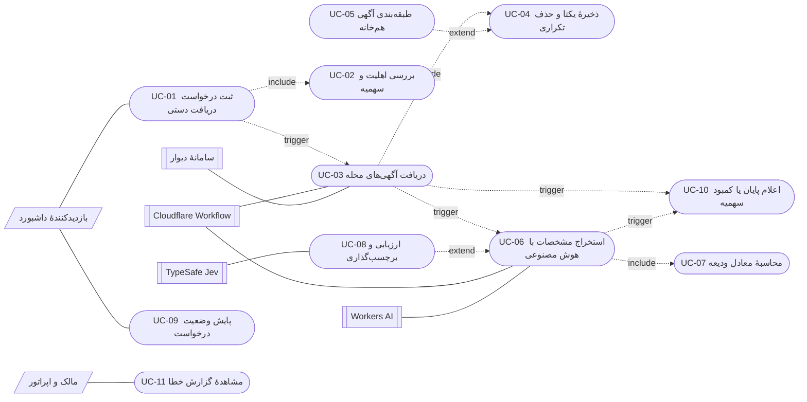

> در این نمودار، `include` و `extend` مطابق UML به کار رفته‌اند. فلش `trigger` یک قرارداد سند برای نشان‌دادن زنجیرهٔ رویداد غیرهم‌زمان بین موارد کاربرد است؛ در UML استاندارد، موارد کاربرد معمولاً فقط با `include`، `extend` یا تعمیم به هم مرتبط می‌شوند.

### ۳.۳. فهرست موارد کاربرد

| شناسه | نام | بازیگر اصلی | هدف | نتیجهٔ قابل مشاهده |
|---|---|---|---|---|
| UC-01 | ثبت درخواست دریافت دستی | بازدیدکننده | ایجاد یک اجرای دستی معتبر | رکورد `queued` و شناسهٔ اجرا |
| UC-02 | بررسی اهلیت و سهمیه | بازدیدکننده | جلوگیری از مصرف بیش از سهمیه | پذیرش با `effective_count` یا رد با ۴۲۹ |
| UC-03 | دریافت آگهی‌های محله | Workflow | جمع‌آوری آگهی‌های تازه | شمار درج‌ها، خطای احتمالی و وضعیت میانی `scraped`؛ نتیجهٔ نهایی بعداً |
| UC-04 | ذخیرهٔ یکتا و حذف تکراری | Workflow | جلوگیری از دادهٔ تکراری | حداکثر یک رکورد برای هر توکن |
| UC-05 | طبقه‌بندی آگهی هم‌خانه | Workflow | کنار گذاشتن اجارهٔ اشتراکی | برچسب `hamkhane` و خروج از آمار |
| UC-06 | استخراج مشخصات با هوش مصنوعی | Workflow | تبدیل متن به دادهٔ ساخت‌یافته | پر شدن مبلغ، متراژ، اتاق و `extracted_data` |
| UC-07 | محاسبهٔ معادل ودیعه | Workflow | مقایسه‌پذیر کردن آگهی‌ها | `deposit_equivalent_toman` |
| UC-08 | ارزیابی و برچسب‌گذاری | Workflow | تشخیص آگهی مشکوک یا جعلی | `fake_label`، `fake_score` و `fake_reason` |
| UC-09 | پایش وضعیت درخواست | بازدیدکننده | آگاهی از پیشرفت و پایان | کارت وضعیت با برچسب فارسی |
| UC-10 | اعلام پایان یا کمبود سهمیه | Workflow | بستن چرخهٔ اجرا | وضعیت پایانی و پیام متناسب |
| UC-11 | مشاهدهٔ گزارش خطا | مالک | عیب‌یابی فراخوانی‌ها | فهرست `request_logs` |

### ۳.۴. توصیف تفصیلی UC-01: ثبت درخواست دریافت دستی

| عنصر | مقدار |
|---|---|
| شناسه | UC-01 |
| بازیگر اصلی | بازدیدکنندهٔ داشبورد |
| بازیگران پشتیبان | API Worker، D1، Workflow |
| پیش‌شرط | داشبورد بارگذاری شده و فهرست محله‌های فعال در دسترس است |
| محرک | کلیک روی دکمهٔ «شروع دریافت» |
| پس‌شرط موفق | یک رکورد `manual_runs` با وضعیت `queued` ایجاد و Workflow آغاز شده است |
| پس‌شرط ناموفق | پیام خطای فارسی نمایش داده شده و هیچ اجرای نیمه‌کاره‌ای باقی نمانده است |

**جریان اصلی**

1. کاربر یک محله از فهرست انتخاب می‌کند و تعداد آگهی درخواستی را وارد می‌کند.
2. داشبورد وجود محله در فهرست محلی را بررسی می‌کند.
3. داشبورد تعداد را عدد صحیح بین ۱ تا ۵۰۰ بررسی می‌کند.
4. داشبورد از آخرین وضعیت سهمیه که هنگام باز شدن تب دریافت دستی خوانده شده استفاده می‌کند و از مثبت‌بودن سهمیهٔ دستی مطمئن می‌شود.
5. داشبورد بررسی می‌کند تعداد درخواستی از سهمیهٔ دستی باقی‌مانده بیشتر نباشد.
6. داشبورد `POST /api/manual-runs` را با بدنهٔ `{ neighborhood, count }` می‌فرستد.
7. API شیءبودن JSON، تعداد معتبر و وجود محلهٔ فعال را بررسی می‌کند.
8. API وضعیت قفل موقت AI را بررسی می‌کند.
9. API سهمیهٔ دستی را با `aiCallBudgets` محاسبه می‌کند.
10. API فعال‌نبودن lease جریان را بررسی و مقدار `effective_count` را محاسبه می‌کند.
11. API در یک `batch` شمارندهٔ `manual_searches` را افزایش می‌دهد و رکورد اجرا را با وضعیت `queued` درج می‌کند.
12. API با شناسهٔ یکتا Workflow را آغاز می‌کند و پاسخ `202` شامل `id`، `status` و `effective_count` برمی‌گرداند.
13. داشبورد پیام «در صف» را نمایش می‌دهد و پایش دوره‌ای را آغاز می‌کند.

**جریان‌های جایگزین و استثنا**

| گام | شرط | واکنش |
|---|---|---|
| 2 | محله انتخاب نشده یا نامعتبر است | پیام «یک محلهٔ معتبر انتخاب کنید» و پایان |
| 3 | تعداد خارج از بازه است | پیام «تعداد باید بین ۱ تا ۵۰۰ باشد» و پایان |
| 4 | سهمیهٔ دستی صفر است | پیام اتمام سهمیه، غیرفعال‌شدن کنترل‌ها و پایان |
| 5 | تعداد از سهمیه بیشتر است | پیام «سهمیهٔ دستی باقی‌مانده امروز …» و پایان |
| 7 | محلهٔ فعال پیدا نشد | پاسخ ۴۰۴ و پیام «محله پیدا نشد» |
| 8 | قفل موقت AI فعال است | پاسخ ۴۲۹ و پیام «سهمیهٔ هوش مصنوعی موقتاً قفل شده است» |
| 9 | سهمیهٔ دستی صفر است | پاسخ ۴۲۹ و پیام اتمام سهمیه |
| 10 | زنجیرهٔ دیگری lease فعال دارد | پاسخ ۴۰۹؛ اگر رقابت هنگام آغاز رخ دهد رکورد ساخته‌شده `failed` می‌شود |
| 11 | درج رکورد یا افزایش شمارنده شکست بخورد | خطای پایگاه داده و پاسخ ۵۰۰ |
| 12 | آغاز Workflow شکست بخورد | رکورد اجرا `failed` می‌شود و خطا به کاربر برمی‌گردد |

**نکتهٔ طراحی:** اعتبارسنجی سهمیه در دو لایه انجام می‌شود: داشبورد برای تجربهٔ کاربری بهتر و API برای امنیت و صحت. لایهٔ سرویس هرگز به اعتبارسنجی سمت کلاینت اعتماد نمی‌کند.

### ۳.۵. توصیف تفصیلی UC-02: بررسی اهلیت و سهمیه

| عنصر | مقدار |
|---|---|
| شناسه | UC-02 |
| بازیگر اصلی | بازدیدکننده (به‌صورت `include` در UC-01) |
| پیش‌شرط | سقف روزانه از تنظیمات خوانده شده است |
| محرک | درخواست ثبت اجرای دستی |
| پس‌شرط | یا درخواست با سهمیهٔ کافی پذیرفته می‌شود یا با پیام مشخص رد می‌شود |

**الگوریتم**

```text
L = سقف ذخیره‌شده (پیش‌فرض کد ۵۰۰؛ تولید تأییدشده ۳۰۰)
A = floor(4 × L / 5)
M = L − A

اگر hour ≥ 22 و manual_searches = 0:
    A_late = L
در غیر این صورت:
    A_late = A

remaining        = max(0, L − total_calls)
auto_remaining   = max(0, min(A_late − auto_calls, L − total_calls))
manual_remaining = max(0, min(M − manual_calls, L − total_calls))

اگر manual_remaining = 0: درخواست با ۴۲۹ رد می‌شود
در غیر این صورت:
    effective_count = min(requested_count, manual_remaining)
```

**جریان‌های استثنا**

| شرط | پاسخ |
|---|---|
| قفل `ai_quota_until` فعال است | ۴۲۹؛ «سهمیهٔ هوش مصنوعی موقتاً قفل شده است» |
| سهمیهٔ دستی صفر است | ۴۲۹؛ «سهمیهٔ دریافت دستی امروز تمام شده است» |
| تعداد درخواستی از سهمیه بیشتر است | پذیرش با `effective_count` کمتر و اعلام آن به کاربر |

**قاعدهٔ وابسته:** `manual_searches` هنگام درج درخواست افزایش می‌یابد، نه پایان دریافت؛ این شمارنده مشخص می‌کند ذخیرهٔ دستی شبانه آزاد شود یا نه و خودش قفل هم‌زمانی نیست. lease جریان هم‌زمانی و `reserveAiCall` سقف مصرف را کنترل می‌کنند. شکست آغاز پس از درج، شمارنده را برنمی‌گرداند و آزادسازی شبانه را منتفی می‌کند.

### ۳.۶. توصیف تفصیلی UC-03: دریافت آگهی‌های محله

| عنصر | مقدار |
|---|---|
| شناسه | UC-03 |
| بازیگر اصلی | موتور Workflow |
| بازیگران پشتیبان | سامانهٔ دیوار، D1 |
| پیش‌شرط | رکورد اجرا وجود دارد و وضعیت آن `running` شده است |
| محرک | `planPhase` با `manualRunId` و سپس فاز `scrape` در زنجیره |
| پس‌شرط | شمار درج‌ها و خطای احتمالی ثبت و وضعیت `scraped` می‌شود؛ `empty`/`failed` عادی در نهایی‌سازی تعیین می‌شوند |

**جریان اصلی**

1. `planPhase` پس از بررسی دوبارهٔ سهمیه، `MAX(listings.id)` را در `afterId` ذخیره می‌کند؛ `scrapeOneHood` از شناسهٔ عددی دیوار یا slug محله استفاده می‌کند.
2. تعداد صفحه‌ها را با `listingPagesFor(target)` محاسبه می‌کند.
3. برای هر صفحه تا سقف محاسبه‌شده و تا رسیدن به هدف:
   1. درخواست `POST` به `https://api.divar.ir/v8/postlist/w/search` با شهر `1`، دستهٔ `residential-rent`، فیلتر ناحیه و صفحهٔ جاری می‌فرستد.
   2. فرادادهٔ پاسخ را به گام Workflow برمی‌گرداند؛ در `request_logs` خلاصهٔ موفقیت یا خطا و قطعه‌ای از پاسخ ناموفق ثبت می‌شود، نه پاسخ کامل هر درخواست.
   3. ویجت‌های `POST` و `POST_ROW` را استخراج و بر اساس `divar_token` یکتا می‌کند.
   4. عنوان، توضیح، تصویر، محله و سیگنال‌های قیمت را از ویجت بیرون می‌کشد.
   5. توکن‌های موجود در D1 را حذف و سپس به اندازهٔ باقی‌ماندهٔ هدف، تازه‌ها را با `INSERT OR IGNORE` در یک `batch` درج می‌کند.
   6. در صفحهٔ پُر و هدف ناتمام یک ثانیه فاصله می‌گذارد. حلقه تا رسیدن به هدف، پایان بودجهٔ صفحه، پاسخ خالی یا خطا ادامه دارد؛ صفحهٔ کوتاهِ غیرخالی به‌تنهایی شرط توقف نیست.
4. اگر حداقل یک جست‌وجو انجام شده باشد، `last_scraped_at` محله را به‌روزرسانی می‌کند.
5. برای اجرا دستی، `fetched_count`، خطای احتمالی و وضعیت موقت `scraped` را ثبت می‌کند؛ حتی در دریافت صفر تا نهایی‌سازی وضعیت پایانی اعلام نمی‌شود.
6. نتیجه شامل تعداد درج‌شده، تعداد دریافت‌شده و پرچم شکست را برمی‌گرداند.

**جریان‌های استثنا**

| شرط | واکنش |
|---|---|
| پاسخ HTTP ناموفق | ثبت لاگ، بازگشت `null` و ثبت خطای دریافت؛ در مسیر عادی نهایی‌سازی نتیجه `failed` می‌دهد |
| JSON نامعتبر | مانند خطای HTTP |
| خطای شبکه یا استثنا | ثبت خطا با وضعیت `0` و شکست فاز دریافت |
| پاسخ بدون ویجت آگهی | توقف؛ اگر هیچ درج و خطایی نباشد، در نهایی‌سازی `empty` |
| همهٔ آگهی‌های صفحه تکراری باشند | حلقه تا سقف صفحه ادامه می‌یابد و ممکن است به هدف نرسد |

**نکتهٔ طراحی:** نام `fetched_count` در پایگاه داده در واقع تعداد **درج‌شده** را نگه می‌دارد، نه تعداد خام دریافت‌شده. این اختلاف نام‌گذاری در بخش نقد طراحی بررسی شده است.

### ۳.۷. توصیف تفصیلی UC-06: استخراج مشخصات با هوش مصنوعی

| عنصر | مقدار |
|---|---|
| شناسه | UC-06 |
| بازیگر اصلی | موتور Workflow |
| بازیگران پشتیبان | Workers AI، D1 |
| پیش‌شرط | حداقل یک آگهی تازه درج شده و سهمیهٔ AI در دسترس است |
| محرک | `extractPhase` با منبع `manual`، محله و `afterId` در payload |
| پس‌شرط | حقایق معتبر `extraction_done = 1`؛ بدون متن `-1`؛ خطا یا خروجی نامعتبر روی `0` می‌ماند |

**جریان اصلی**

1. Workflow بررسی می‌کند قفل سراسری سهمیه فعال نباشد.
2. مصرف امروز را از `daily_ai_usage` می‌خواند و سقف منبع را محاسبه می‌کند.
3. حداکثر ۴۰ ردیف pending با منبع `manual`، محلهٔ اجرا و `id > afterId` را با زمان دریافت نزولی انتخاب می‌کند؛ صف دستی قدیمی خارج از انتخاب است.
4. `runAiStep` برای ردیف دارای متن، یک فراخوانی را پیش از ارسال با `UPDATE` شرطی در تاریخ واقعی تهران رزرو می‌کند؛ نتیجه در گام پایدار می‌ماند.
5. `callExtractionModel` یک درخواست به `@cf/google/gemma-4-26b-a4b-it` می‌فرستد: JSON object، `enable_thinking: false` در `chat_template_kwargs`، `max_completion_tokens: 768` و `temperature: 0`. عنوان ۳۰۰ و متن تکمیلی ۴۰۰۰ نویسه سقف دارند؛ مدل fallback ندارد.
6. `parseExtractionResult` قالب‌های مستقیم، `response`، `output_text` و `choices[0].message.content` را تفسیر و نوع فیلدها را بررسی می‌کند؛ خروجی ناقص، refusal، صرفاً reasoning یا خراب رد می‌شود، بدون درخواست تکراری از مفسر.
7. اگر اجازهٔ صریح تبدیل کامل، انعطاف‌پذیری و هر دو مبلغ معلوم باشند، جاوااسکریپت مبلغ کامل را با نسبت ۱۰۰/۳ محاسبه و اجاره را صفر می‌کند. مقدار مجهول `null` است؛ مذاکره یا گزینه‌های محدود به‌تنهایی تبدیل کامل نیستند.
8. `commitChunk` حداکثر پنج نتیجه را ثبت می‌کند؛ حقایق نرمال‌شده، ودیعهٔ معادل و برچسب هم‌خانه ذخیره می‌شوند. هم‌خانه `jev_done = 1` می‌گیرد.
9. فاصلهٔ عادی فراخوانی‌ها ۵۰۰ میلی‌ثانیه است؛ نخستین خطای سهمیه یا زیردرخواست ارسال باقی chunk را فوراً متوقف می‌کند. برش پُر فقط با پیشرفت ثبت‌شده ادامه می‌یابد.

**جریان‌های استثنا**

| شرط | واکنش |
|---|---|
| رزرو سهمیه ممکن نیست | توقف با `quotaExhausted`، بدون ساخت قفل ارائه‌دهنده و بدون ارسال AI |
| خطای ۴۰۰۶ یا `daily free allocation` | توقف فوری و ثبت `ai_quota_until` تا نیمه‌شب UTC بعدی |
| محدودیت زیردرخواست | `subrequest_limit`؛ توقف استخراج این زنجیره، بدون قفل ارائه‌دهنده؛ سپس ارزیابی ردیف‌های موفق |
| آگهی متن قابل استخراج ندارد | بدون فراخوانی AI مقدار `extraction_done = -1` |
| پاسخ خالی/نامعتبر یا خطای موقت مدل | لاگ و باقی‌ماندن روی `0`؛ شناسه‌های ناموفق اخیر در فهرست حداکثر ۹۰تایی موقتاً کنار گذاشته می‌شوند |

خطای تفسیر، سهم فراخوانی مصرف‌شده را برنمی‌گرداند. ردیف دستیِ ناتمام با مرز `afterId` در اجرای دستی بعدی خودکار انتخاب نمی‌شود؛ رسیدگی به صف قدیمی عملیات جداگانه است. در نهایی‌سازی، وجود چنین ردیف‌هایی مانع `complete` می‌شود.

### ۳.۸. توصیف تفصیلی UC-09: پایش وضعیت درخواست

| عنصر | مقدار |
|---|---|
| شناسه | UC-09 |
| بازیگر اصلی | بازدیدکننده |
| پیش‌شرط | شناسهٔ اجرا در داشبورد موجود است |
| محرک | پاسخ `202` یا پایش دوره‌ای |
| پس‌شرط | وضعیت نهایی نمایش داده شده و داده‌های آماری بازخوانی شده‌اند |

**جریان اصلی**

1. داشبورد `GET /api/manual-runs/{id}` را می‌فرستد.
2. API رکورد اجرا را همراه نام محله می‌خواند.
3. API برچسب فارسی وضعیت را به پاسخ اضافه می‌کند.
4. داشبورد تعداد درخواستی، تعداد دریافت‌شده، وضعیت و خطا را نمایش می‌دهد.
5. تا وقتی وضعیت میانی است، `finished_at` خالی است یا `/api/quota` مقدار `workflow_running = true` دارد، سه ثانیه بعد دوباره می‌پرسد. کنترل‌ها در این مدت فعال نمی‌شوند.
6. پس از پایان، خلاصه، جدول و آگهی‌ها بازخوانی می‌شوند. خطای موقت شبکه پایش را قطع نمی‌کند؛ تلاش بعدی پس از ۱۰ ثانیه است.

**برچسب‌های وضعیت**

| وضعیت | برچسب فارسی |
|---|---|
| `queued` | در صف |
| `running` | در حال اجرا |
| `scraped` | در حال تحلیل |
| `complete` | کامل شد |
| `partial` | کمتر از درخواست دریافت شد |
| `empty` | آگهی تازه‌ای پیدا نشد |
| `quota_exhausted` | سهمیهٔ دریافت دستی امروز تمام شده است |
| `failed` | ناموفق |

### ۳.۹. موارد کاربرد پشتیبان

| شناسه | نام | مسئول | خلاصه |
|---|---|---|---|
| UC-04 | ذخیرهٔ یکتا و حذف تکراری | مخزن آگهی | درج با `INSERT OR IGNORE` و کلید یکتای `divar_token` |
| UC-05 | طبقه‌بندی هم‌خانه | طبقه‌بند هم‌خانه | بررسی نوع ملک و الگوهای متنی، ثبت برچسب و خروج از آمار مستقل |
| UC-07 | محاسبهٔ معادل ودیعه | ارزش‌گذاری ودیعه | ودیعه + اجاره × ۱۰۰/۳ با جایگزینی `price_toman` در نبود هر دو |
| UC-08 | ارزیابی و برچسب‌گذاری | ارزیاب آگهی | انتخاب JEV در صورت وجود کلید یا روش ابتکاری، محاسبهٔ امتیاز و برچسب |
| UC-10 | اعلام پایان یا کمبود سهمیه | حل‌کنندهٔ نتیجه | بررسی خطا، سهمیه، تحلیل ناتمام و سپس تعداد درج‌شده؛ ثبت هم‌زمان زمان پایان |
| UC-11 | مشاهدهٔ گزارش خطا | گزارش‌گیر درخواست | ثبت و خواندن رویدادهای موفق و ناموفق هر سرویس |

---

## ۴. مدل‌سازی کلاس‌محور

این بخش مدل شی‌گرای **مفهومی** برای تحلیل مسئولیت‌هاست. پیاده‌سازی واقعی عمدتاً توابع ES Modules و SQL در `src/` است؛ نام‌هایی مانند `ManualRunService`، `ListingRepository` و `OutcomeResolver` کلاس مستقل موجود در سورس نیستند. نگاشت واقعی در بخش ۷ آمده است.

### ۴.۱. استخراج کلاس‌های کاندید از نیازمندی‌ها

| عبارت یا اسم | منبع | دستهٔ تحلیل | تصمیم |
|---|---|---|---|
| محله | FR-02، BR-06 | موجودیت | کلاس `Neighborhood` |
| آگهی | FR-11، FR-12، BR-07 | موجودیت | کلاس `Listing` |
| اجرای دستی | FR-07، FR-15 | موجودیت | کلاس `ManualRun` |
| مصرف روزانهٔ AI | FR-05، BR-02 | موجودیت | کلاس `DailyAiUsage` |
| سهمیه | FR-05، BR-04 | شیء مقدار | کلاس `QuotaBudget` |
| گزارش درخواست | FR-17 | موجودیت | کلاس `RequestLog` |
| تنظیمات | BR-01، BR-10 | موجودیت پیکربندی | کلاس `Setting` |
| داشبورد | UC-01، UC-09 | مرزی | کلاس `DashboardPage` |
| API دریافت دستی | UC-01 | مرزی | کلاس `ManualRunApi` |
| سامانهٔ دیوار | UC-03 | مرزی خارجی | کلاس `DivarSearchClient` |
| Workers AI | UC-06 | مرزی خارجی | کلاس `AiExtractor` |
| TypeSafe Jev | UC-08 | مرزی خارجی | کلاس `JevEvaluator` |
| Workflow | UC-03، UC-06 | کنترلی | کلاس `WorkflowOrchestrator` |
| ویجت آگهی | UC-03 | شیء انتقال داده | کلاس `ListingDraft` |
| توکن آگهی | BR-07 | صفت | صفت `divarToken` در `Listing` |
| صفحه | BR-06 | صفت/پارامتر | صفت `page` در درخواست جست‌وجو |
| تایمر پایش | UC-09 | مکانیزم | بخشی از `DashboardPage`، کلاس مستقل نیست |

کلاس‌های تحلیل در سه ردهٔ کلاسیک Pressman دسته‌بندی می‌شوند:

| رده | کلاس‌ها | نقش |
|---|---|---|
| موجودیت | `Neighborhood`، `Listing`، `ManualRun`، `DailyAiUsage`، `RequestLog`، `Setting` | دادهٔ پایدار و قواعد محلی |
| مرزی | `DashboardPage`، `ManualRunApi`، `DivarSearchClient`، `AiExtractor`، `JevEvaluator` | ارتباط با کاربر یا سامانهٔ خارجی |
| کنترلی | `ManualRunService`، `WorkflowOrchestrator`، `QuotaPolicy`، `OutcomeResolver` | هماهنگی جریان و تصمیم‌گیری |

### ۴.۲. نمودار کلاس دامنه

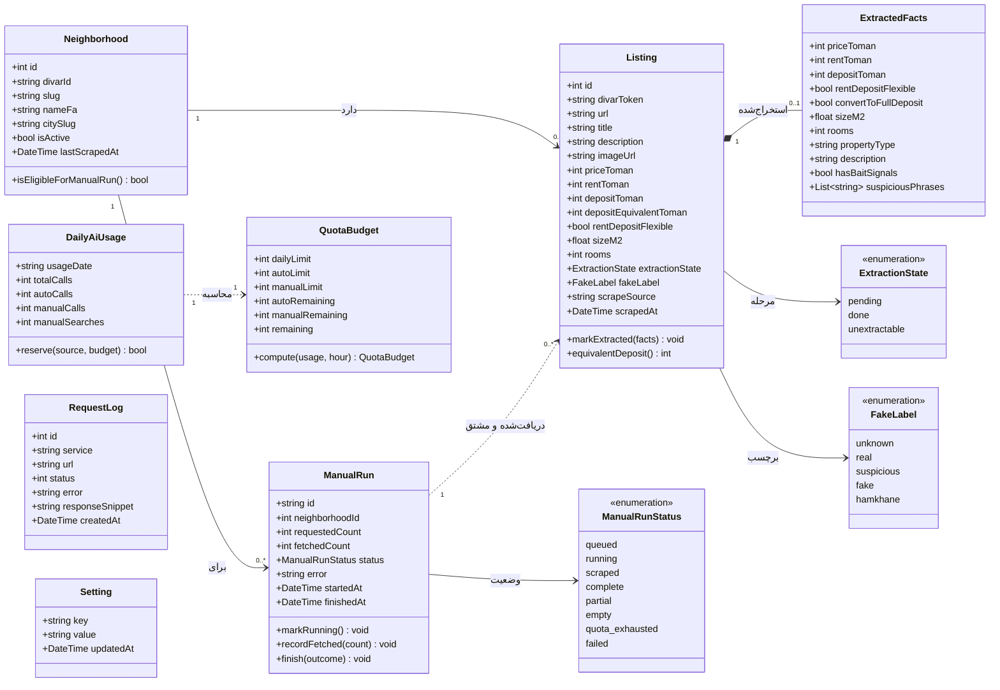

**توضیح رابطهٔ مشتق:** `listings` ستون `manual_run_id` ندارد. انتخاب و نهایی‌سازی جاری بر اساس محله، منبع `manual` و مرز `id > afterId` در payload زنجیره است؛ lease هم‌پوشانی را کنترل می‌کند. این مرز در جدول `manual_runs` ذخیره نمی‌شود، پس برای گزارش‌گیری بلندمدت رابطهٔ صریح اجرا/آگهی هنوز پیشنهاد است. `convertToFullDeposit` نیز فیلد مفهومی JSON است، نه ستون جدید؛ اعداد استخراج می‌توانند `null` باشند.

### ۴.۳. نمودار کلاس طراحی و خدمات

برای خوانایی چاپ، نمودار طراحی به پنج بستهٔ مسئولیتی تقسیم شده است: چهار بستهٔ نمودار کلاس و یک بستهٔ جدول مسئولیت. کلاس‌های مشترک مانند `ListingRepository` در هر بسته‌ای که همکار آن هستند تکرار شده‌اند تا هر نمودار مستقل خوانده شود.

#### ۴.۳.۱. بستهٔ خدمات کاربرد

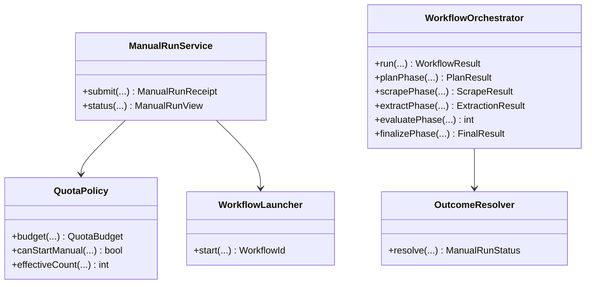

`ManualRunService` برای رزرو سهمیه، درج اجرا و ثبت مصرف به مخازن بستهٔ ۴.۳.۲ وابسته است. `WorkflowOrchestrator` از نظر مفهومی پنج فاز برنامه‌ریزی، دریافت، استخراج، ارزیابی و نهایی‌سازی را در نمونه‌های زنجیره‌شده هماهنگ می‌کند.

#### ۴.۳.۲. بستهٔ مخازن و زیرساخت

این پنج کلاس همکار سرویس‌های نمودار ۴.۳.۱ و فازهای دریافت، استخراج و ارزیابی هستند. `RunRepository` و `UsageRepository` وضعیت اجرا و مصرف را نگه می‌دارند، `NeighborhoodRepository` اهلیت محله را می‌خواند، `WorkflowLock` انحصار اجرا را تأمین می‌کند و `RequestLogger` خطاهای مرزهای خارجی را ثبت می‌کند. چون میان این کلاس‌ها وابستگی مستقیمی نیست، برای صرفه‌جویی در فضای چاپ به‌جای نمودار کلاس، جدول مسئولیت آمده است؛ خود کلاس‌ها در نمودار بسته‌هایی که آن‌ها را فراخوانی می‌کنند دیده می‌شوند.

| کلاس | مسئولیت | عملیات کلیدی |
|---|---|---|
| `RunRepository` | درج و بازیابی اجرای دستی و به‌روزرسانی وضعیت آن | `create`، `find`، `updateStatus` |
| `UsageRepository` | رزرو اتمی فراخوانی AI و شمارش جست‌وجوی دستی روز | `reserveCall`، `incrementManualSearch` |
| `NeighborhoodRepository` | خواندن محلهٔ فعال بر اساس نامک و ثبت زمان دریافت | `findActiveBySlug`، `markScraped` |
| `WorkflowLock` | lease با مالک و انقضا؛ تمدید در فرزند و آزادسازی مالک‌محور | `acquire`، `renew`، `owns`، `release` |
| `RequestLogger` | ثبت پاسخ‌های موفق و خطاهای مرزهای خارجی | `success`، `error` |

#### ۴.۳.۳. بستهٔ دریافت

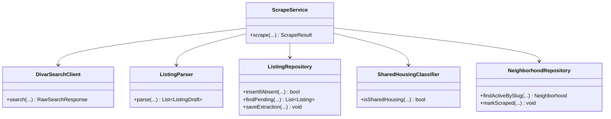

#### ۴.۳.۴. بستهٔ استخراج

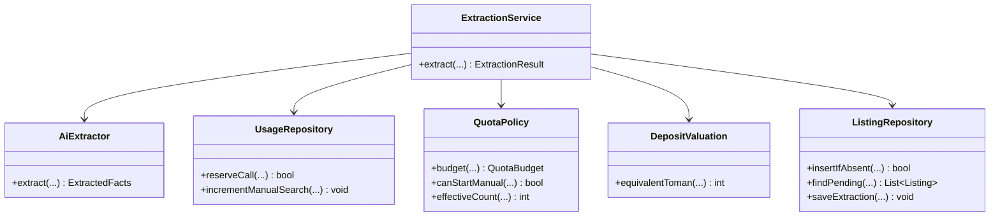

#### ۴.۳.۵. بستهٔ ارزیابی

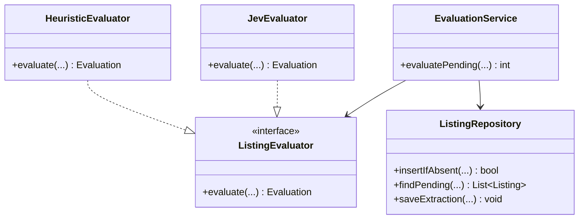

### ۴.۴. روابط و چندگانگی

| رابطه | چندگانگی | توضیح | وضعیت در پیاده‌سازی |
|---|---|---|---|
| `Neighborhood` → `Listing` | ۱ به ۰..* | هر محله چند آگهی دارد | کلید خارجی `neighborhood_id` |
| `Neighborhood` → `ManualRun` | ۱ به ۰..* | هر محله چند اجرای دستی دارد | کلید خارجی `neighborhood_id` |
| `ManualRun` → `Listing` | ۱ به ۰..* | آگهی‌های همان اجرا | مشتق؛ بدون کلید خارجی |
| `Listing` → `ExtractedFacts` | ۱ به ۰..۱ | واقعیت‌های استخراج‌شده | ستون JSON `extracted_data` |
| `DailyAiUsage` → `QuotaBudget` | ۱ به ۱ | محاسبهٔ سهمیه در هر درخواست | شیء مقدار محاسبه‌شده، بدون جدول |
| `Setting` → `QuotaPolicy` | ۱ به ۱ | سقف و آستانه‌ها از تنظیمات می‌آیند | جدول کلید-مقدار |
| `RequestLog` → سرویس | ۰..* به ۱ | هر سرویس چند گزارش دارد | ستون `service` |
| `Neighborhood` → `neighborhood_stats` | ۱ به ۰..* | آمار پیش‌محاسبه‌شده | جدول کش، خارج از دامنهٔ اصلی |

### ۴.۵. کارت‌های CRC

| کلاس | مسئولیت‌ها | همکاران |
|---|---|---|
| `ManualRun` | نگهداری شناسه، محله، تعداد درخواستی، تعداد دریافت‌شده و وضعیت؛ اعمال گذارهای مجاز؛ ثبت خطا و زمان پایان | `RunRepository`، `ManualRunStatus`، `WorkflowOrchestrator` |
| `Neighborhood` | نگهداری هویت محله و وضعیت فعال؛ اعلام اهلیت برای اجرای دستی؛ ثبت زمان آخرین دریافت | `NeighborhoodRepository`، `ScrapeService` |
| `Listing` | نگهداری هویت آگهی، مبالغ، مشخصات فیزیکی و وضعیت استخراج؛ محاسبهٔ معادل ودیعه | `ExtractedFacts`، `DepositValuation`، `SharedHousingClassifier` |
| `ExtractedFacts` | نگهداری خروجی ساخت‌یافتهٔ مدل زبانی و نشانه‌های فریب | `AiExtractor`، `Listing` |
| `QuotaBudget` | محاسبهٔ سهم خودکار و دستی، باقی‌ماندهٔ کل و باقی‌ماندهٔ هر منبع؛ تصمیم اهلیت | `DailyAiUsage`، `QuotaPolicy` |
| `DailyAiUsage` | نگهداری مصرف روزانه و شمارندهٔ جست‌وجوی دستی؛ رزرو اتمیک فراخوانی | `UsageRepository`، `QuotaBudget` |
| `DivarSearchClient` | ساخت درخواست جست‌وجو، افزودن هدرهای مرورگر، ارسال و بازگرداندن پاسخ خام؛ ثبت خطا | `ListingParser`، `RequestLogger` |
| `ListingParser` | استخراج ویجت‌های آگهی، نرمال‌سازی ارقام فارسی، استخراج سیگنال‌های ودیعه و اجاره، حذف تکراری | `DivarSearchClient`، `ListingDraft` |
| `AiExtractor` | ساخت پیام مدل، درخواست JSON، تبدیل خروجی به `ExtractedFacts`، تشخیص خطاهای سهمیه و زیردرخواست | `ExtractionService`، `RequestLogger` |
| `SharedHousingClassifier` | تشخیص هم‌خانه از نوع ملک یا الگوهای متنی با تحمل فاصله و نویسهٔ اتصال | `Listing`، `ScrapeService` |
| `DepositValuation` | تبدیل اجارهٔ ماهانه به معادل ودیعه با نسبت ۱۰۰/۳ و جایگزینی قیمت کل | `Listing` |
| `ListingEvaluator` | قرارداد مشترک ارزیابی آگهی و تولید امتیاز، برچسب و دلیل | `JevEvaluator`، `HeuristicEvaluator` |
| `WorkflowOrchestrator` | ترتیب‌دهی فازهای دریافت، استخراج و ارزیابی؛ مدیریت وضعیت اجرا؛ آزادسازی قفل در پایان | `ScrapeService`، `ExtractionService`، `EvaluationService`، `RunRepository` |
| `RequestLogger` | ثبت رویداد موفق یا ناموفق با سرویس، نشانی، وضعیت و قطعهٔ پاسخ | همهٔ مرزهای خارجی |

### ۴.۶. ناورداهای کلاس‌ها

| شناسه | ناوردا |
|---|---|
| INV-01 | `Listing.divarToken` در کل جدول یکتاست |
| INV-02 | `ManualRun.requestedCount` بین ۱ و ۵۰۰ است |
| INV-03 | `effective_count` هرگز از `requestedCount` و از `manualRemaining` بیشتر نیست |
| INV-04 | همهٔ شمارنده‌های مصرف و دریافت نامنفی‌اند |
| INV-05 | `ManualRun.status` فقط یکی از هشت وضعیت مجاز است |
| INV-06 | `manualRemaining` و `autoRemaining` از `remaining` کل بیشتر نیستند |
| INV-07 | آگهی `hamkhane` از آمار اجارهٔ مستقل و ارزیابی JEV کنار گذاشته می‌شود |
| INV-08 | `depositEquivalentToman` از ودیعهٔ خالص کمتر نیست |
| INV-09 | در هر لحظه حداکثر یک جریان دریافت در وضعیت اجرا وجود دارد |
| INV-10 | هر درخواست درج‌شده دقیقاً یک واحد `manual_searches` را افزایش می‌دهد |
| INV-11 | وضعیت `complete` بدون استخراج و ارزیابی همهٔ آگهی‌های درخواست صادر نمی‌شود |
| INV-12 | وضعیت نهایی عادی و `finished_at` با هم نوشته می‌شوند |

---

<div class="page-break"></div>

## ۵. مدل‌سازی رفتارمحور

### ۵.۱. نمودار فعالیت اعتبارسنجی سمت مرورگر

این نمودار بررسی‌های محلی داشبورد پیش از ارسال درخواست را نشان می‌دهد. هر شاخهٔ خطا به وضعیت پایانی خودش می‌رسد تا نمودار برای چاپ فشرده بماند.

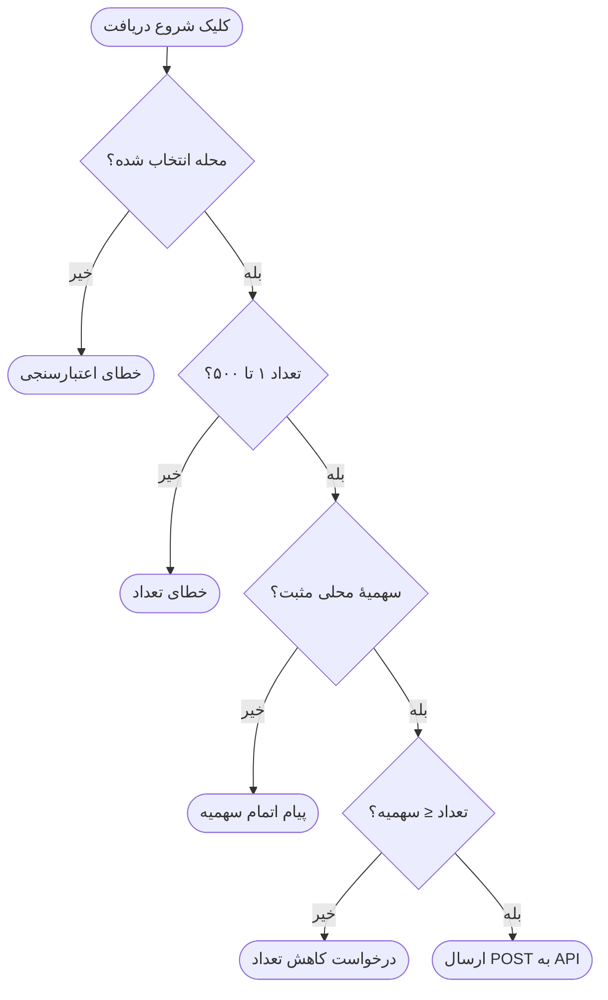

### ۵.۲. نمودار فعالیت پذیرش درخواست در API

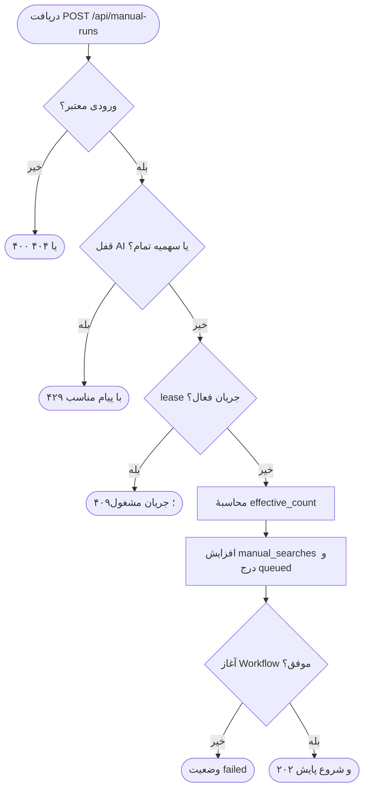

### ۵.۳. نمودار فعالیت اجرای Workflow

#### ۵.۳.۱. فاز دریافت آگهی‌ها

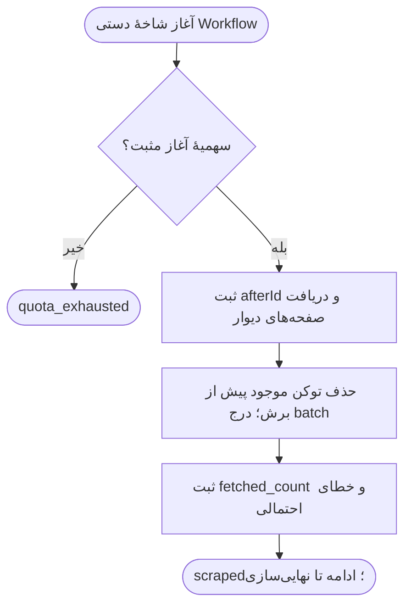

#### ۵.۳.۲. فاز استخراج

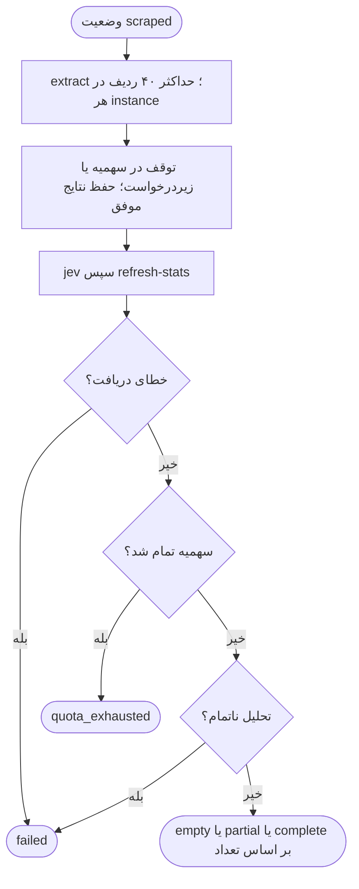

### ۵.۴. نمودار توالی ثبت درخواست و پایش وضعیت

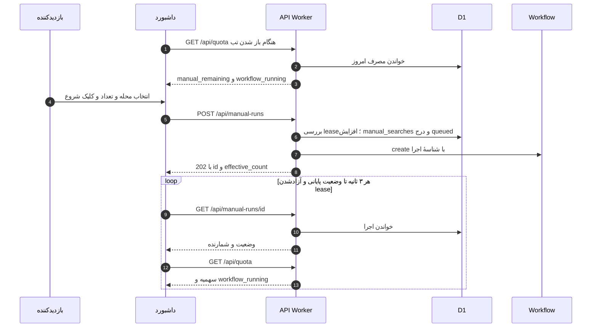

### ۵.۵. نمودار توالی اجرای Workflow و استخراج

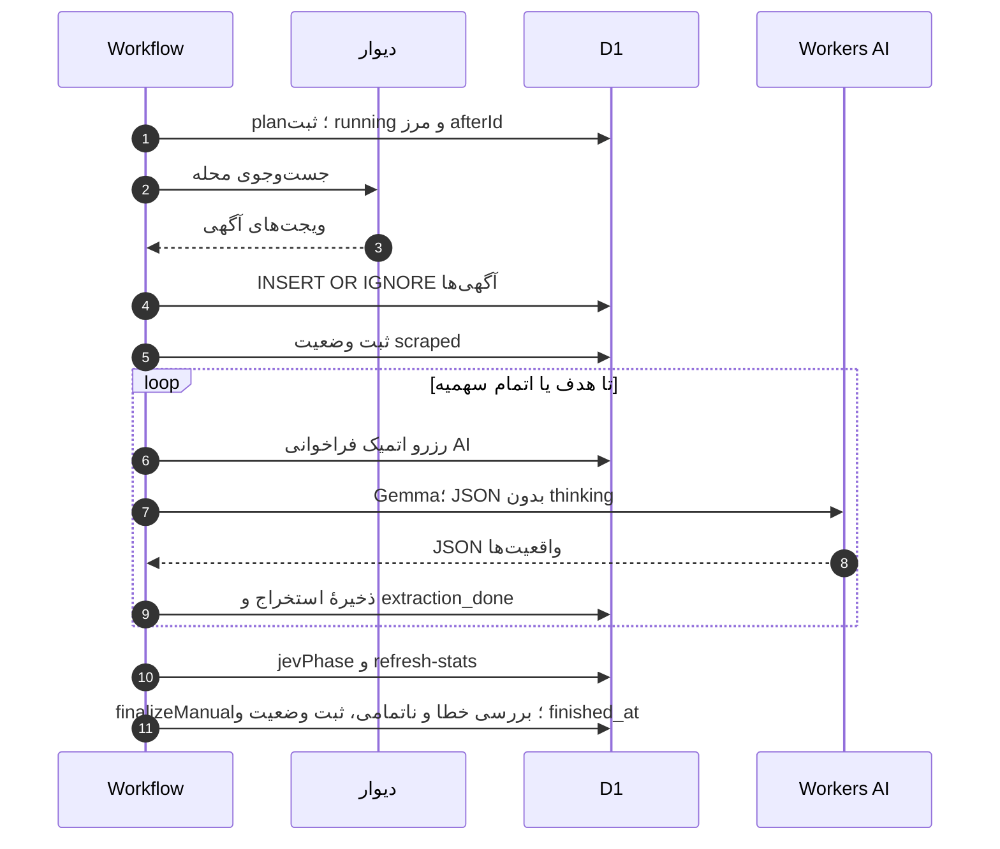

### ۵.۶. نمودار توالی رد درخواست به دلیل اتمام سهمیه

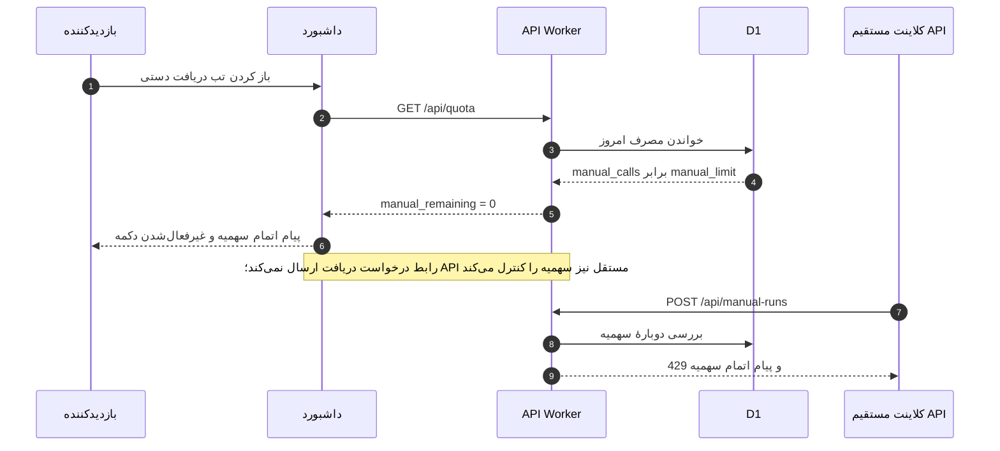

### ۵.۷. نمودار توالی اتمام سهمیه در میانهٔ استخراج

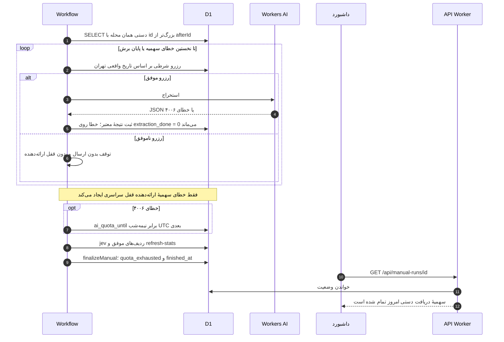

### ۵.۸. ماشین حالت `ManualRun`

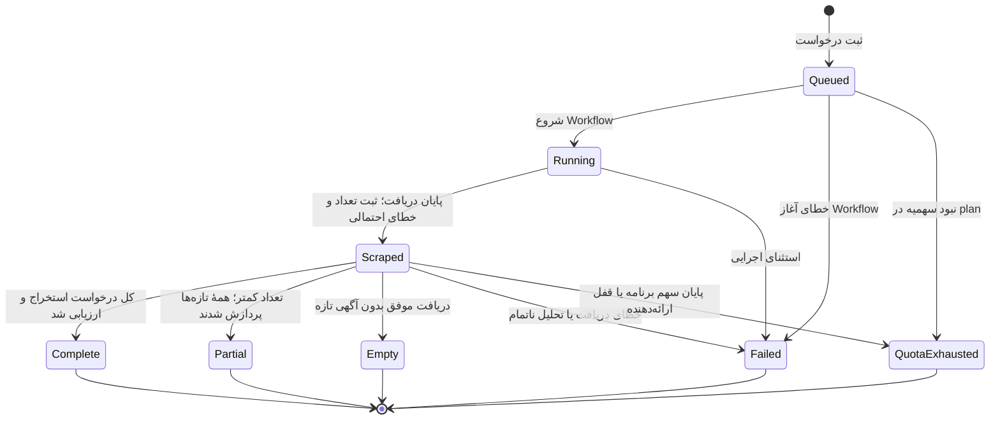

### ۵.۹. جدول وضعیت‌ها و گذارها

| وضعیت | معنا | پیش‌نیاز ورود | گذارهای خروج |
|---|---|---|---|
| `queued` | درخواست منتظر برنامه‌ریزی است | درج موفق | `running`، `failed`، `quota_exhausted` |
| `running` | برنامه‌ریزی انجام شده و دریافت در جریان است | سهمیهٔ مثبت در plan | `scraped`، `failed` |
| `scraped` | دریافت تمام و پردازش پایین‌دستی/نهایی‌سازی باقی است؛ تعداد می‌تواند صفر باشد | ثبت نتیجهٔ دریافت | همهٔ وضعیت‌های پایانی |
| `complete` | همهٔ تعداد درخواستی استخراج و ارزیابی شده‌اند | بدون خطا، سهمیهٔ پایان‌یافته یا تحلیل ناتمام | پایانی |
| `partial` | کمتر از درخواست دریافت شد ولی همهٔ ردیف‌های تازه پردازش شدند | پایان پردازش بدون خطا | پایانی |
| `empty` | جست‌وجوی موفق بدون آگهی تازه | بدون خطای دریافت یا سهمیه | پایانی |
| `quota_exhausted` | سهم برنامه یا تخصیص AI تمام شده است | نبود سهم در plan/extract یا خطای ارائه‌دهنده | پایانی |
| `failed` | خطای دریافت/راه‌اندازی یا تحلیل ناتمام | خطای ثبت‌شده یا ردیف استخراج/ارزیابی‌نشده | پایانی |

> **نکتهٔ پیاده‌سازی:** زیردرخواست با سهمیهٔ ارائه‌دهنده یکی نیست؛ استخراج آن زنجیره متوقف و ردیف‌های موفق ارزیابی می‌شوند. ردیف ناتمام در اجرای دستی به `failed` می‌انجامد، مگر خطای دریافت/سهمیهٔ دارای اولویت وجود داشته باشد. خطای `refresh-stats` غیرمهلک و فقط لاگ می‌شود؛ `complete` تضمین تازه‌بودن کش نیست.

---

## ۶. طراحی شی‌گرا

### ۶.۱. معماری لایه‌ای

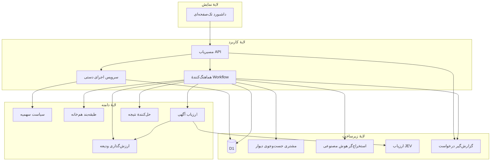

### ۶.۲. مسئولیت مؤلفه‌ها

| مؤلفه | لایه | مسئولیت | فایل مرجع |
|---|---|---|---|
| داشبورد | نمایش | فرم دریافت دستی، نمایش سهمیه، پایش وضعیت | `src/dashboard.js` |
| مسیریاب API | کاربرد | اعتبارسنجی شیء JSON، پاسخ‌های ۴۰۰/۴۰۴/۴۰۹/۴۲۹، قرارداد JSON | `src/index.js` |
| سرویس اجرای دستی | کاربرد | محاسبهٔ سهمیه، ثبت اتمیک، آغاز Workflow | `src/index.js` و `src/quota.js` |
| هماهنگ‌کنندهٔ Workflow | کاربرد | پنج فاز در نمونه‌های زنجیره‌شده، slice، مالکیت و وضعیت پایانی | `src/workflow.js`، `src/chain.js` و `src/utils.js` |
| مشتری دیوار | زیرساخت | ارسال جست‌وجو، برگرداندن پاسخ/فراداده و ثبت خلاصه یا خطا | `src/scraper.js` |
| تحلیل‌گر پاسخ | دامنه | استخراج ویجت‌ها، نرمال‌سازی ارقام، سیگنال قیمت | `src/scraper.js` |
| استخراج‌گر AI | زیرساخت | فراخوانی مدل، اعتبارسنجی JSON، تشخیص خطا | `src/extractor.js` |
| طبقه‌بند هم‌خانه | دامنه | تشخیص آگهی اشتراکی از متن و نوع ملک | `src/listing-classification.js` |
| ارزش‌گذاری ودیعه | دامنه | محاسبهٔ معادل ودیعه با نسبت ۱۰۰/۳ | `src/rental-pricing.js` |
| ارزیاب آگهی | دامنه | انتخاب JEV یا روش ابتکاری و تولید برچسب | `src/jev.js` |
| سیاست سهمیه | دامنه | محاسبهٔ بودجه، عمق صفحه و نتیجهٔ اجرا | `src/quota.js` |
| گزارش‌گیر | زیرساخت | ثبت موفقیت و خطا در `request_logs` | `src/utils.js` |
| مخازن D1 | زیرساخت | خواندن و نوشتن محله، آگهی، اجرا، مصرف و تنظیمات | `schema.sql` و کوئری‌های ماژول‌ها |

### ۶.۳. الگوهای طراحی و معادل مفهومی آن‌ها

| الگو | محل کاربرد | چرا |
|---|---|---|
| Repository (مدل مفهومی) | SQL فعلاً در API و Workflow است | استخراج کلاس مخزن هنوز انجام نشده؛ هارنس D1 امکان آزمون SQL فعلی را می‌دهد |
| Adapter | `DivarSearchClient` و `AiExtractor` | تبدیل رابط خارجی ناهمگون به مدل دامنه |
| Strategy | `ListingEvaluator` با دو پیاده‌سازی JEV و ابتکاری | انتخاب الگوریتم در زمان اجرا بر اساس وجود کلید |
| Value Object | `QuotaBudget` و معادل ودیعه | جلوگیری از محاسبهٔ تکراری و تضمین ناورداها |
| Policy / Guard | `QuotaPolicy` و `WorkflowLock` | تمرکز قواعد سهمیه و هم‌زمانی در یک نقطه |
| Orchestration | `nextPhase` و `step.do` در زنجیره | فازهای محدود، نتیجهٔ پایدار AI و فرزند با شناسهٔ قطعی |
| Idempotent Repository | `INSERT OR IGNORE` و `UNIQUE(divar_token)` | جلوگیری از درج تکراری در اجرای مجدد |
| Circuit Breaker | `ai_quota_until` | توقف فراخوانی‌های AI پس از اتمام سهمیه |
| DTO | بدنهٔ درخواست و پاسخ API | جداسازی قرارداد بیرونی از موجودیت‌های داخلی |
| Polling | پایش وضعیت در داشبورد | سادگی و سازگاری با محیط بدون WebSocket |

### ۶.۴. طراحی داده و نگاشت کلاس به جدول

| کلاس | جدول | کلید | ستون‌های کلیدی | محدودیت |
|---|---|---|---|---|
| `ManualRun` | `manual_runs` | `id` (UUID) | `neighborhood_id`، `requested_count`، `fetched_count`، `status`، `error`، `started_at`، `finished_at` | کلید خارجی محله |
| `Listing` | `listings` | `id` | `divar_token`، مبالغ، متراژ، اتاق، `extraction_done`، `fake_label`، `scrape_source` | `UNIQUE(divar_token)` |
| `ExtractedFacts` | `listings.extracted_data` | همان رکورد | JSON اعتبارسنجی و نرمال‌شده، شامل پرچم تبدیل | متن JSON |
| `Neighborhood` | `neighborhoods` | `id` | `divar_id`، `slug`، `name_fa`، `is_active`، `last_scraped_at` | `UNIQUE(slug)` |
| `DailyAiUsage` | `daily_ai_usage` | `usage_date` | `total_calls`، `auto_calls`، `manual_calls`، `manual_searches` | یک رکورد در روز |
| `QuotaBudget` | بدون جدول | — | مقدار مشتق در هر درخواست | شیء مقدار |
| `RequestLog` | `request_logs` | `id` | `service`، `url`، `status`، `error`، `response_snippet` | ایندکس زمان |
| `Setting` | `settings` | `key` | `value`، `updated_at` | کلید-مقدار |
| `WorkflowLock` | `system_state` | `key = 'workflow_running'` | `value` | یک رکورد |
| قفل سهمیه | `system_state` | `key = 'ai_quota_until'` | `value` (زمان epoch) | یک رکورد |

### ۶.۵. قراردادهای API

| متد و مسیر | ورودی | خروجی موفق | خطاهای اصلی |
|---|---|---|---|
| `GET /api/quota` | — | سقف، مصرف، سهم‌ها، `quota_exhausted` و `workflow_running` | ۵۰۰ |
| `POST /api/manual-runs` | شیء JSON `{ neighborhood, count }` | `202 { id, status, requested_count, effective_count }` | ۴۰۰، ۴۰۴، ۴۰۹، ۴۲۹، ۵۰۰ |
| `GET /api/manual-runs/{id}` | شناسهٔ UUID | `{ id, requested_count, fetched_count, status, status_fa, error, ... }` | ۴۰۴، ۵۰۰ |
| `GET /api/neighborhoods` | صفحه، جست‌وجو، مرتب‌سازی | فهرست محله‌ها و آمار | ۵۰۰ |
| `GET /api/listings` | صفحه، جست‌وجو، محله، برچسب؛ شامل `pending` و `failed` | آگهی‌ها با `extracted_data` تجزیه‌شده؛ هم‌خانه فقط با فیلتر خودش | ۵۰۰ |
| `GET /api/logs` | سرویس، وضعیت، حد | فهرست گزارش‌ها | ۵۰۰ |

**نمونهٔ درخواست و پاسخ**

`POST /api/manual-runs`:
```json
{ "neighborhood": "central-janat-abad", "count": 40 }
```

پاسخ `202 Accepted`:
```json
{
  "id": "0f1e2d3c-4b5a-6978-8c9d-0a1b2c3d4e5f",
  "status": "queued",
  "requested_count": 40,
  "effective_count": 40
}
```

### ۶.۶. طراحی هم‌زمانی و خودتکراری‌ناپذیری

| مکانیزم | محل | رفتار |
|---|---|---|
| کلید یکتای توکن | `listings.divar_token` | درج تکراری بی‌اثر است |
| `INSERT OR IGNORE` | `scrapeOneHood` | توکن‌های موجود پیش از برش حذف و درج‌های باقی در batch اجرا می‌شوند |
| lease جریان | `system_state.workflow_running` | توکن مالک و زمان؛ پس از ۳۰ دقیقه بدون تمدید قابل تصاحب |
| رزرو شرطی AI | `UPDATE daily_ai_usage ... WHERE total_calls < ?` | شمارنده هرگز از سقف عبور نمی‌کند |
| قفل ارائه‌دهنده | `system_state.ai_quota_until` | فقط خطای سهمیهٔ Workers AI؛ انقضا در نیمه‌شب UTC بعدی |
| `batch` ثبت درخواست | `src/index.js` | افزایش شمارنده و درج اجرا با هم انجام می‌شوند |

lease دیگر پرچم دائمی صفر/یک نیست: در شروع هر فرزند تمدید می‌شود و مالکیت در آزادسازی و نهایی‌سازی کنترل می‌شود. `childId` شناسهٔ قطعی می‌سازد؛ فرزند `queued`، `running` یا `complete` دوباره استفاده و فرزند `errored`/`terminated` باعث توقف پیوند می‌شود. پایان مهلت lease به معنی اجرای خودکار فوری نیست؛ ورود بعدی می‌تواند lease منقضی را تصاحب کند.

### ۶.۷. طراحی خطا و مشاهده‌پذیری

| خطا | تشخیص | واکنش | اثر قابل مشاهده |
|---|---|---|---|
| HTTP ناموفق دیوار | `!response.ok` | ثبت گزارش، شکست فاز دریافت | وضعیت `failed` |
| JSON نامعتبر | استثنای `JSON.parse` | ثبت گزارش، شکست فاز دریافت | وضعیت `failed` |
| خطای شبکه | بلوک `catch` | ثبت گزارش با وضعیت `0` | وضعیت `failed` |
| شکست آغاز Workflow | استثنای `create` | به‌روزرسانی اجرا به `failed` | خطای API |
| اتمام سهمیهٔ AI | خطای ۴۰۰۶ | ثبت `ai_quota_until` و توقف | `quota_exhausted` |
| محدودیت زیردرخواست | متن خطا | توقف استخراج، بدون قفل ارائه‌دهنده؛ ادامهٔ ارزیابی موفق‌ها | تحلیل ناتمام دستی معمولاً `failed` |
| آگهی غیرقابل استخراج | نبود متن کافی | `extraction_done = -1` | آگهی از صف خارج می‌شود |
| پاسخ نامعتبر/خطای موقت مدل | parser یا خطای فراخوانی | ثبت خطا و حفظ `0` | مانع `complete`؛ ردیف دستی قدیمی نیاز به رسیدگی جدا دارد |
| محلهٔ نامعتبر | جست‌وجوی D1 | پاسخ ۴۰۴ | پیام «محله پیدا نشد» |
| تعداد نامعتبر | اعتبارسنجی ورودی | پاسخ ۴۰۰ | پیام بازهٔ مجاز |

### ۶.۸. طراحی امنیت و بهره‌برداری

| موضوع | وضعیت فعلی | ارزیابی | پیشنهاد |
|---|---|---|---|
| احراز هویت داشبورد | ندارد | هر بازدیدکننده می‌تواند درخواست دستی ثبت کند | Cloudflare Access یا ورود مدیر |
| رمز تنظیمات | مقدار ثابت در کد | قابل خواندن در مخزن و رابط | Secret محیطی و ذخیرهٔ هش‌شده |
| محافظت از سهمیه | فقط منطق سهمیه | درخواست‌های تکراری سهم دستی را مصرف می‌کنند | محدودیت نرخ و کلید ایدمپوتنسی |
| CSRF | بدون توکن | با نبود احراز هویت، اثر محدود است | پس از افزودن احراز هویت، توکن CSRF |
| تزریق SQL | کوئری‌های پارامتری | محافظت‌شده | حفظ الگوی فعلی |
| مرتب‌سازی پویا | نگاشت سفید ستون‌ها | ایمن | حفظ الگوی فعلی |
| دادهٔ حساس | متن آگهی عمومی | ریسک کم | سیاست نگهداری گزارش‌ها |

### ۶.۹. طراحی کارایی و هزینه

| تصمیم | اثر |
|---|---|
| حداکثر ۳۰ آگهی در هر صفحه | تعداد درخواست‌ها را کنترل می‌کند |
| حداکثر ۲۰ صفحه برای هر محله | از حلقهٔ بی‌پایان جلوگیری می‌کند |
| حداقل بودجهٔ پایهٔ ۳ صفحه | امکان ادامهٔ جست‌وجو برای هدف کوچک؛ الزام به دریافت سه صفحه نیست |
| فاصلهٔ یک‌ثانیه‌ای بین صفحه‌ها | فشار به سرویس دیوار را کاهش می‌دهد |
| فاصلهٔ ۵۰۰میلی‌ثانیه‌ای بین فراخوانی‌های AI | نرخ درخواست را هموار می‌کند |
| انتخاب جدیدترین زمان دریافت با مرز `afterId` در دستی | عدم مصرف صف قبلی برای درخواست تازه |
| دریافت خودکار پس از کسر backlog از سهم باقی‌مانده | در صف پُر، دریافت تازه متوقف و ابتدا صف auto پردازش می‌شود |
| ۴۰ استخراج در هر instance، chunk پنج‌تایی، ۴۰ ارزیابی | محدودکردن بودجهٔ نمونه و حفظ نتیجهٔ گام AI |
| Gemma با thinking خاموش و سقف ۷۶۸ توکن | خروجی محدود بدون مدل fallback یا درگاه پولی |
| انتخاب قدیمی‌ترین آگهی‌ها در اجرای خودکار | کاهش گرسنگی داده در صف |
| آمار پیش‌محاسبه‌شده | جلوگیری از اسکن مکرر جدول بزرگ آگهی‌ها |

---

## ۷. ماتریس ردیابی

| نیازمندی | مورد کاربرد | کلاس‌های مسئول | پیاده‌سازی | آزمون |
|---|---|---|---|---|
| FR-01، FR-02 | UC-01 | `DashboardPage`، `ManualRunApi`، `NeighborhoodRepository` | `startManual`؛ `POST /api/manual-runs` | محلهٔ نامعتبر در `system-verification.test.js`؛ رندر UI خودکار نیست |
| FR-03 | UC-01 | `ManualRunApi` | اعتبارسنجی JSON و `count` در `src/index.js` | بدنهٔ غیرشیء در `system-verification.test.js`؛ پوشش همهٔ مرزهای count کامل نیست |
| FR-04، FR-05 | UC-02 | `QuotaPolicy`، `ManualRunApi` | `isAiLocked` و `aiCallBudgets` در `src/index.js` و `src/quota.js` | `test/quota.test.js` |
| FR-06 | UC-02 | `QuotaPolicy` | `effectiveCount` و بررسی دوبارهٔ plan | `quota.test.js` و جریان‌های `system-verification.test.js`؛ همهٔ رقابت‌ها شبیه‌سازی نمی‌شوند |
| FR-07 | UC-01 | `UsageRepository`، `RunRepository` | `batch` در `src/index.js` | مسیر موفق هارنس SQLite؛ تزریق خطای درج پوشش کامل ندارد |
| FR-08، FR-09 | UC-01 | `WorkflowLauncher`، `WorkflowLock` | `startWorkflow`، `linkChild` و lease | `chain.test.js` و هارنس؛ خطای واقعی زیرساخت پوشش کامل ندارد |
| FR-10 | UC-03 | `ScrapeService`، `QuotaPolicy` | `listingPagesFor`، `scrapeHoods` و `scrapeOneHood` | `quota.test.js`، `subrequest-budget.test.js` و تست صفحه‌های تکراری |
| FR-11 | UC-03 | `DivarSearchClient`، `ListingParser` | `fetchListingsPage` و `extractListingsFromApiResponse` در `src/scraper.js` | `test/rental-pricing.test.js` |
| FR-12 | UC-03 | `ListingRepository` | حذف توکن موجود و `batch` در `scrapeOneHood` | درج تازه پس از تکراری در `system-verification.test.js` |
| FR-13، BR-08 | UC-05 | `SharedHousingClassifier` | `isSharedHousingListing` در `src/listing-classification.js` | `test/rental-pricing.test.js` |
| FR-14 | UC-06 | `AiExtractor`، `UsageRepository` | `extractPhase`، `runAiStep`، `commitChunk`، `callExtractionModel` و `parseExtractionResult` | رزرو، پاسخ‌های AI و تاریخ واقعی در `system-verification.test.js` |
| FR-15 | UC-10 | `OutcomeResolver` | `finalizeManual` و `manualRunOutcome` | `quota.test.js` و تست خطای دریافت/تحلیل/سهمیه در هارنس |
| FR-16 | UC-09 | `DashboardPage`، `ManualRunApi` | `pollManual` و `GET /api/manual-runs/{id}` | API در هارنس؛ تایمر/تعامل مرورگر در npm test اجرا نمی‌شود |
| FR-17 | UC-11 | `RequestLogger` | `logError`، `logSuccess` و لاگ chunk | لاگ سهمیه و فیلتر API در `system-verification.test.js` |
| FR-18 | UC-08 | `EvaluationService`، `ListingEvaluator` | `jevPhase`، `evaluateListing` و `refreshAggregates` | مسیر هیوریستیک و کش پس از سهمیه در `system-verification.test.js` |
| BR-09 | UC-07 | `DepositValuation` | `depositEquivalentToman` در `src/rental-pricing.js` | `test/rental-pricing.test.js` |
| BR-02، BR-03، BR-04 | UC-02 | `QuotaPolicy` | `aiCallBudgets` در `src/quota.js` | `test/quota.test.js` و `test/system-verification.test.js` |

**جمع‌بندی آزمون‌ها:** پنج فایل آزمون، ۵۶ تست موفق و یک تست زندهٔ غیرفعال در اجرای عادی وجود دارد. `system-verification.test.js` مسیریاب و Workflow واقعی را روی SQLite حافظه‌ای با سرویس‌ها و زمان‌بندی جایگزین اجرا می‌کند. parser، تبدیل قطعی، قرارداد Gemma، صف قبلی، استخراج دستی مستقل، وضعیت نهایی، کش خالی و خطاهای سهمیه پوشش دارند. تست عادی AI زنده مصرف نمی‌کند و آزمون رندر مرورگر یا بازسازی کامل زیرساخت Cloudflare نیست.

شش fixture فارسی با Gemma نهایی در آزمون زنده نیز موفق شدند؛ این شاهد محدود است، نه تضمین صحت همهٔ آگهی‌ها. تست زنده فقط با `EXTRACTION_LIVE_URL` و endpoint آزمایشی جدا در `127.0.0.1` فعال می‌شود؛ ورودی `{ model, listing }` و خروجی `{ facts, raw, elapsed_ms }`. endpoint موقت پس از بررسی حذف شده و جزو برنامه نیست. اجرای آن Neuron حساب مصرف می‌کند. برای هارنس، Node 24 (تأییدشده: 24.11.0) پیشنهاد می‌شود؛ Node 20 فاقد APIهای لازم و شاخهٔ 22 نیازمند حداقل 22.15.0 است.

---

## ۸. نقد طراحی و بهبودهای پیشنهادی

| اولویت | مسئله | شاهد در کد | پیشنهاد |
|---|---|---|---|
| بالا | نداشتن احراز هویت و رمز ثابت تنظیمات | داشبورد عمومی؛ مقایسهٔ رمز با رشتهٔ ثابت در کد | Cloudflare Access، Secret محیطی، ذخیرهٔ هش رمز |
| بالا | نبود کلید ایدمپوتنسی برای درخواست دستی | هر `POST` یک اجرای جدید می‌سازد | پذیرش `Idempotency-Key` و بازگرداندن اجرای موجود |
| بالا | مصرف `manual_searches` حتی در شکست آغاز Workflow | `batch` پیش از `startWorkflow` | افزایش شمارنده پس از آغاز موفق یا جبران در خطا |
| متوسط | نبود رابطهٔ صریح اجرا و آگهی | `listings` ستون `manual_run_id` ندارد | افزودن کلید خارجی و ایندکس |
| متوسط | ذخیره‌نشدن `effective_count` | فقط `requested_count` در جدول است | افزودن ستون `effective_count` |
| متوسط | نبود شمارندهٔ پیشرفت تحلیل در API | `finalizeManual` ناتمامی را بررسی می‌کند ولی API تعداد تحلیل‌شده را نشان نمی‌دهد | افزودن شمارندهٔ پیشرفت بدون تغییر معنای `fetched_count` |
| متوسط | صف دستی قدیمی دوباره انتخاب نمی‌شود | استخراج دستی محدود به `afterId` و خودکار محدود به منبع `auto` است | مسیر retry صریح با سهمیه و مالکیت روشن، بدون مصرف خودکار ذخیرهٔ دستی |
| پایین | نام‌گذاری گمراه‌کنندهٔ `fetched_count` | مقدار درج‌شده ذخیره می‌شود | تغییر نام به `inserted_count` یا اصلاح معنای ستون |
| پایین | پوشش ناقص مرورگر و خطاهای زیرساخت | هارنس تعامل DOM و همهٔ شکست‌های آغاز/رقابت را اجرا نمی‌کند | آزمون‌های هدفمند اضافی، بدون مصرف پیش‌فرض AI زنده |
| پایین | نمایش رمز پیش‌فرض در رابط | متن راهنمای تنظیمات | حذف راهنما و اجبار به تغییر رمز |

---

موارد رفع‌شده دیگر شکاف جاری نیستند: lease زمان‌دار جای پرچم دائمی را گرفته، درج‌ها batch شده‌اند، بدنهٔ نامعتبر و parser پوشش تست دارند، و `finalizeManual` از اعلام موفقیتِ تحلیل ناتمام جلوگیری می‌کند. این‌ها نباید دوباره به‌عنوان پیشنهاد اجراشده‌نبودن معرفی شوند.

## ۹. نتیجه‌گیری

زیرمجموعهٔ «دریافت دستی آگهی‌های یک محله» یک دامنهٔ کوچک اما کامل برای تحلیل و طراحی شی‌گراست: یک درخواست کاربر، چند قاعدهٔ سهمیه، یک منبع خارجی، یک سرویس هوش مصنوعی، یک چرخهٔ وضعیت و چند ناوردای داده‌ای. مدل ارائه‌شده نشان می‌دهد چگونه می‌توان از توصیف سناریومحور به کلاس‌های موجودیت، مرزی و کنترلی رسید و سپس با نمودارهای فعالیت، توالی و حالت، رفتار را دقیق کرد.

نقاط قوت طراحی فعلی، جداسازی توابع خالص دامنه، استفاده از گام‌های مقاوم Workflow، رزرو اتمیک سهمیه و کلید یکتای آگهی است. مهم‌ترین شکاف‌ها در امنیت دسترسی، ایدمپوتنسی درخواست دستی، ردیابی دقیق اجرا به آگهی و تفکیک معنای «دریافت» از «تحلیل» است. رفع این موارد، سامانه را از یک ابزار شخصی قابل استفاده به یک سرویس قابل بهره‌برداری تبدیل می‌کند.

---

## پیوست الف: شبه‌کد الگوریتم‌های کلیدی

```text
تابع aiCallBudgets(L, usage, hour):
    A = floor(4 × L / 5)
    M = L − A
    اگر hour ≥ 22 و usage.manual_searches = 0:
        A_late = L
    وگرنه:
        A_late = A
    remaining        = max(0, L − usage.total_calls)
    auto_remaining   = max(0, min(A_late − usage.auto_calls, L − usage.total_calls))
    manual_remaining = max(0, min(M − usage.manual_calls, L − usage.total_calls))
    بازگرداندن (A_late, M, remaining, auto_remaining, manual_remaining)

تابع listingPagesFor(target, perPage = 30, maxPages = 20):
    بازگرداندن min(maxPages, max(3, ceil(target / perPage) × 3))

تابع manualRunOutcome(requested, inserted, quotaLocked):
    اگر quotaLocked: بازگرداندن "quota_exhausted"
    اگر inserted ≤ 0: بازگرداندن "empty"
    اگر inserted < requested: بازگرداندن "partial"
    بازگرداندن "complete"

تابع finalizeManual(run, payload):
    اگر مالک lease نیست: بازگشت بدون نوشتن
    اگر run از قبل failed یا quota_exhausted است: بازگشت
    unfinished = ردیف‌های manual همان محله با id > afterId و
                 (extraction_done != 1 یا jev_done = 0)
    اگر خطای دریافت هست: status = failed
    وگرنه اگر manualQuotaExhausted: status = quota_exhausted
    وگرنه اگر unfinished > 0: status = failed
    وگرنه: status = manualRunOutcome(requested, fetched_count, false)
    ثبت status، error و finished_at با هم

تابع depositEquivalent(listing):
    اگر deposit و rent هر دو خالی باشند: بازگرداندن price_toman
    بازگرداندن round(deposit + rent × 100 / 3)
```

## پیوست ب: فرض‌ها و محدودیت‌ها

1. سناریوها و نگاشت فایل‌ها بر اساس کد جاری‌اند؛ کلاس‌های OO و برخی نام عملیات مدل مفهومی مسئولیت‌ها هستند، نه ادعای وجود کلاس متناظر در سورس.
2. داشبورد در زمان نوشتن سند احراز هویت ندارد و نشانی آن عمومی است. بنابراین بخش امنیت سند، الزامات آینده را نیز ثبت کرده است.
3. استنتاج واقعی Workers AI از محیط محلی نیز به سرویس ابری و Neuron حساب متکی است؛ تست عادی از mock استفاده می‌کند اما router، Workflow و SQL واقعی را اجرا می‌کند.
4. رابطهٔ `ManualRun` با `Listing` در پیاده‌سازی فعلی مشتق است و به کلید خارجی صریح متکی نیست.

## پیوست ج: نقشهٔ فایل‌های مرتبط

| فایل | نقش |
|---|---|
| [`src/index.js`](./src/index.js) | مسیرهای API، اعتبارسنجی درخواست دستی، آغاز Workflow |
| [`src/dashboard.js`](./src/dashboard.js) | رابط فارسی، فرم دریافت دستی، پایش وضعیت |
| [`src/workflow.js`](./src/workflow.js) | پنج فاز، مرز afterId، رزرو AI، ثبت chunk و نهایی‌سازی |
| [`src/chain.js`](./src/chain.js) | انتقال فاز، شناسهٔ قطعی فرزند، lease و شمارنده‌های زنجیره |
| [`src/scraper.js`](./src/scraper.js) | مشتری دیوار، تحلیل ویجت‌ها و سیگنال قیمت |
| [`src/extractor.js`](./src/extractor.js) | استخراج مشخصات با Workers AI |
| [`src/jev.js`](./src/jev.js) | ارزیابی JEV و روش ابتکاری جایگزین |
| [`src/quota.js`](./src/quota.js) | سهمیه، عمق صفحه، نتیجهٔ اجرا و زمان تهران |
| [`src/rental-pricing.js`](./src/rental-pricing.js) | معادل ودیعه |
| [`src/listing-classification.js`](./src/listing-classification.js) | تشخیص آگهی هم‌خانه |
| [`src/utils.js`](./src/utils.js) | گزارش‌گیری، قفل سهمیه و تنظیمات |
| [`schema.sql`](./schema.sql) | ساختار جداول و محدودیت‌ها |
| [`test/quota.test.js`](./test/quota.test.js) | آزمون سهمیه، صفحه‌بندی و نتیجهٔ اجرا |
| [`test/rental-pricing.test.js`](./test/rental-pricing.test.js) | آزمون قیمت‌گذاری، طبقه‌بندی و تحلیل پاسخ |
| [`test/system-verification.test.js`](./test/system-verification.test.js) | API و Workflow روی SQLite، مدل/parser، تبدیل، سهمیه و کش |
| [`test/chain.test.js`](./test/chain.test.js) | انتقال فاز، پیشرفت، lease و فرزند |
| [`test/subrequest-budget.test.js`](./test/subrequest-budget.test.js) | مسیر شناسهٔ محله و بودجهٔ درخواست |

## پیوست د: تولید نسخهٔ PDF در مرحلهٔ بعد
پس از تأیید متن، `npm run docs:ooad-pdf` این فایل را به `OOAD_MANUAL_FETCH_FA.pdf` تبدیل می‌کند. `npm run docs:pdf` نیز PDF سند فنی جامع را می‌سازد. به Chrome/Chromium و در صورت لزوم `CHROME_PATH` نیاز است؛ ابزار رندر دارایی‌ها را در `.cache/docs-pdf/` نگه می‌دارد. در این مرحله هیچ PDF یا تصویری بازنویسی نشده است.
