# سامانه هوشمند خانه‌یاب و پایش بازار مسکن دیوار (Divar Housing Finder)

> **نسخهٔ آنلاین داشبورد:** [divar-housing-finder.lizadfarshid.workers.dev](https://divar-housing-finder.lizadfarshid.workers.dev/)
>
> **مستندات کامل فارسی:** [DOCUMENTATION_FA.md](./DOCUMENTATION_FA.md) · **راهنمای انگلیسی:** [README_EN.md](./README_EN.md) · **تحلیل دریافت دستی:** [OOAD_MANUAL_FETCH_FA.md](./OOAD_MANUAL_FETCH_FA.md)
>
> این نسخهٔ مستندات در ۲۰۲۶-۱۱-۱۷ با کد `b73f7ba` هماهنگ شده است. فایل‌های PDF و تصاویر هنوز برای این نسخه بازتولید نشده‌اند؛ ساخت PDF از منابع به‌روز، مرحلهٔ بعدی انتشار مستندات است.

یک سامانه اطلاعاتی هوشمند و سرورلس (Serverless) مبتنی بر **Cloudflare Workers**، پایگاه داده **Cloudflare D1 (SQLite)** و مدل‌های زبانی بزرگ **Cloudflare Workers AI** جهت جمع‌آوری، استخراج خودکار مشخصات، پایش قیمت‌های رهن و اجاره، و شناسایی آگهی‌های مشکوک و فیک در محله‌های تهران به همراه داشبورد تحلیلی تعاملی راست‌به‌چپ (RTL).

---

## ۱. معرفی و حوزه کسب‌وکار (Business Domain)

بازار مسکن و به‌ویژه بازار رهن و اجاره در کلان‌شهرهایی مانند تهران، از چالش‌های بنیادین اقتصادی و اجتماعی شهروندان است. بسترهایی نظیر وب‌سایت **دیوار** بستر اصلی دادوستد مستقیم ملک میان مالکان، مستأجران و مشاوران املاک هستند. با این وجود، این بازار با چالش‌های عمده‌ای روبرو است:
- **آگهی‌های طعمه (Bait) و قیمت‌های غیرواقعی/جعلی**: درج ودیعه و اجاره بسیار پایین‌تر از عرف بازار جهت کشاندن متقاضی به تماس.
- **تنوع شدید در شیوه ثبت ارقام و تبدیل رهن و اجاره**: برخی آگهی‌ها فقط رهن، برخی اجاره و برخی قابل تبدیل هستند.
- **آگهی‌های هم‌خانه و اتاق مشترک**: این دسته از آگهی‌ها به اشتباه در بخش آپارتمان مستقل قرار گرفته و میانگین آماری محله‌ها را منحرف می‌کنند.
- **نبود تحلیل لحظه‌ای و شفاف از وضعیت واقعی ودیعه و اجاره در سطح محله‌ها**.

**سامانه خانه‌یاب دیوار** به عنوان یک سامانه اطلاعاتی هوشمند برای حل این مسائل طراحی شده است:
1. به‌صورت دوره‌ای و خودکار، ساختار و شناسه محله‌های تهران را از سرورهای دیوار دریافت و به‌روزرسانی می‌کند.
2. بر اساس زمان‌بندی منظم روزانه (ساعت ۱۰ صبح و ساعت ۱۰ شب به وقت تهران)، آگهی‌های تازه محله‌های هدف را پیمایش و در دیتابیس ثبت می‌کند.
3. با استفاده از مدل زبانی هوش مصنوعی (`@cf/google/gemma-4-26b-a4b-it`)، اطلاعات کلیدی متن آگهی (ودیعه، اجاره، متراژ، تعداد اتاق، قابلیت تبدیل و سیگنال‌های فریب) را استخراج و مقادیر را نرمال‌سازی می‌کند.
4. بر اساس فرمول عرف بازار مسکن ایران (هر ۱۰۰ میلیون تومان ودیعه معادل ۳ میلیون تومان اجاره ماهانه)، ارزش «ودیعه معادل» را محاسبه می‌کند.
5. به کمک موتور تحلیل آماری-هیوریستیک و مقایسه متری با میانگین همان محله، آگهی‌ها را در دسته‌های **معمولی (Real)**، **مشکوک (Suspicious)**، **جعلی (Fake)** و **هم‌خانه (Hamkhane)** طبقه‌بندی می‌کند.
6. آمارهای توصیفی (میانگین، میانه، روند روزانه، میانه ودیعه بر متر مربع) را در یک داشبورد فارسی و وب‌سرویس‌های RESTful در اختیار کاربر قرار می‌دهد.

---

## ۲. مدل داده‌ای و ساختار پایگاه داده (Data Model & Schema)

این سامانه به پایگاه داده رابطه‌ای لبه‌ای **Cloudflare D1** متصل است (مبتنی بر استاندارد SQLite با پشتیبانی کامل از Foreign Keys، تراکنش‌های اتمیک و Window Functions).

### دیاگرام مدل داده‌ای و ساختار جداول (ER & Database Architecture)

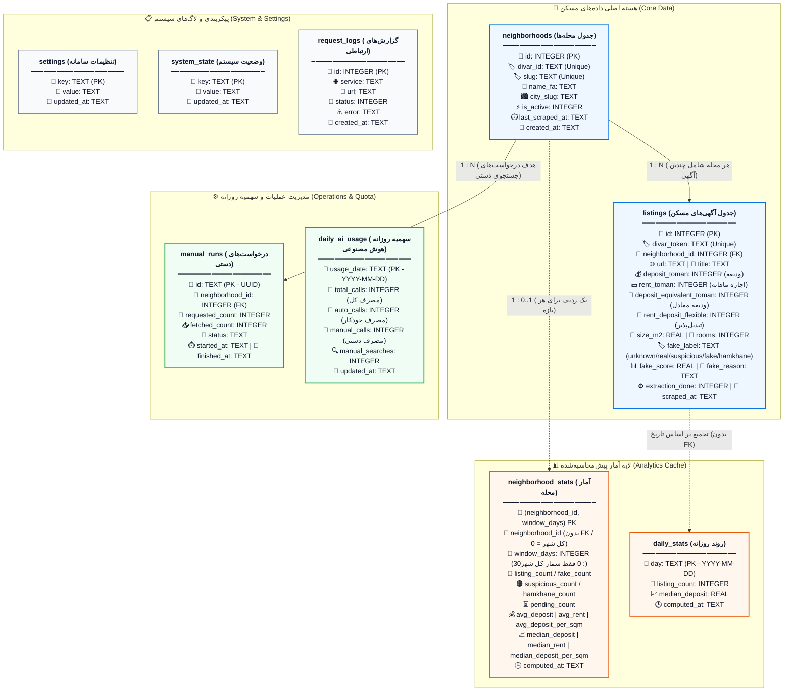

> نکته: جدول‌های `neighborhood_stats` و `daily_stats` کش تحلیلی هستند و داده‌ی جدید تولید نمی‌کنند؛ در پایان هر اجرای ورک‌فلو از روی `listings` بازسازی می‌شوند. ردیف با `neighborhood_id = 0` در `neighborhood_stats` یک ردیف مصنوعی «کل شهر» است و عمداً کلید خارجی ندارد.

<details>
<summary><b>روابط جداول پایگاه داده (کلیک کنید)</b></summary>

| جدول مبدأ | نوع رابطه | جدول مقصد | توضیح |
|---|---|---|---|
| `neighborhoods` | یک به چند (1:N) | `listings` | هر محله شامل چندین آگهی است |
| `neighborhoods` | یک به چند (1:N) | `manual_runs` | هر محله می‌تواند چندین درخواست دستی داشته باشد |
| `neighborhoods` | رابطهٔ منطقی (بدون FK) | `neighborhood_stats` | یک ردیف ۳۰روزه برای هر محلهٔ دارای داده؛ ردیف کل‌زمانی فقط برای کل شهر |
| `listings` | تجمیع منطقی (بدون FK) | `daily_stats` | یک ردیف برای هر روز دارای آگهی غیرهم‌خانه با ودیعهٔ مثبت در ۳۰ روز اخیر |

**ساختار کامل ستون‌های هر جدول:**

**`neighborhoods`:** `id` PK, `divar_id` UNIQUE, `slug` UNIQUE, `name_fa`, `city_slug`, `is_active`, `last_scraped_at`, `created_at`

**`listings`:** `id` PK, `divar_token` UNIQUE, `neighborhood_id` FK, `url`, `title`, `price_toman`, `rent_toman`, `deposit_toman`, `deposit_equivalent_toman`, `rent_deposit_flexible`, `size_m2`, `rooms`, `description`, `image_url`, `extracted_data`, `extraction_done`, `jev_result`, `jev_score`, `jev_done`, `fake_label`, `fake_score`, `fake_reason`, `scrape_source`, `scraped_at`, `updated_at`

**`manual_runs`:** `id` PK (UUID), `neighborhood_id` FK, `requested_count`, `fetched_count`, `status`, `error`, `started_at`, `finished_at`

**`daily_ai_usage`:** `usage_date` PK, `total_calls`, `auto_calls`, `manual_calls`, `manual_searches`, `updated_at`

**`settings`:** `key` PK, `value`, `updated_at`

**`system_state`:** `key` PK, `value`, `updated_at`

**`request_logs`:** `id` PK, `service`, `url`, `status`, `error`, `response_snippet`, `created_at`

**`neighborhood_stats`:** `(neighborhood_id, window_days)` PK, `listing_count`, `fake_count`, `suspicious_count`, `hamkhane_count`, `pending_count`, `avg_deposit`, `avg_rent`, `avg_deposit_per_sqm`, `median_deposit`, `median_rent`, `median_deposit_per_sqm`, `computed_at` — بدون FK؛ `neighborhood_id = 0` ردیف سراسری شهر است.

**`daily_stats`:** `day` PK, `listing_count`, `median_deposit`, `computed_at`

</details>

### تشریح جداول پایگاه داده

1. **`neighborhoods` (محله‌ها)**:
   - ذخیره مشخصات محله‌های شهر تهران دریافت شده از نقشه و متادیتای دیوار (`divar_id`، `slug`، نام فارسی `name_fa`، وضعیت فعال بودن و تاریخ آخرین پیمایش).
2. **`listings` (آگهی‌های مسکن)**:
   - هسته مرکزی سیستم؛ شامل شناسه یکتای دیوار (`divar_token`)، نشانی آگهی، عناوین، مبالغ ودیعه و اجاره خام و استخراج‌شده، ارزش ودیعه معادل (`deposit_equivalent_toman`)، متراژ، تعداد اتاق، داده‌های ساختاریافته JSON از هوش مصنوعی، برچسب سلامت آگهی (`fake_label`: unknown, real, suspicious, fake, hamkhane)، امتیاز ارزیابی و ارتباط کلید خارجی با جدول محله‌ها.
3. **`daily_ai_usage` (مدیریت سهمیه روزانه هوش مصنوعی)**:
   - مدیریت شمار فراخوانی‌ها بر اساس تاریخ محلی تهران و سقف ذخیره‌شده در تنظیمات؛ پیش‌فرض کد ۵۰۰ است، اما مقدار تأییدشدهٔ محیط عملیاتی در ۲۰۲۶-۱۱-۱۷ برابر ۳۰۰ بوده است. این جدول مصرف Neuron حساب را جمع نمی‌زند.
4. **`manual_runs` (ردگیری درخواست‌های دستی)**:
   - تاریخچه و وضعیت کارهای دریافت دستی به تفکیک محله، تعداد درخواستی، تعداد دریافت شده و وضعیت پیشرفت (`queued`, `running`, `scraped`, `complete`, `partial`, `empty`, `quota_exhausted`, `failed`).
5. **`settings` (تنظیمات سامانه)**:
   - پارامترهای پویا شامل آستانه‌های کشف آگهی مشکوک (`fake_threshold`) و جعلی (`high_fake_threshold`)، سقف پردازش روزانه (`daily_listing_limit`؛ پیش‌فرض کد ۵۰۰، مقدار عملیاتی مستقل)، لیست محله‌های تحت پیمایش خودکار (`auto_neighborhoods`)، کلمات کلیدی طعمه (`bait_keywords`) و وزن‌های ارزیابی.
6. **`system_state` (وضعیت سراسری سامانه)**:
   - نگهداری قفل‌های هم‌زمانی اجرای ورک‌فلو (`workflow_running`)، زمان آخرین بروزرسانی لیست محله‌ها (`neighborhood_discovery_last_run`) و وضعیت تعلیق احتمالی سهمیه کلادفلر (`ai_quota_until`).
7. **`request_logs` (لاگ‌های سیستمی)**:
   - گزارش ارتباطات و خطاها با ایندکس زمانی؛ موفقیت جست‌وجو به‌صورت خلاصه و AI به‌صورت خطا/خلاصهٔ chunk ثبت می‌شود. نتیجهٔ خام AI در گام پایدار Workflow است، نه لاگ مستقل موفقیت برای هر فراخوانی.
8. **`neighborhood_stats` (کش آمار محله)**:
   - آمار ۳۰روزه برای محله‌های دارای داده و کل شهر (`neighborhood_id = 0`) شامل شمارش‌ها و شاخص‌های قیمت؛ ردیف `window_days = 0` فقط شمارش کل‌زمانی شهر را نگه می‌دارد. بازسازی اتمیک در پایان زنجیره، هزینهٔ خواندن داشبورد را کاهش می‌دهد؛ فهرست آگهی‌ها و برخی کوئری‌ها همچنان زنده‌اند.
9. **`daily_stats` (روند روزانه)**:
   - میانهٔ ودیعه و تعداد آگهی‌های غیرهم‌خانه با ودیعهٔ مثبت به تفکیک روز برای ۳۰ روز اخیر؛ منبع نمودار سراسری شهر. روند یک محلهٔ منتخب همچنان از کوئری زنده محاسبه می‌شود.

---

## ۳. نحوه عملکرد و معماری سامانه

### الف) دریافت دوره‌ای محله‌ها (Neighborhood Discovery)
سامانه به‌صورت دوره‌ای (هر ۷ روز یک‌بار یا با درخواست دستی کاربر از طریق دکمه یا API) به اندپوینت رسمی نقشه دیوار مراجعه کرده (`https://map.divarcdn.com/places-web.json`) و تمامی محله‌های مربوط به تهران (`parent = 1` و `type = 4`) را استخراج و در جدول `neighborhoods` به روش `UPSERT` همگام‌سازی می‌کند.

### ب) زمان‌بندی روزانه (Cron Schedule)
در فایل پیکربندی `wrangler.jsonc` تریگر زمان‌بندی شده روی عبارت استاندارد کرون تنظیم شده است:
```text
30 6,18 * * * (بر حسب UTC)
```
با توجه به اختلاف ساعت رسمی تهران (UTC+3:30):
- ساعت **۰۶:۳۰ UTC** دقیقاً برابر با ساعت **۱۰:۰۰ صبح به وقت تهران** است.
- ساعت **۱۸:۳۰ UTC** دقیقاً برابر با ساعت **۲۲:۰۰ شب (۱۰ شب) به وقت تهران** است.

### ج) سهمیه‌بندی و سازگاری با پلن رایگان (AI Quota Allocation)
دو محدودیت مستقل وجود دارد:
- **شمار فراخوانی برنامه**: `daily_listing_limit` بین ۳ تا ۵۰۰ قابل تنظیم است. پیش‌فرض کد و ساخت دیتابیس ۵۰۰ است، ولی مقدار عملیاتیِ تأییدشده در ۲۰۲۶-۱۱-۱۷ **۳۰۰ فراخوانی: ۲۴۰ خودکار و ۶۰ دستی** بود و در اصلاحات اخیر افزایش نیافت. مقدار جاری را از `/api/quota` بخوانید؛ ۵۰۰ معادل ظرفیت تضمین‌شدهٔ پلن Free نیست.
- **سهمیهٔ Workers AI**: تخصیص رایگان روزانه **۱۰٬۰۰۰ Neuron برای کل حساب** است و پروژه‌های دیگر و تست زندهٔ محلی نیز از آن مصرف می‌کنند. برنامه تعداد فراخوانی را ثبت می‌کند، نه جمع Neuron؛ حتی سقف ۳۰۰ نیز تضمین نمی‌کند تخصیص حساب تمام نشود.
- **تقسیم بودجه**: سهم خودکار `floor(4L/5)` و سهم دستی باقی‌ماندهٔ آن است. باقی‌ماندهٔ هر سهم به باقی‌ماندهٔ کل نیز محدود می‌شود. از ساعت ۲۲ تهران، فقط اگر `manual_searches = 0` باشد، ذخیرهٔ دستی استفاده‌نشده در اختیار خودکار قرار می‌گیرد.
- **دو مرز زمانی**: شمارندهٔ برنامه بر اساس روز تهران است؛ تخصیص Neuron در **۰۰:۰۰ UTC، معادل ۰۳:۳۰ تهران** بازنشانی می‌شود. خطای سهمیهٔ ارائه‌دهنده، `ai_quota_until` را تا نیمه‌شب UTC بعدی تنظیم می‌کند، نه ۲۴ ساعت پس از خطا. انقضای قفل خودش اجرای تازه‌ای ایجاد نمی‌کند.
- **رزرو و توقف**: هر فراخوانی پیش از ارسال با تاریخ واقعی تهران اتمیک رزرو می‌شود؛ پاسخ خراب یا تلاش ناموفق نیز شمارش دارد. پس از نخستین خطای سهمیه، ارسال همان لحظه متوقف می‌شود. تمام‌شدن سهم دستی برنامه به‌تنهایی قفل سراسری ارائه‌دهنده ایجاد نمی‌کند.
- **تخصیص وزن‌دار (`neighborhoodTarget`)**: محله‌های کم‌آگهی‌تر در ۷ روز گذشته و با زمان دریافت قدیمی‌تر وزن بیشتری می‌گیرند؛ ظرفیت استفاده‌نشده به محله‌های بعدی می‌رسد.

پروژه برای **Cloudflare Workers Free** نگه داشته شده است؛ در `wrangler.jsonc` افزایش پولی CPU یا زیردرخواست، درگاه پولی یا مدل جایگزین پولی تعریف نشده است. سازگاری با پلن به معنی تضمین عدم اتمام سهمیه تحت هر حجم کاری نیست. منابع رسمی: [قیمت Workers AI](https://developers.cloudflare.com/workers-ai/platform/pricing/)، [محدودیت Workflows](https://developers.cloudflare.com/workflows/reference/limits/)، [محدودیت Workers](https://developers.cloudflare.com/workers/platform/limits/) و [قیمت D1](https://developers.cloudflare.com/d1/platform/pricing/).

### د) دریافت آگهی: مسیر خودکار و مسیر دستی
هر آگهی فقط یک بار با `divar_token` یکتا ذخیره می‌شود؛ بنابراین «تعداد دریافت‌شده» یعنی آگهی تازه، نه تعداد آگهی‌های دیده‌شده. هر صفحهٔ نتایج دیوار حداکثر ۳۰ آگهی دارد.

**مسیر خودکار (ساعت ۱۰ و ۲۲ تهران)**
1. سهمیهٔ خودکار و صف قبلی با `scrape_source = 'auto'` خوانده می‌شوند. بودجهٔ دریافت تازه برابر `max(0, auto_remaining - pendingBeforeRun)` است؛ اگر صف تمام ظرفیت را پر کند، دریافت تازه انجام نمی‌شود.
2. فقط برای ظرفیت باقی‌ماندهٔ دریافت تازه، محله‌های انتخاب‌شده به ترتیب کم‌آگهی‌ترین در ۷ روز گذشته مرتب می‌شوند.
3. سهمیه بین آن‌ها با وزن `(بیشترین آگهی + ۱) ÷ (آگهی محله + ۱)` و ضریب تازگی `۱ + min(۷، روزهای گذشته از آخرین دریافت) ÷ ۷` تقسیم می‌شود. اگر یک محله کمتر از سهم خود آگهی تازه داشته باشد، باقی‌مانده به محلهٔ بعدی منتقل می‌شود.
4. بودجهٔ پایهٔ صفحه از `min(20, max(3, ceil(target / 30) * 3))` محاسبه می‌شود؛ در مسیر خودکار سقف اضافی **۴ صفحه برای هر محله** و **۸ محله / ۳۲ صفحه در هر instance** اعمال می‌شود. رسیدن به هدف یا پاسخ خالی جست‌وجو را زودتر متوقف می‌کند.
5. توکن‌های موجود پیش از محدودکردن نامزدها به تعداد مورد نیاز حذف می‌شوند. استخراج خودکار، ردیف‌های در انتظار همان منبع را از قدیمی به جدید پردازش می‌کند؛ آگهی‌های قبلی حذف نمی‌شوند و صف دستی قدیمی جزو این مسیر نیست.

**مسیر دستی (تب «دریافت دستی»)**
1. سهمیهٔ دستی امروز و قفل ارائه‌دهنده بررسی می‌شوند؛ نبود سهمیه پاسخ ۴۲۹ دارد. وجود زنجیرهٔ فعال با ۴۰۹ رد می‌شود.
2. تعداد مؤثر برابر `min(تعداد درخواستی، سهمیهٔ دستی باقی‌مانده)` است و در پاسخ `effective_count` برگردانده می‌شود.
3. برنامه‌ریزی ظرفیت را دوباره بررسی کرده و `MAX(listings.id)` را به‌عنوان `afterId` ثبت می‌کند. جست‌وجوی دستی همان فرمول پایه را تا سقف **۲۰ صفحه** به کار می‌گیرد؛ سقف ۴صفحه‌ای خودکار به آن اعمال نمی‌شود.
4. فقط آگهی‌های دستی همان محله با `id > afterId` از جدیدترین زمان دریافت استخراج می‌شوند؛ صف دستی قدیمی مصرف این درخواست را نمی‌گیرد. وضعیت `scraped` تا پایان پردازش پایین‌دستی حفظ می‌شود.
5. در `finalizeManual` ابتدا خطا، سهمیه و استخراج/ارزیابی ناتمام بررسی می‌شود: `complete` یعنی همهٔ تعداد درخواستی استخراج و ارزیابی شده‌اند؛ `partial` یعنی تعداد کمتر است ولی همان آگهی‌ها پردازش شده‌اند؛ `empty` یعنی جست‌وجوی موفق بدون آگهی تازه؛ `failed` برای خطای دریافت یا تحلیل ناتمام؛ و `quota_exhausted` برای اتمام سهمیه. وضعیت نهایی و `finished_at` هم‌زمان ذخیره می‌شوند. ردیف‌های موفق حتی پس از اتمام سهمیه به ارزیابی و مرحلهٔ آمار می‌رسند.

> سهمیه فقط برای تحلیل هوش مصنوعی است؛ خود جست‌وجو در دیوار مصرف سهمیه ندارد.

### هـ) پایپ‌لاین هوش مصنوعی و مدل‌سازی مالی
1. **استخراج حقایق با Gemma 4 26B**:
   مدل `@cf/google/gemma-4-26b-a4b-it` جایگزین مدل بازنشسته‌شوندهٔ Qwen 3 30B شده است. درخواست با `response_format: { type: 'json_object' }`، `chat_template_kwargs: { enable_thinking: false }`، `max_completion_tokens: 768` و `temperature: 0` ارسال می‌شود. عنوان حداکثر ۳۰۰ و متن تکمیلی حداکثر ۴۰۰۰ نویسه است.
   مدل مبلغ‌های نقل‌شده به تومان را استخراج می‌کند، مجهول‌ها را `null` می‌گذارد و برای «رهن کامل» اجاره را صفر می‌گیرد. در گزینه‌های محدود پرداخت، گزینهٔ دارای بیشترین ودیعه انتخاب می‌شود. تنها اجازهٔ صریح تبدیل کامل، `convert_to_full_deposit = true` را فعال می‌کند؛ با مبالغ معلوم و `rent_deposit_flexible = true`، محاسبه در جاوااسکریپت انجام می‌شود. مثلاً ۱۰۰ میلیون ودیعه و ۶ میلیون اجاره به ۳۰۰ میلیون ودیعه و اجارهٔ صفر تبدیل می‌شود؛ صرف مذاکره مجوز این تبدیل نیست.
   مفسر، قالب‌های قدیمی و `choices[0].message.content` را پشتیبانی و خروجی ناقص، ردشده، صرفاً استدلالی یا دارای نوع نامعتبر را رد می‌کند. پاسخ نامعتبر در صف `0` می‌ماند و لاگ می‌شود، بدون فراخوانی دوباره از داخل مفسر؛ فقط نبود متن قابل استخراج، ردیف را بدون فراخوانی AI به `-1` می‌برد.
2. **محاسبه ودیعه معادل (Deposit Equivalent)**:
   بر اساس استاندارد ۳ درصد در بازار مسکن ایران:
   $$\text{Deposit Equivalent} = \text{Deposit} + \left(\text{Rent} \times \frac{100}{3}\right)$$
   این معیار برای مقایسهٔ آگهی‌ها حتی بدون اجازهٔ تبدیل محاسبه می‌شود و به معنی پذیرش آن شرایط پرداخت از سوی مالک نیست.
3. **تفکیک خودکار هم‌خانه و اتاق اشتراکی (`hamkhane`)**:
   آگهی‌هایی که شامل کلمات کلیدی نظیر «هم‌خانه»، «هم‌اتاقی»، «اتاق مشترک» باشند یا در تحلیل مدل `property_type = room` تشخیص داده شوند، برچسب `hamkhane` دریافت کرده و به‌طور خودکار از محاسبات میانگین و میانه قیمت مسکن مستقل حذف می‌شوند تا داده‌های بازار تحریف نشوند.
4. **موتور ارزیابی آگهی مشکوک و جعلی (Fraud Detection)**:
   در نبود کلید اختیاری `TYPESAFE_API_KEY` یا خطای سرویس TypeSafe Jev، ارزیابی هیوریستیک محلی بر اساس ودیعهٔ معادل هر متر و کلمات طعمه انجام می‌شود. با وجود کلید، پاسخ سرویس در امتیاز وزن‌دار به کار می‌رود. شرایط مصرف و هزینهٔ این سرویس خارجی مستقل از Cloudflare Free است.

### و) اجرای زنجیره‌ای و محدودیت هر instance
یک اجرای منطقی از فازهای `plan → scrape → extract → jev → finalize` تشکیل می‌شود. هر فاز نمونهٔ Workflow جداگانه دارد؛ استخراج حداکثر ۴۰ آگهی در هر نمونه و ثبت حداکثر ۵ نتیجه در هر chunk، و ارزیابی حداکثر ۴۰ آگهی در هر نمونه انجام می‌شود. فقط برش پُر با پیشرفت ثبت‌شده به نمونهٔ بعدی ادامه می‌دهد؛ خطای سهمیه یا زیردرخواست استخراج را متوقف می‌کند ولی ردیف‌های موفق می‌توانند ارزیابی شوند.

هم‌زمانی Workflow برابر ۱ است. قفل `workflow_running` توکن مالکیت `run:<runId>:<epochMs>` دارد و پس از ۳۰ دقیقه بدون تمدید، قابل تصاحب می‌شود. شناسهٔ قطعی فرزند از ساخت تکراری آن جلوگیری می‌کند؛ آزادسازی قفل و نهایی‌سازی نیازمند مالکیت‌اند. نتیجهٔ فراخوانی AI در گام پایدار ذخیره می‌شود تا صرفاً برای تفسیر یا ثبت دوباره، فراخوانی تکراری انجام نشود. فهرست شناسه‌های ناموفق قابل صرف‌نظر در زنجیره به ۹۰ محدود است تا همراه سایر پارامترها زیر سقف ۱۰۰ پارامتر D1 بماند.

کش آمار در پایان زنجیره بازسازی می‌شود؛ شمارندهٔ «در انتظار» ممکن است حین اجرا تغییر نکند. شکست بازسازی لاگ می‌شود و غیرمهلک است؛ `complete` تضمین تازه‌بودن کش نیست و `stats_computed_at` زمان آن را نشان می‌دهد. آمار خالی با `COALESCE` مقدار صفر می‌گیرد. فاز `jev` همهٔ آگهی‌های استخراج‌شدهٔ غیرهم‌خانه و ارزیابی‌نشده را انتخاب می‌کند، نه فقط آگهی‌های اجرای دستی جاری.

---

## ۴. راهنمای نصب، راه‌اندازی و اجرای پروژه (Setup & Execution)

### پیش‌نیازها
1. **Node.js 24 پیشنهاد می‌شود** (آزموده‌شده با 24.11.0). تست‌های یکپارچه به `node:sqlite` و `node:module.registerHooks` نیاز دارند؛ Node 20 کافی نیست و برای شاخهٔ 22 حداقل 22.15.0 لازم است.
2. **npm**: مدیر بسته‌های نود.
3. **حساب Cloudflare Workers Free** با دسترسی به D1، Workers AI و Workflows؛ ارتقا به پلن پولی پیش‌نیاز این نسخه نیست.

---

### گام اول: نصب پیش‌نیازها
در پوشه ریشه پروژه دستور زیر را اجرا کنید:
```bash
npm ci
```

---

### گام دوم: اجرای تست‌های سامانه
در نسخهٔ مستندشده، پنج فایل تست **۵۶ آزمون موفق، صفر شکست و یک آزمون زندهٔ ردشده از اجرای عادی** دارند. تست‌های یکپارچه مسیریاب و SQL واقعی Workflow را روی SQLite حافظه‌ای اجرا کرده و زمان‌بندی Cloudflare و سرویس‌های خارجی را جایگزین می‌کنند؛ سهمیهٔ واقعی AI مصرف نمی‌شود:
```bash
npm test
```

---

### گام سوم: راه‌اندازی پایگاه داده محلی (Local D1)
برای ساخت ساختار جداول و مقداردهی اولیه محله‌های پیش‌فرض در محیط لوکال:
```bash
# ایجاد جداول پایگاه داده در محیط محلی
npm run db:init-local

# بارگذاری محله‌های پیش‌فرض و تنظیمات در محیط محلی
npm run db:seed-local
```

برای دیتابیس قدیمی فقط مایگریشن واقعاً مورد نیاز را پس از بررسی SQL اعمال کنید. `0001` مخرب است؛ `0002` و `0004` سهمیهٔ ذخیره‌شده را تغییر می‌دهند و `0003` شکست‌های قبلی را دوباره وارد صف می‌کند. هیچ‌کدام پیش‌نیاز اصلاح صف یا تعویض مدل اخیر نیستند. فقط در صورت نبود جدول‌های کش در دیتابیس محلی:
```bash
npm run db:migrate-precomputed-stats-local
```

---

### گام چهارم: اجرای لوکال پروژه (Local Development)
برای اجرای شبیه‌ساز سرورلس کلادفلر و مشاهده داشبورد روی سیستم خود:
```bash
npm run dev
```
پس از اجرا، آدرس محلی نمایش‌داده‌شده (معمولاً `http://localhost:8787`) را در مرورگر باز کنید. استنتاج واقعی Workers AI از محیط محلی نیز از تخصیص Neuron حساب مصرف می‌کند. آزمون زندهٔ `EXTRACTION_LIVE_URL` به endpoint آزمایشی جداگانه در `127.0.0.1` نیاز دارد که جزو مسیرهای این برنامه نیست؛ در اجرای عادی آن را فعال نکنید.

---

### گام پنجم: استقرار بر روی کلادفلر (Deploy to Remote)
1. ورود به حساب کلادفلر از طریق خط فرمان:
   ```bash
   npx wrangler login
   ```
2. ایجاد پایگاه داده D1 روی کلادفلر (در صورت نیاز به دیتابیس جدید):
   ```bash
   npx wrangler d1 create divar-housing-db
   ```
   شناسه پایگاه داده (`database_id`) بازگردانده شده را در فایل `wrangler.jsonc` در بخش `d1_databases` قرار دهید.
3. فقط برای دیتابیس ابری جدید، ساخت جداول و داده‌های اولیه:
   ```bash
   npm run db:init
   npm run db:seed
   ```
   برای دیتابیس قدیمی که جدول‌های آمار را ندارد، مایگریشن افزایشی آمار را یک‌بار اجرا کنید:
   ```bash
   npm run db:migrate-precomputed-stats
   ```
4. مسیر معمول این مخزن، push به `main` و استقرار خودکار Cloudflare است. فرمان زیر فقط جایگزین دستی و صریح آن است، نه مرحلهٔ اضافی پس از push:
   ```bash
   npm run deploy
   ```
   > مایگریشن‌ها با push خودکار اجرا نمی‌شوند. اصلاحات صف و مدل Gemma به مایگریشن، حذف داده، تغییر سهمیه یا تغییر پلن نیاز ندارند. مسیر زندهٔ آمار پیش از آماده‌شدن نشانگر کش فعال است؛ کش نیاز به جدول‌های آمار و یک نهایی‌سازی موفق دارد.

---

## ۵. مستندات رابط کاربری و وب‌سرویس‌ها (Dashboard & API)

### داشبورد مدیریتی (تحت آدرس ریشه `/`)
- **تب نمای کلی (Overview)**: کارت‌های ۵ محله برتر، فیلتر و انتخاب هر محله، نمایش میانگین و میانه ودیعه، میانه ودیعه بر متر مربع، نمودار ستونی حجم آگهی‌ها، نمودار خطی روند روزانه ودیعه، و جدول داده‌ای مرتب‌شونده و دارای صفحه‌بندی.
- **تب آگهی‌ها (Listings)**: مشاهده کارت‌های آگهی به همراه عکس، قیمت، متراژ، تعداد خواب، وضعیت سلامت آگهی (نشان‌های رنگی: معمولی، مشکوک، جعلی، هم‌خانه) و لینک مستقیم به دیوار.
- **تب دریافت دستی (Manual)**: امکان انتخاب محله و ثبت سفارش دریافت دستی؛ سقف ورودی از سهمیهٔ دستی باقی‌ماندهٔ امروز پیروی می‌کند و در صورت صفر بودن سهمیه، دکمه غیرفعال می‌شود. وضعیت پیشرفت به‌صورت زنده نمایش داده می‌شود.
- **تب تنظیمات (Settings)**: ویرایش سقف سهمیه روزانه، آستانه‌های ریسک، کلمات کلیدی طعمه و انتخاب محله‌های پیمایش خودکار با برچسب‌های تعاملی.
  > **نکته امنیتی**: ذخیره تغییرات در تب تنظیمات نیازمند **رمز عبور** است. رمز پیش‌فرض تنظیمات در سامانه: **`1311`** می‌باشد.
- **تب گزارش‌ها (Logs)**: نمایش لاگ‌های سیستمی و ارتباط با دیوار و هوش مصنوعی با قابلیت فیلتر بر اساس سرویس و وضعیت خطا یا موفقیت.

### تصاویر رابط کاربری
تصاویر زیر خروجی نمونهٔ اسکریپت `scripts/capture-screenshots.js` هستند، نه آمار زندهٔ تولید. در این ویرایش بازتولید نشده‌اند و ممکن است سهمیه یا کنترل‌های نسخهٔ قبلی را نشان دهند؛ مرجع رفتار جاری، متن این سند و کد است.

| نمای کلی (نمودارها و جدول) | انتخاب یک محله |
|---|---|
| 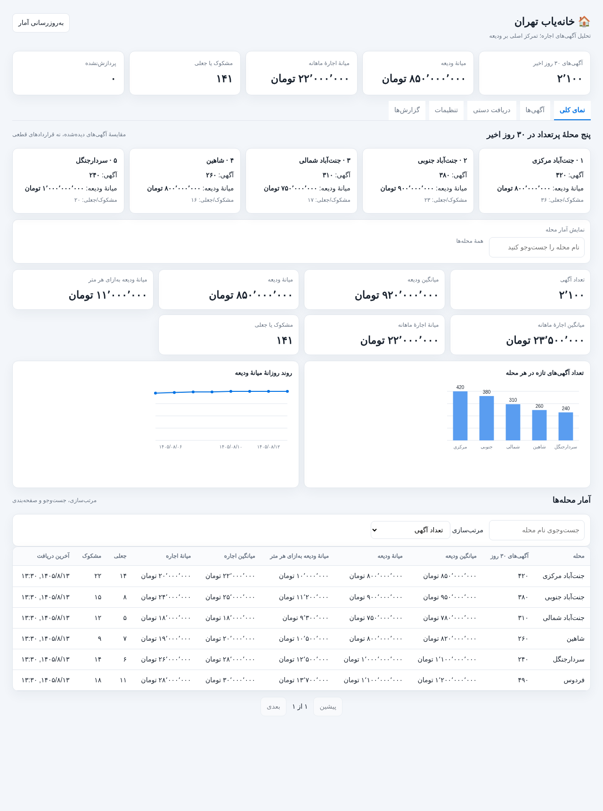 | 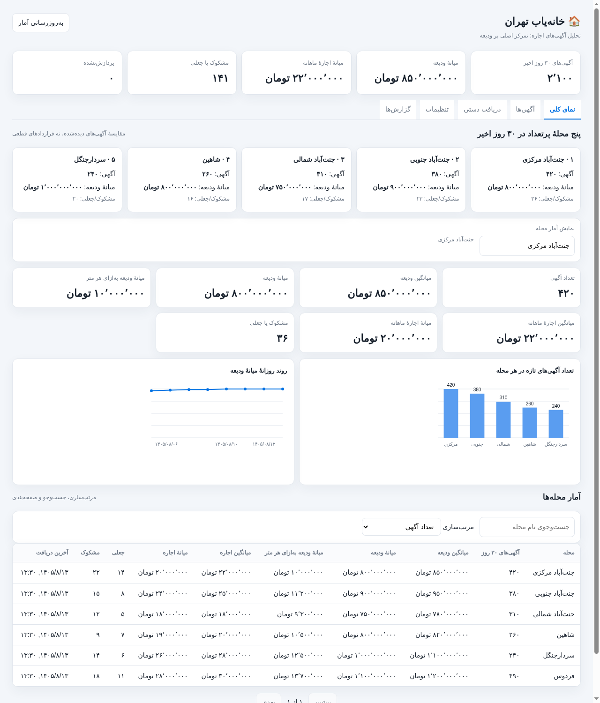 |

| تب آگهی‌ها | فیلتر آگهی‌های جعلی |
|---|---|
| 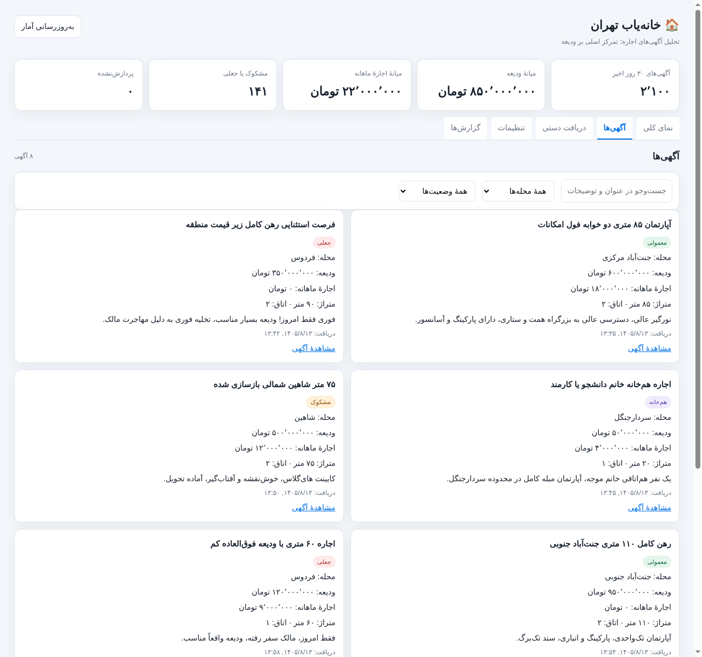 | 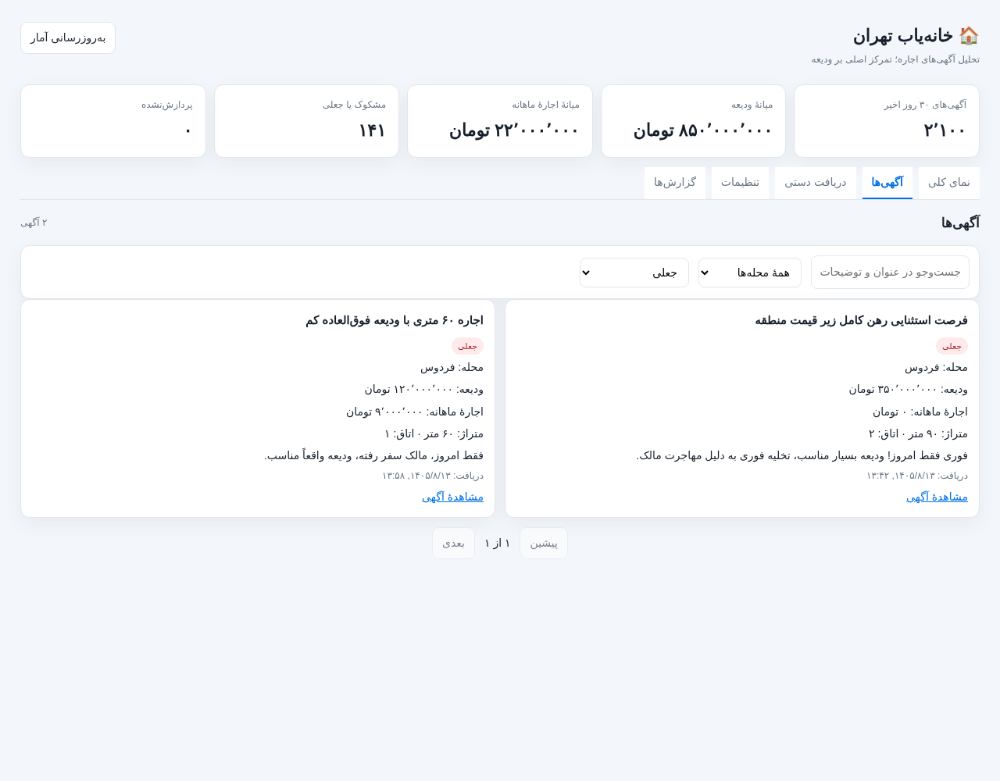 |

| دریافت دستی | تنظیمات | گزارش‌ها |
|---|---|---|
| 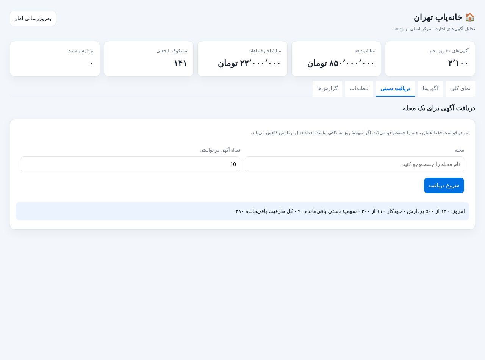 | 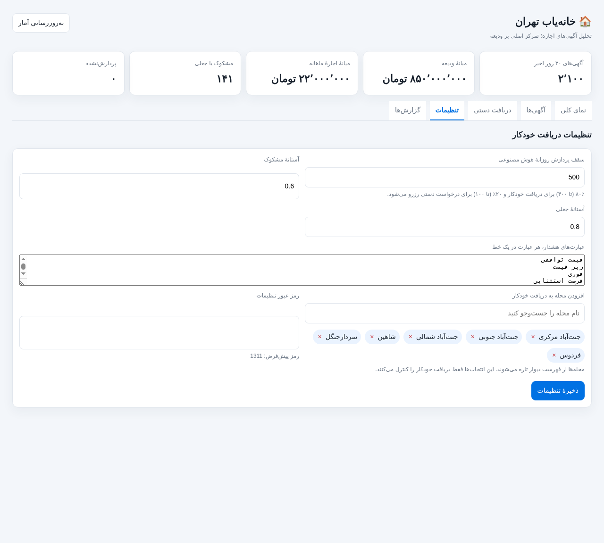 | 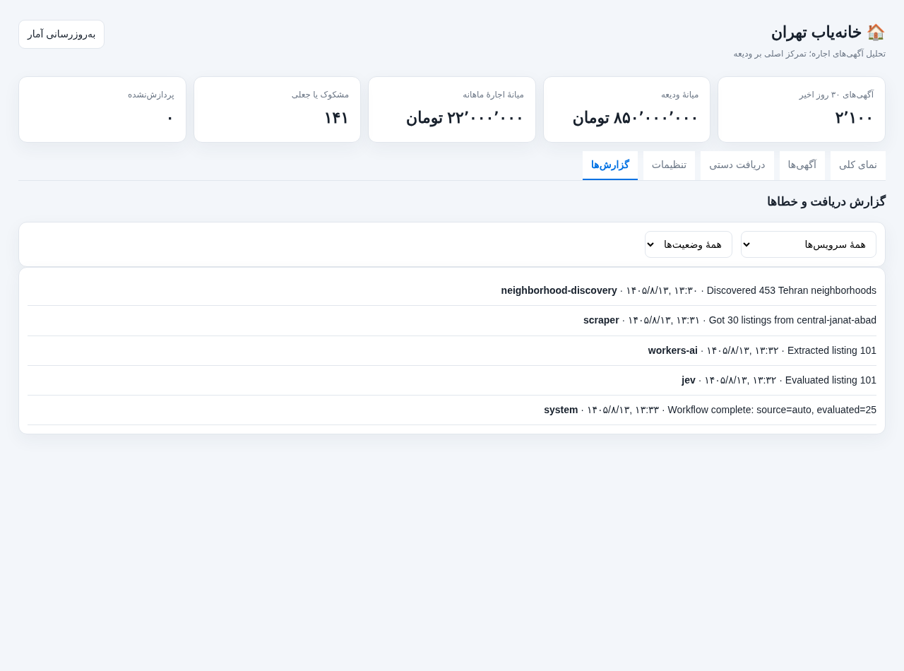 |

برای بازتولید تصاویر:
```bash
node scripts/capture-screenshots.js
```
این اسکریپت به `google-chrome` (حالت headless) نیاز دارد و تصاویر را در `docs/screenshots/` بازنویسی می‌کند. نمودارها با یک رندرر Canvas محلی کشیده می‌شوند تا تصاویر بدون اینترنت و به‌صورت تکرارپذیر ساخته شوند.

### بازتولید PDF مستندات فارسی
پس از تأیید منابع Markdown، در مرحلهٔ بعد دو PDF را از سند متناظر بسازید؛ در این مرحله PDFها دست‌نخورده مانده‌اند:
```bash
npm run docs:pdf
npm run docs:ooad-pdf
```
فرمان اول `DOCUMENTATION_FA.md` را به `DOCUMENTATION_FA.pdf` و فرمان دوم `OOAD_MANUAL_FETCH_FA.md` را به `OOAD_MANUAL_FETCH_FA.pdf` تبدیل می‌کند.
این اسکریپت به `google-chrome` یا `chromium` نیاز دارد؛ در صورت نصب نبودن در مسیرهای رایج، مسیر اجرایی را در متغیر `CHROME_PATH` تعیین کنید. فونت وزیرمتن و کتابخانه‌های رندر در نخستین اجرا در `.cache/docs-pdf/` دانلود و در اجراهای بعدی از همان کش استفاده می‌شوند.

### راهنمای کامل دکمه‌ها و کنترل‌های داشبورد
داشبورد یک صفحهٔ RTL است و داده‌ها را از همان APIهای مستندشده می‌خواند. جدول‌های زیر تمام کنترل‌های تعاملی را شرح می‌دهند:

#### کنترل‌های سراسری

| کنترل | شناسه | رفتار | درخواست‌های شبکه |
|---|---|---|---|
| دکمهٔ «به‌روزرسانی آمار» | `#refresh` | در حین اجرا غیرفعال و متن آن «در حال به‌روزرسانی…» می‌شود؛ یک اجرای خودکار صف می‌کند، هر ۵ ثانیه تا پایان `workflow_running` صبر می‌کند و سپس خلاصه، جدول، آگهی‌ها و سهمیه را دوباره می‌خواند | `POST /api/refresh` سپس `GET /api/neighborhoods?all=1`، `GET /api/analytics?days=30`، `GET /api/neighborhoods?...`، `GET /api/listings`، `GET /api/quota` |
| تب‌ها | `.tab[data-tab]` | جابه‌جایی بین پنج پنل بدون بارگذاری مجدد صفحه؛ تب «آگهی‌ها» فهرست، تب «گزارش‌ها» لاگ‌ها و تب «دریافت دستی» سهمیه را تازه می‌کند | `GET /api/listings`، `GET /api/logs`، `GET /api/quota` |

#### تب «نمای کلی»

| کنترل | شناسه | رفتار | درخواست |
|---|---|---|---|
| کارت‌های پنج محلهٔ برتر | `.top-card` | کلیک روی کارت، همان محله را انتخاب و آمار بخش «نمایش آمار محله» را به‌روز می‌کند | `GET /api/analytics?days=30&neighborhood=<slug>` |
| انتخاب محله | `#overview-neighborhood` + `#neighborhood-options` | جست‌وجوی نام فارسی از فهرست محله‌های دارای آگهی؛ تغییر مقدار، محله را انتخاب یا در صورت خالی بودن، «همهٔ محله‌ها» را نمایش می‌دهد | `GET /api/analytics?days=30[&neighborhood=<slug>]` |
| جست‌وجوی جدول | `#neighborhood-search` | جست‌وجوی سمت سرور با تأخیر ۲۵۰ میلی‌ثانیه، رد پاسخ کهنه و بازگشت به صفحهٔ اول | `GET /api/neighborhoods?search=...&page=1` |
| مرتب‌سازی جدول | `#neighborhood-sort` | گزینه‌ها: تعداد آگهی، میانگین ودیعه، میانهٔ ودیعه، میانهٔ ودیعه به‌ازای متر، تعداد جعلی، نام محله | `GET /api/neighborhoods?sort=...` |
| ردیف جدول | `tr.table-row` | کلیک روی ردیف، محله را انتخاب کرده و به تب «آگهی‌ها» با فیلتر همان محله می‌رود | `GET /api/analytics?...` و `GET /api/listings?neighborhood=<slug>` |
| صفحهٔ قبل/بعد جدول | `#table-prev` / `#table-next` | صفحه‌بندی ۲۰ ردیفی؛ در ابتدا/انتهای فهرست غیرفعال می‌شوند | `GET /api/neighborhoods?page=...` |
| نمودارها | `#count-chart` / `#deposit-chart` | خودکار از دادهٔ همان پاسخ analytics رسم می‌شوند (ستونی: تعداد آگهی محله‌ها؛ خطی: میانهٔ ودیعهٔ روزانه) | — |

#### تب «آگهی‌ها»

| کنترل | شناسه | رفتار | درخواست |
|---|---|---|---|
| جست‌وجو | `#listing-search` | جست‌وجو در عنوان و توضیحات با تأخیر ۲۵۰ میلی‌ثانیه، رد پاسخ کهنه و بازگشت به صفحهٔ اول | `GET /api/listings?search=...` |
| فیلتر محله | `#listing-neighborhood` | «همهٔ محله‌ها» یا یک محلهٔ فعال | `GET /api/listings?neighborhood=<slug>` |
| فیلتر وضعیت | `#listing-label` | همه، معمولی (`real`)، مشکوک (`suspicious`)، جعلی (`fake`)، هم‌خانه (`hamkhane`)، در انتظار بررسی (`pending` → `extraction_done = 0`)، تحلیل ناموفق (`failed` → `extraction_done = -1`)؛ هم‌خانه فقط با فیلتر خودش نمایش داده می‌شود | `GET /api/listings?label=...` |
| صفحهٔ قبل/بعد | `#listing-prev` / `#listing-next` | صفحه‌بندی ۲۰تایی کارت‌ها | `GET /api/listings?page=...` |
| «مشاهدهٔ آگهی» | لینک داخل کارت | باز کردن صفحهٔ آگهی در دیوار در تب جدید (`target="_blank"`, `rel="noopener noreferrer"`) | — |

#### تب «دریافت دستی»

| کنترل | شناسه | رفتار | درخواست |
|---|---|---|---|
| انتخاب محله | `#manual-neighborhood` + `#manual-options` | فقط محله‌های فعال؛ ورودی نامعتبر با پیام خطا رد می‌شود | — |
| تعداد درخواستی | `#manual-count` | عدد صحیح بین ۱ و سهمیهٔ دستی باقی‌ماندهٔ امروز؛ سقف ورودی با هر بار تازه‌سازی سهمیه به‌روز می‌شود | — |
| دکمهٔ «شروع دریافت» | `#manual-start` | اعتبارسنجی و ثبت؛ پایش هر ۳ ثانیه تا وضعیت پایانی و آزادشدن Workflow، با تلاش مجدد پس از خطای شبکه در ۱۰ ثانیه؛ هنگام اجرا یا نبود سهمیه غیرفعال است | `POST /api/manual-runs` و `GET /api/manual-runs/<id>` |
| پنل سهمیه | `#quota-panel` | نمایش سهمیهٔ دستی قابل استفاده، سهمیهٔ خودکار و مصرف امروز؛ در صورت اتمام سهمیه، قفل هوش مصنوعی یا Workflow فعال، ورودی و دکمه غیرفعال می‌شوند | `GET /api/quota` |
| ناحیهٔ وضعیت | `#manual-status` | وضعیت فارسی اجرا، تعداد درخواستی/دریافت‌شده و متن خطا در صورت شکست | — |

وضعیت‌های اجرای دستی: `queued` (در صف) ← `running` (در حال اجرا) ← `scraped` (در حال تحلیل) و سپس یکی از `complete` (کامل)، `partial` (کمتر از درخواست دریافت شد)، `empty` (آگهی تازه‌ای پیدا نشد)، `quota_exhausted` (سهمیه یا قفل هوش مصنوعی) یا `failed`.

#### تب «تنظیمات»

| کنترل | شناسه | رفتار | درخواست |
|---|---|---|---|
| سقف پردازش روزانه | `#daily-limit` | عدد ۳ تا ۵۰۰؛ ۸۰٪ خودکار و ۲۰٪ دستی تقسیم می‌شود | — |
| آستانهٔ مشکوک / جعلی | `#fake-threshold` / `#high-threshold` | عدد بین ۰ و ۱ | — |
| عبارت‌های هشدار | `#bait-keywords` | هر عبارت در یک خط | — |
| افزودن محله به دریافت خودکار | `#auto-search` + `#auto-suggestions` | پیشنهاد تا ۱۵ محلهٔ انتخاب‌نشده؛ کلیک روی پیشنهاد، برچسب اضافه می‌کند | — |
| برچسب محله‌های خودکار | `#auto-selected .chip` | دکمهٔ «×» هر برچسب را حذف می‌کند | — |
| رمز عبور تنظیمات | `#settings-password` | الزامی برای ذخیره؛ پیش‌فرض `1311` | — |
| دکمهٔ «ذخیرهٔ تنظیمات» | `form#settings-form` | ارسال همهٔ مقادیر؛ در موفقیت پیام سبز و پاک شدن رمز، در خطا پیام قرمز | `POST /api/settings` |

#### تب «گزارش‌ها»

| کنترل | شناسه | رفتار | درخواست |
|---|---|---|---|
| فیلتر سرویس | `#log-service` | همه یا یکی از `scraper`، `neighborhood-discovery`، `workers-ai`، `jev`، `system` | `GET /api/logs?service=...` |
| فیلتر وضعیت | `#log-status` | همه، خطاها یا موفق | `GET /api/logs?status=...` |

### جریان‌های اصلی برنامه (Flows)
#### ۱) اجرای خودکار زمان‌بندی‌شده
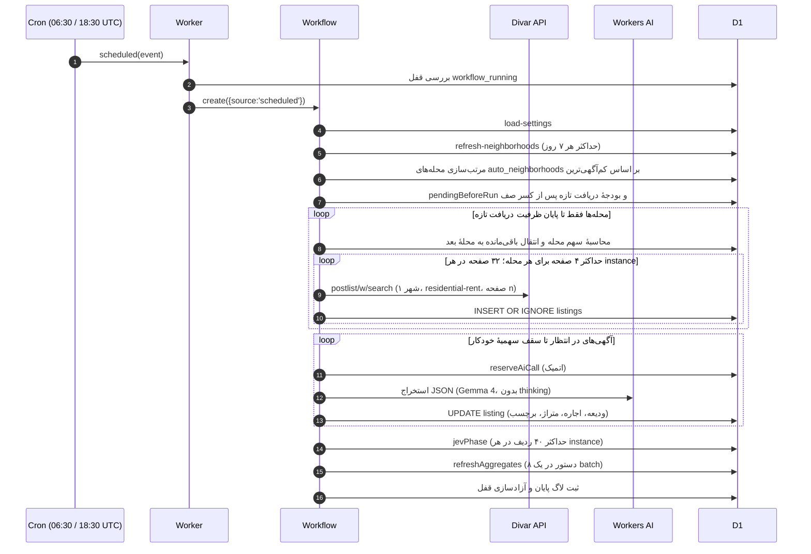

#### ۲) دریافت دستی یک محله
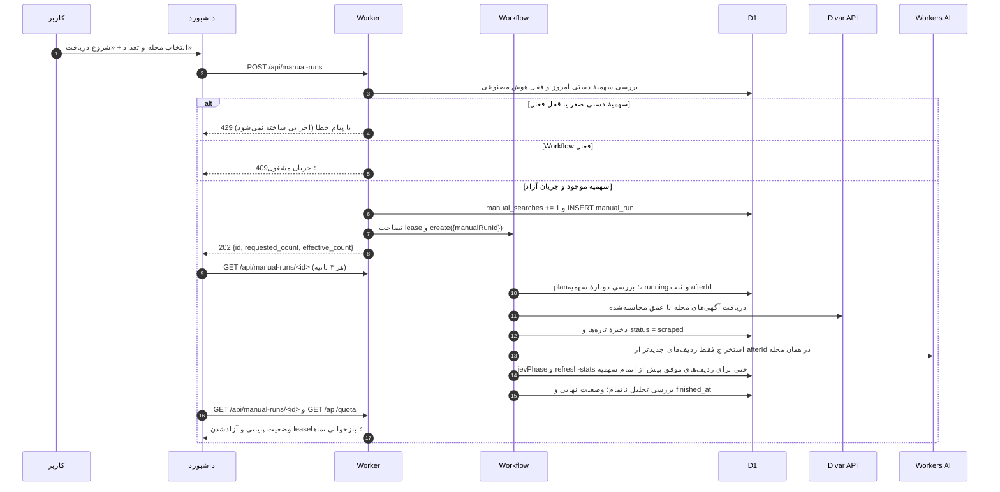

#### ۳) ذخیرهٔ تنظیمات
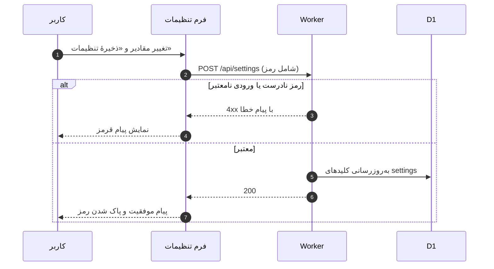

#### ۴) بارگذاری اولیهٔ داشبورد
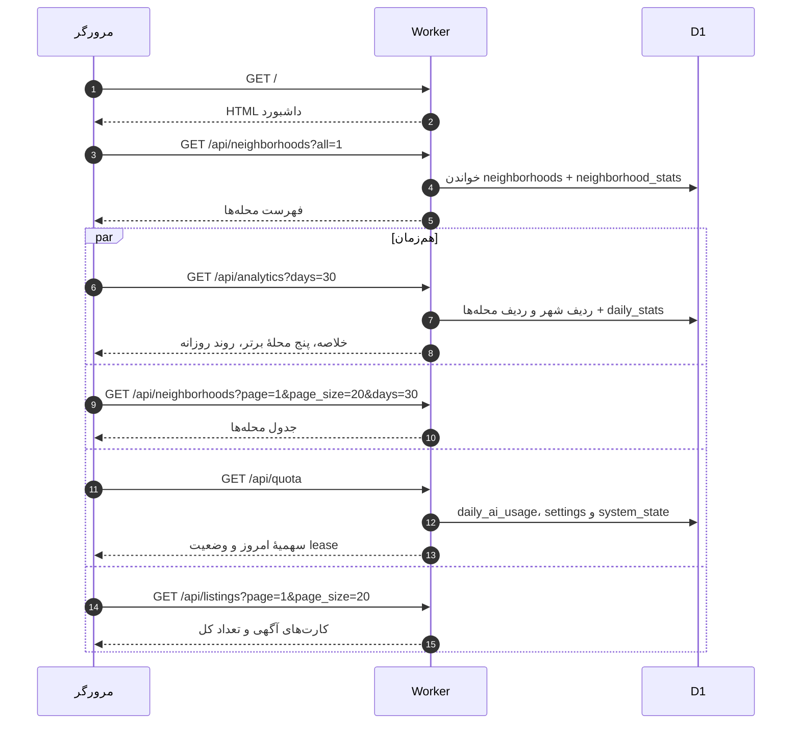

### مستندات اندپوینت‌های API

| مسیر (Path) | متد | شرح عملکرد |
|---|---|---|
| `GET /api/analytics` | `GET` | دریافت خلاصه آماری، ۵ محله پرآگهی و روند روزانه (پارامترهای اختیاری: `days=30` و `neighborhood=<slug>`)؛ در مسیر کش، `stats_computed_at` نیز برگردانده می‌شود |
| `GET /api/stats` | `GET` | خلاصهٔ آماری کل شهر برای ۳۰ روز (همان قرارداد `overall`) |
| `GET /api/neighborhoods` | `GET` | دریافت آمار محله‌ها با قابلیت جستجو، مرتب‌سازی و صفحه‌بندی (`page`, `page_size`, `search`, `sort`) |
| `GET /api/listings` | `GET` | لیست آگهی‌ها همراه با فیلتر محله، برچسب (`label`)، کلمه جستجو و صفحه‌بندی |
| `POST /api/manual-runs` | `POST` | ثبت درخواست دریافت دستی با بدنه `{"neighborhood": "<slug>", "count": 10}`؛ پاسخ شامل `requested_count` و `effective_count` است و اگر سهمیهٔ دستی امروز صفر باشد یا هوش مصنوعی قفل شده باشد، کد ۴۲۹ برمی‌گردد |
| `GET /api/manual-runs/:id` | `GET` | دریافت وضعیت پیشرفت (`queued`, `running`, `scraped`, `complete`, `partial`, `empty`, `quota_exhausted`, `failed`) همراه با `status_fa` |
| `GET /api/quota` | `GET` | سهمیهٔ امروز، `auto_remaining`، `manual_remaining`، `remaining`، قفل ارائه‌دهنده `quota_exhausted` و وضعیت lease با `workflow_running`؛ قفل غیرفعال لزوماً به معنی سهم قابل استفاده نیست |
| `GET /api/settings` | `GET` | دریافت تنظیمات جاری سیستم |
| `POST /api/settings` | `POST` | به‌روزرسانی تنظیمات سیستم (نیازمند فیلد `settings_password: "1311"`) |
| `GET /api/logs` | `GET` | دریافت لاگ‌های سیستمی (`service`, `status`, `limit`) |
| `POST /api/discover-neighborhoods` | `POST` | همگام‌سازی اجباری و لحظه‌ای فهرست محله‌ها از سرورهای دیوار |
| `POST /api/refresh` | `POST` | شروع زنجیرهٔ خودکار شامل صف قبلی (`202`)؛ اگر مشغول باشد `409`. صرفاً خواندن کش نیست و ممکن است سهمیهٔ خودکار مصرف کند |

بدنهٔ `POST /api/manual-runs` و `POST /api/settings` باید شیء JSON معتبر باشد؛ `null`، آرایه و مقدار ساده با `400` رد می‌شوند. دریافت دستی برای محلهٔ ناموجود `404`، زنجیرهٔ فعال `409` و نبود سهمیه `429` دارد. خروجی فهرست آگهی‌ها شامل شیء تجزیه‌شدهٔ `extracted_data` است؛ `failed` فیلتر استخراج است، نه برچسب تقلب.

---

## ۶. ساختار فایل‌های پروژه

```text
divar-housing-finder/
├── migrations/                                # اسکریپت‌های مهاجرت ساختار دیتابیس
│   ├── 0001_neighborhood_first_rebuild.sql  # بازسازی پایگاه داده مبتنی بر محله
│   ├── 0002_daily_quota_and_listing_reclassification.sql # رده‌بندی هم‌خانه و سهمیه
│   ├── 0003_retry_failed_extractions.sql     # بازنشانی آگهی‌های ناموفق
│   ├── 0004_increase_daily_quota_to_500.sql  # افزایش سقف سهمیه به ۵۰۰
│   └── 0005_precomputed_stats.sql            # جدول‌های آمار پیش‌محاسبه‌شده
├── seed/
│   └── seed-neighborhoods.sql                 # داده‌های اولیه محله‌ها و تنظیمات
├── src/
│   ├── index.js                               # نقطه ورود ورکر، مسیریابی API و تریگر کرون
│   ├── workflow.js                            # کلاس Cloudflare Workflow برای پیمایش و هوش مصنوعی
│   ├── scraper.js                             # توابع دریافت داده و ارتباط با API دیوار
│   ├── extractor.js                           # Gemma، تفسیر پاسخ و تبدیل قطعی مبلغ
│   ├── chain.js                               # انتقال فازها، شناسهٔ فرزند و lease
│   ├── jev.js                                 # موتور ارزیابی قیمت مشکوک و غیرواقعی
│   ├── stats.js                               # تجمیع SQL، بازسازی کش آمار و readerهای کش
│   ├── quota.js                               # محاسبات سهمیه، ساعت تهران، عمق صفحه و نتیجهٔ اجرای دستی
│   ├── rental-pricing.js                      # فرمول‌های تبدیل رهن و اجاره به ودیعه معادل
│   ├── listing-classification.js              # الگوهای تشخیص آگهی‌های هم‌خانه و اشتراکی
│   ├── neighborhood-discovery.js              # دریافت و همگام‌سازی محله‌های تهران از نقشه دیوار
│   ├── dashboard.js                           # رابط کاربری وب فارسی و کلاینت Chart.js
│   ├── constants.js                           # ثوابت سهمیه، صفحه‌بندی و سیستم
│   └── utils.js                               # توابع کمکی، نرمال‌سازی اعداد فارسی و لاگ‌گذاری
├── test/
│   ├── quota.test.js                          # تست‌های سهمیه، عمق صفحه، ساعت تهران و نتیجهٔ اجرای دستی
│   ├── rental-pricing.test.js                 # تست‌های واحد قیمت‌گذاری و تطبیق متن
│   ├── chain.test.js                          # زنجیره، مالکیت و سهمیه
│   ├── subrequest-budget.test.js              # بودجهٔ درخواست‌های دیوار
│   └── system-verification.test.js            # API، Workflow، SQLite و استخراج
├── scripts/
│   ├── capture-screenshots.js                 # تولید تصاویر مستندات از داشبورد
│   └── build-persian-pdf.mjs                  # تولید PDF فارسی از DOCUMENTATION_FA.md
├── docs/
│   └── screenshots/                           # تصاویر رابط کاربری برای مستندات
├── package.json                               # مشخصات پروژه و اسکریپت‌های npm
├── schema.sql                                 # ساختار کامل جداول پایگاه داده D1
├── wrangler.jsonc                             # پیکربندی سرورلس، دیتابیس، مدل هوش مصنوعی و کرون
├── README.md                                  # فایل راهنمای اصلی پروژه (فارسی)
├── README_EN.md                               # نسخه انگلیسی راهنما
├── DOCUMENTATION_FA.md                        # گزارش جامع فنی و دانشگاهی سامانه
└── OOAD_MANUAL_FETCH_FA.md                     # تحلیل و طراحی جریان دریافت دستی
```

---

## ۷. نکات حقوقی و عملیاتی

- **حفظ حریم خصوصی و امنیت**: این سامانه به طور پیش‌فرض روی داشبورد احراز هویت کاربری ندارد و نشانی نسخهٔ آنلاین در همین فایل منتشر شده است؛ هر کسی با این نشانی می‌تواند دریافت دستی را شروع کند و سهمیهٔ روزانهٔ هوش مصنوعی را مصرف کند. برای محدودکردن دسترسی از Cloudflare Access یا لایهٔ مشابه استفاده کنید. بخش تغییر تنظیمات دارای رمز عبور پیش‌فرض است.
- **مسئولیت استخراج داده**: وب‌سایت دیوار ممکن است ساختار پاسخ‌های داخلی API را تغییر دهد یا درخواست‌های پرشمار خودکار را محدود کند. فاصله‌گذاری (`step.sleep`) و سقف صفحه‌ها مصرف را محدود می‌کنند، اما تضمین پذیرش درخواست‌ها از سوی دیوار نیستند؛ سقف AI نیز جای محدودیت ترافیک دیوار را نمی‌گیرد.
- **ماهیت برچسب‌های مشکوک/فیک**: برچسب‌های جعلی و مشکوک جنبه سیگنال‌های کمکی برای بازبینی کارشناس دارند و به منزله ادعای قطعی در مورد قصد آگهی‌دهنده نیستند.

---

## ۸. انطباق با سرفصل‌های پروژه

| سرفصل | محل پاسخ در این مخزن |
|---|---|
| **تعیین حوزهٔ کسب‌وکاری** | حوزهٔ «پایش بازار رهن و اجارهٔ مسکن و شناسایی آگهی‌های مشکوک» در بخش ۱ همین فایل و بخش ۲ سند `DOCUMENTATION_FA.md` تحلیل شده است. |
| **تحلیل برای مدل داده‌ای و ساختار جداول** | بخش ۲ همین فایل (نمودار ER، روابط، ستون‌ها، فرهنگ داده) و بخش ۴ سند `DOCUMENTATION_FA.md` (تحلیل موجودیت‌ها، نرمال‌سازی، ایندکس‌گذاری و الگوی خواندن/نوشتن). اسکریپت اجرایی: `schema.sql` و `migrations/`. |
| **پیاده‌سازی با زبان انتخابی** | جاوااسکریپت (ES Modules) روی Cloudflare Workers؛ کد در `src/` و پیکربندی در `wrangler.jsonc`. |
| **سورس + راهنمای کاربردی + سند تحلیل و طراحی** | سورس کامل در مخزن؛ راهنمای کاربر در همین `README.md` (نصب، اجرا، دکمه‌ها، API)؛ سند تحلیل و طراحی در `DOCUMENTATION_FA.md`؛ تصاویر در `docs/screenshots/`. |
