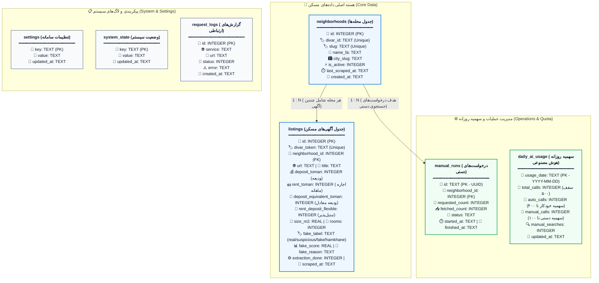
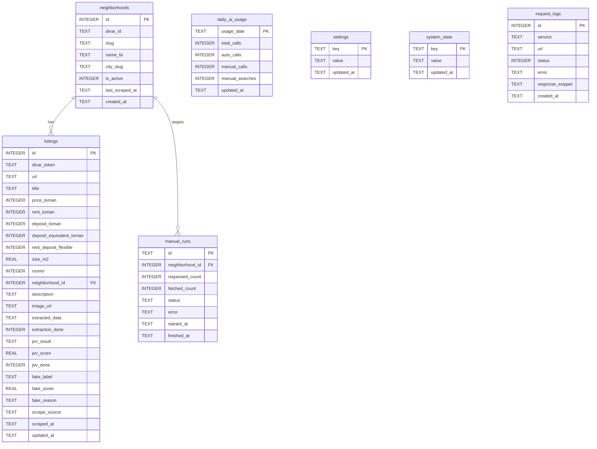

# سامانه هوشمند خانه‌یاب و پایش بازار مسکن دیوار (Divar Housing Finder)

یک سامانه اطلاعاتی هوشمند و سرورلس (Serverless) مبتنی بر **Cloudflare Workers**، پایگاه داده **Cloudflare D1 (SQLite)** و مدل‌های زبانی بزرگ **Cloudflare Workers AI** جهت جمع‌آوری، استخراج خودکار مشخصات، پایش قیمت‌های رهن و اجاره، و شناسایی آگهی‌های مشکوک و فیک در محله‌های تهران به همراه داشبورد تحلیلی تعاملی راست‌به‌چپ (RTL).

---

## ۱. معرفی و حوزه کسب‌وکار (Business Domain)

بازار مسکن و به‌ویژه بازار رهن و اجاره در کلان‌شهرهایی مانند تهران، از چالش‌های بنیادین اقتصادی و اجتماعی شهروندان است. بسترهایی نظیر وب‌سایت **دیوار** بستر اصلی دادوستد مستقیم ملک میان مالکان، مستأجران و مشاوران املاک هستند. با این وجود، این بازار با چالش‌های عمده‌ای روبرو است:
- **آگهی‌های طعمه (Bait) و قیمت‌های غیرواقعی/جعلی**: درج ودیعه و اجاره بسیار پایین‌تر از عرف بازار جهت کشاندن متقاضی به تماس.
- **تنوع شدید در شیوه ثبت ارقام و تبدیل رهن و اجاره**: برخی آگهی‌ها فقط رهن، برخی اجاره و برخی قابل تبدیل هستند.
- **آگهی‌های هم‌خانه و اتاق مشترک**: این دسته از آگهی‌ها به اشتباه در بخش آپارتمان مستقل قرار گرفته و میانگین آماری محله‌ها را منحرف می‌کنند.
- **نبود تحلیل لحظه‌ای و شفاف از وضعیت واقعی ودیعه و اجاره در سطح محله‌ها**.

**سامانه خانه‌یاب دیوار** به عنوان یک سامانه اطلاعاتی هوشمند برای حل این مسائل طراحی شده است:
1. به‌صورت دوره‌ای و خودکار، ساختار و شناسه محله‌های تهران را از سرورهای دیوار دریافت و به‌روزرسانی می‌کند.
2. بر اساس زمان‌بندی منظم روزانه (ساعت ۱۰ صبح و ساعت ۱۰ شب به وقت تهران)، آگهی‌های تازه محله‌های هدف را پیمایش و در دیتابیس ثبت می‌کند.
3. با استفاده از مدل زبانی هوش مصنوعی (`@cf/qwen/qwen3-30b-a3b-fp8`)، اطلاعات کلیدی متن آگهی (ودیعه، اجاره، متراژ، تعداد اتاق، قابلیت تبدیل و سیگنال‌های فریب) را استخراج و مقادیر را نرمال‌سازی می‌کند.
4. بر اساس فرمول عرف بازار مسکن ایران (هر ۱۰۰ میلیون تومان ودیعه معادل ۳ میلیون تومان اجاره ماهانه)، ارزش «ودیعه معادل» را محاسبه می‌کند.
5. به کمک موتور تحلیل آماری-هیوریستیک و مقایسه متری با میانگین همان محله، آگهی‌ها را در دسته‌های **معمولی (Real)**، **مشکوک (Suspicious)**، **جعلی (Fake)** و **هم‌خانه (Hamkhane)** طبقه‌بندی می‌کند.
6. آمارهای توصیفی (میانگین، میانه، روند روزانه، میانه ودیعه بر متر مربع) را در یک داشبورد فارسی و وب‌سرویس‌های RESTful در اختیار کاربر قرار می‌دهد.

---

## ۲. مدل داده‌ای و ساختار پایگاه داده (Data Model & Schema)

این سامانه به پایگاه داده رابطه‌ای لبه‌ای **Cloudflare D1** متصل است (مبتنی بر استاندارد SQLite با پشتیبانی کامل از Foreign Keys، تراکنش‌های اتمیک و Window Functions).

### دیاگرام مدل داده‌ای و ساختار جداول (ER & Database Architecture)



<details>
<summary><b>مشاهده دیاگرام با استاندارد متنی Mermaid Crow's Foot ER</b> (کلیک کنید)</summary>



</details>

### تشریح جداول پایگاه داده

1. **`neighborhoods` (محله‌ها)**:
   - ذخیره مشخصات محله‌های شهر تهران دریافت شده از نقشه و متادیتای دیوار (`divar_id`، `slug`، نام فارسی `name_fa`، وضعیت فعال بودن و تاریخ آخرین پیمایش).
2. **`listings` (آگهی‌های مسکن)**:
   - هسته مرکزی سیستم؛ شامل شناسه یکتای دیوار (`divar_token`)، نشانی آگهی، عناوین، مبالغ ودیعه و اجاره خام و استخراج‌شده، ارزش ودیعه معادل (`deposit_equivalent_toman`)، متراژ، تعداد اتاق، داده‌های ساختاریافته JSON از هوش مصنوعی، برچسب سلامت آگهی (`fake_label`: real, suspicious, fake, hamkhane)، امتیاز ارزیابی و ارتباط کلید خارجی با جدول محله‌ها.
3. **`daily_ai_usage` (مدیریت سهمیه روزانه هوش مصنوعی)**:
   - مدیریت سهمیه تفکیک‌شده روزانه (مجموع درخواست‌ها، درخواست‌های خودکار، درخواست‌های دستی و تعداد جستجوهای دستی) برای اعمال محدودیت سخت‌گیرانه سهمیه ۵۰۰ فراخوانی در روز.
4. **`manual_runs` (ردگیری درخواست‌های دستی)**:
   - تاریخچه و وضعیت کارهای دریافت دستی به تفکیک محله، تعداد درخواستی، تعداد دریافت شده و وضعیت پیشرفت (`queued`, `running`, `scraped`, `complete`, `failed`, `quota_exhausted`).
5. **`settings` (تنظیمات سامانه)**:
   - پارامترهای پویا شامل آستانه‌های کشف آگهی مشکوک (`fake_threshold`) و جعلی (`high_fake_threshold`)، سقف پردازش روزانه (`daily_listing_limit = 500`)، لیست محله‌های تحت پیمایش خودکار (`auto_neighborhoods`)، کلمات کلیدی طعمه (`bait_keywords`) و وزن‌های ارزیابی.
6. **`system_state` (وضعیت سراسری سامانه)**:
   - نگهداری قفل‌های هم‌زمانی اجرای ورک‌فلو (`workflow_running`)، زمان آخرین بروزرسانی لیست محله‌ها (`neighborhood_discovery_last_run`) و وضعیت تعلیق احتمالی سهمیه کلادفلر (`ai_quota_until`).
7. **`request_logs` (لاگ‌های سیستمی)**:
   - لاگ تمام ارتباطات خارجی شبکه (دیوار، ورکر هوش مصنوعی، سرویس Jev و خطاهای سیستمی) با ایندکس زمانی برای عیب‌یابی سریع.

---

## ۳. نحوه عملکرد و معماری سامانه

### الف) دریافت دوره‌ای محله‌ها (Neighborhood Discovery)
سامانه به‌صورت دوره‌ای (هر ۷ روز یک‌بار یا با درخواست دستی کاربر از طریق دکمه یا API) به اندپوینت رسمی نقشه دیوار مراجعه کرده (`https://map.divarcdn.com/places-web.json`) و تمامی محله‌های مربوط به تهران (`parent = 1` و `type = 4`) را استخراج و در جدول `neighborhoods` به روش `UPSERT` همگام‌سازی می‌کند.

### ب) زمان‌بندی روزانه (Cron Schedule)
در فایل پیکربندی `wrangler.jsonc` تریگر زمان‌بندی شده روی عبارت استاندارد کرون تنظیم شده است:
```text
30 6,18 * * * (بر حسب UTC)
```
با توجه به اختلاف ساعت رسمی تهران (UTC+3:30):
- ساعت **۰۶:۳۰ UTC** دقیقاً برابر با ساعت **۱۰:۰۰ صبح به وقت تهران** است.
- ساعت **۱۸:۳۰ UTC** دقیقاً برابر با ساعت **۲۲:۰۰ شب (۱۰ شب) به وقت تهران** است.

### ج) سهمیه‌بندی و بودجه ۵۰۰ پردازش روزانه (AI Quota Allocation)
به دلیل محدودیت توکن‌ها و واحدهای پردازشی کلادفلر (Workers AI Neuron Limits)، سامانه سقف پردازش شبانه‌روزی را روی **۵۰۰ پردازش** تنظیم کرده است:
- **سهمیه خودکار (۸۰٪ = ۴۰۰ فراخوانی)**: به پیمایش‌های خودکار صبح و شب اختصاص دارد.
- **سهمیه دستی (۲۰٪ = ۱۰۰ فراخوانی)**: برای جستجوهای درخواستی کاربر از طریق تب دستی داشبورد رزرو می‌شود.
- **انتقال سهمیه مازاد در ساعت ۲۲:۰۰**: در اجرای ساعت ۱۰ شب، چنانچه تا آن لحظه کاربر هیچ جستجوی دستی انجام نداده باشد (`manual_searches = 0`)، سامانه به شکل هوشمند کل ۱۰۰ سهمیه دست‌نخورده را آزاد کرده و به اجرای شبانه اختصاص می‌دهد تا حداکثر بهره‌وری حاصل شود.
- **تخصیص وزن‌دار به محله‌ها (`neighborhoodTarget`)**: در اجرای خودکار، محله‌هایی که آگهی کمتری در ۷ روز گذشته دارند یا زمان بیشتری از آخرین پیمایش آن‌ها گذشته است، اولویت و سهمیه بیشتری دریافت می‌کنند؛ همچنین اگر محله‌ای آگهی تازه کمتری داشته باشد، سهمیه باقیمانده به محله‌های بعدی تخصیص می‌یابد.

### د) پایپ‌لاین هوش مصنوعی و مدل‌سازی مالی
1. **استخراج حقایق با مدل Qwen 3 (30B)**:
   متن و عنوان آگهی به مدل `@cf/qwen/qwen3-30b-a3b-fp8` ارسال و مقادیر در قالب JSON استاندارد استخراج می‌شوند.
2. **محاسبه ودیعه معادل (Deposit Equivalent)**:
   بر اساس استاندارد ۳ درصد در بازار مسکن ایران:
   $$\text{Deposit Equivalent} = \text{Deposit} + \left(\text{Rent} \times \frac{100}{3}\right)$$
   این معیار، امکان مقایسه دقیق میان آگهی‌های رهن کامل و آگهی‌های اجاره ماهانه را ممکن می‌سازد.
3. **تفکیک خودکار هم‌خانه و اتاق اشتراکی (`hamkhane`)**:
   آگهی‌هایی که شامل کلمات کلیدی نظیر «هم‌خانه»، «هم‌اتاقی»، «اتاق مشترک» باشند یا در تحلیل مدل `property_type = room` تشخیص داده شوند، برچسب `hamkhane` دریافت کرده و به‌طور خودکار از محاسبات میانگین و میانه قیمت مسکن مستقل حذف می‌شوند تا داده‌های بازار تحریف نشوند.
4. **موتور ارزیابی آگهی مشکوک و جعلی (Fraud Detection)**:
   سامانه ارزش هر مترمربع ودیعه معادل آگهی را با میانگین همان محله می‌سنجد. در صورتی که قیمت کمتر از ۶۰٪ میانگین محله باشد یا کلمات طعمه (نظیر «فوری»، «زیر قیمت»، «فرصت استثنایی») در آن به کار رفته باشد، امتیاز ریسک افزایش یافته و برچسب `suspicious` یا `fake` می‌خورد.

---

## ۴. بررسی درستی عملکرد سامانه (Verification & Health Check)

عملکرد سامانه با ابزارهای تست واحد و شبیه‌سازی دیتابیس ارزیابی و اعتبارسنجی شده است:
- **تست‌های واحد (Unit Tests)**: کلیه ۱۱ آزمون در فایل‌های `test/quota.test.js` و `test/rental-pricing.test.js` با موفقیت ۱۰۰٪ پاس می‌شوند:
  - صحت محاسبات سهمیه ۵۰۰‌تایی (تقسیم به ۴۰۰ خودکار و ۱۰۰ دستی).
  - صحت تبدیل ساعت به وقت محلی تهران (`Asia/Tehran`) برای مرزهای ۱۰:۰۰ و ۲۲:۰۰.
  - آزادسازی سهمیه دستی به خودکار در ساعت ۲۲:۰۰ در صورت عدم فعالیت دستی.
  - توزیع وزن‌دار سهمیه میان محله‌ها.
  - صحت تبدیل ریاضی اجاره به ودیعه معادل با ضریب $100/3$.
  - تشخیص عبارات مختلف املایی و نیم‌فاصله‌ای آگهی‌های هم‌خانه.
  - پارس ویجت‌های خروجی API دیوار.
- **یکپارچگی پایگاه داده**: فایل `schema.sql` و تمامی ۴ فایل مایگریشن به‌طور کامل بر روی SQLite/D1 اجرا و اعتبارسنجی شدند.
- **کوئری‌های تحلیلی پنجره‌ای**: کوئری‌های محاسبه میانه (`ROW_NUMBER() OVER (...)`) برای ودیعه، اجاره و ودیعه بر متر مربع به صورت اتمیک و سریع اجرا می‌شوند.

---

## ۵. راهنمای نصب، راه‌اندازی و اجرای پروژه (Setup & Execution)

### پیش‌نیازها
1. **Node.js**: نسخه **20 به بالا** (نسخه 22 پیشنهاد می‌شود، زیرا دستور `node --test` در نسخه‌های پایین‌تر از 18 پشتیبانی نمی‌شود).
2. **npm**: مدیر بسته‌های نود.
3. **حساب کاربری Cloudflare** (برای استقرار نهایی، همراه با فعال‌سازی Workers, D1, Workers AI, Workflows).

---

### گام اول: نصب پیش‌نیازها
در پوشه ریشه پروژه دستور زیر را اجرا کنید:
```bash
npm install
```

---

### گام دوم: اجرای تست‌های سامانه
برای اطمینان از سلامت محاسبات سهمیه، ساعت تهران و منطق قیمت‌گذاری:
```bash
npm test
```

---

### گام سوم: راه‌اندازی پایگاه داده محلی (Local D1)
برای ساخت ساختار جداول و مقداردهی اولیه محله‌های پیش‌فرض در محیط لوکال:
```bash
# ایجاد جداول پایگاه داده در محیط محلی
npm run db:init-local

# بارگذاری محله‌های پیش‌فرض و تنظیمات در محیط محلی
npm run db:seed-local
```

*(در صورت نیاز به اعمال مایگریشن‌ها در دیتابیس محلی قدیمی:)*
```bash
npm run db:migrate-neighborhoods-local
npm run db:migrate-quota-and-labels-local
npm run db:increase-daily-quota-local
```

---

### گام چهارم: اجرای لوکال پروژه (Local Development)
برای اجرای شبیه‌ساز سرورلس کلادفلر و مشاهده داشبورد روی سیستم خود:
```bash
npm run dev
```
پس از اجرا، آدرس محلی (معمولاً `http://localhost:8787`) در مرورگر باز خواهد شد.

---

### گام پنجم: استقرار بر روی کلادفلر (Deploy to Remote)
1. ورود به حساب کلادفلر از طریق خط فرمان:
   ```bash
   npx wrangler login
   ```
2. ایجاد پایگاه داده D1 روی کلادفلر (در صورت نیاز به دیتابیس جدید):
   ```bash
   npx wrangler d1 create divar-housing-db
   ```
   شناسه پایگاه داده (`database_id`) بازگردانده شده را در فایل `wrangler.jsonc` در بخش `d1_databases` قرار دهید.
3. ساخت جداول روی دیتابیس ابری:
   ```bash
   npm run db:init
   npm run db:seed
   ```
4. استقرار نهایی پروژه:
   ```bash
   npm run deploy
   ```

---

## ۶. مستندات رابط کاربری و وب‌سرویس‌ها (Dashboard & API)

### داشبورد مدیریتی (تحت آدرس ریشه `/`)
- **تب نمای کلی (Overview)**: کارت‌های ۵ محله برتر، فیلتر و انتخاب هر محله، نمایش میانگین و میانه ودیعه، میانه ودیعه بر متر مربع، نمودار ستونی حجم آگهی‌ها، نمودار خطی روند روزانه ودیعه، و جدول داده‌ای مرتب‌شونده و دارای صفحه‌بندی.
- **تب آگهی‌ها (Listings)**: مشاهده کارت‌های آگهی به همراه عکس، قیمت، متراژ، تعداد خواب، وضعیت سلامت آگهی (نشان‌های رنگی: معمولی، مشکوک، جعلی، هم‌خانه) و لینک مستقیم به دیوار.
- **تب دریافت دستی (Manual)**: امکان انتخاب محله و ثبت سفارش دریافت ۱ تا ۵۰۰ آگهی به صورت دستی به همراه رهگیری زنده وضعیت پیشرفت در صف.
- **تب تنظیمات (Settings)**: ویرایش سقف سهمیه روزانه، آستانه‌های ریسک، کلمات کلیدی طعمه و انتخاب محله‌های پیمایش خودکار با برچسب‌های تعاملی.
  > **نکته امنیتی**: ذخیره تغییرات در تب تنظیمات نیازمند **رمز عبور** است. رمز پیش‌فرض تنظیمات در سامانه: **`1311`** می‌باشد.
- **تب گزارش‌ها (Logs)**: نمایش لاگ‌های سیستمی و ارتباط با دیوار و هوش مصنوعی با قابلیت فیلتر بر اساس سرویس و وضعیت خطا یا موفقیت.

### مستندات اندپوینت‌های API

| مسیر (Path) | متد | شرح عملکرد |
|---|---|---|
| `GET /api/analytics` | `GET` | دریافت خلاصه آماری، ۵ محله پرآگهی و روند روزانه (پارامترهای اختیاری: `days=30` و `neighborhood=<slug>`) |
| `GET /api/neighborhoods` | `GET` | دریافت آمار محله‌ها با قابلیت جستجو، مرتب‌سازی و صفحه‌بندی (`page`, `page_size`, `search`, `sort`) |
| `GET /api/listings` | `GET` | لیست آگهی‌ها همراه با فیلتر محله، برچسب (`label`)، کلمه جستجو و صفحه‌بندی |
| `POST /api/manual-runs` | `POST` | ثبت درخواست استخراج دستی با بدنه `{"neighborhood": "<slug>", "count": 10}` |
| `GET /api/manual-runs/:id` | `GET` | دریافت وضعیت پیشرفت فرایند استخراج دستی با شناسه |
| `GET /api/quota` | `GET` | استعلام وضعیت مصرف سهمیه ۵۰۰تایی، سهمیه خودکار و دستی مصرف‌شده و باقیمانده |
| `GET /api/settings` | `GET` | دریافت تنظیمات جاری سیستم |
| `POST /api/settings` | `POST` | به‌روزرسانی تنظیمات سیستم (نیازمند فیلد `settings_password: "1311"`) |
| `GET /api/logs` | `GET` | دریافت لاگ‌های سیستمی (`service`, `status`, `limit`) |
| `POST /api/discover-neighborhoods` | `POST` | همگام‌سازی اجباری و لحظه‌ای فهرست محله‌ها از سرورهای دیوار |
| `POST /api/refresh` | `POST` | فراخوانی دستی گردش‌کار (Workflow) پیمایش خودکار آگهی‌ها |

---

## ۷. ساختار فایل‌های پروژه

```text
divar-housing-finder/
├── migrations/                                # اسکریپت‌های مهاجرت ساختار دیتابیس
│   ├── 0001_neighborhood_first_rebuild.sql  # بازسازی پایگاه داده مبتنی بر محله
│   ├── 0002_daily_quota_and_listing_reclassification.sql # رده‌بندی هم‌خانه و سهمیه
│   ├── 0003_retry_failed_extractions.sql     # بازنشانی آگهی‌های ناموفق
│   └── 0004_increase_daily_quota_to_500.sql  # افزایش سقف سهمیه به ۵۰۰
├── seed/
│   └── seed-neighborhoods.sql                 # داده‌های اولیه محله‌ها و تنظیمات
├── src/
│   ├── index.js                               # نقطه ورود ورکر، مسیریابی API و تریگر کرون
│   ├── workflow.js                            # کلاس Cloudflare Workflow برای پیمایش و هوش مصنوعی
│   ├── scraper.js                             # توابع دریافت داده و ارتباط با API دیوار
│   ├── extractor.js                           # فراخوانی مدل زبانی Workers AI (Qwen)
│   ├── jev.js                                 # موتور ارزیابی قیمت مشکوک و غیرواقعی
│   ├── quota.js                               # مدیریت محاسبات سهمیه ۵۰۰‌تایی و ساعت تهران
│   ├── rental-pricing.js                      # فرمول‌های تبدیل رهن و اجاره به ودیعه معادل
│   ├── listing-classification.js              # الگوهای تشخیص آگهی‌های هم‌خانه و اشتراکی
│   ├── neighborhood-discovery.js              # دریافت و همگام‌سازی محله‌های تهران از نقشه دیوار
│   ├── dashboard.js                           # رابط کاربری وب فارسی و کلاینت Chart.js
│   ├── constants.js                           # ثوابت سهمیه و سیستم
│   └── utils.js                               # توابع کمکی، نرمال‌سازی اعداد فارسی و لاگ‌گذاری
├── test/
│   ├── quota.test.js                          # تست‌های واحد منطق سهمیه و زمان‌بندی
│   └── rental-pricing.test.js                 # تست‌های واحد قیمت‌گذاری و تطبیق متن
├── package.json                               # مشخصات پروژه و اسکریپت‌های npm
├── schema.sql                                 # ساختار کامل جداول پایگاه داده D1
├── wrangler.jsonc                             # پیکربندی سرورلس، دیتابیس، مدل هوش مصنوعی و کرون
├── README.md                                  # فایل راهنمای اصلی پروژه (فارسی)
├── README_EN.md                               # نسخه پیشین انگلیسی راهنما
└── DOCUMENTATION_FA.md                        # گزارش جامع فنی و دانشگاهی سامانه
```

---

## ۸. نکات حقوقی و عملیاتی

- **حفظ حریم خصوصی و امنیت**: این سامانه به طور پیش‌فرض روی داشبورد احراز هویت کاربری ندارد؛ بنابراین در صورت استقرار عمومی، دسترسی به نشانی آن را محدود نگه دارید. بخش تغییر تنظیمات دارای رمز عبور پیش‌فرض است.
- **مسئولیت استخراج داده**: وب‌سایت دیوار ممکن است ساختار پاسخ‌های داخلی API را تغییر دهد یا درخواست‌های پرشمار خودکار را محدود کند. این سامانه با رعایت فاصله‌گذاری مناسب بین درخواست‌ها (`step.sleep`) و محدودیت ۵۰۰ عددی، بار بسیار سبکی روی سرورها ایجاد می‌کند.
- **ماهیت برچسب‌های مشکوک/فیک**: برچسب‌های جعلی و مشکوک جنبه سیگنال‌های کمکی برای بازبینی کارشناس دارند و به منزله ادعای قطعی در مورد قصد آگهی‌دهنده نیستند.
