# سامانه هوشمند خانه‌یاب و پایش بازار مسکن دیوار (Divar Housing Finder)

> **نسخهٔ آنلاین داشبورد:** [divar-housing-finder.lizadfarshid.workers.dev](https://divar-housing-finder.lizadfarshid.workers.dev/)
>
> **مستندات کامل فارسی:** [DOCUMENTATION_FA.md](./DOCUMENTATION_FA.md)

یک سامانه اطلاعاتی هوشمند و سرورلس (Serverless) مبتنی بر **Cloudflare Workers**، پایگاه داده **Cloudflare D1 (SQLite)** و مدل‌های زبانی بزرگ **Cloudflare Workers AI** جهت جمع‌آوری، استخراج خودکار مشخصات، پایش قیمت‌های رهن و اجاره، و شناسایی آگهی‌های مشکوک و فیک در محله‌های تهران به همراه داشبورد تحلیلی تعاملی راست‌به‌چپ (RTL).

---

## ۱. معرفی و حوزه کسب‌وکار (Business Domain)

بازار مسکن و به‌ویژه بازار رهن و اجاره در کلان‌شهرهایی مانند تهران، از چالش‌های بنیادین اقتصادی و اجتماعی شهروندان است. بسترهایی نظیر وب‌سایت **دیوار** بستر اصلی دادوستد مستقیم ملک میان مالکان، مستأجران و مشاوران املاک هستند. با این وجود، این بازار با چالش‌های عمده‌ای روبرو است:
- **آگهی‌های طعمه (Bait) و قیمت‌های غیرواقعی/جعلی**: درج ودیعه و اجاره بسیار پایین‌تر از عرف بازار جهت کشاندن متقاضی به تماس.
- **تنوع شدید در شیوه ثبت ارقام و تبدیل رهن و اجاره**: برخی آگهی‌ها فقط رهن، برخی اجاره و برخی قابل تبدیل هستند.
- **آگهی‌های هم‌خانه و اتاق مشترک**: این دسته از آگهی‌ها به اشتباه در بخش آپارتمان مستقل قرار گرفته و میانگین آماری محله‌ها را منحرف می‌کنند.
- **نبود تحلیل لحظه‌ای و شفاف از وضعیت واقعی ودیعه و اجاره در سطح محله‌ها**.

**سامانه خانه‌یاب دیوار** به عنوان یک سامانه اطلاعاتی هوشمند برای حل این مسائل طراحی شده است:
1. به‌صورت دوره‌ای و خودکار، ساختار و شناسه محله‌های تهران را از سرورهای دیوار دریافت و به‌روزرسانی می‌کند.
2. بر اساس زمان‌بندی منظم روزانه (ساعت ۱۰ صبح و ساعت ۱۰ شب به وقت تهران)، آگهی‌های تازه محله‌های هدف را پیمایش و در دیتابیس ثبت می‌کند.
3. با استفاده از مدل زبانی هوش مصنوعی (`@cf/qwen/qwen3-30b-a3b-fp8`)، اطلاعات کلیدی متن آگهی (ودیعه، اجاره، متراژ، تعداد اتاق، قابلیت تبدیل و سیگنال‌های فریب) را استخراج و مقادیر را نرمال‌سازی می‌کند.
4. بر اساس فرمول عرف بازار مسکن ایران (هر ۱۰۰ میلیون تومان ودیعه معادل ۳ میلیون تومان اجاره ماهانه)، ارزش «ودیعه معادل» را محاسبه می‌کند.
5. به کمک موتور تحلیل آماری-هیوریستیک و مقایسه متری با میانگین همان محله، آگهی‌ها را در دسته‌های **معمولی (Real)**، **مشکوک (Suspicious)**، **جعلی (Fake)** و **هم‌خانه (Hamkhane)** طبقه‌بندی می‌کند.
6. آمارهای توصیفی (میانگین، میانه، روند روزانه، میانه ودیعه بر متر مربع) را در یک داشبورد فارسی و وب‌سرویس‌های RESTful در اختیار کاربر قرار می‌دهد.

---

## ۲. مدل داده‌ای و ساختار پایگاه داده (Data Model & Schema)

این سامانه به پایگاه داده رابطه‌ای لبه‌ای **Cloudflare D1** متصل است (مبتنی بر استاندارد SQLite با پشتیبانی کامل از Foreign Keys، تراکنش‌های اتمیک و Window Functions).

### دیاگرام مدل داده‌ای و ساختار جداول (ER & Database Architecture)

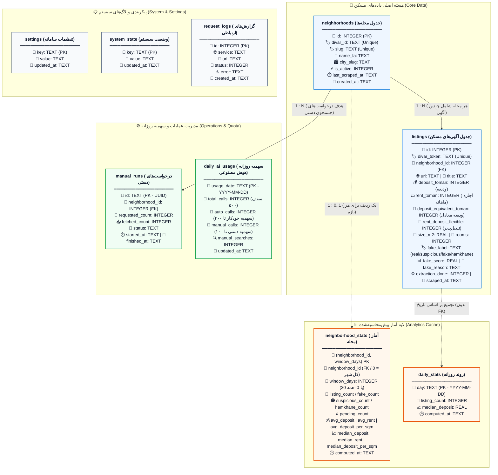

> نکته: جدول‌های `neighborhood_stats` و `daily_stats` کش تحلیلی هستند و داده‌ی جدید تولید نمی‌کنند؛ در پایان هر اجرای ورک‌فلو از روی `listings` بازسازی می‌شوند. ردیف با `neighborhood_id = 0` در `neighborhood_stats` یک ردیف مصنوعی «کل شهر» است و عمداً کلید خارجی ندارد.

<details>
<summary><b>روابط جداول پایگاه داده (کلیک کنید)</b></summary>

| جدول مبدأ | نوع رابطه | جدول مقصد | توضیح |
|---|---|---|---|
| `neighborhoods` | یک به چند (1:N) | `listings` | هر محله شامل چندین آگهی است |
| `neighborhoods` | یک به چند (1:N) | `manual_runs` | هر محله می‌تواند چندین درخواست دستی داشته باشد |
| `neighborhoods` | یک به یک (1:0..1) | `neighborhood_stats` | برای هر محله در هر بازه (`30` و `0`) یک ردیف تجمیعی |
| `listings` | تجمیع منطقی (بدون FK) | `daily_stats` | یک ردیف به ازای هر روز دارای آگهی |

**ساختار کامل ستون‌های هر جدول:**

**`neighborhoods`:** `id` PK, `divar_id` UNIQUE, `slug` UNIQUE, `name_fa`, `city_slug`, `is_active`, `last_scraped_at`, `created_at`

**`listings`:** `id` PK, `divar_token` UNIQUE, `neighborhood_id` FK, `url`, `title`, `price_toman`, `rent_toman`, `deposit_toman`, `deposit_equivalent_toman`, `rent_deposit_flexible`, `size_m2`, `rooms`, `description`, `image_url`, `extracted_data`, `extraction_done`, `jev_result`, `jev_score`, `jev_done`, `fake_label`, `fake_score`, `fake_reason`, `scrape_source`, `scraped_at`, `updated_at`

**`manual_runs`:** `id` PK (UUID), `neighborhood_id` FK, `requested_count`, `fetched_count`, `status`, `error`, `started_at`, `finished_at`

**`daily_ai_usage`:** `usage_date` PK, `total_calls`, `auto_calls`, `manual_calls`, `manual_searches`, `updated_at`

**`settings`:** `key` PK, `value`, `updated_at`

**`system_state`:** `key` PK, `value`, `updated_at`

**`request_logs`:** `id` PK, `service`, `url`, `status`, `error`, `response_snippet`, `created_at`

**`neighborhood_stats`:** `(neighborhood_id, window_days)` PK, `listing_count`, `fake_count`, `suspicious_count`, `hamkhane_count`, `pending_count`, `avg_deposit`, `avg_rent`, `avg_deposit_per_sqm`, `median_deposit`, `median_rent`, `median_deposit_per_sqm`, `computed_at` — بدون FK؛ `neighborhood_id = 0` ردیف سراسری شهر است.

**`daily_stats`:** `day` PK, `listing_count`, `median_deposit`, `computed_at`

</details>

### تشریح جداول پایگاه داده

1. **`neighborhoods` (محله‌ها)**:
   - ذخیره مشخصات محله‌های شهر تهران دریافت شده از نقشه و متادیتای دیوار (`divar_id`، `slug`، نام فارسی `name_fa`، وضعیت فعال بودن و تاریخ آخرین پیمایش).
2. **`listings` (آگهی‌های مسکن)**:
   - هسته مرکزی سیستم؛ شامل شناسه یکتای دیوار (`divar_token`)، نشانی آگهی، عناوین، مبالغ ودیعه و اجاره خام و استخراج‌شده، ارزش ودیعه معادل (`deposit_equivalent_toman`)، متراژ، تعداد اتاق، داده‌های ساختاریافته JSON از هوش مصنوعی، برچسب سلامت آگهی (`fake_label`: real, suspicious, fake, hamkhane)، امتیاز ارزیابی و ارتباط کلید خارجی با جدول محله‌ها.
3. **`daily_ai_usage` (مدیریت سهمیه روزانه هوش مصنوعی)**:
   - مدیریت سهمیه تفکیک‌شده روزانه (مجموع درخواست‌ها، درخواست‌های خودکار، درخواست‌های دستی و تعداد جستجوهای دستی) برای اعمال محدودیت سخت‌گیرانه سهمیه ۵۰۰ فراخوانی در روز.
4. **`manual_runs` (ردگیری درخواست‌های دستی)**:
   - تاریخچه و وضعیت کارهای دریافت دستی به تفکیک محله، تعداد درخواستی، تعداد دریافت شده و وضعیت پیشرفت (`queued`, `running`, `scraped`, `complete`, `partial`, `empty`, `quota_exhausted`, `failed`).
5. **`settings` (تنظیمات سامانه)**:
   - پارامترهای پویا شامل آستانه‌های کشف آگهی مشکوک (`fake_threshold`) و جعلی (`high_fake_threshold`)، سقف پردازش روزانه (`daily_listing_limit = 500`)، لیست محله‌های تحت پیمایش خودکار (`auto_neighborhoods`)، کلمات کلیدی طعمه (`bait_keywords`) و وزن‌های ارزیابی.
6. **`system_state` (وضعیت سراسری سامانه)**:
   - نگهداری قفل‌های هم‌زمانی اجرای ورک‌فلو (`workflow_running`)، زمان آخرین بروزرسانی لیست محله‌ها (`neighborhood_discovery_last_run`) و وضعیت تعلیق احتمالی سهمیه کلادفلر (`ai_quota_until`).
7. **`request_logs` (لاگ‌های سیستمی)**:
   - لاگ تمام ارتباطات خارجی شبکه (دیوار، ورکر هوش مصنوعی، سرویس Jev و خطاهای سیستمی) با ایندکس زمانی برای عیب‌یابی سریع.
8. **`neighborhood_stats` (کش آمار محله)**:
   - نتیجهٔ تجمیع ۳۰ روزه و تجمیع کل‌زمانی (`window_days = 0`) برای هر محله و یک ردیف سراسری شهر (`neighborhood_id = 0`). شامل شمارش آگهی/جعلی/مشکوک/هم‌خانه/درانتظار و میانگین و میانهٔ ودیعه، اجاره و ودیعهٔ هر متر است. این جدول در پایان هر اجرای ورک‌فلو به‌صورت اتمیک بازسازی می‌شود تا کوئری‌های داشبورد به‌جای اسکن جدول `listings` فقط چند ده ردیف بخوانند.
9. **`daily_stats` (روند روزانه)**:
   - میانهٔ ودیعه و تعداد آگهی به تفکیک روز برای ۳۰ روز اخیر؛ منبع نمودار «روند روزانهٔ میانهٔ ودیعه» و جایگزین محاسبهٔ پنجره‌ای روی کل `listings` در هر بار بارگذاری داشبورد.

---

## ۳. نحوه عملکرد و معماری سامانه

### الف) دریافت دوره‌ای محله‌ها (Neighborhood Discovery)
سامانه به‌صورت دوره‌ای (هر ۷ روز یک‌بار یا با درخواست دستی کاربر از طریق دکمه یا API) به اندپوینت رسمی نقشه دیوار مراجعه کرده (`https://map.divarcdn.com/places-web.json`) و تمامی محله‌های مربوط به تهران (`parent = 1` و `type = 4`) را استخراج و در جدول `neighborhoods` به روش `UPSERT` همگام‌سازی می‌کند.

### ب) زمان‌بندی روزانه (Cron Schedule)
در فایل پیکربندی `wrangler.jsonc` تریگر زمان‌بندی شده روی عبارت استاندارد کرون تنظیم شده است:
```text
30 6,18 * * * (بر حسب UTC)
```
با توجه به اختلاف ساعت رسمی تهران (UTC+3:30):
- ساعت **۰۶:۳۰ UTC** دقیقاً برابر با ساعت **۱۰:۰۰ صبح به وقت تهران** است.
- ساعت **۱۸:۳۰ UTC** دقیقاً برابر با ساعت **۲۲:۰۰ شب (۱۰ شب) به وقت تهران** است.

### ج) سهمیه‌بندی و بودجه ۵۰۰ پردازش روزانه (AI Quota Allocation)
به دلیل محدودیت توکن‌ها و واحدهای پردازشی کلادفلر (Workers AI Neuron Limits)، سامانه سقف پردازش شبانه‌روزی را روی **۵۰۰ پردازش** تنظیم کرده است:
- **سهمیه خودکار (۸۰٪ = ۴۰۰ فراخوانی)**: به پیمایش‌های خودکار صبح و شب اختصاص دارد.
- **سهمیه دستی (۲۰٪ = ۱۰۰ فراخوانی)**: برای جستجوهای درخواستی کاربر از طریق تب دستی داشبورد رزرو می‌شود.
- **انتقال سهمیه مازاد در ساعت ۲۲:۰۰**: در اجرای ساعت ۱۰ شب، چنانچه تا آن لحظه کاربر هیچ جستجوی دستی انجام نداده باشد (`manual_searches = 0`)، سامانه به شکل هوشمند کل ۱۰۰ سهمیه دست‌نخورده را آزاد کرده و به اجرای شبانه اختصاص می‌دهد تا حداکثر بهره‌وری حاصل شود.
- **تخصیص وزن‌دار به محله‌ها (`neighborhoodTarget`)**: در اجرای خودکار، محله‌هایی که آگهی کمتری در ۷ روز گذشته دارند یا زمان بیشتری از آخرین پیمایش آن‌ها گذشته است، اولویت و سهمیه بیشتری دریافت می‌کنند؛ همچنین اگر محله‌ای آگهی تازه کمتری داشته باشد، سهمیه باقیمانده به محله‌های بعدی تخصیص می‌یابد.

### د) دریافت آگهی: مسیر خودکار و مسیر دستی
هر آگهی فقط یک بار با `divar_token` یکتا ذخیره می‌شود؛ بنابراین «تعداد دریافت‌شده» یعنی آگهی تازه، نه تعداد آگهی‌های دیده‌شده. هر صفحهٔ نتایج دیوار حداکثر ۳۰ آگهی دارد.

**مسیر خودکار (ساعت ۱۰ و ۲۲ تهران)**
1. سهمیهٔ خودکار روز (پیش‌فرض ۴۰۰ فراخوانی) خوانده می‌شود.
2. محله‌های انتخاب‌شده به ترتیب کم‌آگهی‌ترین در ۷ روز گذشته مرتب می‌شوند.
3. سهمیه بین آن‌ها با وزن `(بیشترین آگهی + ۱) ÷ (آگهی محله + ۱)` و ضریب تازگی `۱ + min(۷، روزهای گذشته از آخرین دریافت) ÷ ۷` تقسیم می‌شود. اگر یک محله کمتر از سهم خود آگهی تازه داشته باشد، باقی‌مانده به محلهٔ بعدی منتقل می‌شود.
4. عمق جست‌وجو از خود هدف محاسبه می‌شود: `min(20, max(3, ⌈هدف ÷ 30⌉ × 3))` صفحه. هدف ۹۰ آگهی حداقل ۹ صفحه و هدف ۳۱۰ آگهی ۲۰ صفحه (سقف) جست‌وجو می‌کند.
5. آگهی‌های تازه ابتدا ذخیره و سپس تا سقف سهمیهٔ خودکار با هوش مصنوعی تحلیل می‌شوند.

**مسیر دستی (تب «دریافت دستی»)**
1. سهمیهٔ دستی امروز (پیش‌فرض ۱۰۰ فراخوانی) بررسی می‌شود؛ اگر صفر باشد درخواست با کد ۴۲۹ رد می‌شود و هیچ اجرایی ساخته نمی‌شود.
2. تعداد مؤثر برابر `min(تعداد درخواستی، سهمیهٔ دستی باقی‌مانده)` است و در پاسخ `effective_count` برگردانده می‌شود.
3. جست‌وجوی همان محله با همان فرمول عمق انجام می‌شود.
4. آگهی‌های تازه از جدید به قدیم تحلیل می‌شوند و وضعیت پایانی دقیق ثبت می‌شود: `complete` (به تعداد درخواستی آگهی تازه دریافت شد)، `partial` (کمتر از درخواست دریافت شد؛ به دلیل سهمیه یا کمبود آگهی تازه)، `empty` (آگهی تازه‌ای پیدا نشد)، `quota_exhausted` (سهمیه یا قفل هوش مصنوعی) یا `failed`.

> سهمیه فقط برای تحلیل هوش مصنوعی است؛ خود جست‌وجو در دیوار مصرف سهمیه ندارد.

### هـ) پایپ‌لاین هوش مصنوعی و مدل‌سازی مالی
1. **استخراج حقایق با مدل Qwen 3 (30B)**:
   متن و عنوان آگهی به مدل `@cf/qwen/qwen3-30b-a3b-fp8` ارسال و مقادیر در قالب JSON استاندارد استخراج می‌شوند.
2. **محاسبه ودیعه معادل (Deposit Equivalent)**:
   بر اساس استاندارد ۳ درصد در بازار مسکن ایران:
   $$\text{Deposit Equivalent} = \text{Deposit} + \left(\text{Rent} \times \frac{100}{3}\right)$$
   این معیار، امکان مقایسه دقیق میان آگهی‌های رهن کامل و آگهی‌های اجاره ماهانه را ممکن می‌سازد.
3. **تفکیک خودکار هم‌خانه و اتاق اشتراکی (`hamkhane`)**:
   آگهی‌هایی که شامل کلمات کلیدی نظیر «هم‌خانه»، «هم‌اتاقی»، «اتاق مشترک» باشند یا در تحلیل مدل `property_type = room` تشخیص داده شوند، برچسب `hamkhane` دریافت کرده و به‌طور خودکار از محاسبات میانگین و میانه قیمت مسکن مستقل حذف می‌شوند تا داده‌های بازار تحریف نشوند.
4. **موتور ارزیابی آگهی مشکوک و جعلی (Fraud Detection)**:
   سامانه ارزش هر مترمربع ودیعه معادل آگهی را با میانگین همان محله می‌سنجد. در صورتی که قیمت کمتر از ۶۰٪ میانگین محله باشد یا کلمات طعمه (نظیر «فوری»، «زیر قیمت»، «فرصت استثنایی») در آن به کار رفته باشد، امتیاز ریسک افزایش یافته و برچسب `suspicious` یا `fake` می‌خورد.

---

## ۴. راهنمای نصب، راه‌اندازی و اجرای پروژه (Setup & Execution)

### پیش‌نیازها
1. **Node.js**: نسخه **20 به بالا** (نسخه 22 پیشنهاد می‌شود، زیرا دستور `node --test` در نسخه‌های پایین‌تر از 18 پشتیبانی نمی‌شود).
2. **npm**: مدیر بسته‌های نود.
3. **حساب کاربری Cloudflare** (برای استقرار نهایی، همراه با فعال‌سازی Workers, D1, Workers AI, Workflows).

---

### گام اول: نصب پیش‌نیازها
در پوشه ریشه پروژه دستور زیر را اجرا کنید:
```bash
npm install
```

---

### گام دوم: اجرای تست‌های سامانه
برای اطمینان از سلامت محاسبات سهمیه، ساعت تهران و منطق قیمت‌گذاری:
```bash
npm test
```

---

### گام سوم: راه‌اندازی پایگاه داده محلی (Local D1)
برای ساخت ساختار جداول و مقداردهی اولیه محله‌های پیش‌فرض در محیط لوکال:
```bash
# ایجاد جداول پایگاه داده در محیط محلی
npm run db:init-local

# بارگذاری محله‌های پیش‌فرض و تنظیمات در محیط محلی
npm run db:seed-local
```

*(در صورت نیاز به اعمال مایگریشن‌ها در دیتابیس محلی قدیمی:)*
```bash
npm run db:migrate-neighborhoods-local
npm run db:migrate-quota-and-labels-local
npm run db:increase-daily-quota-local
npm run db:migrate-precomputed-stats-local
```

---

### گام چهارم: اجرای لوکال پروژه (Local Development)
برای اجرای شبیه‌ساز سرورلس کلادفلر و مشاهده داشبورد روی سیستم خود:
```bash
npm run dev
```
پس از اجرا، آدرس محلی (معمولاً `http://localhost:8787`) در مرورگر باز خواهد شد.

---

### گام پنجم: استقرار بر روی کلادفلر (Deploy to Remote)
1. ورود به حساب کلادفلر از طریق خط فرمان:
   ```bash
   npx wrangler login
   ```
2. ایجاد پایگاه داده D1 روی کلادفلر (در صورت نیاز به دیتابیس جدید):
   ```bash
   npx wrangler d1 create divar-housing-db
   ```
   شناسه پایگاه داده (`database_id`) بازگردانده شده را در فایل `wrangler.jsonc` در بخش `d1_databases` قرار دهید.
3. ساخت جداول روی دیتابیس ابری:
   ```bash
   npm run db:init
   npm run db:seed
   ```
   برای دیتابیس موجود، فقط مایگریشن افزایشی آمار را یک‌بار اجرا کنید:
   ```bash
   npm run db:migrate-precomputed-stats
   ```
4. استقرار نهایی پروژه:
   ```bash
   npm run deploy
   ```
   > این پروژه به Git متصل است و با هر `git push` روی شاخهٔ اصلی به‌صورت خودکار روی Cloudflare دیپلوی می‌شود. مایگریشن‌ها خودکار اجرا نمی‌شوند؛ پیش از نخستین دیپلویِ نسخه‌ای که به جدول‌های آمار وابسته است، `db:migrate-precomputed-stats` را روی دیتابیس ریموت اجرا کنید. حتی بدون آن، اندپوینت‌ها به‌صورت خودکار به مسیر زنده برمی‌گردند و خطا نمی‌دهند.

---

## ۵. مستندات رابط کاربری و وب‌سرویس‌ها (Dashboard & API)

### داشبورد مدیریتی (تحت آدرس ریشه `/`)
- **تب نمای کلی (Overview)**: کارت‌های ۵ محله برتر، فیلتر و انتخاب هر محله، نمایش میانگین و میانه ودیعه، میانه ودیعه بر متر مربع، نمودار ستونی حجم آگهی‌ها، نمودار خطی روند روزانه ودیعه، و جدول داده‌ای مرتب‌شونده و دارای صفحه‌بندی.
- **تب آگهی‌ها (Listings)**: مشاهده کارت‌های آگهی به همراه عکس، قیمت، متراژ، تعداد خواب، وضعیت سلامت آگهی (نشان‌های رنگی: معمولی، مشکوک، جعلی، هم‌خانه) و لینک مستقیم به دیوار.
- **تب دریافت دستی (Manual)**: امکان انتخاب محله و ثبت سفارش دریافت دستی؛ سقف ورودی از سهمیهٔ دستی باقی‌ماندهٔ امروز پیروی می‌کند و در صورت صفر بودن سهمیه، دکمه غیرفعال می‌شود. وضعیت پیشرفت به‌صورت زنده نمایش داده می‌شود.
- **تب تنظیمات (Settings)**: ویرایش سقف سهمیه روزانه، آستانه‌های ریسک، کلمات کلیدی طعمه و انتخاب محله‌های پیمایش خودکار با برچسب‌های تعاملی.
  > **نکته امنیتی**: ذخیره تغییرات در تب تنظیمات نیازمند **رمز عبور** است. رمز پیش‌فرض تنظیمات در سامانه: **`1311`** می‌باشد.
- **تب گزارش‌ها (Logs)**: نمایش لاگ‌های سیستمی و ارتباط با دیوار و هوش مصنوعی با قابلیت فیلتر بر اساس سرویس و وضعیت خطا یا موفقیت.

### تصاویر رابط کاربری
تصاویر زیر با اسکریپت `scripts/capture-screenshots.js` از همان HTML داشبورد و با دادهٔ نمونه تولید می‌شوند (بدون تماس با دیتابیس یا سرویس‌های بیرونی):

| نمای کلی (نمودارها و جدول) | انتخاب یک محله |
|---|---|
| 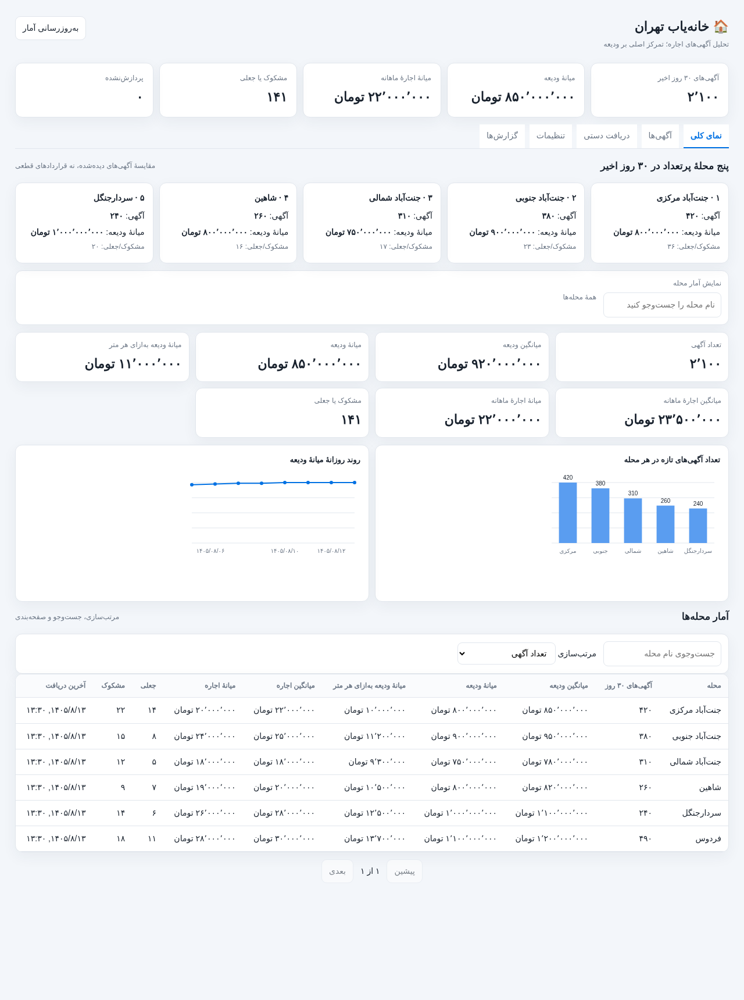 | 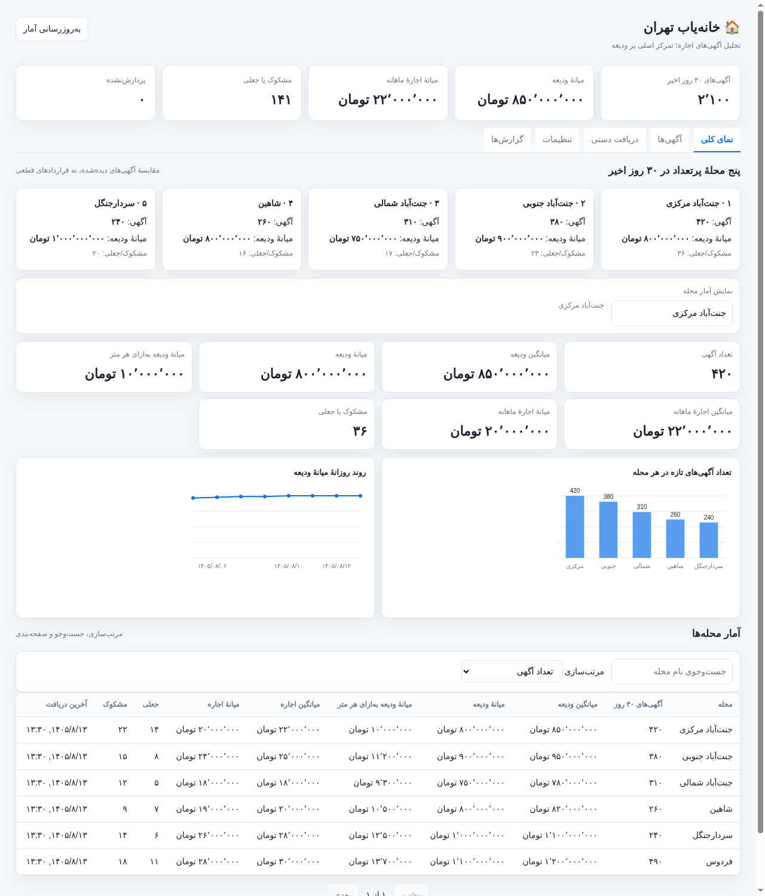 |

| تب آگهی‌ها | فیلتر آگهی‌های جعلی |
|---|---|
| 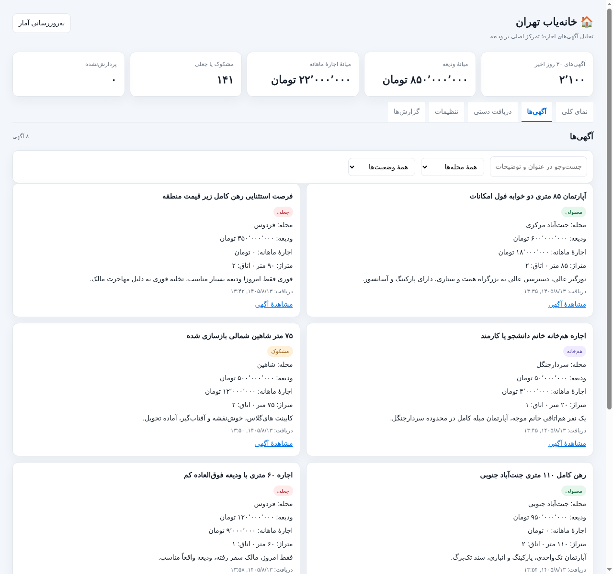 | 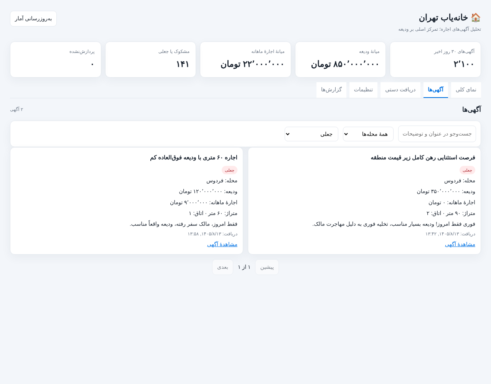 |

| دریافت دستی | تنظیمات | گزارش‌ها |
|---|---|---|
| 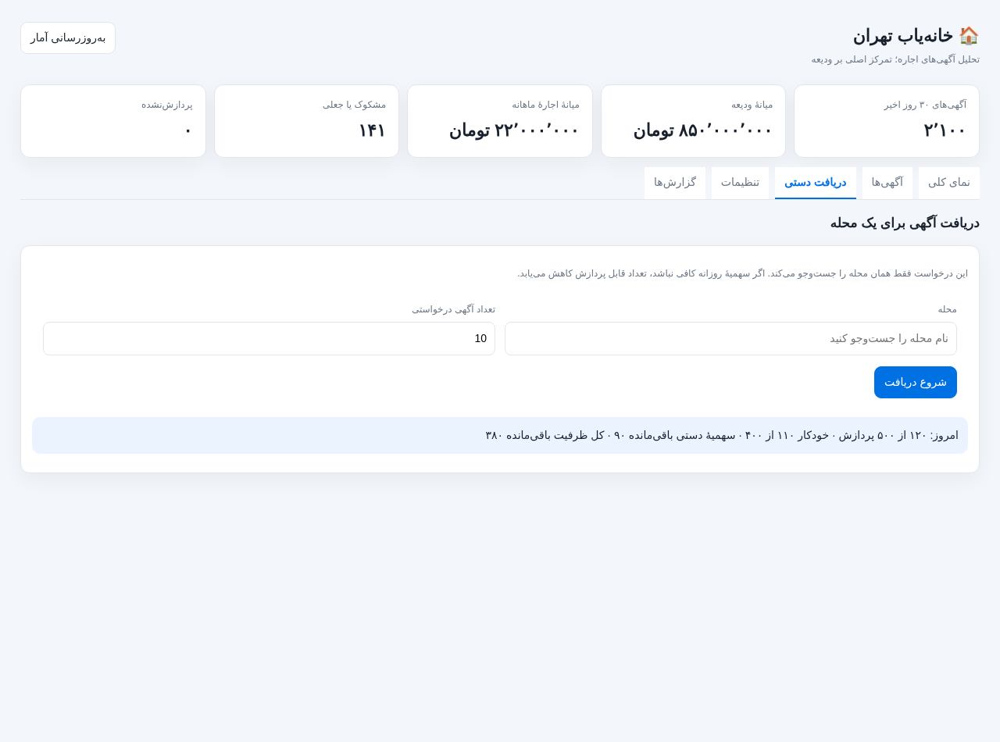 | 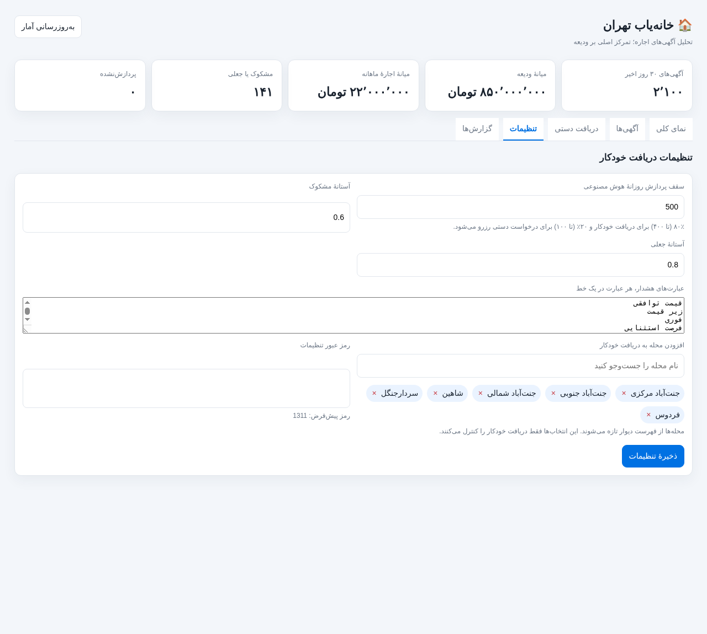 | 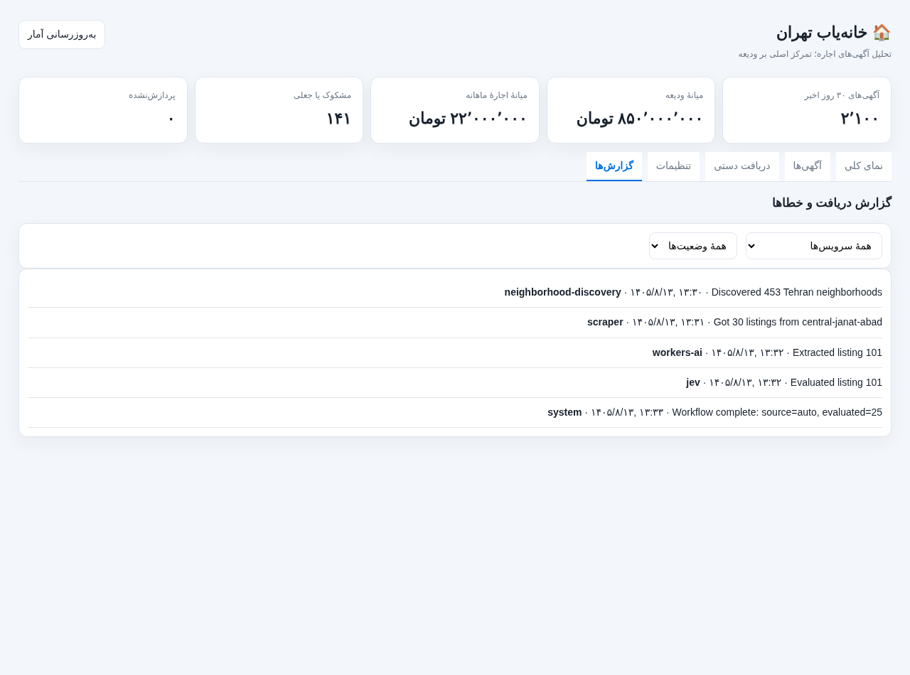 |

برای بازتولید تصاویر:
```bash
node scripts/capture-screenshots.js
```
این اسکریپت به `google-chrome` (حالت headless) نیاز دارد و تصاویر را در `docs/screenshots/` بازنویسی می‌کند. نمودارها با یک رندرر Canvas محلی کشیده می‌شوند تا تصاویر بدون اینترنت و به‌صورت تکرارپذیر ساخته شوند.

### بازتولید PDF مستندات فارسی
پس از هر تغییر در `DOCUMENTATION_FA.md`، نسخهٔ PDF را با این فرمان دوباره بسازید:
```bash
npm run docs:pdf
```
این اسکریپت به `google-chrome` یا `chromium` نیاز دارد؛ در صورت نصب نبودن در مسیرهای رایج، مسیر اجرایی را در متغیر `CHROME_PATH` تعیین کنید. فونت وزیرمتن و کتابخانه‌های رندر در نخستین اجرا در `.cache/docs-pdf/` دانلود و در اجراهای بعدی از همان کش استفاده می‌شوند.

### راهنمای کامل دکمه‌ها و کنترل‌های داشبورد
داشبورد یک صفحهٔ RTL است و داده‌ها را از همان APIهای مستندشده می‌خواند. جدول‌های زیر تمام کنترل‌های تعاملی را شرح می‌دهند:

#### کنترل‌های سراسری

| کنترل | شناسه | رفتار | درخواست‌های شبکه |
|---|---|---|---|
| دکمهٔ «به‌روزرسانی آمار» | `#refresh` | در حین اجرا غیرفعال و متن آن «در حال به‌روزرسانی…» می‌شود؛ ابتدا یک اجرای ورک‌فلو صف می‌کند و سپس خلاصه، جدول و سهمیه را دوباره می‌خواند | `POST /api/refresh` سپس `GET /api/neighborhoods?all=1`، `GET /api/analytics?days=30`، `GET /api/neighborhoods?...`، `GET /api/quota` |
| تب‌ها | `.tab[data-tab]` | جابه‌جایی بین پنج پنل بدون بارگذاری مجدد صفحه؛ تب «آگهی‌ها» فهرست، تب «گزارش‌ها» لاگ‌ها و تب «دریافت دستی» سهمیه را تازه می‌کند | `GET /api/listings`، `GET /api/logs`، `GET /api/quota` |

#### تب «نمای کلی»

| کنترل | شناسه | رفتار | درخواست |
|---|---|---|---|
| کارت‌های پنج محلهٔ برتر | `.top-card` | کلیک روی کارت، همان محله را انتخاب و آمار بخش «نمایش آمار محله» را به‌روز می‌کند | `GET /api/analytics?days=30&neighborhood=<slug>` |
| انتخاب محله | `#overview-neighborhood` + `#neighborhood-options` | جست‌وجوی نام فارسی از فهرست محله‌های دارای آگهی؛ تغییر مقدار، محله را انتخاب یا در صورت خالی بودن، «همهٔ محله‌ها» را نمایش می‌دهد | `GET /api/analytics?days=30[&neighborhood=<slug>]` |
| جست‌وجوی جدول | `#neighborhood-search` | جست‌وجوی سرور-side روی نام محله و بازگشت به صفحهٔ اول | `GET /api/neighborhoods?search=...&page=1` |
| مرتب‌سازی جدول | `#neighborhood-sort` | گزینه‌ها: تعداد آگهی، میانگین ودیعه، میانهٔ ودیعه، میانهٔ ودیعه به‌ازای متر، تعداد جعلی، نام محله | `GET /api/neighborhoods?sort=...` |
| ردیف جدول | `tr.table-row` | کلیک روی ردیف، محله را انتخاب کرده و به تب «آگهی‌ها» با فیلتر همان محله می‌رود | `GET /api/analytics?...` و `GET /api/listings?neighborhood=<slug>` |
| صفحهٔ قبل/بعد جدول | `#table-prev` / `#table-next` | صفحه‌بندی ۲۰ ردیفی؛ در ابتدا/انتهای فهرست غیرفعال می‌شوند | `GET /api/neighborhoods?page=...` |
| نمودارها | `#count-chart` / `#deposit-chart` | خودکار از دادهٔ همان پاسخ analytics رسم می‌شوند (ستونی: تعداد آگهی محله‌ها؛ خطی: میانهٔ ودیعهٔ روزانه) | — |

#### تب «آگهی‌ها»

| کنترل | شناسه | رفتار | درخواست |
|---|---|---|---|
| جست‌وجو | `#listing-search` | جست‌وجو در عنوان و توضیحات و بازگشت به صفحهٔ اول | `GET /api/listings?search=...` |
| فیلتر محله | `#listing-neighborhood` | «همهٔ محله‌ها» یا یک محلهٔ فعال | `GET /api/listings?neighborhood=<slug>` |
| فیلتر وضعیت | `#listing-label` | همه، معمولی (`real`)، مشکوک (`suspicious`)، جعلی (`fake`)، هم‌خانه (`hamkhane`)، در انتظار بررسی (`pending` → `extraction_done = 0`) | `GET /api/listings?label=...` |
| صفحهٔ قبل/بعد | `#listing-prev` / `#listing-next` | صفحه‌بندی ۲۰تایی کارت‌ها | `GET /api/listings?page=...` |
| «مشاهدهٔ آگهی» | لینک داخل کارت | باز کردن صفحهٔ آگهی در دیوار در تب جدید (`target="_blank"`, `rel="noopener noreferrer"`) | — |

#### تب «دریافت دستی»

| کنترل | شناسه | رفتار | درخواست |
|---|---|---|---|
| انتخاب محله | `#manual-neighborhood` + `#manual-options` | فقط محله‌های فعال؛ ورودی نامعتبر با پیام خطا رد می‌شود | — |
| تعداد درخواستی | `#manual-count` | عدد صحیح بین ۱ و سهمیهٔ دستی باقی‌ماندهٔ امروز؛ سقف ورودی با هر بار تازه‌سازی سهمیه به‌روز می‌شود | — |
| دکمهٔ «شروع دریافت» | `#manual-start` | اعتبارسنجی، ثبت درخواست، سپس نظرسنجی وضعیت هر ۳ ثانیه تا رسیدن به وضعیت پایانی؛ در صورت صفر بودن سهمیه غیرفعال است | `POST /api/manual-runs` و `GET /api/manual-runs/<id>` |
| پنل سهمیه | `#quota-panel` | نمایش سهمیهٔ دستی قابل استفاده، سهمیهٔ خودکار و مصرف امروز؛ در صورت اتمام سهمیه یا قفل هوش مصنوعی، ورودی و دکمه غیرفعال می‌شوند | `GET /api/quota` |
| ناحیهٔ وضعیت | `#manual-status` | وضعیت فارسی اجرا، تعداد درخواستی/دریافت‌شده و متن خطا در صورت شکست | — |

وضعیت‌های اجرای دستی: `queued` (در صف) ← `running` (در حال اجرا) ← `scraped` (در حال تحلیل) و سپس یکی از `complete` (کامل)، `partial` (کمتر از درخواست دریافت شد)، `empty` (آگهی تازه‌ای پیدا نشد)، `quota_exhausted` (سهمیه یا قفل هوش مصنوعی) یا `failed`.

#### تب «تنظیمات»

| کنترل | شناسه | رفتار | درخواست |
|---|---|---|---|
| سقف پردازش روزانه | `#daily-limit` | عدد ۳ تا ۵۰۰؛ ۸۰٪ خودکار و ۲۰٪ دستی تقسیم می‌شود | — |
| آستانهٔ مشکوک / جعلی | `#fake-threshold` / `#high-threshold` | عدد بین ۰ و ۱ | — |
| عبارت‌های هشدار | `#bait-keywords` | هر عبارت در یک خط | — |
| افزودن محله به دریافت خودکار | `#auto-search` + `#auto-suggestions` | پیشنهاد تا ۱۵ محلهٔ انتخاب‌نشده؛ کلیک روی پیشنهاد، برچسب اضافه می‌کند | — |
| برچسب محله‌های خودکار | `#auto-selected .chip` | دکمهٔ «×» هر برچسب را حذف می‌کند | — |
| رمز عبور تنظیمات | `#settings-password` | الزامی برای ذخیره؛ پیش‌فرض `1311` | — |
| دکمهٔ «ذخیرهٔ تنظیمات» | `form#settings-form` | ارسال همهٔ مقادیر؛ در موفقیت پیام سبز و پاک شدن رمز، در خطا پیام قرمز | `POST /api/settings` |

#### تب «گزارش‌ها»

| کنترل | شناسه | رفتار | درخواست |
|---|---|---|---|
| فیلتر سرویس | `#log-service` | همه یا یکی از `scraper`، `neighborhood-discovery`، `workers-ai`، `jev`، `system` | `GET /api/logs?service=...` |
| فیلتر وضعیت | `#log-status` | همه، خطاها یا موفق | `GET /api/logs?status=...` |

### جریان‌های اصلی برنامه (Flows)
#### ۱) اجرای خودکار زمان‌بندی‌شده
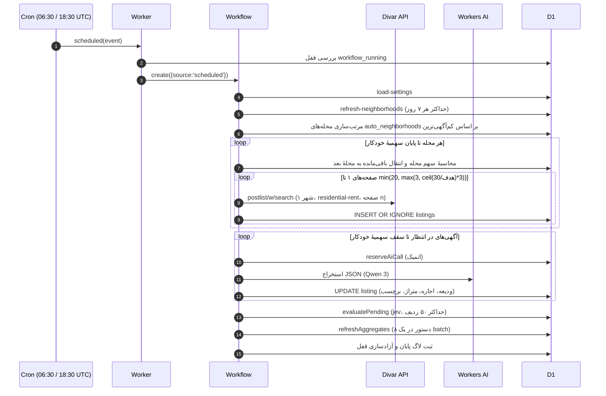

#### ۲) دریافت دستی یک محله
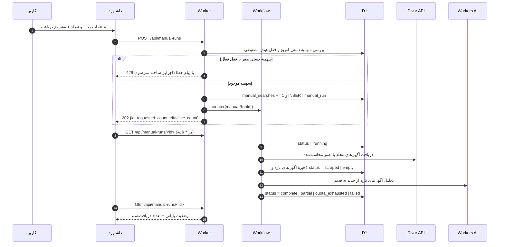

#### ۳) ذخیرهٔ تنظیمات
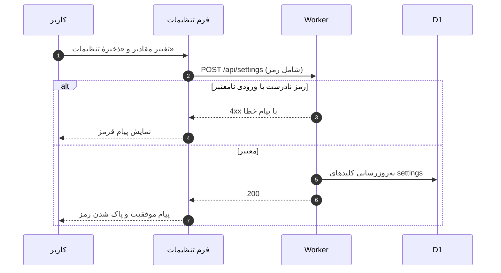

#### ۴) بارگذاری اولیهٔ داشبورد
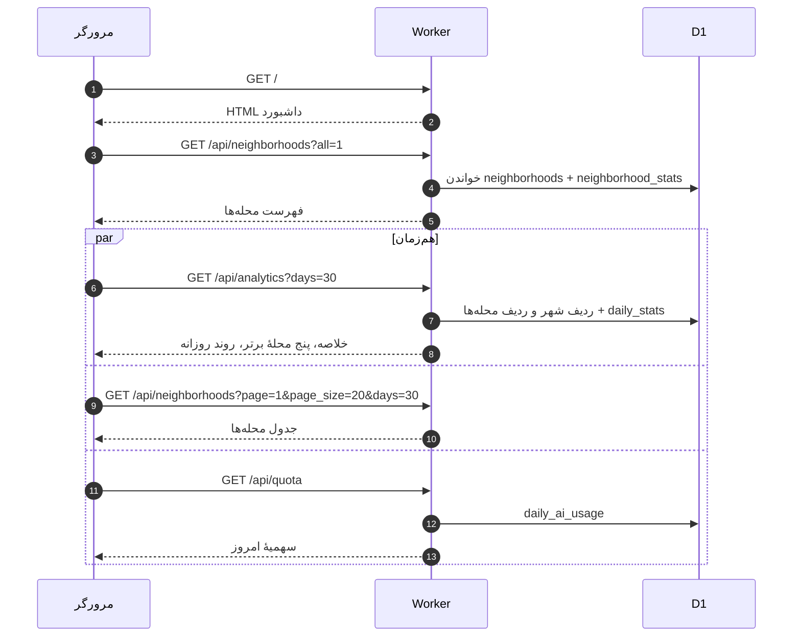

### مستندات اندپوینت‌های API

| مسیر (Path) | متد | شرح عملکرد |
|---|---|---|
| `GET /api/analytics` | `GET` | دریافت خلاصه آماری، ۵ محله پرآگهی و روند روزانه (پارامترهای اختیاری: `days=30` و `neighborhood=<slug>`)؛ در مسیر کش، `stats_computed_at` نیز برگردانده می‌شود |
| `GET /api/stats` | `GET` | خلاصهٔ آماری کل شهر برای ۳۰ روز (همان قرارداد `overall`) |
| `GET /api/neighborhoods` | `GET` | دریافت آمار محله‌ها با قابلیت جستجو، مرتب‌سازی و صفحه‌بندی (`page`, `page_size`, `search`, `sort`) |
| `GET /api/listings` | `GET` | لیست آگهی‌ها همراه با فیلتر محله، برچسب (`label`)، کلمه جستجو و صفحه‌بندی |
| `POST /api/manual-runs` | `POST` | ثبت درخواست دریافت دستی با بدنه `{"neighborhood": "<slug>", "count": 10}`؛ پاسخ شامل `requested_count` و `effective_count` است و اگر سهمیهٔ دستی امروز صفر باشد یا هوش مصنوعی قفل شده باشد، کد ۴۲۹ برمی‌گردد |
| `GET /api/manual-runs/:id` | `GET` | دریافت وضعیت پیشرفت (`queued`, `running`, `scraped`, `complete`, `partial`, `empty`, `quota_exhausted`, `failed`) همراه با `status_fa` |
| `GET /api/quota` | `GET` | استعلام سهمیهٔ امروز: سقف کل، مصرف خودکار/دستی، `auto_remaining`، `manual_remaining`، `remaining` و وضعیت قفل هوش مصنوعی |
| `GET /api/settings` | `GET` | دریافت تنظیمات جاری سیستم |
| `POST /api/settings` | `POST` | به‌روزرسانی تنظیمات سیستم (نیازمند فیلد `settings_password: "1311"`) |
| `GET /api/logs` | `GET` | دریافت لاگ‌های سیستمی (`service`, `status`, `limit`) |
| `POST /api/discover-neighborhoods` | `POST` | همگام‌سازی اجباری و لحظه‌ای فهرست محله‌ها از سرورهای دیوار |
| `POST /api/refresh` | `POST` | فراخوانی دستی گردش‌کار (Workflow) پیمایش خودکار آگهی‌ها |

---

## ۶. ساختار فایل‌های پروژه

```text
divar-housing-finder/
├── migrations/                                # اسکریپت‌های مهاجرت ساختار دیتابیس
│   ├── 0001_neighborhood_first_rebuild.sql  # بازسازی پایگاه داده مبتنی بر محله
│   ├── 0002_daily_quota_and_listing_reclassification.sql # رده‌بندی هم‌خانه و سهمیه
│   ├── 0003_retry_failed_extractions.sql     # بازنشانی آگهی‌های ناموفق
│   ├── 0004_increase_daily_quota_to_500.sql  # افزایش سقف سهمیه به ۵۰۰
│   └── 0005_precomputed_stats.sql            # جدول‌های آمار پیش‌محاسبه‌شده
├── seed/
│   └── seed-neighborhoods.sql                 # داده‌های اولیه محله‌ها و تنظیمات
├── src/
│   ├── index.js                               # نقطه ورود ورکر، مسیریابی API و تریگر کرون
│   ├── workflow.js                            # کلاس Cloudflare Workflow برای پیمایش و هوش مصنوعی
│   ├── scraper.js                             # توابع دریافت داده و ارتباط با API دیوار
│   ├── extractor.js                           # فراخوانی مدل زبانی Workers AI (Qwen)
│   ├── jev.js                                 # موتور ارزیابی قیمت مشکوک و غیرواقعی
│   ├── stats.js                               # تجمیع SQL، بازسازی کش آمار و readerهای کش
│   ├── quota.js                               # محاسبات سهمیه، ساعت تهران، عمق صفحه و نتیجهٔ اجرای دستی
│   ├── rental-pricing.js                      # فرمول‌های تبدیل رهن و اجاره به ودیعه معادل
│   ├── listing-classification.js              # الگوهای تشخیص آگهی‌های هم‌خانه و اشتراکی
│   ├── neighborhood-discovery.js              # دریافت و همگام‌سازی محله‌های تهران از نقشه دیوار
│   ├── dashboard.js                           # رابط کاربری وب فارسی و کلاینت Chart.js
│   ├── constants.js                           # ثوابت سهمیه، صفحه‌بندی و سیستم
│   └── utils.js                               # توابع کمکی، نرمال‌سازی اعداد فارسی و لاگ‌گذاری
├── test/
│   ├── quota.test.js                          # تست‌های سهمیه، عمق صفحه، ساعت تهران و نتیجهٔ اجرای دستی
│   ├── rental-pricing.test.js                 # تست‌های واحد قیمت‌گذاری و تطبیق متن
│   └── system-verification.test.js            # تست‌های یکپارچگی سامانه
├── scripts/
│   ├── capture-screenshots.js                 # تولید تصاویر مستندات از داشبورد
│   └── build-persian-pdf.mjs                  # تولید PDF فارسی از DOCUMENTATION_FA.md
├── docs/
│   └── screenshots/                           # تصاویر رابط کاربری برای مستندات
├── package.json                               # مشخصات پروژه و اسکریپت‌های npm
├── schema.sql                                 # ساختار کامل جداول پایگاه داده D1
├── wrangler.jsonc                             # پیکربندی سرورلس، دیتابیس، مدل هوش مصنوعی و کرون
├── README.md                                  # فایل راهنمای اصلی پروژه (فارسی)
├── README_EN.md                               # نسخه انگلیسی راهنما
└── DOCUMENTATION_FA.md                        # گزارش جامع فنی و دانشگاهی سامانه
```

---

## ۷. نکات حقوقی و عملیاتی

- **حفظ حریم خصوصی و امنیت**: این سامانه به طور پیش‌فرض روی داشبورد احراز هویت کاربری ندارد و نشانی نسخهٔ آنلاین در همین فایل منتشر شده است؛ هر کسی با این نشانی می‌تواند دریافت دستی را شروع کند و سهمیهٔ روزانهٔ هوش مصنوعی را مصرف کند. برای محدودکردن دسترسی از Cloudflare Access یا لایهٔ مشابه استفاده کنید. بخش تغییر تنظیمات دارای رمز عبور پیش‌فرض است.
- **مسئولیت استخراج داده**: وب‌سایت دیوار ممکن است ساختار پاسخ‌های داخلی API را تغییر دهد یا درخواست‌های پرشمار خودکار را محدود کند. این سامانه با رعایت فاصله‌گذاری مناسب بین درخواست‌ها (`step.sleep`) و محدودیت ۵۰۰ عددی، بار بسیار سبکی روی سرورها ایجاد می‌کند.
- **ماهیت برچسب‌های مشکوک/فیک**: برچسب‌های جعلی و مشکوک جنبه سیگنال‌های کمکی برای بازبینی کارشناس دارند و به منزله ادعای قطعی در مورد قصد آگهی‌دهنده نیستند.

---

## ۸. انطباق با سرفصل‌های پروژه

| سرفصل | محل پاسخ در این مخزن |
|---|---|
| **تعیین حوزهٔ کسب‌وکاری** | حوزهٔ «پایش بازار رهن و اجارهٔ مسکن و شناسایی آگهی‌های مشکوک» در بخش ۱ همین فایل و بخش ۲ سند `DOCUMENTATION_FA.md` تحلیل شده است. |
| **تحلیل برای مدل داده‌ای و ساختار جداول** | بخش ۲ همین فایل (نمودار ER، روابط، ستون‌ها، فرهنگ داده) و بخش ۴ سند `DOCUMENTATION_FA.md` (تحلیل موجودیت‌ها، نرمال‌سازی، ایندکس‌گذاری و الگوی خواندن/نوشتن). اسکریپت اجرایی: `schema.sql` و `migrations/`. |
| **پیاده‌سازی با زبان انتخابی** | جاوااسکریپت (ES Modules) روی Cloudflare Workers؛ کد در `src/` و پیکربندی در `wrangler.jsonc`. |
| **سورس + راهنمای کاربردی + سند تحلیل و طراحی** | سورس کامل در مخزن؛ راهنمای کاربر در همین `README.md` (نصب، اجرا، دکمه‌ها، API)؛ سند تحلیل و طراحی در `DOCUMENTATION_FA.md`؛ تصاویر در `docs/screenshots/`. |
